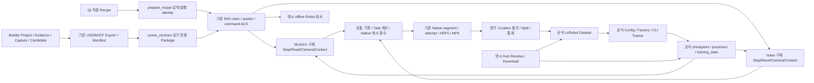

# Real2Sim Learning Studio — 아키텍처 정리·기능 이관 결과

2026-10-28. **요청한6개 Phase의 구현과 명시 범위 검증을 완료했다.** 실물·모든 모델·모든 기존 기능의 완전한 상위호환 완료를 뜻하지 않는다. 현재 브랜치는 `architecture-completion`, 기준은 Initial 공개 Commit `8a8210d13e31ea2c777e120f4e8fb0640050fec0`다. 이번 요청의6개 Phase를 순서대로 구현·검증했다. 자동 GitHub Push·실물 장치·새 v9/실측 Calibration은 수행하지 않는다.

## 비교 기준

GitHub와 로컬 원본의 main HEAD를 읽기 전용으로 대조했다.

- 기존 Builder `ad018a018711d03fb51c28242dfc2bd19b6d0b07`: `app/core/project.py` Git blob `e2e8d00f161b93ac3810bdb256a63e88b33cbde2` 일치. 원본 app36개 Python 파일의 함수/class 목록·SHA를 조사했다.
- 기존 SO101 `875e64fe6673e664f6fa8203d15ab103d488a6ad`: `workflow/adapters.py` blob `ba1ccea47d07dbc26ee1acf1578d2dfce2736bf3` 일치. 원본151개 Python 파일을 조사했다.
- 현재 설치 LeRobot0.4.1의 factory/config registry에는 ACT/Diffusion/SmolVLA/PI0/PI05/TDMPC/VQBeT/GROOT/SAC/reward_classifier가 등록돼 있다. 등록·config 생성·선택 의존성·학습/실제 Scene 배포 가능성은 각각 별개로 검사한다.
- 기존 Native C·Saturation·v8 Collision·Task phase·E01 물체 잔차는 기준을 유지한다. 과거966 PASS와 새 실행은 구분한다.

세 저장소의 기존 기능이 모두 동일하다고 가정하지 않는다. 원본의 범용 SimulationAdapter를 새 실행기에 다시 넣지 않으며, 기존 SO101의 SciPy/Strict·과거 명령 clip 정책은 승인된 DLS/Best Effort·Saturation 정책과 구분한다.

## Phase1 — 엔진 보조 함수

기록·IPC·Native 게시·Task/Policy binding의 엔진 무관 함수25개를 이동했다. 구체 MjData/ManagerBasedEnv loop·Step/Reset/Camera/Contact와 Env별 상태 수명은 유지한다. 실제 함수 목록은 로컬 `docs/evidence/architecture-completion/helper-moves.json`에 있다.

최초 경계 RED2개와 리뷰 경계 RED2개를 거쳐 집중74 PASS, 전체970 PASS를 확인했다. 실제 양 엔진1/4-env Source→Annotation→DataGen→Evaluation을 신규 출력에 각각8run/20 Episode로 검증했다. SDK cache write 보호 audit와 기존 Render/종료 warning은 허용/삭제하지 않는다.

독립 검토의 video→run 상위 의존은 정리 함수를 실행 소유자 run으로 옮겨 해소했다. 영상·장치 드라이버 파일은 기준 Commit과 byte-exact이며, Leader 구성만 robot/configuration.py에 있다. 기존 producer 예외였던 보조 함수의 분류만 유지해 기존 append를 보존하고 control/state/device/Mimic/Task 검사는 엄격하게 유지한다. 실제 원본 불변 복제본에서 양 엔진 Source8→9, MuJoCo DataGen6→7과 이동된 cleanup의 실제 평가를 확인했다. 오래된 초기 R01 자료는 기준 Commit 이전 video identity로도 이미 비호환임을 확인했으며 이를 임의로 완화하지 않았다. 두 축 리뷰의 High/Medium 잔여0이다. 후속 Phase의 완료를 이 결과로 주장하지 않는다.

## 적용한 순서

1. 공통 함수 이동·리뷰·동일 경로 Resume·Prepared source coverage 검증.
2. Builder Scene/Evidence/Capture/Candidate/Scan의 실제 책임 분리와 CLI/UI/Export 회귀.
3. 공식 Policy Factory/Trainer·fine-tune/Resume·Hub 경계와 실제 지원 상태/UI.
4. 장치·Calibration/Capture·real-policy의 오프라인/Fake/공식 SDK 계약; 실제 장치 상태는 미검증 유지.
5. UI의 신규 출력 기본값만 Stage별 workspace에 정리; 기존 경로 이동/포맷 변경 없음.
6. 양 엔진 실행·공식 소비자·학습/평가·UI 결과·전체 회귀/wheel·독립 리뷰·보존 종합.

최종 상태는 VERIFIED(actual), CODE_READY(연결됐으나 실제 실행 미검증), PARTIAL, UNSUPPORTED, EXCLUDED로 구분한다. 완료 범위와 남은 미검증 항목은 아래 기능 대응표와 통합 집계에서 구분한다.

## 실제 이동한 공통 함수

| 소유 모듈 | 함수 |
|---|---|
| `data.recording` | `pose7`, `record_frame`, `add_initial`, `collection_coordinates`, `command_summary`, `recorded_initial`, `validate_recording`, `validate_source_ranges` |
| `commands` | `control_commands`, `step_completed`, `command_channels` |
| `data.publication` | `publish_event`, `publish_annotation`, `publish_generation`, `publish_attempt` |
| `tasks.evaluation` | `accept_annotation`, `evaluation_result`, `evaluation_execution`, `trackers_for`, `post_evaluation`, `report_limit` |
| `learning.policy` | `policy_inputs` |
| `run` | `execution_failure`, `abort_videos` |
| `robot.configuration` | `create_leader` |

이동 시점의 import 외 AST 동일성을 확인했다. 이후 Phase3의 `policy_inputs`는 공식 Factory/추가 언어 Policy 호환 검사 요구에 맞춰 확장했으며, 물리/IK 계산을 바꾸지 않았다. 기존 모듈의 필요한 공개 이름은 같은 함수 object를 가리키는 direct alias로 유지한다. 같은 구현 본문을 두 곳에 남기지 않는다.

## Phase2 — Builder 역할별 모듈

`project.py`의 기존 공개 이름은 direct alias로 유지하고 내부 caller는 실제 소유 모듈을 사용한다. 새 scene/files/evidence/capture/editing/cameras/candidate/scan/initialization은 현재 알고리즘을 그대로 가진 목적별 파일이며 새로운 계층/Manager/저장 포맷이 아니다. Project lifecycle은 project.py, bounded review loop는 reconstruction.py가 소유한다.

기준 project.py 약1,900줄→약200줄, reconstruction.py1,036→약400줄이다. 이동64개 함수/class는 import를 제외한 AST exact. 파일 이동 과정의 schema constant 누락은 기존 상대 Geometry 회귀가 재현했고 원 상수를 올바른 소유 모듈로 옮겨 고쳤다. Capture/Project 집중54 PASS, Builder 전체103 PASS, 전체973 PASS, 마지막 import 정리 후 Builder103 PASS다. 실제 보존 v8 Manifest84개/SHA 및 native USD/MJCF/URDF closure를 읽기 전용 검증했다. 원본 프로젝트/Scene/Export를 재작성하지 않았다. 두 축 독립 리뷰의 High/Medium 잔여0.

## Phase3 — 공식 LeRobot 경계

ACT/SmolVLA 이름 whitelist를 설치된 공식 Registry/Config/Policy Factory로 교체했다. 10개 등록 설정과 실제 model class import를 조사하며, 등록 자체를 학습/Scene 지원 완료로 표시하지 않는다. 공식 Trainer로 신규 Diffusion 1step→2step Resume 및 별도 local fine-tune1step을 실행했다. 양 엔진1/4-env에서 공식 Diffusion history2/queue4로 각각6step Evaluation을 완료했다. 성공률이 아닌 실제 실행 경로 증거다. 기존 ACT/SmolVLA와 Diffusion의 독립 Validation도 각각8batch를 실행했다.

Hub는 명시 Resolve→Commit 고정→공식 cache snapshot 경로를 반환한다. `lerobot/pusht` Commit `7628202a2180972f291ba1bc6723834921e72c19`를 실제 다운로드하고 공식 Reader/DataLoader/Curation으로206 Episode/25,650frame을 열었다. 2축 PushT action을 SO101 rad로 재명명하지 않았다. 불완전한 외부 v3 Metadata와 구형 v2 Dataset, processor가 없는 구형 ACT Hub Policy는 명시 거부하며 원본을 자동 마이그레이션하지 않는다. Policy 다운로드 자체는 `lerobot/act_aloha_sim_transfer_cube_human` 고정 Commit에서 확인했다.

업로드는 명시 버튼/저장 요청, Repo 종류/공개 범위, 현재 Remote parent Commit 일치가 필요하며 기존 Repo만 대상으로 한다. 실제 업로드는 요구대로 미수행; 공식 API의 통제 fixture로 경계와 결과 Commit 기록을 검증한다. Token을 Recipe나 결과에 저장하지 않는다. Cache blob을 제외한 외부 escaping symlink는 거부한다. 장시간 전송은 기존 R03 child/취소 수명을 사용한다. 새 Policy/Trainer/Dataset 프레임워크는 없다.

독립 Spec 리뷰의 Scratch/가중치 의미 혼동·외부 심볼릭 링크 유출·Registry 응답 race와 Standards 리뷰의 승인 표시/Recipe 불일치·Fine-tune 상대 경로를 수정했다. Spec 보고서는 수정 확인을 기록했지만 최종 agent turn은 서비스 usage limit으로 종료됐다. 당시 Standards의 두 건은 주 에이전트의 실제 Qt/실행 및 소스로 closure했고, 이후 Phase4 및 최종 독립 검토에서도 수정 유지와 High/Medium0을 확인받았다. 외부 공식 Dataset의 독립 Validation은 IO 오차만 측정할 수 있으며 lineage가 없으면 train/val 격리를 입증했다고 표시하지 않는다. SO101 배포 검사는 여전히 별도 strict 계약을 요구한다.

Phase3 최종 전체 회귀981 PASS/skip0, 기존 torchvision warning2개. 실제 UI의10개 페이지·Registry/config·승인 초기화, ACT/Smol/Diffusion Validation 및 Diffusion 양 엔진1/4 실행을 구분해 검증했다.

## Phase4 — 실물 경로의 오프라인 경계

기존 Leader/Follower/CalibrationDevice/CameraReader의 수명·mapping·encoder·cleanup 계산을 재사용했다. 실제 ACT checkpoint/processor 출력→Saturation된 승인 model/motor 교집합→Precision inverse→SDK 정수 encoding→Fake Follower send/close를 시험했다. SDK 생성자의 공식 Config dataclass만 별도 검사하며 실물 SDK Device/포트를 생성하거나 연결하지 않는다.

`robot/offline.py`는 기존 R03의 capture/precision_calibration/real_sim/real_evaluation Stage에서 **명시 offline** 보존 입력 검사만 수행한다. Builder가 소유한 Capture Reader·기존 profile fitter/검증과 Policy API를 호출하고 작은 inspection report만 저장한다. 새로운 Capture 저장 포맷/실행 프레임워크가 아니다. Qt에는 오프라인임을 명시한 네 화면을 연결했다. 실물 Calibration 수집·토크·실측 정확도·실제 Policy Rollout은 UNSUPPORTED/미검증이며 검사 worker 완료와 구분한다.

원래 보존 snapshot/Precision 근거를 새 worker에서 읽었다. Capture는 내부 clock/image/model SHA가 유효하더라도 현재 Scene과 mapping/model/단위가 결합되지 않으면 PARTIAL이다. 이 상태에서 Policy inference/command 변환을 수행하지 않는다. 한계가 다른 역사 모델의 SHA를 같다고 재명명하지 않는다. 실물 command record가 없는 현재 v8을 자동 승인하지 않는다.

Phase4 실제 Qt→기존 R03 worker의 보존 Precision 검사, 실제 저장 Snapshot/Capture 및 Real/Sim 입력 검사를 완료했다. Real Policy 보고서는 과거 Capture 결합 부재 때문에 PARTIAL·inference_performed=false·command_sent=false다. 공식 SDK/Fake 장치·Policy 집중110 PASS. 독립 Spec/Standards 두 축의 identity/단위/실행 코드 누락 지적을 수정하고 High/Medium0 closure를 받았다. Camera/Scene Calibration identity도 명시 결합이 없으면 승격하지 않는다. 당시 진행 중 스냅샷과 최종 집중 검사를 구분했고 Phase6에서 고정 코드 전체987개를 다시 검증했다.

## Phase5 — UI 출력 기본 위치

UI 새 Run의 출력 제안만 source/annotation/datagen/dataset/policy/evaluation/scenes로 정리했다. `ui/paths.py`는 경로를 반환하며 Dataset을 만들거나 옮기지 않는다. 저장 Recipe를 열 때 명시 output을 덮어쓰지 않고, 명시 append 중에는 새 출력 제안을 거부한다. 과거 fresh-worker Run의 계속 실행 버튼도 기존 output+resume=true+추가 Episode 계약을 편집하도록 수정했다. 역사 identity가 다르면 prepare가 명시 거부하며 자동 복사/수정하지 않는다.

Curation/공식 Export/Merge·Training Config 저장 대화상자와 다음 단계 입력 선택은 해당 폴더를 먼저 제안한다. 빈 Workspace Builder를 열 수 있지만 Scene은 사용자 New 동작 전에는 생성하지 않는다. 실제 Qt에서 저장 경로 보존/새 제안/append/계속 실행/Scene 미생성을 확인했다. 기존 run.json/segments/attempts/HDF5/MP4/공식 checkpoint 형식은 변경하지 않았다. 동일 영상·Native segment·Checkpoint를 새 등록 포맷으로 복제하지 않는다.

Phase5 전체987 PASS/skip0 및 최종 UI 집중21 PASS, 두 축 독립 리뷰 High/Medium0. 신규 단계 경로에서 양 엔진1/4의 실제 통합 실행도 완료했으며 전체 결과를 Phase6에 집계한다.

## 기능 대응표와 검증 상태

VERIFIED는 표에 적힌 실제 실행/fixture 범위, CODE_READY는 연결됐지만 그 사용 사례 미실행, PARTIAL은 일부 경로만 연결, UNSUPPORTED는 현재 거부, EXCLUDED는 의도적 제외다. 모델 등록이나 함수 존재만으로 실제 기능 완료를 의미하지 않는다.

| 기존 역할 / 현재 책임 | 실제 호출과 입력→결과 | 상태와 한계 |
|---|---|---|
| Builder Project/Scene | Project.create/load/save/clone→scene.py 검증→Candidate promote/rollback | VERIFIED: CPU/CLI/UI fixture, 보존 v8 Package 로딩. 새 v9 미생성 |
| Builder Evidence/Capture | evidence.py 입력 복사/근거→capture.load_session/import_*→기존 Project Evidence | VERIFIED: 기존 테스트·보존 Snapshot 읽기. 새로운 실물 Capture 수집은 PARTIAL |
| Scan/Segmentation/Registration | scan.py→initialization.py→reconstruction bounded review | VERIFIED: 기존 수치/합성 fixture와 CLI. 새 실제 scanner 취득 미수행 |
| Camera/Geometry/Physics Calibration | 기존 calibration/* fitter→명시 Scene/Candidate→Export | VERIFIED: 기존 fixture/수치. 새로운 실측 Calibration/physical_verified는 미검증 |
| Scene Export/Closure | exporters + export_revision/verify_package→USD/MJCF/Manifest | VERIFIED: 기존 시험/보존 v8 전체 Manifest. 재Export/자산 수정 없음 |
| SO101 Leader/Follower | 기존 devices/calibration/control 및 Source 직접 loop | VERIFIED: Fake lifecycle/SDK Config/encoder 경계. 실제 모터/포트/토크는 미검증 |
| Capture/Precision Runner | Recipe→R03→robot.offline→기존 Reader/profile review→inspection | VERIFIED: 명시 offline 검사만. Live acquisition/calibration는 UNSUPPORTED |
| Real Policy / Real-Sim | 보존 Capture→Scene/Mapping gate→가능한 Policy/command preflight | PARTIAL: 현재 과거 Capture 미결합으로 추론 중단. Fake Policy→Follower 경계와 구분 |
| Source/Annotation | 엔진별 loop→공통 record_frame/Native 게시→공식 Reader/Pool | VERIFIED: 양 엔진1/4. Source recording_only, Annotation grasp AND placement 유지 |
| Fixed/Random DataGen | 동일 generate_attempt + reset_placements 차이→Mimic/DLS→공식 Step | VERIFIED: 실제 작은 표본. entropy Pose, Workspace/거리 검사 유지; 전역 성공률 아님 |
| Pinocchio/Mimic | E05 계산→DLS/Best Effort→previous-applied jump→Saturation | VERIFIED: 기존 fixture 및 실제 엔진. SciPy/Strict/Hold 선택은 EXCLUDED |
| Native/Recipe/Worker | prepare identity/claim→구체 loop→닫힌 HDF5/MP4→atomic publish | VERIFIED: 추가 저장/완료·실패/취소/기존 회귀. 중간 physics tick 복구는 UNSUPPORTED |
| Curation/LeRobot | 영구 참조 선택/Trim/Split→공식 materialize/지원 Merge | VERIFIED: Native 생성 결과와 외부 공식 PushT 소비. 미확인 IO 의미 자동 Merge는 거부 |
| ACT/SmolVLA/Diffusion | 공식 Config/Factory→공식 CLI Trainer/checkpoint/Resume→공식 processor | VERIFIED: 짧은 smoke·독립 추론·Simulation. 일반화/수렴/Task 성공 보장 아님 |
| PI0/PI05/GROOT/TDMPC/VQBeT/SAC | 설치 Registry→Config/class import→공식 CLI/loader | CODE_READY: 실제 full weights/학습/Scene 동작은 미검증. 추가 입력/의존성 오류를 그대로 표시 |
| reward_classifier | 공식 Registry/config/class import | 등록 확인. 6축 command Policy로 자동 승인하지 않음; 현재 Scene Rollout은 UNSUPPORTED |
| Hub Dataset/Policy | 명시 Resolve→fixed Commit→snapshot_download cache→직접 선택 | VERIFIED: 실제 공개 Repo 다운로드/공식 Dataset 소비. 구형/불완전 artifact는 명시 거부 |
| Hub upload | 명시 기존Repo/visibility/parent/confirm→공식 upload_folder→Commit receipt | CODE_READY: API fixture/취소 경계. 요구대로 실제 원격 업로드 EXCLUDED |
| Evaluation | L02 official queued action→엔진 Step→T02 Placement→Native | VERIFIED: ACT/Smol/Diffusion 실행 경로. 실패도 분모/기록에 유지; grasp를 성공 조건으로 바꾸지 않음 |
| Qt 및 Output | 저장 Recipe→짧은 backend job→기존 R03 worker→결과/Preview 재열기 | VERIFIED: 실제 offscreen Qt/QTest. 사람이 장기간 데스크톱 사용한 UX 검증 아님 |

기존 SimulationAdapter·기존 자체 Training/Policy 프레임워크를 복원하지 않았다. 새 공통화는 함수 이동25개, Builder 책임 이동64개이며, dtype/알고리즘 AST 비교 근거를 남겼다. Source/Native 수명 및 엔진별 mutable state는 통합하지 않았다. 공식 SDK의 Dataset/model/processor/Trainer/Hub를 재사용하며 SDK 전체 구현을 복제하지 않는다. Smol 패치는 기존 단일 SHA 고정 모듈의 명시 호환 변경만 유지한다.

## 최종 실행 해석과 보존

원래 Fixed 입력의 Source/Annotation 공통 기록 배열과 MuJoCo Fixed DataGen/ACT Evaluation 배열은 Phase1 대비 exact였다(존재하는 동일 필드만 비교). Isaac Random DataGen은 새 entropy Pose라 같은 궤적을 기대하지 않는다. Isaac Fixed ACT Evaluation은 같은 초기 q/모델/Policy/Scene identity에서도 기록 RGB와 첫 Action에 작은 차이가 있었다. 현재6step의 최대 Action 차이는 약1.736e-4rad다. 동일 frozen decoded RGB/측정 q/가중치를 이전 직접 ACT Loader와 신규 Factory Loader에 입력하면 출력은 exact였다. 실시간 raw RGB·RTX/카메라 시간 기여를 모두 분리한 증거는 없으므로 pixel/궤적 동등성 또는 입증된 비결정성으로 승격하지 않는다. 두 결과는 모두 Placement=false/max_steps다. 기존 E01 cube–cup1.197188790mm 잔차와 별도다.

새 Workspace 예시는 아래와 같다. explicit output.directory는 언제나 우선하며 기존 자료를 이 위치로 자동 이동하지 않는다.

```text
workspace/
  scenes/                 # Builder 프로젝트/사용자가 요청한 Export
  source/source-.../      # 기존 Native run/segments/attempts
  annotation/annotation-.../
  datagen/datagen-.../    # Resume 시 같은 Dataset root에 추가
  dataset/curation-....json
  dataset/lerobot-.../    # 공식 meta/data/videos; 영상 공유
  policy/act-.../         # 공식 checkpoints/processor/training_state
  policy/smolvla-.../
  evaluation/eval-.../    # Native 평가 또는 명시 offline inspection
```

세 wheel은 새 증거 영역에서 빌드하고 source bytes/compile/isolated import·CLI/worker를 검증했으며 환경에 설치하지 않았다. 설정된 lint/type 도구가 없는 상태에서 실행했다고 보고하지 않는다. 원본56,100개 stat·선택57개 과거 근거/SDK SHA 변화0, Scene Manifest 전체 검증을 확인했다. 전체 SDK binary/corpus 전수 hash를 수행한 것은 아니다. 초기 공개 Commit 대비 변경 파일은 별도로 기록한다. 보호 audit가 막은 SDK cache 쓰기 시도와 Isaac의 기존 Fabric/렌더/종료 경고는 남아 있으며 warning-free로 표시하지 않는다.

실물 연결 후에는 device_command Calibration/모터 범위·encoder branch/양자화·토크 release·USB/timeout·실제 카메라 timestamp/skew·측정 정확도·정지/취소/전원 장애·실제 Policy rollout 안전성을 별도로 검증해야 한다. 과거 Capture 결합 부재를 자동 보정하지 않는다. 새 v9/실측 Calibration·실물 제어·원격 업로드는 이번에 수행하지 않았다.

## 정리 후 실제 호출 경계



사용자 설정은 저장 Recipe·공식 Training JSON·선택 Scene/Dataset/Policy/Calibration·Fixed/Random/Object·추가 Episode/유한 Attempt 예산·명시 Hub Repo/Commit/visibility다. 내부 상태는 R03 claim/ACK/worker identity, Env별 Physics/Tracker/Policy queue, Native segment/attempt history, 공식 optimizer/scheduler/RNG/checkpoint다. Random Pose 생성에는 고정 seed/상태 복원을 추가하지 않았고 기존 Mimic/Training/attempt seed와 구분한다.

읽기 전용 Scene contract가 실제 물리 상태를 소유하지 않고 각 엔진이 상태를 소유한다. `commands.py`는 IPC 이벤트만 관리하며 물리 공통 Adapter가 아니다. `data/publication.py`는 닫힌 Native 게시만 담당한다. Dataset/Scene/Calibration hash 검사는 publish/Resume/입력 변경 방지를 위한 기존 의미를 유지했다. 새로운 공통 계층이나 전역 singleton 상태를 추가하지 않았다.

## 최종 통합 검증 집계

최종 고정 제품 코드 전체 **987 passed / skipped0**, 기존 torchvision 경고2개다. 기준966개에서 신규21개이며 실제 엔진/Trainer/Qt 실행은 이 pytest 숫자와 별도다. 독립 Standards/Spec 최종 리뷰의 High/Medium 잔여0이며 초기 지적은 RED→GREEN과 실제 실행으로 닫았다.

- 양 엔진 각각 1/4-env Source388·Annotation388·DataGen399·Evaluation6 control frame/Episode를 실제 실행했다. Source/Annotation stage별 원래 판정 의미와 post→pre latch를 유지했다. 같은 경로 Source1→2, DataGen1→2 추가 저장과 이전 닫힌 HDF5/영상 SHA 불변을 확인했다.
- 기본 행렬 및 추가 Fixed/Random 결과로 엔진별 Source6·Annotation5·DataGen7개 완료 Episode가 있다. Source는 recording_only이며 Annotation/DataGen 성공과 같은 의미가 아니다. 모든 완료 DataGen은 기존 grasp AND placement gate를 통과한 실제 작은 표본이다.
- 신규 양 엔진4-env DataGen을 영구 Curation으로 선택했다. train4 Episode/304frame, val4/360frame이며 원 Episode UID 교집합0. 같은 Source pool/Scene의 작은 smoke 자료이므로 일반화 검증이 아니다. 영상은 hardlink로 공유하며 Export/Merge 재인코딩0이다.
- 새 선택 Dataset으로 공식 ACT2step→4 Resume, SmolVLA1step→2 Resume 및 각8batch 독립 Validation을 완료했다. 별도 Diffusion1step→2 Resume·local fine-tune1step·양 엔진1/4 rollout도 완료했다. train loop/optimizer를 새로 만들지 않았다.
- 공식 Reader는 Native의 실제 applied target과 `joint_targets` 동일성을 확인했고, 양 camera640×480·30FPS·전체 frame count/PTS를 검사했다. 공식 LeRobotDataset/DataLoader도 선택된 state/action/RGB를 소비했다. 학습 float32 경계와 pre/post 의미는 유지한다.

중단 전 Isaac Smol 평가 Worker 하나가 재개 시 `unknown`으로 확인됐다. 해당 claim/출력은 복구·재실행·성공 승격하지 않고 보존했다. 남은 검증은 독립 출력에서 bounded 실행 완료했고, unknown worker와 새 실제 평가 성적을 합쳐 성공으로 세지 않았다. 이 중단은 SDK/OOM/물리 원인으로 확인된 것이 아니다.


| 최종 통합 범위 (상속 Episode 중복 계수 없음) | MuJoCo | Isaac |
|---|---:|---:|
| Source 완료 / frame |6 /2,328|6 /2,328|
| Annotation 성공 / frame |5 /1,940|5 /1,940|
| Fixed+Random DataGen 성공 / frame |7 /2,793|7 /2,793|
| ACT/Smol Evaluation 완료 실패 |10×6step|10×6step|
| 별도 실제 취소 / 공개 Episode |1 /0|1 /0|
| 알려진 평가 Attempt의 Placement 성공 |0/11|0/11|

이 표는 Phase5 새 Workspace 행렬·Phase6 추가 저장/반대 배치·추가 Policy/취소 범위다. Phase1 실행·Phase3 Diffusion 평가5 Episode/engine 등 개발/별도 검증은 이 표에 합치지 않았다. Isaac의 중단된 unknown worker1건은 별도 보존하며, 그 작업의 Task 시도/효과를 임의로 추정하지 않는다.

최종 새 ACT4 체크포인트를 MuJoCo와 Isaac 실제 Evaluation에 연결했고, 새 Smol2 체크포인트도 Isaac Random4-env에서 실행했다. 공식 Reader로 새6 Episode의 requested/applied·pre[t+1]=post[t]·Action queue·RGB/PTS를 검사했다. Policy 출력 포화와 Task 성공은 별개다. 성공을 만들기 위한 추가 Training·target 보정·Scene 변경은 없다.

출력 용량: 최종 Dataset subtree 논리24,377,103B, 영상 고유11,776,994B는 모두 기존 inode와 공유하며 영상 외 고유 block892,928B다. 정책/공식 optimizer·여러 step checkpoint의 고유 block은 약2.08GB로 실제 변경된 학습 상태다. 이를 불필요한 Dataset 복사라고 분류하거나 공식 Trainer 파일을 삭제하지 않았다. Source/Episode/Checkpoint를 등록할 때 무조건 복제하는 계층을 추가하지 않았다.

최종 독립 Standards/Spec 리뷰의 High/Medium 잔여0, 원본 보존 변화0, 신규 active Worker0이다. 기존 E01 물체 잔차·pixel/전 궤적 동일성·실물 command binding/모터 범위·실측 Calibration·미실행 모델/장시간/OOM은 OPEN이다. 세 wheel과 새 보고서/작업 계획을 로컬 브랜치에 저장하며 GitHub Push·후속 기능을 자동 시작하지 않는다.

상세 로컬 근거: `docs/evidence/architecture-completion/verification.json`, `commands.json`, `final-tests.xml`, `final-consumer-results.json`, `new-policy-consumer-results.json`, `preservation-after.json`, 각 Phase의 두 축 review 및 실제 worker 로그. 증거 폴더는 기존 공개 제외 정책을 유지한다.
