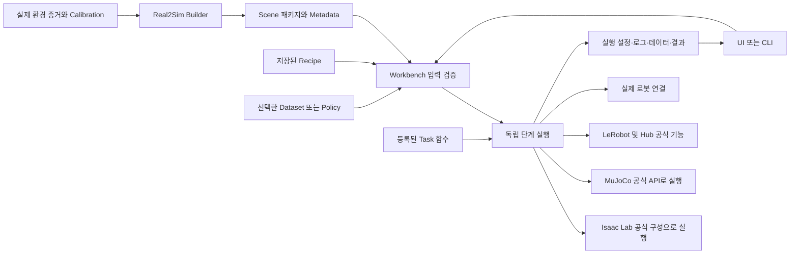

# 아키텍처 비교 초안

> 후속 상세 설계: [API·Interface 명세](interfaces.md). 이 문서의 초기 호출 예시보다 최신 타입·오류·상태 수명 계약을 우선하며 확정 요구사항과 v8 보존 원칙은 유지한다.

> 학습 설계 갱신: MiniVLA에서 자체 개발한 LR 그래프·Training/Validation Loss 기록/시각화·학습 관리 코드도 이관하지 않는다. ACT·SmolVLA는 공식 LeRobot CLI/API·Trainer 기본 동작을 사용한다. 추가 시각화는 공식 로그/결과를 읽는 독립 모듈로만 연결하고 loop/scheduler/optimizer/validation 처리를 변경하지 않는다. Offline Validation은 별도 실행 단계다. 아래 과거 UI/loss 보존 표현에도 이 원칙을 우선 적용한다.

> 범위 갱신: MiniVLA는 사용자의 명시적 지시에 따라 신규 개발·이관 범위에서 완전히 제외한다. 관련 모듈·호환 계층·Checkpoint 로더·학습/추론/평가는 새 Workbench에 구현하지 않는다. 아래 과거의 전체 기능 보존 표현에도 이 예외를 적용한다. 기존 MiniVLA 원본 코드와 데이터는 수정·삭제하지 않으며 공식 LeRobot 기반 ACT·SmolVLA 방향은 유지한다.

> 2026-10-25 통합 설계: [architecture.md](architecture.md). 구체 데이터 계약은 [data-contracts.md](data-contracts.md), 이관·검증 계획은 [migration-validation.md](migration-validation.md)를 참조한다. 이 문서는 논의 이력으로 보존한다. 아래 초기 트리와 설명용 Recipe는 최신 상세 설계를 대체하지 않는다. 22절 A/B/C 방향은 사용자 승인으로 확정되었다.

작성: 2026-10-24. 갱신: 2026-10-25. 상태: C안, Scene 패키지 기반 제품 연결, Task 파일별 등록, 선언용 YAML Recipe는 확정. 구체 구조와 후속 선택은 논의 중. 확정 요구사항은 `requirements.md`가 기준이다.
이 문서의 파일명·Interface·배포 구분은 비교를 위한 후보이며 구현 지시나 확정 결정이 아니다. 구현 코드, 기존 프로젝트, Scene 및 데이터는 변경하지 않았다.

## 1. 첫 결정: 두 엔진에서 공유할 범위

| 대안 | Interface와 실행 방식 | 장점 | 비용과 보존 위험 |
|---|---|---|---|
| A. 엔진별 독립 Workflow | 공통 Recipe를 각각의 Source/Annotation/DataGen/Evaluation 실행기로 전달 | 공식 엔진 구조를 직접 사용하기 쉬움 | 단계 순서·판정·기록 처리까지 중복되면 수정 누락과 의미 차이가 늘어남 |
| B. 하나의 범용 Env | 모든 단계를 공통 Env의 reset/observe/step/contact/render 등의 Interface로 실행 | 호출부가 하나이고 단순한 Task 작성이 쉬움 | 센서 갱신·병렬 환경·접촉·렌더링 차이를 모두 표현하면서 Interface가 커질 수 있음 |
| C. 가치 있는 공통 처리와 엔진 실행 분리 | Recipe·Object ID·Task 계산·기록을 필요한 범위에서 공유하고 각 엔진 공식 구조로 실행 | 재사용과 엔진 고유 동작 보존을 함께 달성 | 공유할 데이터의 좌표·시점·접촉 의미와 상태 초기화를 정확히 정의해야 함 |

**확정: C, 사용자 조건 반영.** Isaac Lab은 SceneCfg·EnvCfg·MDP Terms 등 공식 구성을, MuJoCo는 MjModel/MjData 등 공식 API를 최대한 활용한다. Recipe 해석·Object ID 참조·Task 판정 계산·기록처럼 공유 가치가 있는 처리만 공유한다. Source·Annotation·DataGen 실행은 엔진별 구현이 더 단순하면 분리한다. 공통 실행 루프나 범용 Env, 별도 Interface·Adapter·Wrapper·추상 클래스를 의무적으로 만들지 않는다. Calibration·알고리즘·단계별 조건·실행 시점 보존이 우선한다.

호출 예시: Source는 저장 Recipe를 검증하고 선택된 물체를 구성한 뒤 관측·명령·물리 진행·기록을 수행한다. Annotation은 입력 Episode의 기록 상태를 복원한다. 같은 Reset 진입점을 무조건 호출해 Annotation까지 랜덤화해서는 안 된다.

실행 Interface 후보는 `prepare(saved_recipe) → PreparedRun`, `execute(prepared_run, events) → RunResult`다. UI와 CLI가 동일하게 사용한다. Prepare는 기본 입력·등록 함수·엔진 지원을 검사한다. 엔진 로딩이 필요한 검사까지 성공하기 전에는 수집·생성·모터 동작을 시작하지 않는다. 미지원, 입력 부적합, 실행 오류, 정상 Task 실패는 구분한다.

## 2. 전체 연결 제안



- Builder는 실제 환경 재구성·검토·엔진별 Scene 산출물을 담당한다. Workbench는 선택한 Scene으로 작업을 실행한다.
- 제품 간 기본 전달물은 Scene 패키지로 확정한다. 두 프로젝트는 독립적으로 유지하며 Workbench는 Builder 내부 구현에 직접 의존하지 않는다. 버전 표현과 세부 파일 계약은 후속 설계한다.
- Calibration의 추정·검토와 실행 시 적용은 구분한다. 양쪽에서 동일하게 필요한 변환·검증만 필요성과 의존성을 확인한 뒤 공유한다. 큰 공통 라이브러리를 먼저 만들지 않으며 구체적인 소유 위치와 배포 방식은 미정이다.
- UI는 실행 상태와 영상을 표시하며 엔진이나 학습 라이브러리를 직접 import하지 않는다. 엔진/학습/하드웨어 실행은 작업 프로세스에서 수행하는 방향을 추천한다. 프로세스 수와 메시지 형식은 미정이다.
- 일반 LeRobot 학습에는 Scene이나 프로젝트 전용 Task Metadata를 필수로 요구하지 않는다.

## 3. 후보 폴더·파일과 책임

아래는 C안의 책임 배치를 검토하기 위한 트리다. 각 파일을 실제로 생성하기 전에 공유 코드의 소유권과 Interface를 결정한다. `stages/`의 파일은 단계를 찾기 위한 후보이며 공통 실행 루프를 강제하지 않는다. 필요하면 엔진별 디렉터리에 실행 파일을 배치한다. `__init__.py` 등의 패키징 파일은 생략했다.

```text
real2sim_builder/
  pyproject.toml
  src/real2sim_builder/
    cli.py                     # Builder 명령 진입점
    project.py                 # 입력 증거·후보 Scene·검토 상태 관리
    capture.py                 # 캡처 자료 수집/인수; 장치 연결 소유권은 후속 결정
    reconstruction.py          # 재구성 실행과 결과 관리
    calibration.py             # 보정 추정·검토·근거 연결
    scene.py                   # Object identity·Geometry·Joint·transform 편집 모델
    export.py                  # 의존 자산 포함 Scene 패키지 작성
    validation.py              # Geometry/물성/정합 검증 결과; READY와 구분
    exporters/
      usd.py                   # USD 산출
      mjcf.py                  # MJCF 산출
    ui/
      app.py                   # Builder UI 진입
      scene_review.py          # 후보 Scene과 검증 근거 검토

robot_learning_workbench/
  pyproject.toml
  src/robot_learning_workbench/
    cli.py                     # 단계 독립 실행 진입
    recipe.py                  # 파일 읽기·구조/파라미터 검증·실행 설정 확정
    scene.py                   # Scene 패키지 읽기·Object ID/엔진 참조 해석
    execution.py               # 입력 준비·작업 프로세스 시작/중지·실행 상태
    records.py                 # 실행 설정 snapshot·결과·오류·버전 기록
    tasks/
      registry.py              # 함수 검색·이름 중복/파라미터/지원 기능 검사
      context.py               # 좌표·단위·시점을 명시한 Task 입력 계약
      pick_place.py            # 기존 Placement/StableGrasp 및 단계별 조합
      placement.py             # 고정/균일 랜덤 초기 배치와 유효성 검사
    stages/
      source.py                # 시연 관측/명령 수집
      annotation.py            # 기록 복원·수동/자동 Annotation
      datagen.py               # Annotated Dataset에서 생성·채택·실패 관리
      simulation_evaluation.py # Policy 실행·성공/별도 지표 기록
      real_evaluation.py       # 실제 로봇 Policy 실행·제어 제한·기록
      real_sim.py              # Real/Sim 동기 표시·조작
    engines/
      isaac/
        launcher.py            # AppLauncher 수명과 import 순서
        scene_cfg.py           # Metadata/Recipe에서 공식 Scene 설정 구성
        env_cfg.py             # 공식 EnvCfg 구성
        mdp.py                 # 공식 MDP Terms와 재사용 계산 연결
        environment.py         # 필요한 경우 공식 환경 확장; 불필요한 wrapper 제외
        task_inputs.py         # 센서/접촉/좌표를 Task 입력으로 추출
      mujoco/
        model.py               # 선택 객체의 MJCF 구성·MjModel 생성
        environment.py         # MjData·mj_step·state 복원·렌더 수명
        task_inputs.py         # 접촉/좌표를 Task 입력으로 추출
    generation/
      mimic.py                 # 생성 알고리즘 연결; 공식/기존 이식본 선택 미정
    robot/
      connection.py            # 장치 연결·관측·명령
      calibration.py           # Calibration 적용·identity 확인·변환
      control.py               # 기존 명령 제한·제어 상태 보존
    data/
      episodes.py               # 내부 Episode 입출력; 기록 시점/관측/명령 구분
      conversion.py             # 공식 LeRobot Dataset 작성
      curation.py               # 기존 검토·위치 분포·선택·분할 기능
    learning/
      training.py               # 공식 LeRobot 학습 실행
      validation.py             # Offline Validation
      policy.py                 # 공식 Policy/preprocessor/postprocessor 로딩
      hub.py                    # Dataset/Policy 업로드·다운로드
    ui/
      app.py                    # 기존 전체 화면 구성과 탐색
      recipe_editor.py          # 파일 열기·명시적 저장·미저장 상태
      workflow_page.py          # 단계 선택·실행·Preview·로그·결과
      capture_page.py           # Real2Sim Capture 화면
      real_sim_page.py          # Real/Sim 화면
      calibration_page.py       # Precision Calibration 화면
      curation_page.py          # Data Curation 화면
  recipes/                      # 제공 Recipe; 사용자 저장 경로는 미정
  tests/                        # 알고리즘·계약·엔진별 회귀 검증

migration/                      # 별도 변환 도구 후보; 실제 출력은 원본과 분리
```

파일을 잘게 나누는 것 자체가 목표는 아니다. 의미 없이 한 번 전달만 하는 파일은 합친다. 반대로 `pick_place.py`가 상태 추출·UI·파일 로딩까지 담당하도록 키우지 않는다. Capture 및 Calibration의 두 제품 간 구체적 소유권, migration 도구 위치는 후속 비교 사항이다.

## 4. 호출·의존 관계와 Task 확장

1. UI/CLI → `execution.py` → `recipe.py`, `scene.py`, `tasks/registry.py`: 저장 설정과 실제 입력을 확인한다.
2. 작업 프로세스 → 해당 `stages/*`: 필요한 엔진 또는 공식 학습 도구를 생성한다.
3. 엔진의 `task_inputs.py` → 명시된 상태 자료 → `tasks/pick_place.py`: 엔진 참조를 계산 코드에 퍼뜨리지 않는다.
4. Task 결과 → 단계의 채택/종료/지표 처리 → `records.py`, `data/episodes.py` → UI 이벤트.

Task 등록은 Task 파일별 선언과 별도의 명시적 모듈 로딩 목록으로 확정했다. 단순 함수는 그대로 사용하고 상태가 필요한 기능만 상태 관리 구조를 둔다. 이름 중복과 파라미터 오류는 실행 전 실패한다. 상세 문법은 후속 설계한다.

Task 함수는 이미 제공된 pose/joint/contact 등 입력으로 표현되면 새 Python 파일·등록·Recipe 참조로 추가한다. 새로운 센서나 제어 기능이 필요한 Task는 엔진별 구현의 기능 추가도 필요할 수 있다. 이는 기존 UI나 Workflow에 Task 이름별 분기를 추가해야 한다는 의미가 아니다. 계약은 함수 인자와 자료형으로 충분하면 그렇게 표현하고 별도 추상 계층을 추가하지 않는다.

판정은 항상 무상태 boolean 함수일 수 없다. StableGrasp는 Episode/환경별 tracker와 reset/update 수명, tick 중복/누락 처리, latch를 가진다. 함수 등록 계약에는 상태를 만드는 factory도 표현할 수 있어야 한다. Reset은 상태를 변경하므로 순수 판정과 동일한 입력/출력 계약을 강제하지 않는다.

Recipe는 Scene ID, 생성할 작업 대상 ID, 초기 배치, 단계별 함수 참조/파라미터, 단계 입력을 표현한다. Metadata는 기준 transform, 좌표계·단위, Geometry/Joint, 엔진 참조 및 Calibration 근거를 표현한다. YAML/JSON 및 정확한 필드명은 미정이다. 기본값은 새로 추측하지 않고 기존 경로별로 확인한다.

## 5. 보존을 구조에 반영하는 방법

- Scene v8 원본을 수정하지 않고 선택된 작업 대상만 실행 Scene에 구성한다. 기준 환경은 유지한다.
- Calibration 적용 위치와 횟수를 명시해 중복 적용을 막는다. 관측과 명령 변환, geometry residual과 joint 명령 보정을 혼동하지 않는다.
- Placement 계산을 공유해도 접촉 관측과 stage별 성공 조합은 별도로 유지한다. Annotation/DataGen의 Placement AND latched StableGrasp와 기본 Evaluation의 Placement를 하나의 성공 조건으로 합치지 않는다.
- pre/post-step, 센서 갱신 시점, 초기 상태 복원, tracker 초기화는 Interface 일부다. 호출부 리팩터링을 이유로 순서를 바꾸지 않는다.
- four_anchors 제외는 승인된 변경으로 별도 기록한다. uniform의 범위·물체 크기·간격·지지면 높이와 고정 배치 검사를 보존한다.
- 엔진별 동일 입력의 중간 계산·최종 판정을 비교한다. 엔진 간 접촉/물리/영상의 완전 일치는 완료 조건으로 주장하지 않는다.
- 새 코드가 없으므로 현재 동등성 검증 완료를 주장하지 않는다. 문서에 적힌 폴더와 함수가 구현되었다는 뜻도 아니다.

## 6. 기존 코드 및 공식 근거

기존 Python 경로의 공통 접두어는 `/home/hyeonhee/soarm_isaaclab/soarm101_lab/source/soarm101_lab/soarm101_lab/`다.

| 근거 | 설계에 주는 의미 |
|---|---|
| `workflow/operations.py:551 execute_request` | 이미 GUI가 엔진을 로딩하지 않는 worker 실행이 존재한다. 유지할 동작과 정리할 분기를 분리한다. |
| `real2sim/workspaces/grasp.py:9 StableGrasp`, `update` | 시간창·움직임·양측 접촉·완료 latch·tick 처리는 상태 있는 계산이다. |
| `simulation/mujoco_backend.py:237 success_details` | 목표 로컬 좌표의 8개 꼭짓점·컵 형상·속도와 부등호를 보존해야 한다. |
| `workflow/datagen.py:138 run_mujoco`, `:310 run_isaac` | 엔진별 실행 연결이 실제로 존재한다. |
| `workflow/mimic.py MimicGenerator` 및 `mimic_reference/` | 기존 생성은 reference 이식본을 사용한다. MuJoCo의 공식 Isaac Lab Mimic 지원이라고 표현하면 안 된다. |
| `learning/training.py training_command` | 공식 `lerobot.scripts.lerobot_train` 실행이 이미 존재한다. 학습기를 새로 작성할 필요가 없다. |

확인한 로컬 환경: IsaacLab 저장소 VERSION 2.3.0, isaaclab distribution 0.47.2, isaaclab_mimic 1.0.15, MuJoCo 3.3.7, LeRobot 0.4.1. 이는 당시 조사 기준이었다. 2026-10-25 최종 결정으로 Sim5.1/Lab2.3/LeRobot0.4.1/MuJoCo3.3.7을 새 플랫폼 개발 기준으로 고정했으며 업그레이드·별도 분리 추론 코드는 구현하지 않는다. [B01 실행](b01-baseline.md)을 기준으로 한다.

- [Isaac Lab 2.3.0 Task Workflows](https://isaac-sim.github.io/IsaacLab/v2.3.0/source/overview/core-concepts/task_workflows.html): manager-based/direct 구성이 모두 존재한다. Recipe 기반 설정 조합에는 manager-based를 우선 비교하되 기존 기록·판정 시점을 맞출 수 있는지 확인한 뒤 선택한다.
- [MuJoCo 3.3.7 Python](https://mujoco.readthedocs.io/en/3.3.7/python.html): MjModel/MjData/mj_step 공식 바인딩을 사용한다. 상태 view가 step에 의해 바뀌므로 기록 자료의 복사 시점도 계약에 포함한다.
- [LeRobot 0.4.1 공식 학습 진입점](https://github.com/huggingface/lerobot/blob/v0.4.1/src/lerobot/scripts/lerobot_train.py): 학습/재개는 공식 실행을 연결한다. 프로젝트 전용 학습 루프를 기본으로 만들지 않는다.

## 7. 다음 결정 순서

1. 두 엔진에서 공유할 범위: C안 확정. 공통 실행 루프·추상 계층은 필수가 아니다.
2. Builder–Workbench 연결: Scene 패키지 + 실제 필요한 작은 공통 코드로 확정. 세부 스키마와 Calibration/Capture 코드 소유권은 추가 결정.
3. Task 파일별 선언 + 명시적 로딩 목록 확정. 상태 수명·엔진 지원의 상세 계약과 공식 Mimic/기존 이식본 연결 선택은 후속 결정.
4. Scene/Recipe/기록 스키마 및 저장 위치.
5. 단계별 화면 구성과 기존 UI 요소의 유지/대체/제거 대응표.
6. 위 결정 반영 후 파일별 Interface·호출 관계·마이그레이션/검증 계획 확정.

새 Task 확장은 가상 서랍 사례로 설계를 검토하되 서랍 구현은 만들지 않는다. 전체 세부 기능 보존 목록과 파일별 이관 대응표는 추가 조사·설계가 필요한 상태다.

## 8. 확정 방향: Builder–Workbench 데이터 계약과 코드 공유

아래 비교에서 두 번째 방식으로 확정했다. 엔진 간 코드 공유와 제품 간 코드 공유는 별개다. Workbench의 Recipe·Task·학습 코드를 Builder까지 공유할 필요는 없다.

| 대안 | 연결 방식 | 장점 | 비용 |
|---|---|---|---|
| 파일 계약만 공유 | Builder가 Scene 패키지를 내보내고 Workbench가 독립적으로 읽음 | 설치·실행 독립성이 높음 | 의미 검증과 변환 계산을 중복 작성하면 불일치 위험 |
| Scene 패키지 + 필요한 소규모 공통 코드 | 전달은 파일로, 양쪽이 실제 사용하는 계약 검증·변환 계산만 공유 | 내부 구현 의존 없이 의미 중복을 줄임 | 공유 코드의 버전·배포 관리 필요 |
| Builder 내부 코드를 Workbench에서 직접 사용 | Workbench가 Builder의 모델/프로젝트 로더를 import | 초기 재사용이 빠름 | Builder 내부 변경과 무거운 의존성이 Workbench에 전파 |

**확정:** 독립적인 Builder가 Scene 패키지를 생성하고 Workbench가 읽는다. Workbench는 Builder 내부 구현에 직접 의존하지 않는다. 검증·변환 계산의 공유는 실제 필요성과 의존성을 확인한 뒤 결정하며 큰 SDK나 공통 프레임워크를 먼저 만들지 않는다. 패키지 이름·디렉터리·배포 방법은 이후 결정한다. Calibration 데이터와 적용 의미, 기존 v8 및 외부 참조 Asset과 적용 로직을 보존한다.

Object ID·Geometry·Joint·좌표계·엔진별 참조 및 Calibration 의미 제공은 확정이다. 아래는 그 요구를 구체화하는 정보 목록이며 정확한 필드·저장 형식은 미정이다.

- Scene identity·버전과 파일 목록·해시·필수 외부 참조. 실행 의존 자산은 가능하면 함께 제공하고 남은 외부 참조는 명시적으로 검사한다.
- Object의 안정적인 ID·이름·기준 배치·기준 환경/작업 대상 역할, Geometry·Collision·Physics·Joint, 엔진별 경로. 역할은 단순 static/dynamic 이분법으로 고정하지 않는다.
- 좌표계·단위·부모 관계·회전 표기·변환 방향, 로봇 관절 순서, 카메라 내부/외부 파라미터.
- Calibration 결과·모델 identity·참조 근거와 적용 의미. 이미 asset에 반영한 보정과 실행 시 적용할 보정을 구분해 이중 적용을 막는다. 원시 encoder 데이터 등은 필요한 관측/명령 의미까지 보존한다.
- 배치에 필요한 지지면·허용 영역 등 기준 정보. 이번 실행의 선택 물체·위치·랜덤 설정은 Recipe에 둔다.
- 검증 상태와 근거. 실행 가능 상태를 실물 정합·물성 검증 완료로 바꾸지 않는다.

Workbench는 패키지 원본을 수정하지 않고 Recipe로 실행 장면을 구성한다. USD/MJCF의 엔진별 상세를 Metadata로 전부 재작성하지 않는다. 기준 값의 원본 위치와 파생 값 관계를 정의하고, 같은 정보가 어긋나면 조용히 한쪽을 우선하지 않는다.

Calibration 추정·검토, 실행 적용, 장치 연결의 구체적 소유권은 별도 결정한다. 공통화 후보는 의존성 없는 계약 검사·좌표/보정 수학이며 실제 중복 사용을 확인한 후 추출한다. Builder UI·재구성 파이프라인, Workbench Task 판정·Recipe 실행·학습 루프는 제품 간 공통 코드 후보에서 제외한다. Capture·Precision Calibration UI의 기존 기능과 실행 동작은 소유 위치 결정과 무관하게 보존한다.

## 9. 확정 방향: Task 기능의 등록 방식

Task 파일별 등록 선언과 명시적 로딩 목록 방식으로 확정했다. 아래는 비교 기록이다. 등록을 위해 공통 실행 코드나 UI에 Task별 분기를 추가하지 않는다.

| 대안 | 추가 절차 | 장점 | 비용 |
|---|---|---|---|
| 중앙 등록 목록 | Task 파일 추가 후 한 등록 목록에 이름과 함수 연결 | 등록 내용을 한곳에서 확인하기 쉬움 | Task 추가마다 중앙 파일 수정 필요 |
| Task 모듈별 선언 + 명시적 모듈 목록 | 각 Task 파일에서 제공 기능을 선언하고 프로젝트의 로딩 목록에 모듈 추가 | 함수와 등록 정보가 가까우며 공통 실행 코드 수정 불필요 | 모듈 발견 규칙과 중복 이름 검사 필요 |
| 설치 패키지의 entry point | Task를 패키지로 만들고 설치 정보로 발견 | 외부 Task 배포·설치에 적합 | 초기 패키징·설치 관리가 늘어남 |

**확정:** Task Python 파일 안에 함수와 등록 정보를 함께 두고 별도의 명시적 로딩 목록으로 연결한다. 사용자는 Recipe에서 등록 이름과 파라미터를 선택한다. 새 Task 추가는 파일 작성과 목록 등록으로 가능해야 하며 공통 실행 코드와 UI를 수정하지 않는다. 단순 함수는 그대로 사용하고 StableGrasp 등 필요한 기능에만 상태 관리를 둔다. 구체적인 목록 위치·이름·문법은 아직 확정하지 않는다.

등록 정보는 이름, 호출할 함수 또는 상태 생성 함수, 허용 단계·파라미터와 필요한 입력/엔진 지원을 표현할 수 있어야 한다. 기존 StableGrasp의 상태 수명·tick 처리·latch는 그대로 유지한다. Recipe에 이름이 같다는 이유로 단계별 판정 시점이나 접촉 추출을 통일하지 않는다. 등록 정보를 검사하기 위해 양 엔진 라이브러리를 UI 프로세스에 로딩하지 않도록 설계한다.

등록 방식의 선택은 모든 Task에 클래스·Wrapper를 요구하는 결정이 아니다. 일반 Python 함수로 충분하면 그대로 사용한다. 기존 입력으로 표현되는 신규 Task는 파일·등록·Recipe 선택만으로 추가할 수 있게 하고, 신규 센서/물리 기능이 필요한 경우에는 해당 엔진 구현도 필요함을 구분한다.

## 10. 확정: Recipe 파일 형식은 선언용 YAML

Recipe는 사용자가 UI 편집기와 외부 편집기에서 작성하는 실행 설정이다. 등록된 기능의 구현은 Task Python 파일에 둔다는 확정 요구를 기준으로 비교한다.

| 대안 | 장점 | 비용 |
|---|---|---|
| YAML | 설명 주석을 붙이기 쉽고 객체 목록·함수 파라미터를 읽기 편함 | 들여쓰기와 값 타입을 엄격하게 검사해야 함 |
| JSON | 구조가 명시적이고 도구 지원이 넓음 | 표준 문법에 주석이 없어 사용자 설명을 곁들이기 불편함 |
| Python | 코드로 설정값을 계산할 수 있음 | 설정을 읽는 과정이 코드 실행이 되어 사전 검사와 실제 사용값 추적이 복잡해짐 |

**확정: YAML (2026-10-25).** 사용자가 직접 편집하고 주석을 작성하며, 실행 설정을 선언하는 데만 사용한다. 실제 계산과 판정은 등록된 Python 함수가 수행한다. 불필요하게 복잡한 YAML 기능이나 자체 설정 언어는 만들지 않는다. 실행 전 필드·값 타입·Scene Object ID·등록 함수 이름과 파라미터를 검증하고 잘못된 설정은 명확한 오류로 안내하며 실행을 막는다. YAML loader와 검증 라이브러리는 미정이다. 중복 키를 조용히 덮어쓰지 않는 검사도 설계 후보에 포함한다.

파일 형식의 선택은 Scene Metadata 저장 형식이나 정확한 Recipe 필드명을 확정하는 결정이 아니다. 단계 독립 실행, 양 엔진 공통 문법, 실행 전 명시적 저장, 실제 사용 설정 자동 기록 요구는 유지한다. Training 등 엔진 독립 단계에 불필요한 Scene 필드를 요구하지 않는다.

## 11. 확정 방향: 단계별 Recipe와 필드 묶음 — 상세 문법은 미정

### 구성 비교

| 대안 | 예시 | 장점 | 비용 |
|---|---|---|---|
| 한 파일에 여러 단계 | 공통 Scene 설정 아래 source/annotation/datagen 등을 함께 작성하고 실행할 단계 선택 | 같은 설정의 반복이 적음 | 단계별 입력·배치·판정의 적용 범위와 덮어쓰기 규칙이 복잡해질 수 있음 |
| 한 파일에 한 단계 | source.yaml, annotation.yaml, datagen.yaml 등을 각각 선택해 실행 | 실행할 설정과 입력이 명확하고 독립 실행·오류 안내가 단순함 | 같은 Scene/물체 설정을 일부 반복 작성 |

**확정: 한 파일에 한 단계 (2026-10-25).** stage, engine, inputs, objects, functions, execution, output 구분을 기본 방향으로 채택하며 단계에 필요한 항목만 사용한다. Scene Geometry·Calibration·Object 기준 정보는 Builder Metadata 및 연결 자산에서 가져온다. Recipe에 시뮬레이터 내부 구현을 옮겨 담지 않는다. 단계별 파일이라는 이유로 이전 단계 실행 이력을 요구하지 않는다. 구체적인 필드명·기본값과 아래 예시의 상세 문법은 미정이다.

### 확정: UI는 Recipe의 편집 인터페이스

- stage는 UI에서 선택한 단계와 별도로 Recipe에 유지한다. CLI에서도 실행 단계를 식별하고 잘못된 단계의 Recipe 실행을 막는다. UI 단계와 불일치하면 자동으로 stage를 바꾸어 실행하지 않는 방향으로 오류 흐름을 설계한다.
- 엔진 선택 UI는 Isaac Lab/MuJoCo 값을 Recipe 편집 내용에 반영한다. 변경은 미저장 상태가 되고, 사용자의 명시적 저장 전에는 실행을 막는다. 실행기는 저장된 YAML을 읽고 검증한다.
- Recipe 외부에서 엔진을 조용히 덮어쓰는 UI 실행 설정을 두지 않는다. 파일을 열 때 엔진 선택 표시는 Recipe 내용과 일치시킨다.
- Training 등 시뮬레이터를 사용하지 않는 단계에는 engine을 요구하지 않는다. 불필요한 engine 필드가 입력된 경우의 오류 정책은 상세 스키마에서 결정한다.
- 이 엔진 선택 UI는 기존 Task/Object 설정 폼 전체를 복원하는 결정이 아니다. 핵심 실행 설정의 기준은 저장된 Recipe다.

### 필드 후보

| 필드 | 책임 | 적용 범위 |
|---|---|---|
| schema_version | Recipe 문법 버전 | 공통 |
| stage | 실행 단계 | 공통 |
| engine | Isaac Lab 또는 MuJoCo 선택 | 시뮬레이션 사용 단계 |
| inputs | Scene 패키지·Dataset·Policy 등 입력 참조 | 단계별 필요한 입력만 |
| objects | 생성할 작업 대상 ID와 각 대상의 초기 배치 | Source/DataGen 등 배치 구성 단계 |
| functions | 단계의 역할별 등록 함수 이름과 params | 판정/Reset 등 등록 기능 사용 단계 |
| execution | Episode 수·seed 등 실행 조건 | 단계별 검사 |
| output | 결과 저장 위치 | 프로젝트의 저장 정책과 함께 후속 결정 |

Task 이름 하나에 모든 설정을 숨기거나 자유 형식 options 하나에 모든 것을 넣는 대신, 배치와 단계 입력을 분리한다. functions의 역할 이름과 입력/출력은 단계별로 정의하며 임의 콜백 시점을 YAML로 프로그래밍하지 않는다. 복합 성공 조건은 등록된 Python 함수에서 조합한다. Stage 전용 엔진 설정을 허용할 범위는 별도 결정한다.

### Source 예시: 빨간 블록만 균일 랜덤 배치

아래 모든 예시는 설계 설명용이며 실행 가능한 제공 Recipe가 아니다. 경로·함수명·영역 ID는 후보 이름이다. 실제 v8 Metadata와 등록 목록에 대조해야 한다. 생략값과 기본 배치는 기존 경로를 확인한 후 정한다.

```yaml
schema_version: 1
stage: source
engine: mujoco
inputs:
  scene: ./scenes/scene_v8
objects:
  cube_red:
    placement:
      mode: random
      region: workspace_area
execution:
  episodes: 10
  seed: 42
output:
  directory: ./runs/source_red
```

objects는 생성 목록이다. 이 예에서는 다른 작업 대상 블록을 생성하지 않으며 로봇·카메라·테이블·Cup은 유지한다. random은 기존 uniform 계산을 사용하도록 연결하는 제안이며 four_anchors는 제공하지 않는다. region은 Metadata의 지지면/허용 영역을 참조하는 후보 문법이다. 영역 크기·margin·물체 간 간격·생성 높이를 이 예에서 새로 정하지 않는다. 자세 생략 시 처리도 상세 계약에서 명시해야 한다.

### DataGen 예시: 지정한 초기 위치에서 생성

```yaml
schema_version: 1
stage: datagen
engine: isaaclab
inputs:
  scene: ./scenes/scene_v8
  dataset: ./datasets/annotated_red
objects:
  cube_red:
    placement:
      mode: fixed
      frame: workspace
      position_m: [0.02, -0.01, 0.03]
      orientation_xyzw: [0.0, 0.0, 0.0, 1.0]
functions:
  acceptance:
    name: pick_place.v8_datagen_acceptance
    params:
      object: cube_red
      target: cup_a
execution:
  episodes: 10
  seed: 42
output:
  directory: ./runs/datagen_red_fixed
```

고정 위치는 지정 frame에서 물체 원점의 위치라는 후보 계약이며, 지지면 위 XY 위치 지정과 구분한다.
등록된 acceptance 함수는 기존 DataGen의 Placement AND latched StableGrasp 의미와 판정 시점을 유지해야 한다. YAML에서 AND 표현식을 해석하지 않는다. 목표 cup_a는 기준 환경의 참조이므로 objects에 다시 넣어야 생성되는 작업 대상 블록과 구분한다. 선택한 Dataset의 객체/Annotation/Scene 호환성도 검사한다. episodes가 목표 성공 수인지 시도 횟수인지 등 예산 의미는 기존 생성 규칙을 조사해 명시하며 이 예에서 확정하지 않는다.

고정 초기 배치 예시에서 사용한 수치는 단지 형식 설명이며 유효성 검증을 통과했다는 뜻이 아니다. 위치·자세는 임의로 보정해 실행하지 않고 검증 결과를 안내하는 방향을 제안한다. 부적합 배치 처리 정책은 별도 합의한다.

### 다른 단계의 적용

- Annotation: inputs.dataset의 기록된 상태를 복원한다. Source/DataGen의 objects 배치 설정을 그대로 적용해 재배치하지 않는다. 예: functions.acceptance에서 기존 Annotation 판정 함수를 참조한다.
- Simulation Evaluation: inputs.policy를 추가하고 단계별 success 함수와 별도 metrics를 선택한다. 기본 성공은 기존 Placement 의미를 보존한다. DataGen의 acceptance 조합을 자동 재사용하지 않는다.
- Training: inputs.dataset에 공식 호환 Local/Hub Dataset을 지정한다. Scene·engine·objects·Task 판정은 필수가 아니다. 공식 학습 설정을 연결하는 정확한 필드는 별도로 설계한다.

오류 안내 예시는 `objects.cube_red.placement.frame: Scene에 없는 좌표계`, `functions.acceptance.name: 등록되지 않은 함수`, `functions.acceptance.params.target: 존재하지 않는 Object ID`다. 파일 경로와 가능한 경우 줄 위치, 기대한 값/허용 후보를 함께 안내한다. Python 실행 기능을 YAML tag로 노출하지 않는다.

한 파일의 실행 범위와 필드 묶음은 확정했다. 위 예시의 정확한 필드명·함수명·좌표 표기·기본값까지 일괄 확정한 것은 아니다. Annotation 초기 상태 복원 및 단계별 성공 의미는 유지한다.

## 12. 확정: Metadata 좌표계 지정과 실행기 변환

같은 위치 숫자라도 어느 좌표계를 기준으로 해석하는지에 따라 다른 위치가 된다. Source/DataGen에서 사람이 특정 영역을 골라 수집하려면 Curation에 표시한 좌표와 Recipe의 좌표 기준을 확인할 수 있어야 한다.

| 대안 | 사용 방식 | 장점 | 비용 |
|---|---|---|---|
| 모든 위치를 world 좌표로 지정 | 단일 좌표계로 XYZ 입력 | 변환 선택이 적음 | 작업 영역이 회전·이동된 Scene에서 사람이 위치를 지정하기 불편할 수 있음 |
| Metadata의 좌표계를 명시해 지정 | 작업 영역 등 frame ID와 XYZ 입력; world도 명시 가능 | 작업 영역 기준 위치를 표현하면서 다른 Scene에도 적용 가능 | frame 존재·변환 관계 검사 필요 |

**확정 (2026-10-25):** Metadata에 정의된 좌표계를 명시하는 두 번째 방식. Workspace를 주로 사용하되 World 등 Metadata의 다른 좌표계도 선택할 수 있다. 실행기가 Metadata의 Transform을 적용하므로 사용자가 직접 변환할 필요는 없다. 실제 ID·원점·축은 Metadata와 기존 v8 자료를 따른다. 두 엔진은 같은 좌표 의미를 각 공식 실행 구조에 적용한다.

위치 입력에서 좌표계 ID를 명시한다. ID가 없거나 필요한 변환을 수행할 수 없으면 실행 전에 오류를 안내하고 실행을 막는다. World/Workspace 또는 identity 변환으로 임의 대체하지 않는다. Curation에서도 위치의 좌표계·단위를 명확히 표시해 사람이 Recipe에 입력할 수 있게 한다. 자동 부족 영역 탐지나 Recipe 자동 생성은 추가하지 않는다. 기존 v8 좌표계와 Calibration 적용 의미·변환 순서를 보존한다.

이 절의 결정은 좌표 기준을 다룬다. XY 배치의 높이 계산 및 자세 생략 정책은 아래 13·14절의 후속 합의를 따른다. 기존 uniform의 높이 의미와 Annotation의 기록 상태 복원을 임의로 변경하지 않는다. 새 형식 변환은 기존 데이터의 좌표 의미와 Calibration 적용 순서를 보존한다.

## 13. 확정 방향: Fixed XY / Random XY의 충돌 Geometry 기반 작업면 배치

| 대안 | 사용자 입력 | 장점 | 비용 |
|---|---|---|---|
| XYZ 직접 지정만 제공 | 좌표계와 물체 원점의 XYZ | 의미가 명확하고 정확한 위치 지정 가능 | 작업면 위 배치에도 높이를 알아야 함 |
| XYZ 직접 지정 + 작업면 위 XY 지정 | 직접 높이를 입력하거나, 지지면을 참조해 평면 위치만 입력 | 정확한 지정과 반복적인 작업면 배치 모두 편리함 | 두 방식의 의미·검증을 구분해야 함 |

위 표는 이전 비교 기록이다. **사용자 확정 방향 (2026-10-25): Fixed XY와 Random XY 모두 작업면 접촉 배치를 기본으로 한다.** Builder Metadata의 실제 충돌 Geometry·물체 원점·Geometry Transform·배치 자세·작업면 정보를 이용해 생성 위치를 계산한다. 사용자가 Z를 직접 계산할 필요가 없어야 한다. 높이의 절반을 더하는 계산으로 고정하지 않는다. XYZ 직접 지정 기능의 제공 여부는 아직 미정이다.

Fixed와 Random은 XY를 얻는 방식만 다르고, 그 뒤 Geometry 기반 높이 계산과 유효성 검사를 재사용하는 방향으로 설계한다. 다른 좌표계의 XY를 작업면 XY로 단순 대입하지 않으며 작업면과 좌표계의 관계를 검사한다. 중심 원점·바닥 원점·비직육면체를 고려하되, 지원하지 않는 충돌 형상이나 작업면을 단순 박스로 조용히 대체하지 않는다.

평면 작업면의 계산 후보: 모든 충돌 형상을 scale 및 local Transform과 배치 자세로 작업면 좌표에 옮겨, 작업면 법선 방향 최저점을 구한다. 그 최저점이 작업면에 닿도록 물체 원점을 법선 방향으로 이동한다. 물체 원점이 Geometry 중심에 있다는 가정은 두지 않는다. 여러 충돌 형상은 전체를 고려한다. Mesh/convex/primitive별 계산과 엔진에서 실제 사용하는 충돌 형상 차이는 상세 설계·검증 대상이다. 비평면 작업면은 이 평면 계산으로 처리했다고 주장하지 않는다.

Geometry 접촉은 안정적인 정착이나 다른 물체와의 무충돌을 보장하지 않는다. 작업 영역 내 footprint, 다른 물체와의 충돌, 허용 여유 및 필요 시 정착 검사와 구분한다. 검사를 이유로 지정된 XY나 자세를 몰래 바꾸지 않는다.

### 코드로 확인한 v8 보존 차이

- 기존 `real2sim/workspaces/reset.py:53 WorkspaceRandomizer.sample`은 `support_center_z + support_half_height + object_height/2 + clearance_m`을 사용한다.
- v8 `task.json`의 `reset.clearance_m`은 0.003 m다. 기존 경로는 정확한 접촉점보다 생성 여유를 둔다. Geometry가 기존 치수와 동일한 직육면체일 때 여유 0의 접촉 배치와는 초기 높이가 3 mm 다를 수 있다. 실제 충돌 Geometry가 다르면 차이는 추가 확인해야 한다.
- 따라서 새 일반 접촉 배치를 v8에 그대로 적용해 여유를 제거하지 않는다. v8의 기존 높이·배치 동작은 보존하고, Geometry 기반 계산 결과와 원래 계산을 비교한다. 보존용 배치 규칙의 저장/선택 방식은 상세 설계한다.
- 비교 항목: 중심/바닥/편심 원점, 자세 변경, 복수 충돌 형상, 최저점·생성 pose·관통/간격, 초기 물리 step 이후 상태. 각 엔진 안에서 기존/신규를 비교하고 엔진 간 차이는 별도로 기록한다. 이번 단계에서는 새 계산 실행이나 동등성 검증을 수행하지 않았다.

이 선택은 부족 영역 자동 추천이나 자동 충돌 회피를 추가하지 않는다. Annotation의 기록 상태 복원과 Recipe 배치 설정이 없는 기존 경로도 바꾸지 않는다. 자세 생략값은 아래 14절로 확정하며, 정확한 표기와 부적합 배치 처리 정책은 후속 결정이다.

## 14. 확정: 기본 자세 유지와 자세별 높이 계산

확정일: 2026-10-25.

- 배치 자세 생략 시 Builder Metadata의 해당 물체 기본 자세를 사용한다. 다른 자세는 Recipe에 명시한다. Fixed XY·Random XY 모두 동일하며 자세 랜덤화는 추가하지 않는다.
- Metadata 자세의 원래 기준 좌표계를 보존하고 실행에 필요한 Transform을 적용한다. 좌표계가 바뀌었다고 quaternion 등의 수치를 그대로 옮겨 다른 의미로 해석하지 않는다.
- 지정 자세와 충돌 Geometry를 작업면 기준으로 변환한 후 생성 높이를 계산한다. 자세 변경 전의 높이를 재사용하지 않는다. 순서는 자세 결정 → Geometry 변환 → 높이 계산 → 배치 검증이다.
- v8의 3mm 생성 여유와 기존 배치 동작은 보존한다. 새 배치 계산과 별도로 비교·검증하며 새 알고리즘을 기존 동작과 동일하다고 가정하지 않는다. four_anchors 제외라는 승인된 변경은 유지한다.
- Annotation은 기록 상태를 그대로 복원한다. 기본 자세나 새 높이 계산으로 기록을 덮어쓰지 않는다.
- 자세 표기, 회전 순서 등의 상세 계약은 미정이며 기존 좌표/회전 의미를 보존하도록 정한다.

## 15. 확정: 부적합 배치 처리

결정할 사항은 작업 영역을 벗어나거나 다른 물체와 겹치는 배치에 대한 처리다. 고정 위치는 사람이 의도한 수집 위치이므로 임의 이동은 데이터 수집 의도를 바꿀 수 있다.

| 대안 | Fixed XY | Random XY | 영향 |
|---|---|---|---|
| 자동 보정 | 가까운 유효 위치로 이동 | 위치 보정 또는 재추출 | 지정 위치가 실제 위치와 달라지며 별도 보정 규칙 필요 |
| 엄격 검사 + 제한된 재추출 | 이유를 안내하고 해당 실행/배치 시작 차단 | 허용 영역에서 재추출, 한도 초과 시 명확한 실패 | 고정 위치 의도 유지, 랜덤 시도 횟수 관리 필요 |

**확정 (2026-10-25): 엄격 검사 + 제한된 재추출.** Fixed XY는 지정 위치를 임의 변경하지 않고, 작업 영역 이탈이나 다른 물체와의 겹침이 있으면 원인을 안내하고 실행을 막는다. Random XY는 허용 영역과 기존 배치 조건을 유지하며 정해진 횟수 안에서 재추출하고 실패 원인을 안내한다. 위치 보정이나 허용 영역 자동 확장은 하지 않는다. 기존 v8의 검사·재시도 조건과 동작을 먼저 확인해 보존하고 새 방식과의 차이는 별도로 보고한다. 혼합 배치에서는 고정 물체를 유지하고 랜덤 물체만 재추출하는 방향으로 상세 설계한다.

좌표/Geometry/함수 지원 정보 누락은 재추출로 해결할 수 없으므로 설정 오류로 처리한다. 파일 기반 검사는 실행 준비 단계에서, 실제 엔진 충돌 검사는 Scene 로딩 이후 해당 Episode 시작 전에 수행할 수 있다. 실행 중 생성되는 모든 Random 후보를 실행 전에 미리 검증했다는 의미는 아니다.

Random XY의 물체별 후보 추출 한도는 1,000회이며 소진 시 해당 작업을 중단하는 것으로 16절에서 확정했다. 기존 v8의 검사·재시도·판정 시점을 먼저 대조하고 새 검사로 기존 허용 배치를 조용히 배제하지 않는다. 이 한도를 다른 기능의 IK·Grasp·Task 재시도 횟수에 적용하지 않는다.

오류에는 Object ID, 좌표계, 요청 위치/자세, 적용 배치 규칙과 실패 원인을 표시하는 방향을 제안한다. 기하학적 유효성 검사를 실제 로봇 도달/파지 가능성 또는 물리적 안정성의 보장으로 표현하지 않는다.

### 기존 코드 확인 근거와 새 검사와의 차이

기존 Python 파일 경로는 6절의 접두어 기준이다. 아래는 코드 확인 결과이며 실행 검증 완료를 뜻하지 않는다.

- `real2sim/workspaces/reset.py:18 WorkspaceRandomizer.sample`: 물체별 최대 1000회 후보를 추출한다. uniform은 지지면 반크기에서 물체 반크기와 margin을 뺀 범위에서 XY를 추출한다. 이미 배치한 물체와 X 또는 Y 중 한 축에서 중심 거리 > 두 물체 반크기 합 + separation일 때 통과한다. 소진 시 ValueError이며 범위 확장이나 위치 보정은 없다.
- 이는 치수 기반 XY 간격 검사다. 임의 회전·원점·실제 충돌 Mesh를 사용하는 새 검사와 동일하지 않다. 기존 샘플 순서와 RNG 소비, 허용 영역·간격 조건도 비교해야 한다.
- `real2sim/workspaces/tasks.py:442 validate_reset_pose`: 유효한 SE(3)를 확인하고, 지지면 좌표계로 옮긴 물체 치수의 8개 꼭짓점을 검사한다. XY 범위는 지지면 반크기 + 1e-7 m까지, 최저 Z는 지지면 상단 - 1e-6 m 이상을 허용한다. 이 검사는 Random 샘플링의 margin 검사와 같은 조건이 아니다.
- `simulation/mujoco_backend.py:219 reset_object_poses`: 배치 후 변경 대상 및 그 자식 body가 관련된 contact.dist < -1e-6 m 접촉을 거부하고, 오류 시 원래 물리 상태로 복원한다. 이 MuJoCo 경로를 Isaac의 모든 경로에도 동일하게 구현되어 있다고 가정하지 않는다.
- 새 Geometry 검사가 기존에 통과하던 배치를 거부하거나 반대로 허용한다면 사례와 영향을 보고한다. 보존 경로와 신규 배치 검사를 구분하고, 기존 성공 판정을 완화하거나 재시도 횟수를 조용히 늘리지 않는다.

## 16. 확정: 초기 배치 1,000회 소진 시 작업 중단

| 대안 | 처리 | 고려할 점 |
|---|---|---|
| 해당 Episode를 건너뛰고 계속 | 배치 실패 기록 후 다음 Episode 시도 | 실행은 계속되지만 불가능한 배치에서 같은 실패를 반복하거나 데이터 분포·예산이 달라질 수 있음 |
| 작업을 중단하고 원인 안내 | 정상적으로 저장 완료된 Episode는 보존하고 다음 Episode 시작 중단 | 사용자가 조건을 확인한 뒤 다시 실행해야 함 |

**확정 (2026-10-25): Random XY의 기존 물체별 1,000회 후보 추출 한도 소진 시 해당 실행 작업을 중단한다.** 이미 정상 저장된 Episode는 보존하고 미완료 Episode는 성공 데이터로 저장하지 않는다. 실패한 Object ID, 배치 조건, 실패 횟수와 원인을 기록한다. 한도 소진을 새 Episode로 바꾸어 무한 재시도하거나 물체를 제거하지 않는다. 파일 저장/원자적 완료 처리의 구체 구조는 별도 설계한다.

이 정책은 초기 배치 실패에만 적용한다. 정상 배치 이후 Grasp 실패·Task 실패·DataGen 재생성 정책은 기존 동작을 유지한다. 기존 엔진별 호출부의 예외 처리와 대조한 뒤 차이를 보고한다.

기존 Resume와 데이터 저장 안전성 보존도 확정했다. 단계별 실제 Resume 지원 범위와 저장 완료 판정·미완료 자료 처리·중복 방지·난수 상태 등 재개에 필요한 정보를 조사한다. 이를 근거 없이 모든 단계의 임의 시점 자동 재개 기능으로 확대하지 않는다. 새 자료 저장 형식과 중단/Resume 검증 계획은 후속 설계한다.

## 17. 확정: 새 데이터 계약에 따른 JSON Scene Metadata

Scene Metadata는 JSON으로 확정했다. 아래는 형식 비교 기록이다. 사용자가 작성하는 Recipe YAML과 구분한다.

| 대안 | 장점 | 비용 |
|---|---|---|
| YAML | Recipe와 같은 형식이고 주석을 직접 작성하기 편함 | Builder가 생성하는 기준 자료에 수동 편집이 섞이면 원본/파생 값 관계를 관리해야 함 |
| JSON | Builder가 생성하고 Workbench가 검증해 읽는 구조화 자료에 단순하게 적용 가능 | 표준 문법에 주석이 없으므로 설명·근거는 명시적인 필드나 연결 문서에 저장해야 함 |

**확정 (2026-10-25): Scene Metadata는 JSON.** 기존 파일 구조를 복사하거나 모든 정보를 하나의 거대한 JSON에 담지 않는다. 새 데이터 계약에 필요한 정보를 구성하고 중복·불필요한 필드를 최소화한다. Scene 실행과 Task 구현에 필요한 Object ID·Geometry·Transform·Joint·Calibration 적용 정보·검증 상태는 보존한다. 파일 형식만으로 올바른 단위·변환·참조·모델 identity가 보장되는 것은 아니므로 별도 계약 검증이 필요하다.

USD·MJCF·Mesh 등 Asset은 별도 파일로 유지하고 Metadata에서 참조한다. 기존 v8과 Calibration 변환 시 계산 의미·적용 방식은 보존하며 원본을 남기고 결과를 검증한다. 책임별 파일 구성과 정확한 참조 규칙은 후속 설계한다. 결과 기록 형식과 Dataset 형식은 이번 결정에서 제외한다.

## 18. 확정 방향: Metadata 책임 구분과 scene.json 진입점

| 대안 | 구성 | 장점 | 비용 |
|---|---|---|---|
| 책임별 소수 파일 | Scene 진입점, Object, 좌표계, Calibration, 검증 기록 | 정보를 찾기 쉽고 역할별 변경을 추적하기 쉬움 | 파일 간 ID 참조 검증 필요 |
| Object별 개별 파일 중심 | 각 물체마다 Geometry·Transform·Joint 등을 파일로 관리 | 대형 Scene에서 개별 자산 관리에 유리 | 작은 Scene에도 파일이 늘고 공통 좌표/Calibration 정보를 반복하기 쉬움 |

**확정:** 책임을 구분하고 `scene.json`을 진입점으로 사용한다. 아래 다섯 JSON 파일을 반드시 각각 만드는 것으로 확정하지 않는다. 실제 데이터 크기·참조 관계·변경 주기·각 모듈의 사용 방식을 확인해 가장 단순한 파일 구성을 선택한다. 동일 정보의 중복 저장과 불필요한 조회 참조 단계·변환을 만들지 않는다. 아래 트리는 책임을 설명하는 후보이며 실제 파일 분할은 미정이다.

```text
scene_package/
  scene.json          # 진입점: Scene identity/계약 버전, Metadata 파일과 Asset 참조 목록
  objects.json        # Object ID/역할, Geometry/Collision/Physics/Joint, 엔진별 연결
  frames.json         # 좌표계 ID, 부모 관계, 기본 Transform과 단위/회전 규약
  calibration.json    # 보정 결과/모델 identity/적용 의미/증거 참조
  validation.json     # 검증 대상·상태·방법·근거 참조
  assets/             # USD/MJCF/Mesh 등 실제 자산
  evidence/           # 필요한 Calibration·검증 근거 파일
```

### 참조와 값의 소유 원칙 제안

- Workbench는 scene.json에서 나머지 자료를 찾는다. 파일명 추측이나 Builder 프로젝트 내부 폴더 탐색을 요구하지 않는다.
- Object 정보와 좌표계 정보는 필요한 ID로 연결하되 같은 파일에 둘 수도 있다. 기본 Transform의 기준 정의를 한곳에 두고 동일한 world/local 행렬을 여러 Metadata에 반복 저장하지 않는다. Object ID와 frame ID를 구분하는 구체 방식은 상세 계약에서 정한다.
- Geometry는 형상 종류·충돌 형상 참조·scale·필요한 로컬 Transform을 해석할 수 있어야 한다. Mesh 좌표 전체를 JSON에 복제하지 않는다. Joint는 자유도·축·한계·관계와 엔진 참조를 개발자가 확인할 수 있도록 한다. 구체 값의 원본/파생 구분은 필드별로 결정한다.
- Calibration 정보는 모델 identity와 보정 의미·순서·적용 대상을 표현한다. 별도 calibration.json 여부와 무관하게 원본·근거를 보존한다. 이미 Asset/기본 Transform에 반영된 보정과 실행 시 적용해야 할 보정을 구분한다. 최종 Transform을 읽었다는 이유로 Calibration을 다시 적용하지 않는다.
- USD/MJCF에 필수적으로 들어가는 Transform·물성 등의 값과 Metadata 사이에는 생성 관계를 둔다. 독립적인 두 정답으로 관리하지 않고 export 검증으로 불일치를 찾는다. 필요한 엔진별 차이는 명시한다.
- 검증 정보는 무엇을 어떤 버전/대상에 대해 검증했는지 표현한다. 별도 validation.json 여부는 미정이다. READY와 실물 정합·물성 검증 완료를 혼동하지 않으며 알려지지 않은 상태를 성공으로 채우지 않는다.
- 실행 Asset은 19절의 합의대로 패키지에 포함하고 내부 상대 경로로 연결한다. 기존 v8 외부 Asset을 누락하거나 임의 대체하지 않는다. 보존·추적용 외부 원본 자료와 실행 의존성을 구분한다.
- Recipe에는 이번 실행의 물체 선택·배치·함수만 두고 위 기준 자료를 복제하지 않는다. 로딩 후에는 필요한 자료를 함께 해석할 수 있으나 거대한 새 공통 객체/Wrapper를 의무적으로 추가하지 않는다.

책임 구분과 진입점은 확정이며 물리적 파일 구성은 미정이다. Asset–Metadata 참조 관계와 이식성을 보장하고 기존 v8의 구조를 복제하지 않는다. Metadata 단위·회전 표기, 동적 frame의 기준 상태와 실행 상태 구분, 상세 Calibration 적용 계약, 파일 목록/해시 구조는 실제 자료에 맞춰 설계한다. 새 JSON 파일이나 변환 결과는 아직 생성하지 않는다.

## 19. 확정: 실행 Asset 포함과 패키지 이식성

| 대안 | 방식 | 장점 | 비용 |
|---|---|---|---|
| 실행 의존 Asset을 패키지에 포함 | USD/MJCF/Mesh/texture 등 필요한 파일을 수집하고 내부 참조로 연결 | 패키지를 다른 경로로 옮겼을 때 재사용하기 쉬움 | 대형 자산의 복사·용량 비용 |
| 공용 외부 Asset 저장소 참조 | 패키지는 자산 식별자와 외부 위치를 사용 | 여러 Scene의 자산 중복을 줄임 | 별도 저장소 설정·버전·내용 검증이 필요 |

**확정 (2026-10-25): 실행 Asset을 포함하는 이동 가능한 Scene 패키지.** 필요한 시뮬레이터·라이브러리가 설치되어 있다면 다른 경로나 컴퓨터에서도 사용할 수 있어야 한다. USD·MJCF·URDF·Mesh·Texture·Collision Geometry·Calibration 적용 파일 등 실제 의존성을 조사해 포함한다. 특히 v8 외부 Finger Collision 데이터와 보정된 Robot Asset을 누락하지 않는다. Asset 중복은 최소화한다. 실행 의존 파일을 포함하지 못했다면 완성된 이동 가능 패키지로 표시하지 않고 원인과 영향을 보고한다.

실행 참조는 패키지 내부 상대 경로를 사용한다. Metadata 경로를 패키지 루트 기준으로 해석하는 방안을 상세 설계하며, USD/MJCF/URDF 내부 참조는 각 형식의 경로 규칙을 지킨다. 모든 경로를 무조건 scene.json 상대 경로로 재작성하지 않는다. 중첩 참조·include·texture·충돌 데이터 등 실제 필요한 파일을 조사하고 패키지 밖으로 이어지는 실행 의존성을 남기지 않는다. Python 실행 환경과 시뮬레이터 설치 자체를 포함한다는 뜻은 아니다.

참조 재작성은 변환 사본에만 적용한다. 자산의 기하·단위·좌표·물성·Calibration 의미를 바꾸지 않고, 원본 파일과 파생 파일의 관계 및 필요한 내용 검증을 기록한다. 저장 위치를 옮긴 뒤 양 엔진에서 참조 해석과 결과를 검증하는 것을 완료 조건으로 제안한다. 해시 일치만으로 Scene 동작 동등성을 검증했다고 주장하지 않는다.

Calibration 원본·근거의 보존은 실행 Asset 포함과 별도 의무다. 원본 촬영 자료나 실험 증거를 모두 실행 패키지에 넣을 필요는 없다. 실행 필수 데이터는 포함하고 보존·추적 자료는 별도로 관리할 수 있다. 실행 검증이나 모델 identity 확인에 실제 필요한 데이터를 단순 증거로 분류해 제외하지 않는다. 기존 원본은 수정하지 않으며 새 패키지를 별도로 만든다. 패키지 이동 후 참조 누락·무결성 검증을 지원한다. 현재 복사·변환·참조 재작성은 수행하지 않는다.

## 20. 확정: 원본 추적과 실행 의존 분리

결정할 사항은 패키지 밖에 보존한 촬영·실험 증거를 어떻게 찾고, 실행 시 접근이 필요한지 구분하는 방식이다.

| 대안 | 연결 방식 | 영향 |
|---|---|---|
| 원본 위치를 직접 참조 | 원래 경로를 기록하고 필요 시 접근 | 단순하지만 원본 이동 후 식별하기 어렵고 다른 컴퓨터에서는 경로가 유효하지 않을 수 있음 |
| 식별 정보와 내용 해시, 보존 위치를 기록 | 원본 ID/해시로 동일 자료인지 확인하고 위치는 탐색 정보로 사용 | 실행 패키지의 이동과 원본 추적을 분리할 수 있으나 추적 기록 관리가 필요 |

**확정 (2026-10-25): 원본 자료를 ID·SHA-256 해시·보존 위치로 추적한다.** 원본 경로만을 identity로 사용하지 않는다. 불필요한 별도 데이터베이스나 복잡한 관리 시스템은 만들지 않는다. Metadata는 필요한 정보만 간결하게 구성하고 중복 기록을 최소화한다. 정확한 파일 위치·필드는 실제 데이터 계약에 맞춰 정한다.

실행 필수 Calibration과 Asset은 패키지에 포함하고 원본 촬영 이미지·실험 증거 등은 외부에 보존할 수 있다. 외부 원본에 접근할 수 없어도 실행 필수 데이터가 완전하면 시뮬레이션을 막지 않는다. 원본 접근 상태는 명확히 표시하고 검증 상태와 구분한다. 접근 불가를 검증 완료로 해석하지 않으며 기존 v8 검증 상태를 그대로 유지한다. 원본 보존 의무는 유지하며 증거 재검토가 필요한 검증 작업은 해당 자료 확보가 필요하다.

변환한 Asset은 원본 식별 정보와 변환 결과를 연결하고, 어떤 변환/보정이 적용되었는지 추적하도록 상세 설계한다. 서로 다른 내용의 원본·변환 파일에 같은 해시를 기대하지 않는다. 추적 기록이 존재한다는 것만으로 계산 동등성을 보장하지 않는다.

## 21. 확정: Scene Revision 보존과 실행 버전 고정

결정할 사항은 Builder에서 Scene이나 Calibration을 수정한 뒤 기존 실행이 참조하던 패키지를 어떻게 다룰지다. 원래 v8 자료의 변경 금지는 이미 확정이며, 여기서는 새 시스템이 생성할 패키지의 수명을 다룬다.

| 대안 | 방식 | 영향 |
|---|---|---|
| 같은 패키지 경로를 갱신 | 재export 시 파일을 교체하고 변경 이력 기록 | 관리할 폴더는 적지만 과거 실행 입력을 따로 복원해야 함 |
| 새 revision으로 별도 export | 이전 실행용 패키지는 유지하고 새 패키지 생성 | 과거 실행의 Scene을 명확히 식별할 수 있지만 저장 공간 관리 필요 |

**확정 (2026-10-25): 실행용 Export는 Revision별로 보존한다.** Builder 편집 작업과 실행용 Export를 구분하고 Scene·Calibration 변경 후 Export는 새 Revision으로 생성한다. 기존 패키지를 덮어쓰지 않는다. Workbench Source·Annotation·DataGen·Evaluation 및 Scene을 사용하는 관련 기록에 실제 사용한 Scene ID·Revision·무결성 정보를 남긴다. 과거 Dataset 재생·Resume는 기록 당시 Scene과 Calibration을 사용하며 최신으로 자동 변경하지 않는다. 필요한 Revision이 없거나 무결성이 다르면 명확한 오류로 진행을 막는다. 정확한 Revision 이름·폴더·내용 해시 계산 방식은 미정이다.

동일 내용의 패키지를 다른 위치로 이동하는 것은 Scene 수정과 구분한다. 경로 문자열만으로 동일성을 판정하지 않는다. 변경된 패키지로 새 실행을 시작하는 것은 가능하되 기존 기록을 새 Scene으로 다시 이름 붙이지 않는다. Resume 호환성은 기존 기능과 단계별 계약을 확인해 설계하며 모든 변경을 자동 수용하지 않는다.

Dataset마다 Scene 패키지 전체를 복사하거나 복잡한 자체 버전 관리 시스템을 만들지 않는다. 여러 실행이 같은 Revision을 참조하고 불필요한 Asset 중복을 최소화한다. Revision 간 중복 저장 최적화는 이식성과 이전 Revision 보존을 훼손하지 않는 범위에서 검토한다. 기존 scene2_builder/v8과 Calibration 원본은 그대로 보존한다. 원본 증거 보존 위치 변경과 검증 근거 추가의 기록 방식은 별도로 설계한다.

## 22. 확정: 제품 책임·작업 프로세스·데이터 역할

작은 필드·파일명마다 승인을 반복하지 않는다. 아래 세 묶음을 논의한 뒤 전체 폴더/파일 책임·호출 관계·데이터 계약을 통합 초안으로 제시한다. 아직 합의되지 않은 제안은 확정 요구사항으로 옮기지 않는다.

### A. Builder와 Workbench의 장치·Calibration 책임

대안은 두 프로젝트가 장치 제어를 각각 구현하는 방식과, 장치가 필요한 사용자 작업을 Workbench가 맡고 Builder에는 자료를 전달하는 방식이다.

**추천:** Workbench가 기존 Real2Sim Capture·Real/Sim·Precision Calibration·실제 로봇 평가 화면과 장치 연결/제어를 담당한다. Builder는 캡처·보정 자료를 입력받아 Scene 재구성, Scene/카메라 정합 계산·검토, 엔진별 Export를 담당한다. 로봇 encoder 보정과 명령 적용 등 장치와 결합된 계산은 Workbench에 두고, 실제 양쪽이 사용하는 순수 좌표/보정 수학만 필요성 확인 후 공유한다.

Calibration 전체를 한 제품으로 몰아넣는 제안이 아니다. 각 기존 알고리즘을 입력·장치 의존성·산출물 기준으로 배치하고 동일 보정 알고리즘의 두 독립 구현은 피한다. Builder는 결과와 적용 의미를 실행 패키지에 연결하고 Workbench는 그 계약대로 적용한다. Capture 자료 전달에는 Builder 내부 import가 필요하지 않다. 기존 UI의 기능은 유지하고 화면의 위치와 내부 계산 소유권을 구분한다.

### B. UI와 실행 프로세스

대안은 UI 안에서 모든 작업을 수행하거나, 독립 서버를 두거나, 로컬 작업 프로세스를 사용하는 방식이다.

**추천:** 기존 데스크톱 UI를 유지하고 엔진·학습·장치 작업은 로컬 별도 프로세스로 실행한다. UI/CLI는 저장 Recipe를 같은 실행 진입점에 전달한다. 작업 프로세스는 필요한 엔진만 로딩하며 진행·로그·결과·Preview를 UI에 전달한다. 상시 웹 서버·분산 작업 시스템은 처음부터 만들지 않는다. 영상과 제어 메시지를 어떻게 전달할지는 기존 구현/성능을 조사해 가장 단순한 방식으로 정한다.

작업 중지·저장·Resume와 장치 제어 제한은 기존 동작을 보존한다. UI 종료나 작업 오류가 장치 제어 수명에 미치는 영향도 검증한다. 엔진별 실행 루프를 하나의 범용 Env로 합치는 결정은 아니다. `workflow/operations.py:551 execute_request`의 GUI/worker 분리는 기존 근거다.

### C. 시연·재생 자료와 공식 LeRobot 자료의 관계

대안은 모든 자료를 곧바로 LeRobot 형식에 넣고 추가 상태를 붙이는 방식과, 재생/생성에 필요한 내부 Episode 계약을 별도로 두고 공식 Dataset으로 변환하는 방식이다.

**추천:** Source·Annotation·DataGen·정확한 상태 재생용 Episode 계약과 공식 LeRobot 학습/공유 계약을 구분한다. 내부 자료에는 필요한 초기 상태·관측/명령 구분·pre/post-step 시점·Annotation·Scene/Calibration Revision 정보를 보존한다. 변환 결과는 프로젝트 전용 Reader 없이 공식 LeRobot에서 사용할 수 있어야 한다. 외부 공식 Dataset/Policy의 일반 학습에 내부 Episode 계약을 요구하지 않는다.

저장소를 두 벌 복제하는 것이 목표가 아니다. 내부 payload 형식은 HDF5 등 기존 기술의 장단점과 Recorder/Mimic 호환성을 조사해 결정한다. 기존 `data/episodes.py:379 DatasetWriter`, `data/recording.py:79 EpisodeBuffer`, `data/datasets.py:177 EpisodeDataset`을 저장/복원 의미의 조사 근거로 사용하며 옛 Schema를 그대로 채택하지 않는다. 영상 참조·Episode 완료·미완료 처리·Resume·실행 기록은 같은 상세 데이터 계약에서 설계한다. 새로운 데이터베이스는 기본 요구로 두지 않는다.

### 통합 상세 설계에 포함할 사항

1. 두 프로젝트의 실제 후보 폴더 트리, 주요 Python 파일과 함수/클래스 책임, 허용 import 방향. 추상 계층 없이 공식 구조를 활용하는 엔진별 파일 배치.
2. Scene/Calibration/Object/좌표계 계약: 실제 v8 데이터 크기·참조를 근거로 최소 파일 구성, 단위·회전·원본/파생 값·무결성 정의.
3. Recipe와 Task 등록: 단계별 필수/금지 필드, 파라미터 검사, 상태 생성/초기화/판정 시점, 엔진 지원 선언. Source/Annotation/DataGen/Training/Evaluation 예시를 함께 제시.
4. 단계별 입력·출력·오류·저장·Resume 계약과 UI 화면별 유지/Recipe 대체/제거 대응표. Capture부터 Hub·실제 로봇 평가까지 누락 없이 포함.
5. 공식 Mimic 연결과 기존 reference 이식본의 차이를 코드/공식 근거로 비교. MuJoCo 지원을 공식 제공으로 오인하지 않으며 기존 알고리즘·판정·타이밍 보존을 확인한다. 구현 동등성이나 의존성에 중대한 선택이 남으면 해당 항목만 별도 논의한다.
6. v8 변환 대응표와 엔진별 회귀 검증: Calibration·충돌·높이·판정 중간값/경계·시점, 재배치/Revision 누락, 중단/Resume 및 공식 LeRobot 상호운용.

위 A/B/C는 2026-10-25 사용자 승인으로 확정했다. Calibration 데이터·적용 의미 보존, 최소 공통 계산, 불필요한 Launcher/Wrapper/Adapter 배제, 공식 엔진 구조 우선, 내부/공식 데이터의 불필요한 중복 배제 조건을 함께 적용한다. 상세 구조는 통합 설계 문서에서 제시한다. 실제 조사에서 동작 변경이나 중요한 비용/의존성 문제가 발견되면 보고한다. 현재는 설계 문서만 수정하며 구현·마이그레이션을 시작하지 않는다.

## 23. 확정: DataGen 고정 IK — 2026-10-25

B01 확보 후 사용자가 새 Workbench DataGen은 **Pinocchio DLS + Best Effort 단일 방식**으로 확정했다. 이전의 여러 Solver/Failure Policy를 모두 이관하는 방향은 채택하지 않는다. SciPy IK·Strict/Hold 및 선택 UI/Recipe 옵션·자동 fallback을 제외해 실행 경로를 단순하게 유지한다. 공식 Pinocchio API를 사용하는 기존 DLS 식·고정 파라미터·측정 seed·Best Effort finite/관절 제한/직전 적용 팔 명령 대비 0.5 rad/step 초과 점프 검사를 보존한다.

Best Effort는 미수렴이어도 안전하게 유효한 candidate를 적용할 수 있다는 뜻이며 성공 보장은 아니다. 최종 채택은 기존 latched StableGrasp AND Placement다. B01의 SciPy + Strict trace와 원본은 변경 전 증거로 보존하고, 새 정책의 명령·trajectory·실패/성공 차이를 승인된 변경으로 보고한다. 과거 IK provenance를 새 값으로 고치거나 다른 정책 run을 그대로 Resume하지 않는다.

새 아키텍처·Solver 계층은 추가하지 않는다. 기존 generation/mimic 및 엔진 datagen/control/MDP 책임 안에서 연결한다. 수치·반환/오류·기록/Resume·시험은 [상세 SPEC](../SPEC-simulation-workflows.md#datagen-ik-고정-계약), [Interface](interfaces.md), [데이터 계약](data-contracts.md), [개발 계획](../tasks/plan.md)에 반영한다. 이번에는 문서만 변경하며 구현·실행·양 엔진 검증은 DataGen 구현 단계에서 수행한다.
