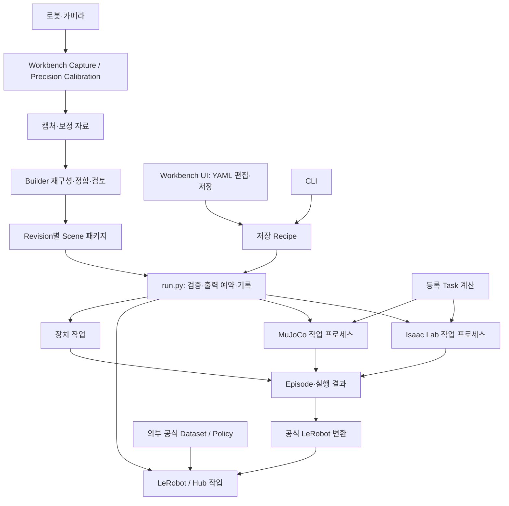

# Real2Sim Builder / Robot Learning Workbench 통합 설계

2026-10-25 최종 결정: 새 플랫폼 개발 기준은 **Isaac Sim5.1 / Isaac Lab2.3 / LeRobot0.4.1 / MuJoCo3.3.7**이다. 업그레이드는 진행하지 않는다. 최신 버전 조사는 참고 이력이며 신규 환경 분리·분리 추론·업그레이드 대응 코드는 개발 범위에 포함하지 않는다. 기존 UI/엔진 worker의 필요에 따른 프로세스 분리는 유지한다.


호출 signature·입출력·오류·상태 수명은 [API·Interface 명세](interfaces.md)를 함께 검토한다. 저장 형식은 데이터 계약, 호출 계약은 Interface 명세가 담당하며 같은 Schema를 별도로 중복 정의하지 않는다.

작성일: 2026-10-25. 상태: **구현 전 검토용 상세 설계 완성본**. 사용자가 확정한 방향은 [requirements.md](requirements.md), 이전 비교 이력은 [architecture-proposal.md](architecture-proposal.md)에 있다. 아래 구체 파일명·Interface·Schema는 이번 검토를 위한 설계 선택이며 구현 완료를 뜻하지 않는다.

## 1. 설계 결론

구현 단위별 재사용·선행 검증·완료 기준은 [11개 SPEC 색인](../CAPABILITY-MAP.md), 하위 기능별 병행과 전달 순서는 [개발 계획](../tasks/plan.md)을 따른다. 이는 기존 파일 책임을 실행 가능한 작업으로 나눈 문서이며 새로운 런타임 모듈 구분이 아니다.

두 독립 프로젝트를 Scene 패키지로 연결한다. Workbench의 UI는 저장 Recipe를 편집하고 작업 프로세스를 실행한다. Isaac Lab은 공식 SceneCfg/EnvCfg/MDP Terms, MuJoCo는 MjModel/MjData를 직접 사용한다. 공통 Env ABC, 엔진별 기능을 전부 덮는 Adapter, 서비스 계층은 만들지 않는다.

Recipe 해석·Scene 검증·Task 계산·Episode 기록은 실제로 두 엔진이 사용하는 코드로 공유한다. 엔진별 Source/Annotation/DataGen/Evaluation 루프는 각 엔진 디렉터리에 둔다. 동일 함수명만 제공하는 얇은 전달 파일은 만들지 않는다.

MiniVLA는 사용자 승인으로 개발·이관 범위에서 완전히 제외한다. 관련 모듈·호환 계층·Checkpoint 로더·학습/추론/평가는 새 Workbench에 만들지 않는다. 기존 기능 보존 원칙의 명시적 예외이며, 기존 MiniVLA 원본 코드와 데이터는 그대로 보존한다. Policy는 공식 LeRobot CLI/API와 ACT·SmolVLA 등 공식 지원 대상으로 설계한다.



장치 연결은 사용자가 실행할 때만 한다. UI 시작·탭 전환·함수 목록 조회가 로봇 연결/모터 동작을 유발하지 않는다. Source의 시연 기록과 Real Evaluation의 모터 제어는 서로 다른 단계다.

## 2. 최종 제안 폴더 구조

아래는 최종 목표 파일 설계다. 2026-10-25 [S01](s01-scene-package.md)과 [S02](s02-frames-calibration.md)에서 scene_contract의 package.py·transforms.py·패키징·tests를 구현했다. [T01](t01-task-registry.md)에서 Workbench의 tasks/registry.py·명시 목록·패키징과 tests를 구현했다. [T02](t02-pick-place.md)에서 tasks/pick_place.py·등록/판정 시험을 추가하고 registry의 명시 sample 필드 두 개를 연결했다. [T03](t03-placement-reset.md)의 tasks/placement.py·등록/시험도 추가했다. [T04](t04-collision-contact.md)의 일반 다면체/평면 배치도 같은 placement.py에 추가했다. [D01~D04](episode-data-bundle.md)의 과거 자체 저장은 [C Native 전환](native-dataset-transition.md)으로 대체했다. data/native.py·curation.py·lerobot.py와 필수 streaming video.py를 사용한다. Recipe/Execution 및 RO 계산·fake 계약도 구현했다. [BU01~BU04](builder-bundle.md)에서 설계된 Builder 파일·패키징·UI/CLI·불변 Export도 구현했다. [E01/E02/E05](simulation-engine-bundle.md)의 구체 엔진 구성/state/control과 Mimic 공통 계산도 구현했다. 실제 E01 수치 동등성 일부는 OPEN이며 Workbench UI·단계별 엔진 Workflow·학습 등 다른 제품 모듈은 아직 없다. 패키지 `__init__.py`는 트리에서 생략했다. 데이터와 실행 결과는 코드 폴더에 넣지 않고 사용자 저장 루트에 둔다.

```text
imitation_learnig_project/
  docs/
    requirements.md
    architecture.md
    data-contracts.md
    migration-validation.md
    architecture-proposal.md       # 논의 이력
  scene_contract/                 # 두 제품이 사용하는 작은 설치 패키지; 별도 제품 아님
    pyproject.toml
    src/scene_contract/
      package.py
      transforms.py
    tests/
  real2sim_builder/
    pyproject.toml
    src/real2sim_builder/
      cli.py
      project.py
      reconstruction.py
      calibration/
        camera.py
        geometry.py
        physics.py
      export.py
      exporters/
        usd.py
        mjcf.py
      validation.py
      rendering.py
      ui.py
    tests/
  robot_learning_workbench/
    pyproject.toml
    task_modules.yaml
    recipes/                      # v8 포함 제공 Recipe
    src/robot_learning_workbench/
      cli.py
      run.py
      recipe.py
      tasks/
        registry.py
        pick_place.py
        placement.py
      engines/
        isaac/
          env_cfg.py
          mdp.py
          state.py
          source.py
          annotation.py
          datagen.py
          evaluation.py
        mujoco/
          model.py
          state.py
          control.py
          source.py
          annotation.py
          datagen.py
          evaluation.py
      generation/
        mimic.py
        reference/               # 추적된 Mimic 1.0.15 이식본, 라이선스/UPSTREAM 포함
      robot/
        devices.py
        calibration.py
        control.py
        capture.py
        real_sim.py
        evaluation.py
      data/
        native.py
        curation.py
        lerobot.py
        video.py
        curation.py
        lerobot.py
      learning/
        train.py
        validate.py
        policy.py
        results.py               # 추가 시각화가 필요할 때만 구현; 공식 결과 읽기 전용
      hub.py
      ui/
        app.py
        recipe_editor.py
        workflow.py
        capture.py
        real_sim.py
        calibration.py
        curation.py
        preview.py
        theme.py
    tests/
```

### 작은 공통 패키지가 필요한 근거

Builder의 export 검증과 Workbench의 load 검증은 **동일 Scene 계약**을 검사해야 한다. 양쪽에 별도 validator를 복제하지 않기 위해 `scene_contract/package.py` 하나를 공유한다. `transforms.py`는 양쪽에서 사용하는 명시적 좌표·SE(3) 연산만 가진다. 설치 시 버전 의존성을 선언하며 sibling 경로를 sys.path에 추가하지 않는다.

이 패키지는 NumPy/표준 라이브러리 수준으로 제한하고 엔진·Qt·LeRobot·장치·Task를 import하지 않는다. Calibration 전체, Episode, Recipe, 범용 registry를 넣지 않는다. 실제 공유 호출이 없는 계산은 제품 안에 둔다. 두 제품은 이 작은 계약 패키지에 의존할 수 있지만 서로의 내부 구현에는 의존하지 않는다.

## 3. 파일별 책임과 필요한 이유

함수 이름은 설계 Interface다. 구현 시 인자 타입을 명시하되 이름만 같은 forwarding 메서드를 만들지 않는다.

### 공통 계약과 Builder

| 파일 | 주요 Interface / 책임 | 별도 파일이 필요한 이유 |
|---|---|---|
| `scene_contract/package.py` | `load_scene(path, expected_identity=None)`, `validate_scene`, `verify_files`; JSON 관계·파일 hash·Revision 검사 | export와 실행의 서로 다른 계약 해석 방지 |
| `scene_contract/transforms.py` | `resolve_transform(frames, source, target)`, `validate_se3`; 단위/회전 규약 | 좌표 합성 순서의 단일 구현 |
| Builder `cli.py` | 재구성·검토·export CLI, 명령 인자 | UI 없이 독립 Builder 사용 |
| `project.py` | 편집 프로젝트, 입력 증거, 후보 Scene, 선택/검토 이력 | 실행 패키지 불변성과 편집 상태 분리 |
| `reconstruction.py` | scan import/registration/segmentation/constraints와 후보 생성·반복 개선 | 공간 재구성 알고리즘; export와 수명 다름 |
| `calibration/camera.py` | 단일/멀티포즈 카메라 정합·투영·잔차·undistortion | 카메라 관측 모델과 수치 최적화의 독립 검증 |
| `calibration/geometry.py` | depth/랜드마크 기반 Geometry 정합, 로봇 기준 Geometry/FK 연결 | 카메라 내부 보정과 다른 최적화 대상 |
| `calibration/physics.py` | 기존 trajectory/물성 추정과 불확실성 기록 | 추정 물성을 검증 완료로 승격하지 않음 |
| `export.py` | `export_revision(project, destination)`; 의존 자산 수집·중복 제거·상대 참조·원자적 publish | 파일 그래프를 닫고 원본/파생 관계를 보존하는 실질 작업 |
| `exporters/usd.py`, `mjcf.py` | 엔진별 Scene 표현 생성; 공식 형식·충돌·물성·보정된 robot 표현 | 두 실제 형식의 차이 격리; 함수 전달용이 아님 |
| `validation.py` | Geometry/카메라/접촉/렌더 비교 지표, 근거 상태 | export 가능 상태와 물리 검증을 구분 |
| `rendering.py` | 기존 Blender/EGL/엔진 렌더 작업 연결과 결과 회수 | 렌더 의존성을 편집·계약 코드에서 분리 |
| `ui.py` | 기존 Builder 편집·후보/증거 검토·export 화면 | Workbench UI와 제품 책임 분리 |

URDF/Mesh를 재작성할 이유가 없으면 export가 원본 바이트를 수집한다. 실제 변환이 필요할 때만 exporters에서 파생 파일을 만들고 기록한다. 독립 URDF exporter 파일은 필요가 입증되기 전 만들지 않는다.

### Workbench 실행·Task·데이터

| 파일 | 주요 Interface / 책임 | 분리 이유 |
|---|---|---|
| `cli.py` | `run`, `validate`, `inspect-scene` 진입; `--worker` 내부 모드 | 하나의 실행 진입점; 별도 launcher CLI 없음 |
| `run.py` | `start(StartRequest)`, `execute(WorkerRequest)`, `send_command(handle, command)`, `read_status(run_dir)` (cancel은 명령 kind; 상세 타입은 Interface 명세 참조); 출력 예약·상태/로그·설정 snapshot·로컬 프로세스 | 프로세스와 결과 수명을 한곳에서 관리; executor/service/manager 중복 없음 |
| `recipe.py` | YAML 읽기·단계별 필드 검사·상대 경로 해석·사용값 확정 | UI/CLI/worker에서 같은 입력 의미 사용 |
| `tasks/registry.py` | 명시 모듈 목록 로딩·등록 선언 검사·`resolve(name, stage, engine)` | Task 추가 때 실행/UI 수정 없이 함수 선택 |
| `tasks/pick_place.py` | `placement`, `StableGrasp`, release/transport 지표, v8 단계별 판정 함수 및 등록 선언 | 수학/상태를 엔진 코드에서 분리, 단계 차이는 유지 |
| `tasks/placement.py` | `fixed_xy`, `random_xy`, Geometry 기반 높이, 기존 v8 배치 규칙 | 위치 선정/높이/유효성 계산 공유; 엔진 생성·step을 하지 않음 |
| `generation/mimic.py` | reference generator 연결·seed stream·subtask/선택/예산·생성 결과 관리, 고정 DLS 계산·Best Effort candidate 검사 | 공유 가치가 있는 생성 계산을 한 번 구현; Solver registry/공통 Engine 계층 없음 |
| `generation/reference/*` | 기존 upstream 추적 이식본 | MuJoCo 프로세스에 Isaac/Omniverse import 없이 기존 계산 보존 |
| `data/native.py` | 공식 EpisodeData/HDF5 handler의 불변 segment 수명·publish/복구·Resume·명시 원본 import | 자체 배열 포맷/Index/Descriptor 없음 |
| `data/curation.py` | 영구 선택/범위/순서/split, 전체 Episode 독립 Native export | 원본은 불변, 저장 JSON만으로 재편집 |
| `data/lerobot.py` | 공식 0.4.1 Parquet/Metadata와 원 MP4 offset의 명시 materialization | Trainer 수정/episodes 필터 의존 없음 |
| `data/video.py` | 기존 비동기 인코딩·프레임 정렬·완료/취소·파일 소유권 | 고비용 영상 처리와 HDF5 transaction 수명이 다름 |
| `data/curation.py` | Episode 검토·필터·제외·split·분포·export | UI 밖에서 같은 큐레이션 계산 재사용 |
| `data/lerobot.py` | 공식 Dataset create/add_frame/save_episode/finalize·공식 merge 연결 | 전용 Parquet/영상 형식을 재구현하지 않음 |
| `learning/train.py` | 공식 LeRobot CLI 설정·scratch/finetune/resume 실행 | loop/optimizer/scheduler/Trainer 기본 Validation은 공식 구현이 소유; UI용 확장 금지 |
| `learning/validate.py` | 별도 Offline Validation 실행, batch/feature 검사 | Trainer 내부에 삽입하지 않으며 loss를 Task 성공으로 해석하지 않음 |
| `learning/results.py` (필요 시) | 공식 로그·결과에서 표시 가능한 Loss/LR 등을 읽기 전용 조회 | 공식 로깅으로 부족한 표시가 실제 필요할 때만 추가; Trainer 수정/호출·상태 소유 없음 |
| `learning/policy.py` | 공식 processor/policy 로딩·관측/action 매핑 | 엔진/실물 평가가 공유하는 inference 계약 |
| `hub.py` | 공식 Hub upload/download·commit pin·경로/인증 처리 | Dataset/Policy 공유를 엔진과 독립 실행 |
| `data/native.py`의 import 함수 | 읽기 전용 기존 Common HDF5/Canonical NPY → 공식 Native | 명시 one-shot 도구; 폐기한 Workbench A 호환 없음 |

`reference/`의 내부 계산 파일은 기존 Mimic 알고리즘·라이선스 보존을 위해 유지한다. data_generator/selection_strategy/waypoint/datagen_info/pool/math/config를 이관 목록에 포함한다. 이는 제외된 MiniVLA와 무관한 DataGen 기능이다.

### 엔진별 파일

| 파일 | 책임 및 공식 기능 사용 | 엔진별로 필요한 이유 |
|---|---|---|
| Isaac `env_cfg.py` | `build_env_cfg(scene, recipe)` → 공식 InteractiveSceneCfg·ManagerBasedEnvCfg, Articulation/RigidObject/Camera/ContactSensor 구성 | Metadata→공식 설정 생성 자체가 실질 구현 |
| Isaac `mdp.py` | 공식 Action/Observation/Event Terms와 프로젝트 계산 연결 | callback 시점·tensor/env ID 의미 보존 |
| Isaac `state.py` | 초기 상태 복원·관측/접촉 추출·Fabric wrist camera·frame 변환 | 공식 상태 API 위에 필요한 실제 기록/보정 의미 |
| MuJoCo `model.py` | 선택 물체의 MJCF 조합, MjModel/MjData·body/joint/geom lookup | 비선택 작업 대상의 실제 미생성, 원본 불변 |
| MuJoCo `state.py` | 상태 복원·관측·mj_forward·접촉·카메라·rollback | MuJoCo 상태 표현과 기존 판정 입력 보존 |
| MuJoCo `control.py` | 목표 관절 검증·물리 substep 제어, DataGen의 고정 IK 결과 적용 | 공식 mj_step 및 기존 제어 의미; Strict IK 이관은 제외 |
| 각 엔진 `source.py` | `run_source`; 장치 입력·pre-step 기록·제어/물리 실행 | 엔진별 실행 수명/센서 갱신 차이 |
| 각 엔진 `annotation.py` | `run_annotation`; recorded initial 복원·수동/자동 표시·post-step tracker | 초기 배치와 재생을 혼동하지 않음 |
| 각 엔진 `datagen.py` | `run_datagen`; Mimic에 실제 엔진 제어·state를 연결, env별 Pinocchio 계산 상태/직전 명령 소유 | 고정 DLS + Best Effort의 입력·적용을 공식 엔진 구조에 연결 |
| 각 엔진 `evaluation.py` | `run_evaluation`; Policy 관측/명령·종료/지표 | 평가 stage별 접촉 threshold와 종료 시점 보존 |

Isaac 시작은 `run.py` worker의 Isaac 분기에서 공식 `AppLauncher`를 먼저 생성하고 이후 엔진 모듈을 import한다. 자체 `launcher.py`를 추가하지 않는다. Source/Annotation에는 불필요한 reward/RL termination manager를 붙이지 않는다. Mimic에서 공식 MimicEnv hook이 필요한 경우 해당 엔진 `datagen.py` 안에서 최소 구현하며 두 번째 범용 Env를 만들지 않는다.

공식 구조 선택 근거: [Isaac Lab 2.3.0 task workflows](https://isaac-sim.github.io/IsaacLab/v2.3.0/source/overview/core-concepts/task_workflows.html)는 manager-based/direct 구성을 제공한다. 여기서는 선언식 Scene/MDP 조합에 manager-based를 사용한다. [MuJoCo 3.3.7 Python](https://mujoco.readthedocs.io/en/3.3.7/python.html)의 MjModel/MjData/mj_step을 직접 사용하고, 기록할 mutable state는 필요한 시점에 복사한다.

### 장치와 UI 파일

| 파일 | 책임 / 분리 이유 |
|---|---|
| `robot/devices.py` | 공식 LeRobot 장치·카메라와 기존 연결 수명/식별; UI 조회 시 연결 금지 |
| `robot/calibration.py` | precision encoder branch/scale/역변환·model identity·프로필 측정/검토; Scene residual 적용과 구분 |
| `robot/control.py` | measured/command 구분·장치 명령 제한·중지; 기존 안전 계약 보존 |
| `robot/capture.py` | 동기 camera/joint snapshot·촬영/보정 자료 묶음 생성 |
| `robot/real_sim.py` | 기존 실물/시뮬레이션 동기 관측·조작, 선택 엔진 구체 함수 직접 호출 |
| `robot/evaluation.py` | Policy→명령 적용·실물 기록; 실물 성공을 임의 자동 판정하지 않음 |
| `ui/app.py` | 기존 전체 탐색/탭·화면 소유; 실행 계산 없음 |
| `ui/recipe_editor.py` | 외부 파일 열기·주석 유지 편집·저장·dirty·오류 위치; 엔진 변경도 YAML 편집 |
| `ui/workflow.py` | 단계 선택·파일/데이터 선택·실행/중지·진행·결과, 단계별 표시 구성 |
| `ui/capture.py`, `real_sim.py`, `calibration.py`, `curation.py` | 서로 다른 실제 사용자 조작/검토 화면; 계산은 대응 모듈 호출 |
| `ui/preview.py` | Side/Wrist·timeline·재생/pause/step 표시 공유; 시뮬레이터 직접 소유 금지 |
| `ui/theme.py` | 기존 색·간격·글꼴 공통 스타일; Task별 스타일 분기 없음 |

UI 엔진 선택은 문자열 치환이 아닌 YAML 구조상의 engine 필드 편집이다. 주석을 유지할 수 있는 round-trip 편집을 사용하고 파싱 불가 버퍼에서는 원문을 보존한 채 수정을 안내한다. 별도의 숨은 UI 설정으로 실행하지 않는다.

## 4. 의존성과 실행 흐름

허용 방향: `UI/CLI → run/recipe → 단계 구체 함수 → Task 계산·Episode·공식 엔진/장치`. `scene_contract`는 가장 아래다. data/tasks는 UI·run을 import하지 않는다. registry가 계산 모듈을 로딩할 수 있지만 계산 모듈이 registry 전역 상태를 변경할 필요는 없다.

로딩 목록은 `task_modules.yaml`의 모듈 이름 목록 하나다. UI 목록 조회에서는 Task Python을 실행하지 않는다. 실행/명시적 검증 worker에서 등록 정보를 로드·검사한다. 등록 함수의 source hash와 모듈 목록 내용을 run 기록에 남긴다. 외부 Python 의존성까지 고정했다는 보장은 하지 않는다.

| 실행 순서 | 소유 코드 | 처리 |
|---|---|---|
| 저장 | UI editor | 미저장 상태에서는 run 비활성; atomic file replace |
| 준비 | recipe/run | 파일 SHA·stage·입출력·출력 경로 예약; UI/CLI 같은 규칙 |
| worker 시작 | run | 저장 파일을 다시 읽고 요청 SHA 일치 확인; 변경됐으면 중단 |
| 본 검증 | recipe/registry/package | 함수·Object·필수 파일·Revision·호환성; hardware 동작 전 완료 |
| 실행 확정 기록 | run | 원문 YAML+정규화된 실제 사용 설정·함수/환경 identity 저장 |
| 엔진 로딩/준비 | 공식 엔진 + 단계 함수 | 필요 엔진만 import; 배치·센서 검사 후 Episode 시작 |
| Episode 반복 | 엔진별 stage | 기존 pre/post-step·tracker·종료 의미 유지 |
| 저장/종료 | native/run | 완료 Episode 보존, 실패 분류, 리소스 close, 결과 publish |

로컬 제어는 작은 JSON 메시지(상태/로그/명령)와 기존 방식의 Preview 공유 메모리/영상 채널을 사용한다. IPC 전용 프레임워크는 만들지 않고 `run.py`와 `ui/preview.py`에 실제 기능으로 둔다. Preview는 최신 프레임을 건너뛸 수 있어도 Dataset frame은 건너뛰지 않는다. 취소는 협력 중지→기록 정리→엔진/장치 close 순서이며 강제 종료 경로도 미완료 데이터와 구분한다.

## 5. Task 등록과 엔진 확장

각 Task 모듈은 일반 함수/필요한 state factory와 `FUNCTIONS` 선언을 함께 가진다. 선언 항목은 이름·역할·파라미터 검사·필수 상태·엔진 지원·함수 참조다. 단순 판정에 클래스 상속을 요구하지 않는다. 입력은 immutable 배열/수치/ID 및 명시적 tick/dt; 거대한 TaskContext가 엔진을 생성하거나 step하지 않는다.

StableGrasp는 환경/Episode별 인스턴스다. reset에서 새 상태, 같은 tick 중복 update 방지, 누락 tick 처리·latch 보존. Annotation/DataGen/Evaluation이 같은 tracker를 쓰더라도 **접촉 입력 생성·판정 결합·호출 시점**은 stage 정의가 소유한다. Isaac MDP 함수는 env tensor를 추출한 후 재사용 계산을 호출한다.

새 서랍 예시: `tasks/drawer.py`에 `object_in_drawer`와 등록 선언 작성 → 로딩 목록에 추가 → Recipe에서 선택. Object pose/joint 등 이미 제공한 상태로 표현되면 엔진/UI/공통 run 수정 없음. 새 센서·actuator가 필요하면 공식 엔진 설정/추출 기능을 추가해야 하며 이를 자동 지원이라고 주장하지 않는다. 서랍 구현은 이번 범위에 넣지 않는다.

## 6. DataGen과 공식 라이브러리 사용 경계

2026-10-25 확정: DataGen IK는 **Pinocchio DLS + Best Effort**만 제공한다. 근거·고정 파라미터·안전 경계는 [simulation-workflows SPEC](../SPEC-simulation-workflows.md#datagen-ik-고정-계약)을 따른다. 과거 SciPy IK 및 Strict/Hold 선택 구조는 이관하지 않으며 UI/Recipe/CLI에 대안 선택·숫자 override를 만들지 않는다. 일반 좌표 변환·정합에서 SciPy를 쓰는 것과 IK Solver 제외는 별개다.

의존 흐름은 `엔진 datagen.py의 target/측정 joint/직전 적용 명령 → generation/mimic.py의 고정 DLS·Best Effort 계산 → 해당 엔진의 기존 명령/physics 경로 → post-step StableGrasp/Placement → 기존 채택·budget`이다. Pinocchio의 모델·mutable Data 및 previous_command는 엔진별 env/worker가 소유하고, 계산은 한 번 구현한다. 기존 파일 책임 내에서 연결하며 Solver registry·선택 Wrapper·Engine ABC를 추가하지 않는다.

수렴/pose 진단과 안전 유효성을 구분한다. 유효한 미수렴 candidate는 적용할 수 있지만 비유한값·관절 제한·팔 관절별 직전 적용 명령 대비 0.5 rad 초과 점프는 해당 attempt 중단이다. 최종 성공 채택은 **latched StableGrasp AND Placement**이며 계산·접촉·시간·기록 시점은 그대로다. Source/Annotation·기본 Simulation Evaluation의 성공 의미에는 이 변경을 확대하지 않는다.

B01은 SciPy + Strict로 확보한 변경 전 Reference로 보존한다. 새 DLS + Best Effort의 trajectory·성공/실패 차이는 승인된 변경으로 보고하고 같은 결과를 요구하지 않는다. 과거 IK provenance를 바꾸거나 정책이 다른 run을 같은 Resume로 연결하지 않는다. 실제 DLS 계산 동등성과 새 양 엔진 연결 검증은 DataGen 구현 단계에서 별도로 수행한다.

기존 `workflow/mimic_reference/NOTICE.md`는 Mimic 1.0.15에서 import 경로 등을 바꾼 추적 이식본임을 명시하며 두 엔진이 같은 generator를 사용한다. 초기 이관은 **이 이식본과 기존 RNG/선택/분할/보간/노이즈 계산을 유지**한다. MuJoCo에서 공식 Isaac Mimic을 그대로 import하거나 엔진 자동 변환을 기대하지 않는다. Isaac도 우선 같은 reference를 연결해 기존 기준과 비교한다. 공식 Isaac 패키지 직접 호출로의 교체는 import 차이뿐 아니라 body·RNG·recording 동등성이 입증된 경우에만 한다.

이것은 새 생성 알고리즘을 만드는 선택이 아니다. 공식 제공 기능을 우선하되 현재 동작 보존에 필요한 최소 이식본의 라이선스·UPSTREAM hash·body 비교를 유지하는 예외다. SkillGen/다중 로봇 등 기존 이식본 미지원 기능을 지원한다고 선언하지 않는다. [공식 Mimic workflow](https://isaac-sim.github.io/IsaacLab/v2.3.0/source/overview/imitation-learning/teleop_imitation.html)와 별개인 프로젝트의 MuJoCo 연결임을 문서화한다.

Training은 [LeRobot 0.4.1 공식 train 진입점](https://github.com/huggingface/lerobot/blob/v0.4.1/src/lerobot/scripts/lerobot_train.py)을 실행한다. optimizer/checkpoint/훈련 Resume를 새로 만들지 않는다. Dataset·Hub·Policy processor도 공식 기능을 연결하고, 프로젝트가 추가할 것은 로봇/Scene과 관측·명령의 의미 연결이다.

ACT·SmolVLA에는 MiniVLA 개발 과정의 LR 그래프, Training/Validation Loss 기록·시각화, 자체 학습 관리 코드를 이관하지 않는다. 기존 화면 보존보다 이 명시적 제외 원칙을 우선한다. 공식 Trainer의 학습 루프·LR Scheduler·Optimizer·Validation 기본 처리는 그대로 사용하고 UI를 위해 override/monkey patch/custom callback을 추가하지 않는다. 공식 설정으로 제공하는 옵션 선택과 학습 구현 변경을 구분한다.

로그·지표는 선택한 공식 버전의 기본 로깅 기능을 우선 사용한다. 추가 표시가 필요하면 `공식 Trainer → 공식 로그/결과 → learning/results.py → UI`의 읽기 전용 흐름으로 연결한다. results는 train/validate를 호출하지 않으며 그래프를 위해 모델·optimizer를 로딩하거나 지표를 새로 계산하지 않는다. 지표 누락/파싱 실패는 UI에서 표시하고 학습 루프에 개입하지 않는다. 공식 로그의 종류와 필드는 실제 선택 버전에서 확인하며 임의 형식을 가정하지 않는다.

Offline Validation은 `stage: offline_validation → learning/validate.py`로 독립 실행한다. Dataset과 저장된 Policy/Checkpoint를 명시적으로 선택하고 별도 run에 결과를 쓴다. Training 중 자동 삽입하거나 종료 후 암묵적으로 실행하는 구조는 두지 않는다. 공식 Trainer 자체가 제공하는 검증은 공식 기본 동작대로 유지하며 별도 Offline 결과와 구분한다.

## 7. UI 구성과 보존 대응

기존 색·레이아웃 방향, 왼쪽 Workflow 탐색, 중앙 영상·결과·로그를 유지한다. 오른쪽 Task/Object 설정은 Recipe 편집기+읽기 전용 실행 요약으로 대체한다. Recipe 내용과 상충하는 별도 설정 폼은 두지 않는다.

UI는 기존 PyQt6를 유지한다. UI용 환경과 Isaac/MuJoCo/학습용 환경은 의존성을 분리할 수 있으며 실행할 Python 경로는 프로젝트 설치 설정에서 정한다. Recipe에 셸 명령을 넣거나 전역 환경변수로 모든 엔진 라이브러리를 섞지 않는다. worker가 실제 사용한 라이브러리 버전은 실행 기록에 남긴다.

| 화면/단계 | 보존할 조작·검토 | 변경/분리 |
|---|---|---|
| Real2Sim Capture | camera preview·snapshot·로봇 상태·촬영 자료 저장 | 수집은 Workbench, Scene 구성은 Builder |
| Real/Sim | 엔진 선택·실물/시뮬 영상·동기 조작·로그 | 엔진 변경을 Recipe에 반영; 모터 동작은 명시 실행 |
| Precision Calibration | 측정·프로필·검토·잔차·적용 확인 | 엔진 Scene residual과 encoder mapping을 분리 표시 |
| Source | Leader 시연·시작/종료·Episode 저장/취소·Resume·Preview | 물체/배치는 Recipe; Source 성공 gate 강제 없음 |
| Annotation | 자동/수동·Pause/Step/Mark/Skip·병렬 할당·채택 결과 | 기록 상태 복원; 수동 mark도 기존 물리 판정 우회 금지 |
| DataGen | 입력 선택·진행·성공/실패 분류·취소/Resume·Preview | 고정 DLS + Best Effort, Solver/Failure Policy 선택 UI/Recipe 옵션 제외; 진단은 읽기 전용. 성공 수/시도 budget 구분; 배치 1000회 실패는 작업 중단 |
| Conversion/Merge | 변환·호환 feature/카메라 확인·병합·결과 | 공식 LeRobot 저장/병합 사용 |
| Training | Local/Hub·scratch/finetune/resume·명령/공식 로그·중지; 공식 제공 지표 조회 | MiniVLA LR/Loss 그래프·학습 관리 이관 제외; 추가 표시는 독립 results 모듈로만 연결 |
| Offline Validation | Dataset/Policy 선택·별도 실행·loss/샘플 결과 | Trainer와 독립 run; Training loss 및 물리 성공률과 분리 |
| Simulation Evaluation | 영상·Episode 지표·성공/실패·중지 | 기존 Placement 성공과 grasp/transport 등 별도 지표 |
| Hub | Dataset/Policy 선택·upload/download·진행/오류 | 인증 토큰을 Recipe/결과 snapshot에 저장하지 않음 |
| 실제 로봇 평가 | 실물 영상·동작 시작/중지·장치 상태·로그·결과 | 기존 명령 제한·실물 판정 방식 유지 |
| Data Curation | Side/Wrist·timeline·3D/2D 경로·제외/복원·필터·Train/Val 미리보기/이동·저장/취소 | 분포 좌표계/단위 표시, 부족 영역 판단은 사람 |

Curation의 기존 자동 선택/필터 기능을 삭제하지 않는다. 새로 요구하지 않은 부족 영역 자동 추천만 추가하지 않는 것이다. 버튼을 누르는 상호작용과 실행 설정을 구분한다. 데이터/Scene 선택 버튼은 필요한 경우 Recipe 편집을 돕고 저장 전에 실행하지 않는다.

## 8. 불필요한 분리 검토

| 제외/합친 후보 | 이유 |
|---|---|
| 자체 launcher.py + executor.py + service.py | `cli.py/run.py`와 공식 AppLauncher로 충분 |
| 공통 engines/interface.py, SimBackend ABC | 엔진 구체 구현이 이미 다르고 만능 Interface가 의미를 숨김 |
| TaskContext의 load/reset/step/close | 상태 추출은 엔진, 계산은 Task가 소유; 이중 상태 관리 방지 |
| 별도 SceneReader/SceneRepository/SceneService | `scene_contract.package.load_scene` 하나가 계약·참조·무결성 처리 |
| 별도 records.py/resume_manager.py | 실행 기록은 run, Native 파일 수명/재개 검사는 data/native.py에 응집 |
| Task별 UI·설정 폼·core if/else | 모듈 등록과 Recipe만으로 확장 |
| Object마다 Metadata 파일 | 현재 v8 규모에서 조회/참조 비용만 증가 |
| 자체 trainer/Hub client/Parquet writer | 공식 기능 사용; MiniVLA 호환 구현은 제외 |

현재 필요한 두 엔진의 네 stage 루프는 중복처럼 보여도 공식 실행 수명 차이를 직접 표현한다. 공통 기록/계산을 호출하므로 수학을 복제하지 않는다. 파일을 합쳐 대형 엔진 파일로 만드는 것보다 단계별 회귀 검증의 변경 범위를 제한한다.

## 9. 검토 범위와 완료 조건

상세 계약은 [data-contracts.md](data-contracts.md), 기존 코드→새 책임·보존 수치·검증 단계는 [migration-validation.md](migration-validation.md)에 있다. 문서 작성 완료와 이관 완료를 구분한다. 2026-10-25 [B01 Baseline 실행](b01-baseline.md)은 대표 조건에서 완료했다. 새 제품 구현·패키지 변환·기존/신규 동등성·하드웨어 검증은 수행하지 않았다.

새 Schema와 구체 파일 배치는 이 문서의 설계 제안이다. 미확인 엔진 지원은 기능 완성으로 표시하지 않는다. v8 양 엔진·전체 UI 기능·공식 학습 상호운용의 검증을 모두 통과해야 제품 이관을 완료로 판단한다.

2026-10-26 [RO01~RO03](robot-operations-bundle.md)을 robot/calibration.py·devices.py·control.py·capture.py 안에 구현했다. 기존 S01/S02의 선언/무결성 계약으로 Encoder record를 연결하며 구체 공식 SDK와 수치 함수를 직접 사용한다. 새 Manager/Device ABC/환경은 없다. 기존 계산·명령 의미를 보존하고 cleanup 누락/unknown 효과를 명시했다. 실제 장치/엔진/Policy·UI·Capture 파일 publish·Recipe stage runner 완료는 아니며 실물 AC03은 BLOCKED다.

2026-10-26 최종 C 전환: **공식 Native 파일 + 최소 실행 Metadata**를 구현했다. NATIVE-01/02/03의 로컬 파일·공식 CPU 소비자 관문을 통과했다. [전환 보고](native-dataset-transition.md)를 현재 계약으로 사용한다. 이전 [비교·차단 보고](dataset-storage-review.md)는 수정하지 않은 조사 이력이다. 엔진·실물·UI·공식 Trainer 학습 실행은 미검증이며 BU/E를 시작하지 않았다.


2026-10-27 [MuJoCo E03/E04·E06-a](mujoco-workflows-ik.md)를 기존 engines/mujoco/source.py·annotation.py와 generation/mimic.py 책임 안에 구현했다. 기존 Scene/Task/RO·Native C·Recipe/run을 직접 호출하며 새 Dataset/Engine Adapter/Manager는 없다. Isaac Workflow와 DataGen 엔진 연결은 미착수, E01 물체 잔차는 OPEN이다.

## 2026-10-28 — Native append와 실제 다중 환경

[확장 결과](resume-multienv-smolvla-preview.md)를 따른다. MuJoCo는 공유 read-only Model+Env별 Data/IK/Renderer/Policy loop를 native thread에서 실행하고 단일 publisher가 기존 Native segment를 게시한다. Isaac은 공식 vector Scene과 Env별 pre/target/post generator를 같은 물리 Step에서 진행하며 완료 Env만 reset한다. 엔진 Adapter나 별도 실행 서버는 추가하지 않는다.

Source/DataGen의 기존 경로 추가는 기존 Native 수명·lock·staging/publish·attempt를 재사용한다. root Metadata는 누적 목표와 검증된 producer history만 갱신하며 닫힌 공식 HDF5/MP4는 불변이다. 학습은 공식 Trainer child, Smol padding 정정은 정확한0.4.1 모듈에 한정한 명시 patch다. Qt는 선택 Env의 최신 RGB two-slot mmap만 소비하고 Torch/엔진을 import하지 않는다. 실제 보호·한계·성과는 링크의 검증 결과와 구분한다.

## Architecture completion ownership (2026-10-28)

Engine-neutral frame recording lives in data/recording.py, Native publications in
data/publication.py, cooperative command events in commands.py, Task evaluation
calculations in tasks/evaluation.py. Each engine retains its concrete physics loop,
reset, camera/contact acquisition and per-env state. Isaac does not import MuJoCo
workflow helpers. See architecture-completion.md for moved-function equivalence.

Builder owns scene/evidence/capture/candidate/editing/scan/initialization modules;
Project and Reconstruction retain direct public API aliases for compatibility.
The public Capture Reader is reused by Workbench offline inspection; Builder has
no dependency on Workbench. Official LeRobot factories own models/processors and
the CLI owns optimization. Hub and Robot offline modules are concrete stage
functions called by the existing R03 worker, without a second scheduler/registry.
Qt backend jobs keep heavy imports and network operations outside the GUI process.
