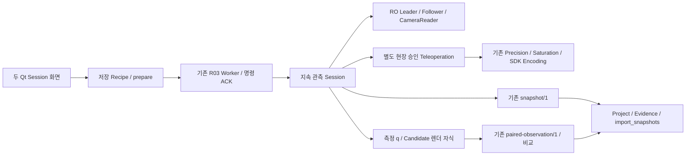

# Real2Sim Capture / Real-Sim — 지속 Session·Paired Capture

2026-10-29. 기준 `1e645745fc9d2d31ecfd1e48e535630bb495511d`, 개발 브랜치 `capture-paired-sessions`. 첨부 시안을 기준으로 두 화면을 전용 Session 화면으로 교체했다. **Scene 없는 Project의 반복 Snapshot, Builder 자동 등록, 명시 승인 Teleoperation의 메모리 장치 실행, 측정 q 기반 MuJoCo/Isaac 렌더와 Paired Capture·재렌더를 구현·검증했다. 실제 장치는 읽기 전용으로 연결해 Snapshot 두 개와 재연결을 확인했다. 실물 Goal/Torque 명령은 보내지 않았다.**

이미지의 예시 FPS·관절값·연결 상태를 실행 결과로 사용하지 않았다. 실물 6축 구동은 구현/Fake 검증 범위이며, 현장 승인·방향·범위·현재 Goal/Feedback/토크 조건을 확인한 실제 동작은 **미검증/BLOCKED**다. 기존 v8/Calibration/SDK/Dataset/Checkpoint를 변경하지 않았다. Push·Merge·설치·학습·새 v9 생성은 수행하지 않았다.

## 화면과 사용자 작업 순서

기존 `./run_workbench_ui.sh`로 실행한다. 기존 Qt/Backend 분리 환경을 사용한다. 새 환경의 선택 의존성은 `robot-learning-workbench[sessions]`로 선언했지만 이번에 설치하지 않았다. Camera/Serial SDK와 엔진은 Backend/렌더 자식만 소유한다.

**Real2Sim Capture:** Project 열기 또는 새 프로젝트 → 장치 설정 불러오기/편집/새 파일 저장 → 로봇 연결 → 관측/정합 상태 확인 → 필요한 경우 현장에서 Teleoperation 승인 → 자세 안정 후 현재 자세 Capture → 반복 → Teleoperation 중지 → 연결 해제 또는 Capture 작업 종료.

- 상단 Project 선택·열기·생성, 중앙 REAL SIDE/WRIST, Follower 측정 6축 rad/degree, 필요한 조작 버튼, 하단 Snapshot 목록·원본 Thumbnail·촬영 시각·품질·등록 상태를 배치했다.
- 우측은 장치 구성과 상태, 현재 Session/저장·시각의 의미다. Recipe/Worker 필드와 로그는 기본 화면에 나열하지 않는다.
- 설정 창은 기존 Device Profile·Camera JSON·Precision Profile·Robot Model/필요한 원본 Model을 선택한다. 포트 폼과 JSON/YAML 편집은 같은 RecipeEditor 버퍼를 쓴다. 저장된 구성은 다시 선택할 수 있으며 외부 경로의 선택도 표시한다. 임의 Python 실행 기능은 없다.
- 연결 중 Project·장치 구성·Candidate·엔진 변경을 막는다. 검사한 파일의 변경은 Prepared identity가 거부한다. 연결은 관측만 시작하며 Teleoperation 승인을 대신하지 않는다.
- 연결 해제는 현재 Worker/장치를 닫고 Project·저장 목록을 유지한다. 작업 종료는 같은 정리를 마친 뒤 해당 Session의 종료를 표시하며 Workbench 전체를 닫지 않는다.

**Real / Sim:** Project·검토 중 Candidate 선택 → 엔진/저장 구성 선택 → 연결 → 실제 관측/선택적 현장 Teleoperation → 안정 후 Real / Sim Capture → 비교·자동 등록 → 해제. 위쪽 REAL SIDE/SIM SIDE, 아래 REAL WRIST/SIM WRIST의 4분할이다. Sim은 최신 유효 Follower 측정 q에 대한 비동기 렌더이며 렌더 시간·결과 age를 따로 표시한다. 실제 카메라와 동시 노출했다고 표시하지 않는다.

Snapshot을 더블 클릭하면 원본·Sim·side-by-side/overlay/difference와 수치 Metadata를 연다. 연결 해제 후 목록의 Capture와 다른 Candidate를 선택하고 **선택 Capture를 현재 후보로 재렌더**하면 Real 원본을 공유하는 별도 결과를 만든다. Project 재열기는 등록된 Capture/Pairs를 다시 읽으며 과거 Candidate identity를 유지한다. 추정 Candidate는 Export/Calibration 승인 완료 Scene으로 표시하지 않는다.

[Capture 실제 Qt 화면 1320](evidence/capture-paired-sessions/final/capture-1320.png) · [1920](evidence/capture-paired-sessions/final/capture-1920.png), [Real/Sim 실제 Qt 화면 1320](evidence/capture-paired-sessions/final/real_sim-1320.png) · [1920](evidence/capture-paired-sessions/final/real_sim-1920.png). 이 네 장은 **MEMORY 합성 장치 + 실제 UI/렌더** 시험이며 실물 동작 화면이 아니다. [실제 읽기 전용 Capture 화면](evidence/capture-paired-sessions/hardware-capture.png), [Builder 입력 화면](evidence/capture-paired-sessions/builder-inputs.png), [파생 Pair 재열기](evidence/capture-paired-sessions/release/rerender-ui.png)도 보존했다. 사람의 장시간 데스크톱 UX 검증은 아니다.

## 책임 분리와 기존 기능 재사용

| 소유 파일 | 책임과 기존 API |
|---|---|
| `ui/session_page.py` | 두 작업의 화면·선택·버튼·상태·미리보기. SDK/모터 계산 없음 |
| `ui/session_settings.py` / `session_results.py` | 기존 스키마의 저장 버퍼·입력 편집 / 불변 저장 결과 표시 |
| `ui/session_client.py` / `session_operations.py` | BackendJob과 기존 R03 prepare/start/events/command ACK·Preview / 짧은 Builder Project 목록·생성·재열기 |
| `robot/session.py` | 한 연결의 Leader/Follower/Camera 수명, 관측·명시 명령·Snapshot transaction·종료 |
| `robot/supervised.py` | 현재 Session에만 결합한 6축 명령 권한. 기존 `command_target`, `checked_target`, Precision inverse, SDK 정수 Encoding 재사용 |
| `robot/session_devices.py` | 공식 SDK 읽기 전용 구성 또는 명시 Memory 장치, 기존 CameraReader. prepare는 연결하지 않음 |
| `robot/snapshots.py` / 기존 `capture.py` | 기존 `prepare_snapshot`, 시각/안정성/blur·mapping 검사, `real2sim.snapshot/1` 저장, 기존 Builder import |
| `robot/real_sim.py` / `candidate_isaac.py` / `render_worker.py` | Candidate/model/camera identity·기존 Builder measured FK·MuJoCo Renderer/USD Export·Isaac Camera, 읽기 전용 렌더 자식 |
| `robot/telemetry.py` | 별도 bounded 저장 작업으로 기존 Native HDF5 requested/target/feedback·timing 보존. 새 Dataset 형식 없음 |
| Builder `capture.py` / `ui.py` | Scene 전 미결합 실측의 Evidence 등록, 원본 보존, 명시 GLB/사진/Capture 수동 Import와 입력 목록 |

구형 `robot/live.py`는 최대300 frame의 유한 관측·오프라인 검토이므로 지속 Session과 합치지 않았다. 두 탭의 구형 WorkflowPage 버튼/관측 화면 분기는 제거했고 Precision·Observe Only·명시 기존 Offline Recipe는 독립 기능으로 유지한다. 새 거대 Manager·Adapter·전역 장치 상태·새 Capture/Dataset 포맷은 없다. UI 구성 클래스는 약200줄, Session은 약210줄이며 화면/장치/렌더 수명을 한 클래스에 넣지 않았다. 밀집된 기존 프로젝트 스타일의 문장은 가독성 개선 여지가 있지만 중복 실행 구현을 남기는 방식으로 연결하지 않았다.

## 저장·시각·Builder 계약

Project는 연결 전에 필요하며 완성된 Scene Package는 필요하지 않다. 명시 URDF/관측 Precision Profile을 사용한다. 과거 Profile과 실행 URDF가 다르면 명시 `source_robot_model`과 기존 limit-only binding 검증이 필요하다. Robot Base/K/Extrinsic을 알아서 identity나 가짜 측정값으로 채우지 않는다.

각 명령은 새로운 Follower 관측을 확보한다. 정합된 관측을 얻기 위한 대기는 최대5초이며 **skew100ms/age200ms·연속 측정/안정성 조건을 그대로 검사**한다. 실패 시 재촬영 이유를 남긴다. Camera 수신 시작/완료·sequence·관절 Raw/Native/model rad·시각·Calibration/model/device identity·안정성·blur를 저장한다. 동일 Camera sequence의 재사용은 거부한다. Host receipt 시각이며 hardware exposure timestamp가 아니다. 정지 관측의 `q_command=null`이며 학습 Action을 생성하지 않는다.

현재 포맷은 기존 **`real2sim.snapshot/1` + `real2sim.paired-observation/1`**이다. 원본 model closure는 기존 공유 함수, RGB는 원본640×480 PNG다. 파일 작성/Hash·공식 Reader 확인 → 닫힌 Snapshot → 기존 Builder lock/transaction Import → 완료 ACK 순서다. 이미 Project 내부에 소유한 자료는 다시 bulk copy하지 않는다. Builder 실패 시 Metadata rollback 및 원 실측 보존, 중복 Import 거부를 시험했다. Pair 렌더 중/저장 중 임의 재시도는 차단하며 실패한 transaction만 복구한다. 중단된 pending은 결과 보고서에 위치를 남기며, 다른 Worker가 사용하지 않는 상태에서 Builder의 명시 Capture/Snapshot Import로 검토·등록할 수 있다. 전원 장애/모든 filesystem 장애의 자동 복구 보장은 아니다.

미결합 Capture는 Project `input/evidence.yaml`에 **ARCHIVED_OBSERVATIONS_ONLY / NEEDS_MORE_DATA / eligible=false**로 등록한다. 기존 Current Scene을 만들거나 덮어쓰지 않는다. 실제 Robot Base·Camera 보정 없이는 Reconstruction 적격성이 되지 않는다. `scene_state_id`는 Project의 그룹 표식이며 실제 고정 Object layout이 검증됐다는 뜻이 아니다. `static_layout_verified=false`, `physical_verified=false`를 유지한다.

Builder Inputs에는 GLB 추가, 여러 사진 추가, Capture/Snapshot 등록과 종류/Source/SHA/상태/필요 근거 목록을 연결했다. GLB는 기존 `scan.import_scan`, 사진은 `evidence.add_image`, Capture는 기존 Reader/Import다. GLB scale/base Registration이나 사진 pose를 자동 승인하지 않는다. 새 Reconstruction 알고리즘은 추가하지 않았다.

## Teleoperation의 명령 권한과 안전 경계

기존 RO Device의 `read_only`·activate/send 차단을 바꾸지 않았다. 별도 `Teleoperation` 권한은 다음 순서다.

1. 실제 Identity/Calibration register·mapping·6축/order/unit/finite·승인 model/motor 교집합을 검사한다.
2. 현재 Follower Raw/Goal/position-mode/torque·측정 q·Leader 첫 목표를 읽는다. 초기 Goal/feedback 불일치, 승인 구간 밖 실측, 초기 target jump는 거부한다. 자동 Home/Hold/Goal 정렬은 없다.
3. UI의 새 proposal SHA와 감독·주변 위험·전원 차단·방향·범위·Torque 유지 확인6개를 **사용자가 직접** 승인한다. 제안30초 만료·단일 사용·실행 직전 상태 exact 재확인이다.
4. 필요한 Torque 활성화는 그 승인 뒤에만 하며 SDK configure/모터 재설정은 하지 않는다. 활성화 readback·200ms deadline이 실패하면 Goal을 보내지 않는다.
5. 기존 `command_target`의 mapping→inward Saturation→Precision inverse→정수 Encoding·양자화 범위 검사 뒤 이전 적용 목표 변화/추종 오차를 재검사한다. stale feedback·Leader/heartbeat·200ms control/send deadline은 추가 명령을 차단한다. 중복 SDK Goal은 억제하고 timeout 후 재전송하지 않는다.

사용자 명령은 기존 영속 R03 ACK를 유지한다. 주기 heartbeat는 최신 값 하나만 원자적으로 전달하는 내부 생존 신호다. 이를 매번 영속 ACK로 쌓던 초기 구현은 관측 지연을 유발해 제거했다. Session3초/명령권한1.5초 watchdog, feedback/Leader100ms·control/send200ms 경계는 별도다. GUI 숨김/탭 전환은 표시 상태가 늦어도 무조건 권한 Stop을 보내며 승인 대화상자를 닫는다. 같은 batch의 Stop/cancel은 시작·Capture보다 우선한다.

Stop/Disconnect/Close는 새 명령을 차단하고 **Torque를 유지**한다. 중력 하중이 있는 로봇에 임의 Torque Release를 보내지 않으며 현장 정지 수단이 필요하다. UI 종료는 실제 Worker/장치 정리를 기다린다. SDK 송신 시도의 requested·목표 payload·실측·raw packet·시각은 실패 시에도 `effect=unknown`으로 보존한다. SDK 응답을 실제 물리 도달로 표시하지 않는다. Native의 다음 측정값이 있는 행과 마지막 미확인 명령 기록을 구분하며 `training_ready=false`다.

이번에 현장6축 구동 승인·실제 Torque 활성화/Goal 전송은 수행하지 않았다. 현재 관측값/초기 Goal·안전 방향·실제 기계 범위·Calibration 정확도·현장 정지 조건을 승인한 것으로 간주하지 않는다. 승인 체크를 자동으로 채운 Qt 시험은 **device_source=memory**에만 제한했다.

## Candidate 렌더·Pair·비교

선택 Candidate는 Project 내부 파일이며 model SHA·실제 FK URDF bytes·관절 순서/Mapping·Side/Wrist640×480 선언이 맞아야 한다. 입력/code/asset closure는 Prepared identity로 고정한다. 렌더 내부는 검증된 SHA를 매 tick 다시 계산하지 않고 stat 변경 때 재검증한다. 원본 공유 hardlink 증가를 내용 변경으로 오인하지 않는다.

측정 q를 기존 Builder `observation_scene`/FK에 적용하고 MuJoCo의 기존 Renderer 또는 기존 USD Export + Isaac Lab Camera로 RGB를 얻는다. **Physics Step0의 authoring Candidate 정적 렌더**다. v8 Native Physics Rollout/Articulation 제어 동등성 검증은 아니다. 승인된 기존 simulation offset이 있으면 별도로 결합·기록하고 measured와 applied sim q의 차이를 남긴다. Render는 별도 자식이므로 Camera/RGB·Kit 초기화가 Serial 제어를 소유하지 않는다. 최신 요청/Live2slot만 유지하며 Pair는 한 건씩 frozen q로 처리한다. 종료는 자신의 child만 TERM/KILL로 bounded 정리한다.

Pair에 Real2+Sim2·frozen 측정 q·적용 Sim q·Camera K/world pose·Candidate/Model/Calibration SHA·엔진·렌더 시각·품질·비교 Metadata를 저장한다. 실제와 Sim의 시간 차이를 동시 노출로 해석하지 않는다. 원 Real을 편집하지 않고, 재렌더는 원 이미지/model을 hardlink하며 바뀐 결과/Metadata만 새 identity로 게시한다. 게시된 Pair에 임시 IPC 경로를 넣지 않고, 성공 후 소유 렌더 transport만 정리한다. 정리 경고로 이미 닫힌 Capture 성공을 실패로 바꾸지 않는다.

RGB MAE/RMSE/edge IoU와 side-by-side/overlay/difference는 기존 Builder `validation.compare`다. **새 Capture에 대응 Landmark/Mask가 없으면 geometry는 UNMEASURED**다. 제공된 근거가 있는 MuJoCo 재렌더는 기존 `object_metrics`와 object-ID mask를 사용한다. 합성 대응점/Mask 시험에서 landmark RMSE0·mask IoU1을 확인했으며 실제 기하 정확도 검증이 아니다. Isaac의 object-mask 비교는 이번 경로에서 측정하지 않았으며 Pixel 결과만 제공한다. Pixel MAE 변화만으로 Geometry/Camera/Base/Lighting/Texture의 원인을 확정하지 않는다.

## 실제 실행과 소비자 검증

| 경로 | 실제 결과 / 범위 |
|---|---|
| 최종 Qt Capture → R03 | 새 Scene 없는 Project, MEMORY 장치 한 번 연결, Snapshot2·각 Side/Wrist640×480, Builder 등록·해제 |
| 최종 Qt Real/Sim → R03 | 명시 MEMORY 승인 Teleoperation, 실제 MuJoCo 렌더, Pair2, 중지·작업 종료. Native 완료 측정행3개/6축·가상 장치이며 실제 팔 아님 |
| 최종 Qt 다른 Candidate 재렌더 | 기존 Pair1을 새 Candidate로 파생, 원 파일 SHA 전부 불변·Real PNG 같은 inode, Builder 재열기 |
| 실제 Hardware RO Qt | 실제 Leader/Follower+양 Camera 연결, Snapshot2, disconnect→reconnect→finish, 완료 Worker2, 금지 register-write/Torque API 시도0 |
| 실제 Isaac 렌더 | 합성6축 Candidate static render1과 실제 RO Snapshot 기반 파생 Pair1. 실제 saved q 적용·physics_steps0·기존 Reader 소비 |
| Builder 수동 Import UI | 합성 GLB1·합성 사진1·보존 실측 Capture1, 기존 CLI Worker 사용·입력 목록5행·원 입력 불변 |

위 표는 선택한 최종 결과다. 초기 실패/진단 결과를 지우거나 상속 Snapshot을 신규 수로 중복 계산하지 않는다. 총 실제 실물 Snapshot은2개이며 별도 파생 Pair는 새 실제 촬영이 아니다. Fake/통제 시험을 Hardware 실행 횟수로 세지 않는다.

실물 읽기는 장치 ID/보정·Raw/Native/model-rad와 실제 Camera RGB를 확인했다. 쓰기 차단 guard가 production SDK의 register-write/torque API를 감시했으며 Worker별 로드 기록·시도0을 남겼다. 별도 wire analyzer/이번 Goal·Torque register 전후 전수 대조라고 주장하지 않는다. 최종 수신률의 한 관측창은 Side **15.271FPS**, Wrist **8.535FPS**다. 요청30FPS와 다르며 전체 성능 benchmark가 아니다. 개별 저장 Snapshot은 skew/age 제한을 통과했다. Wrist blur/texture 경고는 두 실제 Snapshot 모두에 남아 Calibration 부적격이다. Preview의 다른 시점에는 Wrist skew100ms 초과가 표시될 수 있으며 그 시점의 Capture는 대기/거부한다.

실제 RO Snapshot q의 Isaac 렌더1은 약**5,058.951ms**, 적용 Sim q−measured q는6축0, Physics Step0이었다. Pixel MAE(0..1)는 Side 약**0.4908565**, Wrist 약**0.6679303**다. 검증용 Candidate의 Camera는 **estimated fixture**이고 v8/새 실측 Calibration이 아니다. Geometry는 UNMEASURED다. 장치 연결을 새로 하지 않고 보존된 실제 관측을 렌더한 결과다.

공식 Builder `load_session/load_snapshots`, 전체 Metadata/PNG SHA, 실제 RGB shape/Camera timing·q, Project input closure, Pair/원본 공유, Fake Native Reader 소비는 [consumer-results.json](evidence/capture-paired-sessions/consumer-results.json)에 있다. SDK/Calibration·Task 성공·실제 물리 접촉·실물 전축 동작을 이 검사로 승인하지 않는다.

## 회귀·리뷰·보존

**최종 전체 1,122 passed / skipped0 = 기준1,082 + 신규40**, 기존 torchvision 경고4개다. 최종 전체 회귀 결과와 wheel source identity는 `docs/evidence/capture-paired-sessions/verification.json`에 고정한다. 실제 Qt/SDK read/엔진 Render와 pytest fixture는 별도 증거다. 기존 Source/Annotation/DataGen/IK/Native/Resume/Curation/LeRobot/ACT/SmolVLA/Diffusion/Hub·Builder·Scene Contract 회귀를 실행했으며 새 Training/물리 DataGen은 수행하지 않았다. 기존 torchvision 영상 deprecation 경고4개는 남는다. 별도 lint/type 도구 설치나 실행은 없다.

독립 Standards/Spec 두 축 리뷰에서 초기 SDK deadline·중복 Goal·FK URDF·Pair baseline·동기 저장, cleanup 실패의 정상 완료 승격, 저장 중 retry, 연결 중 Project 변경, 숨김 페이지의 늦은 활성화·실패 송신 진단 문제를 RED→GREEN으로 수정했다. 최종 두 축 High/Medium 잔여0을 확인했다. 외부 설정을 불러온 뒤 선택명이 비는 마지막 표시 오류도 별도 재현·수정했다. 안전 검사·Native atomic publish·원본 보존을 단순화 대상으로 삭제하지 않았다.

[보존 대조](evidence/capture-paired-sessions/preservation-after.json): 원본 **56,100개 stat**, 원본 Python **187개 SHA**, 선택 과거/SDK **57개 SHA**, 보존 입력 **47개 SHA** 변화0. v8 전체 Manifest 검증 통과. 전체 SDK binary/corpus 전수 hash는 아니다. 기존 main=`ab94b87d3f579031db0c751f274c0ab7fe6b87e6`이며 기존 브랜치/원본은 유지한다. 증거 폴더는 기존 `.gitignore` 정책으로 공개 제외다. 로컬 기능 Commit만 작성하고 Push/Merge하지 않는다.

로컬 근거는 `docs/evidence/capture-paired-sessions/`의 RED/GREEN·최종 JUnit/wheel·RO guard/Worker 로그·소비자/보존·UI PNG와 두 축 리뷰다. 초기 UI harness의 `initial_feedback`은 mutable 표시 cache를 참조해 terminal 상태가 함께 보이는 한계가 있었다. 촬영 시점 주장은 불변 state.json/R03 events를 기준으로 검증했고 [기록](evidence/capture-paired-sessions/hardware-context-note.md)에 남겼다. 원 실측/판정은 수정하지 않았다.

## 남은 실제 검증

- 현장 승인된 실제6축 Teleoperation/토크·기계 범위·지속 추종·안전 정지/장치 단절·전원 장애는 미검증이다. 이번 실제 모터 쓰기는0이다.
- 실제 Camera 노출 동기화·물리 Robot Base/Extrinsic/Precision Calibration과 새로운 Scene Reconstruction/v9은 완료하지 않았다. Scene 전의 관측은 저장 가능하지만 정합 근거를 별도로 제공해야 한다.
- 실제 서로 다른 팔 자세의 다중 관측은 무인으로 만들지 않았다. Fake Teleoperation/반복 Capture와 실제 정지 RO Capture를 구분한다.
- 장시간 Session/임의 엔진·모든 Candidate/모든 파일 장애/OOM은 미검증이다. Camera blur와 낮은 수신률은 해결됐다고 보고하지 않는다.
- 기존 E01 물체 잔차, 미확인 실물 command binding/motor 범위·실측 정확도 등 기존 OPEN을 승격하지 않는다. 이번 작업은 두 Session UI·관측/Pair/저장 범위에서 종료한다.

공식 API 근거: [Qt6.11 QProcess](https://doc.qt.io/qt-6.11/qprocess.html), [LeRobot0.4.1 SO101 Follower](https://raw.githubusercontent.com/huggingface/lerobot/v0.4.1/src/lerobot/robots/so101_follower/so101_follower.py), [Feetech Bus](https://raw.githubusercontent.com/huggingface/lerobot/v0.4.1/src/lerobot/motors/feetech/feetech.py), [Isaac Lab2.3 Camera](https://isaac-sim.github.io/IsaacLab/v2.3.0/source/api/lab/isaaclab.sensors.html). 설치된 고정 소스와 실제 호출/실행 검증을 우선 사용했다.
