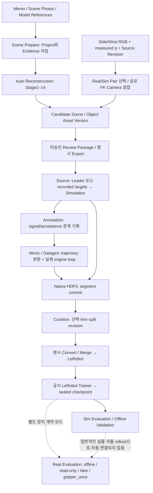
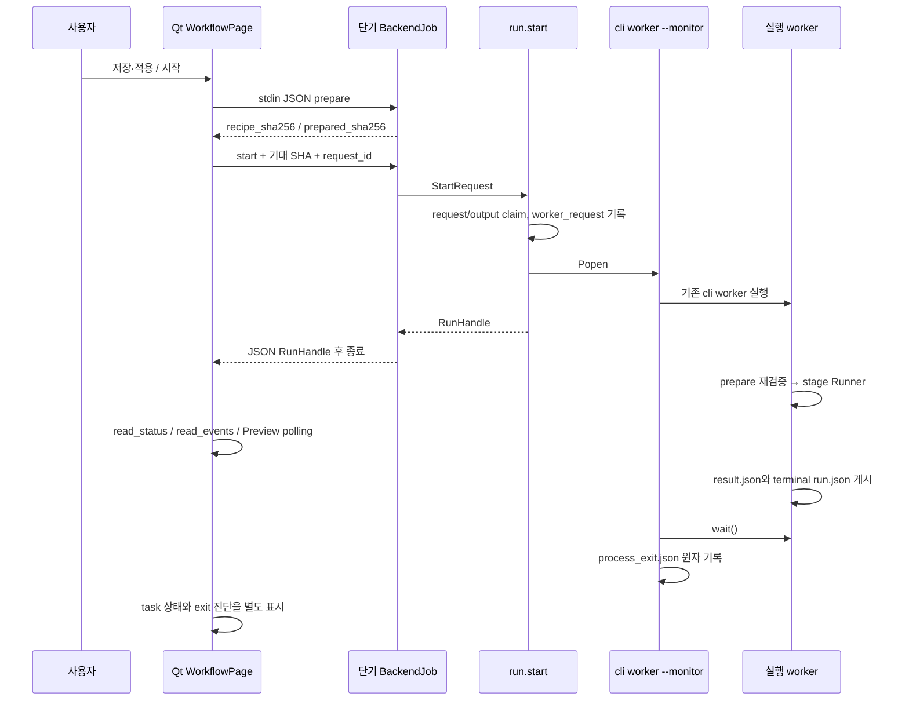
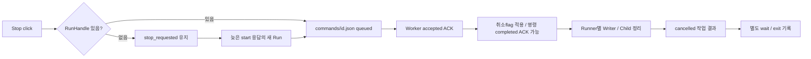

# 01. 시스템 구조: 화면의 요청이 파일과 Worker가 되는 과정

[처음](README.md) · [구조](01-system-architecture.md) · [재구성](02-scene-reconstruction.md) · [좌표·자산](03-camera-assets-simulation.md) · [학습](04-robot-learning.md) · [결함](05-bug-fixes-explained.md) · [코드 지도](06-source-code-atlas.md) · [실습](07-execution-and-debugging.md) · [용어](08-glossary-and-learning-path.md)

기준은 `8e02b1ae023a856694a40b947881f76b66410624`의 현재 소스다. 이 장은 코드를 읽기 위한 구조 설명이며 실행 결과 보고가 아니다. 문서화 중 모델·장치·시험을 실행하지 않았다.

## 목차

- [1. 먼저 구별할 세 프로그램](#architecture-programs)
- [2. 전체 Workflow와 수동 연결](#architecture-workflow)
- [3. 패키지와 데이터 계약](#architecture-contracts)
- [4. 실행 버튼의 실제 경로](#architecture-start)
- [5. R03의 파일 IPC와 상태](#architecture-r03)
- [6. 일곱 가지 상황을 따라가기](#architecture-scenarios)
- [7. 저장 위치와 불변성](#architecture-storage)
- [8. 외부 SDK와 구현 한계](#architecture-sdk)
- [9. 이 구조에서 배울 원칙](#architecture-lessons)

<a id="architecture-programs"></a>
## 1. 먼저 구별할 세 프로그램

한 저장소이지만 하나의 Python 프로세스가 모든 일을 하는 구조가 아니다. 화면을 그리는 Qt Interpreter, 파일 검사·준비를 수행하는 Backend Interpreter, 긴 작업을 수행하는 Worker의 수명을 구별해야 한다. 예를 들어 `ui.jobs.BackendJob`가 끝났다는 것은 **그 한 번의 Backend 요청이 끝났음**을 뜻한다. 별도로 시작한 학습 Worker가 끝났다는 뜻이 아니다.

| 부분 | 실제 구현 | 입력 → 출력 | 분리 이유와 주의점 |
|---|---|---|---|
| Qt 화면 | [ui.app.Window · L12](../../robot_learning_workbench/src/robot_learning_workbench/ui/app.py#L12), [ui.workflow.WorkflowPage · L14](../../robot_learning_workbench/src/robot_learning_workbench/ui/workflow.py#L14) | 사용자 조작 → Backend 요청, 상태 조회 → 위젯 | Qt 이벤트 루프가 Renderer/Trainer의 긴 실행을 직접 맡지 않는다. 화면이 멈추지 않게 한다. |
| 단기 Backend | [ui.jobs.BackendJob.start · L21](../../robot_learning_workbench/src/robot_learning_workbench/ui/jobs.py#L21), [ui.operations.execute · L134](../../robot_learning_workbench/src/robot_learning_workbench/ui/operations.py#L134) | stdin JSON operation/arguments → stdout JSON result/error | Qt의 QProcess가 소유한다. 파일 읽기·검사와 실제 실행 시작을 구별한다. HTTP 서버가 아니다. |
| 장기 R03 작업 | [run.start · L171](../../robot_learning_workbench/src/robot_learning_workbench/run.py#L171), [run.execute · L475](../../robot_learning_workbench/src/robot_learning_workbench/run.py#L475) | 저장 Recipe + SHA → PreparedRun → StageResult | request claim, command/ACK, 이벤트, Preview, 최종 결과를 파일로 남긴다. |
| 재구성 실행 | [ui_reconstruction.ReconstructionDialog · L50](../../real2sim_builder/src/real2sim_builder/ui_reconstruction.py#L50), [automation.reconstruct · L305](../../real2sim_builder/src/real2sim_builder/automation.py#L305) | Project/Candidate/설정 → Stage1–14 결과 | 이것은 R03의 `source/annotation/train` Stage와 다른 Stage 체계다. 같은 이름의 상태를 섞지 않는다. |
| 외부 실행 | [stage_runtime.invoke · L142](../../real2sim_builder/src/real2sim_builder/stage_runtime.py#L142), [inference._run_worker · L393](../../real2sim_builder/src/real2sim_builder/inference.py#L393), [learning.train.train · L104](../../robot_learning_workbench/src/robot_learning_workbench/learning/train.py#L104) | 검증된 요청 → GPU/Blender/공식 Trainer Child | 각 경계의 Runtime과 종료 규칙이 다르다. 모든 Child가 같은 timeout/kill 정책이라고 가정하지 않는다. |

`Window`는 네 탭을 실제로 구성한다: Scene Prepare, Real/Sim, Workspace Pipeline, Precision Calibration. Workspace Pipeline은 Source Demo, Annotation, Mimic/Datagen, Curation, Training, Evaluation, Hub 페이지를 묶는다. 각 페이지를 선택했다고 다음 작업이 자동 실행되는 것은 아니다. [ui.app.Window.select_stage · L78](../../robot_learning_workbench/src/robot_learning_workbench/ui/app.py#L78)는 페이지 선택과 설정 노출을 바꾸며, 실제 실행은 해당 페이지 버튼이 시작한다.

<a id="architecture-workflow"></a>
## 2. 전체 Workflow와 수동 연결



이 그림의 화살표는 **자료를 소비할 수 있는 관계**다. 모든 화살표가 자동 실행되는 것을 뜻하지 않는다. `run._run_stage`는 준비된 Recipe의 한 Stage를 골라 실행한다. Scene 재구성이 끝났다고 Annotation·변환·학습·실물 제어를 이어 실행하는 전역 자동 루프는 없다.

특히 다음은 사람이 자료와 목적을 확인해야 하는 경계다.

1. Scene 입력 저장과 metric Scene 완성은 별개다. [scene_preparation.scene_details · L20](../../robot_learning_workbench/src/robot_learning_workbench/scene_preparation.py#L20)는 입력 목록과 `reconstruction_ready/needs`를 따로 반환한다.
2. Stage13의 Package 생성과 Current 채택·승인된 실물 Task는 다르다. Python Exporter가 파일을 만들었다는 이유로 physical_verified를 true로 바꾸지 않는다.
3. 데이터 생성 완료는 “요청한 정책 Task가 성공했다”와 다르다. 실제 판정 함수·배치·관측이 무엇이었는지 보아야 한다.
4. 현재 Real Evaluation은 모드에 따라 offline/fake/관측/그리퍼 단회 권한이 달라진다. 일반적인 6축 실물 자율 정책 Rollout이 자동으로 연결됐다고 설명할 수 없다. [ui.operations.prepared · L29](../../robot_learning_workbench/src/robot_learning_workbench/ui/operations.py#L29), [run._run_stage · L443](../../robot_learning_workbench/src/robot_learning_workbench/run.py#L443), [robot.live.run · L55](../../robot_learning_workbench/src/robot_learning_workbench/robot/live.py#L55)을 함께 읽는다.

<a id="architecture-contracts"></a>
## 3. 패키지와 데이터 계약

### 3.1 세 패키지

| 패키지 | 현재 제품 Python | 소유 책임 | 대표 경계 |
|---|---:|---|---|
| `scene_contract` | 5 | 불변 실행 Package, 식별자, 파일 hash/closure, 좌표 Frame 검증 | [package.load_scene · L518](../../scene_contract/src/scene_contract/package.py#L518), [transforms.resolve_transform · L71](../../scene_contract/src/scene_contract/transforms.py#L71) |
| `real2sim_builder` | 48 | 입력 Evidence, 추정 Scene, Candidate, Reconstruction, 보정, 자산, Export | [project.Project · L74](../../real2sim_builder/src/real2sim_builder/project.py#L74), [candidate.Candidate · L36](../../real2sim_builder/src/real2sim_builder/candidate.py#L36), [automation.reconstruct · L305](../../real2sim_builder/src/real2sim_builder/automation.py#L305) |
| `robot_learning_workbench` | 124 | UI, 저장 Recipe, R03, 실제/가상 로봇 세션, 데이터·학습·평가 | [recipe.prepare_recipe · L355](../../robot_learning_workbench/src/robot_learning_workbench/recipe.py#L355), [run.execute · L475](../../robot_learning_workbench/src/robot_learning_workbench/run.py#L475) |

177개는 세 `src/` 아래 `.py`의 개수다. 문서·시험 209개 Python·설정·라이선스·실행 Shell은 이 수에 합치지 않았다. 37,927줄은 빈 줄과 주석을 포함한다. 전체 파일의 역할과 정적 참조는 [File Atlas](06-source-code-atlas.md)에서 확인한다.

### 3.2 이름이 비슷해도 같은 객체가 아니다

| 개념 | 실제 자료/타입 | 왜 필요한가 |
|---|---|---|
| Project | `project.yaml`, `input/evidence.yaml`, `working/state.json`; [project.Project · L74](../../real2sim_builder/src/real2sim_builder/project.py#L74) | 입력과 작업의 소유권. owner marker가 없는 원본 Project는 임의 쓰기를 거부한다. |
| Authoring Scene | `real2sim.scene/1`; [scene.empty · L28](../../real2sim_builder/src/real2sim_builder/scene.py#L28), [scene.value · L13](../../real2sim_builder/src/real2sim_builder/scene.py#L13) | 값마다 value/provenance/evidence를 보존하는 제작용 상태. null은 unknown이다. |
| Candidate | `scratch/agent/<name>/candidate.json` + `candidate_scene.yaml`; [candidate.Candidate.create · L47](../../real2sim_builder/src/real2sim_builder/candidate.py#L47) | Current와 분리된 수정 후보. save에서 validate/scope/preserve를 검사한다. |
| Revision / 실행 Package | `scene.json`, `manifest.json` 및 네이티브 USD/MJCF closure; [export.export_revision · L305](../../real2sim_builder/src/real2sim_builder/export.py#L305), [package.load_scene · L518](../../scene_contract/src/scene_contract/package.py#L518) | 실제 엔진이 소비할 불변 파일 집합과 content identity. 폴더 이름만으로 같은 Source라고 하지 않는다. |
| RecipeDocument | 저장 YAML의 원문 byte SHA와 파싱한 RecipeSpec; [recipe.read_recipe · L185](../../robot_learning_workbench/src/robot_learning_workbench/recipe.py#L185) | 검토한 파일과 실행하는 파일이 같은지 확인한다. |
| PreparedRun | 해석된 입력, scene_identity, function_bindings, effective_settings, code_identity; [recipe.PreparedRun · L234](../../robot_learning_workbench/src/robot_learning_workbench/recipe.py#L234) | YAML의 상대 경로·함수 선언을 실행 가능한 고정 계약으로 묶는다. 준비 시점과 실행 시점 사이 변조를 검출한다. |
| StageResult | status/output_refs/completed_episodes/attempt_summary; [run.StageResult · L100](../../robot_learning_workbench/src/robot_learning_workbench/run.py#L100) | Runner가 무엇을 게시했다고 주장하는지 전달한다. execute가 Artifact 존재와 Episode 수를 확인한다. |
| Native Catalog | [data.native.Catalog · L131](../../robot_learning_workbench/src/robot_learning_workbench/data/native.py#L131), [data.native.DatasetIdentity · L110](../../robot_learning_workbench/src/robot_learning_workbench/data/native.py#L110) | 실제 게시 Episode의 읽기 경계. pending writer나 단순 HDF5 존재를 완료 Dataset으로 취급하지 않는다. |

Authoring Scene과 `scene_contract`의 실행 `ScenePackage`와 그 안의 검증된 `scene.json` Mapping은 동일한 JSON이 아니다. Export가 두 계약 사이를 변환하고 파일 의존성을 Package 안으로 모은다. `T_parent_child`와 `T_parent_from_frame`처럼 이름도 다르므로 파일을 임의 복사해 서로 대체하지 않는다.

### 3.3 PreparedRun을 코드로 읽기

<!-- source: robot_learning_workbench/src/robot_learning_workbench/recipe.py:L234-L249 -->
```python
class PreparedRun:
    recipe_sha256:str
    stage:str
    engine:str|None
    resolved_inputs:Mapping
    scene_identity:Mapping|None
    object_order:tuple
    function_bindings:Mapping
    effective_settings:Mapping
    code_identity:str
    output_path:Path
    pending_checks:tuple
    input_documents:Mapping
    scene:object=None
    tasks:object=None

```

각 필드는 다음 질문에 답한다. `resolved_inputs`는 실제 어떤 경로/identity를 읽을 것인가, `function_bindings`는 어떤 Task 함수를 어떤 파라미터로 호출할 것인가, `effective_settings`는 기본값과 선언을 합친 실제 실행값이 무엇인가, `code_identity`는 같은 입력을 다른 구현으로 실행하고 있지는 않은가를 기록한다. `output_path`는 새 출력의 소유 범위다. 메모리의 Mapping을 동결하는 것과 원본 파일 byte가 불변인 것은 다르므로 [recipe.verify_prepared_inputs · L561](../../robot_learning_workbench/src/robot_learning_workbench/recipe.py#L561)가 실제 파일 identity도 다시 확인한다.

`prepare_recipe`는 YAML의 `isaaclab`을 내부 dispatch의 `isaac`으로 정규화한다. UI의 문자열과 `engines/isaac/` 디렉터리가 다른 것이 단순 오타가 아니다. 이 함수는 순수 JSON 검사만 하는 함수도 아니다. 입력·설정·Registry·외부 패키지 메타데이터를 읽어 준비하므로 임의 사용자 데이터에 실행하는 예제 대신 이 교재에서는 정적 추적을 우선한다.

<a id="architecture-start"></a>
## 4. 실행 버튼의 실제 경로

### 4.1 한 번의 실행을 두 번의 Backend 요청으로 준비한다

`WorkflowPage.start_run/apply_script`는 저장되지 않은 편집 상태, 진행 중 작업, 입력 선택을 확인한다. 먼저 `prepare` 요청을 보내고 `prepared_sha256`와 Recipe SHA를 확보한다. 사용자가 검토한 뒤 또는 기존 start-after-prepare 흐름에서 `start` 요청을 보낸다. `ui.operations.execute`는 **다시** 문서를 읽고 SHA와 준비 결과를 비교한 뒤 `run.start(StartRequest(...))`를 호출한다.



핵심 구현은 [ui.jobs.BackendJob.start · L21](../../robot_learning_workbench/src/robot_learning_workbench/ui/jobs.py#L21) → [ui.operations.execute · L134](../../robot_learning_workbench/src/robot_learning_workbench/ui/operations.py#L134) → [run.start · L171](../../robot_learning_workbench/src/robot_learning_workbench/run.py#L171) → [cli.main · L20](../../robot_learning_workbench/src/robot_learning_workbench/cli.py#L20) → [run.execute · L475](../../robot_learning_workbench/src/robot_learning_workbench/run.py#L475)다. UI `BackendJob`는 stdout을 모아 JSON 한 건을 파싱하고 stderr를 로그로 보낸다. Worker stdout은 제어 스트림이 아니라 `stdout.log`의 진단이다. commands/events는 별도 파일 계약이다. 이 구분이 없으면 Worker가 출력한 임의 JSON을 완료 응답으로 오인할 수 있다.

### 4.2 request_id는 재시도를 위한 영수증이다

[run.start · L171](../../robot_learning_workbench/src/robot_learning_workbench/run.py#L171)는 `requests/<request-id-hash>.json`을 독점 생성한다. 같은 request_id와 같은 payload라면 기존 RunHandle을 반환한다. ID는 같고 payload가 바뀌면 REQUEST_CONFLICT다. claim이 반쯤 생기고 spawn 증거가 없으면 RUN_STATE_UNKNOWN으로 남기며 지우고 새 작업을 실행하지 않는다. 이것이 Idempotency다. “무조건 다시 실행”과 달리 같은 Dataset을 두 번 생성하는 일을 막는다.

출력 경로에는 `.workbench-output-<hash>.json` 예약도 있다. Recipe의 output과 StartRequest output이 같아야 하며 이미 존재하는 임의 출력에 덮어쓰지 않는다. resume가 지원된 Source/Datagen은 기존 Dataset 종류·stage·engine 계약까지 별도로 검사한다.

<a id="architecture-r03"></a>
## 5. R03의 파일 IPC와 상태

### 5.1 파일마다 답하는 질문이 다르다

아래는 개념적 경로 도식이며 실제 사용자 폴더의 목록이나 원본은 아니다.

```text
<output-parent>/.workbench-runs/
  requests/<hash>.json       # 동일 요청을 중복 실행하지 않을 claim
  <run-id>/
    worker_request.json     # 실행할 저장 Recipe/SHA/Worker token
    spawn.json              # Popen acknowledgment / launcher identity
    worker.claim            # 실제 execute 독점 실행 증거
    recipe.yaml             # 준비한 저장 Script snapshot
    run.json                # 현재 작업 status/phase/progress
    events.jsonl            # seq가 있는 작은 이벤트
    commands/<id>.json      # protocol_version=1 명령 envelope
    acks/<id>.json          # queued와 구별되는 accepted/completed/rejected
    result.json             # terminal 작업 결과
    process_exit.json       # 실제 Child 종료 코드/PID/관측시각
    stdout.log              # 진단 출력
    preview/                # 최신 제한 Preview 슬롯
```

정확한 파일 생성은 [run.start · L171](../../robot_learning_workbench/src/robot_learning_workbench/run.py#L171), [run.execute · L475](../../robot_learning_workbench/src/robot_learning_workbench/run.py#L475), [run._append_event · L259](../../robot_learning_workbench/src/robot_learning_workbench/run.py#L259), [run.send_command · L348](../../robot_learning_workbench/src/robot_learning_workbench/run.py#L348), [run.preview_session · L575](../../robot_learning_workbench/src/robot_learning_workbench/run.py#L575)에서 확인한다. 모든 파일이 모든 단계에서 존재하는 것은 아니다. 예를 들어 모델 Preview가 없는 작업에는 해당 RGB 슬롯이 필요 없다.

### 5.2 Atomicity는 “보여도 되는 시점”을 정하는 기술이다

<!-- source: robot_learning_workbench/src/robot_learning_workbench/run.py:L31-L36 -->
```python
def _atomic(path,value):
    temp=path.with_name('.'+path.name+'.'+uuid.uuid4().hex)
    try:
        with temp.open('xb') as f:f.write(_bytes(value));f.flush();os.fsync(f.fileno())
        os.replace(temp,path);_sync(path.parent)
    finally:temp.unlink(missing_ok=True)
```

첫 줄은 최종 경로와 같은 부모의 임시 이름을 만든다. `xb`는 이미 있는 임시 파일을 재사용하지 않는다. byte를 기록하고 flush/fsync한 뒤 `os.replace`로 한 이름을 교체한다. 마지막으로 부모 디렉터리도 동기화한다. Consumer는 절반 JSON보다 이전 또는 새 완성 JSON을 보게 된다. 이것이 여러 파일을 동시에 하나의 트랜잭션으로 묶는다는 뜻은 아니다. Dataset의 segment commit, Checkpoint seal은 각각 더 큰 의미의 별도 게시 경계다.

### 5.3 상태를 네 축으로 읽는다

| 축 | 예 | 알 수 있는 것 / 알 수 없는 것 |
|---|---|---|
| 작업 상태 | completed / failed / cancelled | R03 Runner가 반환·실패한 결과. `completed`가 정책 Task 성공을 뜻하지 않는다. |
| phase/progress | preparing / running / terminal, tick·Episode | 어느 실행 단계인지. terminal 게시 직후에도 OS 프로세스는 살아 있을 수 있다. |
| 도메인 결과 | Task success=false, 목표 Episode 미달, Dataset 게시 | 엔진/Task/Writer의 의미. 프로세스 정상 종료만으로 만들 수 없다. |
| 프로세스 종료 | exit_code=null / 0 / 7 / -15 | wait로 실제 관측한 종료. null은 아직 관측하지 않았거나 Legacy라는 뜻이며 0의 축약이 아니다. |

[run.read_status · L130](../../robot_learning_workbench/src/robot_learning_workbench/run.py#L130)는 `RunStatus.error`와 `process_error`를 분리한다. 예를 들어 completed+exit7은 완료 Artifact를 보존하면서 WORKER_EXIT_NONZERO를 추가한다. [ui.operations.run_outcome · L16](../../robot_learning_workbench/src/robot_learning_workbench/ui/operations.py#L16)의 기존 worker_finished는 terminal 작업 여부이고 process_finished는 관측 exit의 존재다.

<!-- source: robot_learning_workbench/src/robot_learning_workbench/run.py:L154-L169 -->
```python
def _monitor(process,run_dir,*,execution_child=True):
    code=process.wait()
    try:
        current=_read(run_dir/'run.json')
        # A starter also reaps its launcher. Only the actual execution PID may
        # supply worker exit metadata (including direct legacy/test launches).
        if not execution_child and current.get('worker_identity',{}).get('pid')!=process.pid:return code
        if current['status'] not in ('completed','cancelled','failed'):
            _status(run_dir,'failed','terminal',error={'code':'WORKER_EXITED','message':f'worker exited with {code} before terminal record','issues':[],'effect':'unknown'})
    except (RunError,OSError):
        if not execution_child:return code
    # Shutdown is a separate fact; never rewrite a published terminal task result.
    if type(code) is int:
        _atomic(run_dir/'process_exit.json',{'exit_code':code,'pid':process.pid,'observed_at_ns':time.time_ns()})
    return code

```

`wait()`는 실제 Child의 종료를 기다린다. terminal이면 기존 작업 결과를 다시 failed로 쓰지 않는다. 아직 terminal이 아니면 기존 WORKER_EXITED 실패 처리를 적용한다. 마지막 별도 파일은 두 경우 모두 실제 exit를 기록한다. `--monitor`의 Launcher와 실행 PID를 구분하는 분기도 있어 Launcher의 exit를 Worker의 값으로 바꾸지 않는다. 자세한 실패 재현과 UI Consumer는 [NEW-03 해설](05-bug-fixes-explained.md#new-03)에서 읽는다.

<a id="architecture-scenarios"></a>
## 6. 일곱 가지 상황을 따라가기

### 6.1 실행 버튼

`WorkflowPage` → 단기 prepare → 준비 SHA → 단기 start → `run.start` claim → Monitor → 실행 worker → `execute` 재준비/입력 검증 → `_run_stage`. Runner는 `events`와 `commands` 콜백을 받는다. Runner가 반환한 output_refs는 실제 존재해야 하고 completed_episodes는 게시 Native 수보다 클 수 없다. 생성 파일과 실패 코드는 위 표에서 찾는다. 관련 시험은 [test_run_claims.py](../../robot_learning_workbench/tests/test_run_claims.py), [test_worker_protocol.py](../../robot_learning_workbench/tests/test_worker_protocol.py)다.

### 6.2 Stop

UI의 Stop은 완료 상태를 임의로 찍는 버튼이 아니다. [ui.workflow.WorkflowPage.cancel_run · L229](../../robot_learning_workbench/src/robot_learning_workbench/ui/workflow.py#L229)은 아직 start 응답을 기다린다면 stop_requested를 남기고, RunHandle을 받으면 새 Run을 대상으로 동일 command_id의 cancel을 전송한다. [run.send_command · L348](../../robot_learning_workbench/src/robot_learning_workbench/run.py#L348)는 commands 파일을 쓰고 queued를 반환한다. Worker가 `_poll_commands`에서 받아 accepted ACK를 게시한다. completed ACK의 의미는 Runner별로 확인해야 한다. Source/Trainer는 취소 flag를 적용한 시점에 completed ACK를 낼 수 있고 실제 Writer/Child 정리는 뒤에 이어진다. Convert는 Writer 정리가 끝난 뒤 ACK를 내는 별도 구현이다. 정리 결과는 StageResult cancelled·게시 파일·실제 exit로 별도 확인한다. 명령 전달·적용·정리·프로세스 종료는 각각 다른 시점이다.



하나의 blocking SDK call 안에서 Cancel을 즉시 처리한다는 보장은 없다. R03의 협력적 취소와 Builder GPU Provider의 timeout/process-group cleanup은 다른 경계다. 관련 시험: [test_workflow_lifecycle.py](../../robot_learning_workbench/tests/test_workflow_lifecycle.py), [test_conversion_cancel.py](../../robot_learning_workbench/tests/test_conversion_cancel.py).

### 6.3 Step을 두 번 누름

[ui.workflow.WorkflowPage.command · L139](../../robot_learning_workbench/src/robot_learning_workbench/ui/workflow.py#L139)는 pending_step_id 동안 새 클릭을 막는다. Backend는 별도로 [commands.control_commands · L4](../../robot_learning_workbench/src/robot_learning_workbench/commands.py#L4)에서 이미 실행 중인 Step이 있으면 새 ID를 rejected로 ACK하고 기존 Step을 계속한다. 같은 ID 재전달은 원래 완료 ACK를 기다리며 premature completed를 만들지 않는다. UI와 Backend를 모두 검사해야 외부 CLI가 위젯 guard를 우회해도 안전하다. Vector 환경의 개별 Step 권한은 별도 거부 규칙이다. [test_step_command_conflicts.py](../../robot_learning_workbench/tests/test_step_command_conflicts.py)를 읽는다.

### 6.4 정상 작업 완료

Runner가 실제 산출물을 닫고 StageResult를 반환한다. `execute`는 계약을 검사하고 `result.json` → terminal `run.json` → status event를 게시한다. 이후 실제 interpreter가 종료돼 Monitor가 exit0을 기록한다. Qt는 Dataset Catalog를 필요 시 다시 열어 결과를 확인한다. “상태가 completed이므로 파일은 정상일 것”이라는 역추론 대신 실제 파일 Consumer를 사용한다.

### 6.5 완료 후 exit7

terminal 작업을 게시한 뒤 shutdown에서 예외/비정상 종료가 나면 Monitor가 process_exit.json에 7을 남긴다. 기존 run.json/result.json/Native Episode는 유지된다. Workflow는 `작업 completed`와 `Process exit 7 (비정상 종료)`를 함께 표시한다. SessionClient는 terminal 신호를 한 번만 내보낸 뒤 새 exit 진단을 기다려 오류/로그에 한 번 전달한다. Legacy 기록에 가상의 exit0을 채우지 않는다. [test_worker_exit_status.py](../../robot_learning_workbench/tests/test_worker_exit_status.py), [test_worker_exit_integration.py](../../robot_learning_workbench/tests/test_worker_exit_integration.py)가 실제 Child→Backend→Qt를 연결한다.

### 6.6 학습 중단과 Resume

학습 Child의 중단 요청을 처리하고 닫힌 Checkpoint를 확인한다. 미완성 Tensor/Optimizer/RNG/Step은 sealed checkpoint가 아니다. 새 Recipe는 기존 Checkpoint와 Dataset/설정 identity를 검증하고 누적 Step target·새 output 등 허용 변화만 적용한다. 원본 Checkpoint를 계속 덮어쓰는 방식이 아니다. config의 null/default와 공식 Trainer의 resolved 값이 다를 수 있어 `_resolved_request`와 `resolved_config`를 함께 기록한다. 상세 호출은 [학습 장](04-robot-learning.md)에 있다.

### 6.7 Dataset 생성 중 오류

Native는 pending segment/intent와 게시 segment를 구분한다. LeRobot은 `.staging` 및 workbench-publication 상태가 Consumer에 노출되지 않도록 검사한다. 오류 뒤 파일이 일부 남아 있는 것은 진단 근거 보존이며 완료 Dataset 목록에 넣으라는 뜻이 아니다. 이미 commit한 과거 Episode와 미게시 새 부분을 구분한다. 실패를 지우고 같은 attempt seed를 무조건 다시 실행하지 않는다. [test_dataset_publication_visibility.py](../../robot_learning_workbench/tests/test_dataset_publication_visibility.py)와 [Native 시험](../../robot_learning_workbench/tests/test_native_dataset.py)이 이 차이를 보여준다.

<a id="architecture-storage"></a>
## 7. 저장 위치와 불변성

Project의 `working/current_scene.yaml`은 현재 제작 상태이고 Candidate는 별도 후보다. 실행 Package는 export된 Revision이다. Native의 `run.json`은 또 다른 Dataset manifest이며 R03의 `run.json`과 같은 문서가 아니다. 경로와 schema를 함께 보고 읽어야 한다.

| 저장 영역 | 소유/Consumer | 변경 방식 |
|---|---|---|
| Project input | Evidence/관측 Adapter | 원 RGB·Memo·실측 근거를 SHA와 연결. 역할/배치를 구분하고 임의 재작성하지 않음 |
| Project working | Project/명시 채택 | 상태·제어·Current. Candidate 검토와 구분 |
| scratch/agent | Candidate/Automation | 후보 Scene, Stage attempt, 실패 기록, Visual Evidence |
| Workspace object_assets | Object Library | v001 등 독립 불변 버전, content/semantic SHA |
| 실행 Package | scene_contract/Engine | manifest와 파일 closure 검증 후 읽기 |
| source/annotation/datagen | Native Writer/Reader | intent/segment의 명시 commit, Resume lineage 보존 |
| dataset | 공식 LeRobot Consumer | 변환 staging와 게시 상태를 구분 |
| policy | 공식 Trainer/Checkpoint Reader | 새 output/닫힌 Checkpoint/설정과 Dataset binding |
| .workbench-runs | R03/Qt | 요청·명령·ACK·로그·프로세스 종료를 작업 결과와 분리 |

숫자로 같아 보이는 K나 q도 provenance·모델·단위·순서가 다르면 같은 보정이 아니다. `DatasetIdentity`, Scene Revision/Manifest, Asset content SHA는 UI 표시 이름과 다르다. 이것이 경로 이름 대신 Identity를 비교하는 이유다.

<a id="architecture-sdk"></a>
## 8. 외부 SDK와 구현 한계

| 외부 기능 | 프로젝트가 맡는 것 | 외부가 맡는 것 / 상태 구분 |
|---|---|---|
| Qt/PyQt6/OpenGL | 신호 연결, 상태 전달, GPU buffer/수명 | 실제 위젯·Context. Viewer는 GLSL410/OpenGL4.1 Core를 요청한다. PBR 인증 Renderer가 아니다. |
| Codex CLI | Schema/입력/Guide SHA/선택 모델·권한·timeout/결과 검증 | 원격 의미 판단·Blender Script 생성. 모든 숫자 solver를 Codex가 실행하는 구조가 아니다. |
| DA3/SAM3.1/FLUX/PDA/Bria | 설치 Runtime 경계, 입력 binding, Child 수명/산출물 검증 | Depth/Mask/편집/완성/Alpha 추정. import·Mock·과거 합성 Forward·실사진 정확도는 다르다. |
| SciPy/OpenCV | 잔차/변수/채택 Gate/프레임 계약 | least_squares, PnP, projection 등. solver 수렴과 실물 정확도는 다르다. |
| MuJoCo/Isaac Lab | Scene/Robot/Task Adapter·단위·입출력 | 실제 engine stepping/render/contact. Kit GPU 실행을 이번 정적 분석으로 인증하지 않는다. |
| Mimic reference subset | 프로젝트가 보존한 변환·선택 수학과 엔진 loop | 원본 전체 Isaac Mimic 앱을 그대로 실행하는 것과 다르다. |
| LeRobot0.4.1 | feature/control/lineage/config/seal·Child 조율 | 공식 Dataset/Policy/Trainer. 저장소가 ACT 학습 알고리즘 전체를 자체 구현한 것은 아니다. |

정확한 버전 제약은 세 [pyproject](../../robot_learning_workbench/pyproject.toml)와 [Builder 설정](../../real2sim_builder/pyproject.toml), [Contract 설정](../../scene_contract/pyproject.toml)에 있다. optional dependency가 선언됐다고 현재 계정의 Runtime·가중치·인증이 완성된 것은 아니다. 설치 계획과 현재 코드의 Adapter가 다르면 현재 호출 경로를 우선한다.

현재 정책 문서와 코드가 모두 같지도 않다. 예를 들어 AGENTS의 “반복 제거는 기본 절차가 아니다”와 달리 현재 `reconstruction_stages.decompose`는 채택 Object의 제거/PDA를 순차 소비한다. 이 교재는 그 충돌을 [재구성 장](02-scene-reconstruction.md)에 기록하며 어느 쪽도 몰래 고치지 않는다.

<a id="architecture-lessons"></a>
## 9. 이 구조에서 배울 원칙

프로젝트를 읽을 때 함수 하나의 성공보다 다음 Consumer를 보자. Writer가 enum을 썼다면 Reader가 받아들이는가, Camera가 바뀌었다면 Cloud signature는 갱신되는가, Dataset을 게시했다면 그 뒤 OS exit도 기록되는가가 실제 결함을 찾은 질문들이다. 이 세 예는 각각 [BUG-002](05-bug-fixes-explained.md#bug-002), [BUG-012/NEW-01](05-bug-fixes-explained.md#bug-012), [NEW-03](05-bug-fixes-explained.md#new-03)으로 연결된다.

한편 깊은 모듈 경계는 “모든 파일을 분리”한다는 뜻이 아니다. 현재 저장 Recipe/Project/Candidate/Writer 계약을 중심으로 검증하고 기존 실행 진입을 재사용하는 방식이다. 다른 프레임워크가 있어야 상태·취소가 해결되는 것이 아니다. 지금 코드의 한계도 드러나 있다. JSON 여러 파일을 한 번에 commit하지 않고, /proc 기반 종료 관측은 관측자 자체가 죽으면 unknown이며, 검증에 재사용한 영상은 독립 Test가 아니다. 이것까지 읽을 수 있어야 아키텍처를 이해한 것이다.

다음은 [Scene 입력과 Stage1–14](02-scene-reconstruction.md)다. 실제 함수를 열어 따라갈 준비가 됐다면 [실습 A–D](07-execution-and-debugging.md)로 이동한다.
