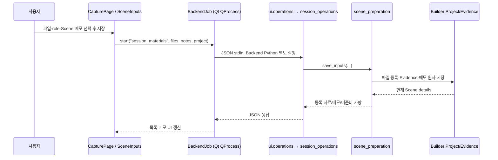
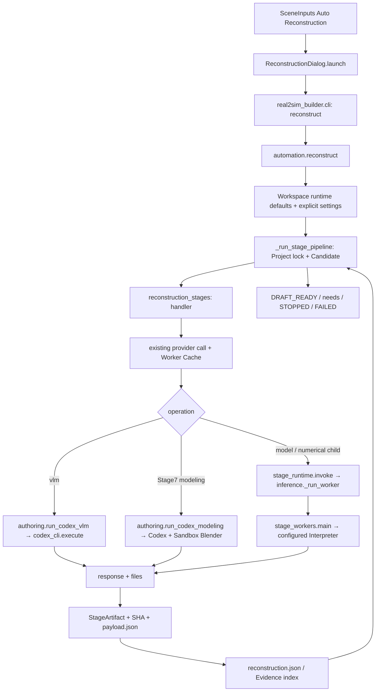

# 02. Scene Prepare와 Auto Reconstruction을 코드로 이해하기

[교재 시작](README.md) · [앞 장: 시스템 구조](01-system-architecture.md) · [다음 장: Camera·Asset·Simulation](03-camera-assets-simulation.md) · [학습 Pipeline](04-robot-learning.md) · [결함 해설](05-bug-fixes-explained.md) · [File Atlas](06-source-code-atlas.md) · [실행 추적](07-execution-and-debugging.md) · [용어·학습 순서](08-glossary-and-learning-path.md)

기준은 `8e02b1ae023a856694a40b947881f76b66410624`의 실제 소스다. 이 장을 작성하면서 모델·테스트·사용자 Scene을 실행하지 않았다. “구현됨”은 아래 호출 코드가 있다는 뜻이며, 실제 사진의 기하 정확도나 로봇 Task 성공과 구별한다. 과거 보고서의 전체 회귀 **2,151 passed**는 과거 검증 기록이다.

## 목차

- [입력부터 구분하기](#inputs)
- [Scene 자료 저장 버튼의 실행 경로](#prepare)
- [Auto Reconstruction 버튼의 실행 경로](#launch)
- [Runner·Provider·Artifact의 책임](#runner)
- [Stage 1](#stage-1), [2](#stage-2), [3](#stage-3), [4](#stage-4), [5](#stage-5), [6](#stage-6), [7](#stage-7), [8](#stage-8), [9](#stage-9), [10](#stage-10), [11](#stage-11), [12](#stage-12), [13](#stage-13), [14](#stage-14)
- [Codex는 무엇을 하고 Python은 무엇을 하는가](#codex)
- [Cache·Stop·Resume를 읽는 법](#resume)
- [설정과 과거 문서를 읽을 때의 차이](#gaps)
- [읽기 연습과 테스트 지도](#study)

<a id="inputs"></a>
## 1. 입력부터 구분하기

Scene 제작에서 “이미지”는 하나의 자료형이 아니다. `scene_photo`, `model_reference`, Capture가 같은 JPEG라는 이유로 같은 기하 관측이 되지 않는다. RGB bytes는 내용이고, Evidence row의 role·Camera·배치·q·SHA는 **어떻게 사용할 수 있는지 정하는 계약**이다.

| 입력 | 저장·Identity | 소비자와 의미 | 잘못된 해석 |
|---|---|---|---|
| Scene Photo | `input/scene_photos/`의 원본, Evidence의 `id/sha256/resolution/scene_state_id/camera_type=external` | Stage1→2의 다중 시점 Depth 입력. Stage7 의미 분석의 실제 Source View | 여러 파일을 올렸다고 같은 배치/보정 렌즈가 확정되는 것은 아니다 |
| Scene Video | 명시 `role=scene_video`, 원 영상 SHA·하나의 배치 ID | Stage1의 FFmpeg 파생 프레임. 이후 Stage2의 정적 View 후보 | 프레임 수와 동시 GPU batch size는 다르다 |
| Model Reference | `input/model_references/`, `role=model_reference` | Stage5 초기 의미 분석·Stage7에서 특정 Object에 연결된 외형 참고 | Stage2의 Camera Pose 또는 Scene 위치 측정에 섞지 않는다 |
| Scene Memo | `input/scene_memo.txt`, UTF-8 원문과 SHA | Codex가 Object·치수·관계·Task 의미를 해석. Python은 반환 Schema/인용/단위를 검증 | Python이 자유문을 정규식으로 해석해 임의 치수를 채우는 구조가 아니다 |
| Side/Wrist Capture | 별도 Capture Manifest·샘플, measured q/URDF/Mapping/센서 역할 | 이후 Sensor Registration와 Real/Sim 정합. 같은 q를 Sim에 반영 | 휴대폰 Photo에 임의 q를 붙이거나 Wrist별로 독립 Mount를 만들지 않는다 |
| Reconstruction Memo | `working/reconstruction_memo.json`, Source Revision Identity+SHA | 기존 Source 기반 Refit의 추가 수정 요구 | 최초 Scene Memo와 다른 Revision의 지시를 섞지 않는다 |

실제 입력 계약은 [save_inputs — L37](../../robot_learning_workbench/src/robot_learning_workbench/scene_preparation.py#L37), [add_image — L43](../../real2sim_builder/src/real2sim_builder/evidence.py#L43), [register_image — L107](../../real2sim_builder/src/real2sim_builder/observations.py#L107), [scene_memo — L381](../../real2sim_builder/src/real2sim_builder/evidence.py#L381)에 있다. `register_image`가 upright pixel frame을 관리하므로 EXIF 회전 전 픽셀 좌표를 그대로 annotation에 쓰면 안 된다. 자세한 pixel affine은 [03장](03-camera-assets-simulation.md)에서 다룬다.

`scene_state_id`는 물체 배치의 Identity다. `save_inputs` 한 번의 업로드는 기본적으로 새 `photos_<id>` 배치를 만든다. 나중 업로드를 같은 배치로 쓰려면 명시 state가 필요하다. 동일 SHA·role의 이미지는 재등록하지 않으며, 기존 이미지가 다른 배치에 있는데 억지로 같은 state를 주면 거부한다. 이름이 같아도 SHA는 다를 수 있고, SHA가 같아도 다른 role의 용도는 구별한다.

<a id="prepare"></a>
## 2. Scene 자료 저장 버튼의 실행 경로

사용자는 먼저 **빈 Project도 만들 수 있다**. Project 생성은 로봇 연결이나 3D Scene 완성을 뜻하지 않는다. [Project.create — L94](../../real2sim_builder/src/real2sim_builder/project.py#L94)가 사람이 읽는 폴더 이름을 예약하고 내부 `project_<uuid>`를 부여한다. `Project.__init__`은 `real2sim.project/1`과 `working/owner.json`을 확인해 쓰기 가능한 프로젝트인지 판단한다. 기존 외부/구형 자료를 열었다고 쓰기 권한이 생기지 않는다.

### 2.1 UI에서 Backend까지



실제 Caller는 [CapturePage.store_materials — L107](../../robot_learning_workbench/src/robot_learning_workbench/ui/session_page.py#L107)다. `SceneInputs.saveRequested` signal이 파일 목록과 메모를 전달하고, `BackendJob`은 모터/모델 코드를 GUI 안에서 실행하지 않고 기존 `ui.operations`를 별도 Interpreter로 실행한다. `session_*` operation은 [execute — L99](../../robot_learning_workbench/src/robot_learning_workbench/ui/session_operations.py#L99)로 넘어간다. Backend JSON 응답의 `ok`는 해당 저장 호출의 성공이지 Scene 전체 검증 성공이 아니다.

### 2.2 `save_inputs`를 한 줄씩 따라갈 때 볼 판단

`files`의 각 항목은 단순 Path 또는 `{'path': ..., 'role': ...}`다. 함수는 경로를 resolve하고 파일 존재를 확인한다. PNG/JPEG 등은 `register_image`, 영상은 `add_video`, URDF/USD/OBJ는 기존 native closure 복사·검사로 분기한다. GLB/glTF는 명시 오류다. 입력 문서는 `UNVERIFIED_INPUT`로 보관할 뿐, 임의로 Scene에 정확한 Geometry를 합성하지 않는다.

자료 파일 등록에는 Project의 기존 `exclusive` lock을 사용한다. 쓰기 도중 다른 Reconstruction이 같은 Project를 수정하면 충돌을 무시하지 않는다. 개별 입력 등록 후 `project.invalidate()`는 이전 승인 판단의 입력이 달라졌음을 표시한다. 입력을 저장한 행위로 Current Scene의 Calibration이 자동 갱신되는 것은 아니다.

`save_scene_memo`는 같은 원문이면 쓰지 않고, 변경된 경우 임시 파일에 UTF-8 bytes를 기록하고 `fsync → os.replace`한다. 갑자기 중단돼 절반짜리 원문이 보이는 것을 줄이는 **원자 교체**다. UI가 표시 과정에서 개행을 정규화해도 수정하지 않은 메모는 원래 bytes를 보존하려고 `SceneInputs.note_text`가 `_loaded_notes`를 사용한다.

| 확인할 생성 파일 | 의미 | 작성 함수 |
|---|---|---|
| `project.yaml` | 이름과 내부 Project ID | `Project.create` |
| `input/evidence.yaml` | 원본 경로·role·SHA·배치 등 등록 정보 | `save_inputs` 및 Evidence helper |
| `input/scene_memo.txt` | 현재 원문 제작 메모 | `save_scene_memo` |
| `working/owner.json` | 이 Builder가 소유한 쓰기 영역 표시 | `Project.create` |
| `working/state.json` | 진행 상태·needs·iteration | `Project.update` |
| `working/current_scene.yaml` | 존재한다면 현재 Scene. 빈 자료 저장만으로 반드시 생기지 않음 | 명시 Scene/승격 경로 |

반환 Consumer인 [scene_details — L20](../../robot_learning_workbench/src/robot_learning_workbench/scene_preparation.py#L20)는 입력을 `MISSING/CHANGED/REGISTERED`로 보여 주고, Current가 있을 때만 `validate(..., complete=True)`를 시도해 `reconstruction_ready`를 계산한다. `REGISTERED`는 그 파일을 찾고 SHA가 맞는다는 뜻이며 Camera K·물리적 정확도를 보증하지 않는다.

관련 정적 근거는 [자료만 있는 Project 시험](../../robot_learning_workbench/tests/test_scene_preparation.py#L5), [Phone batch 등록 시험](../../robot_learning_workbench/tests/test_scene_preparation.py#L27), [role/이름/렌즈 구별 시험](../../robot_learning_workbench/tests/test_scene_preparation.py#L51)이다. 이 문서화에서 이 시험들을 새로 실행하지 않았다.

<a id="launch"></a>
## 3. Auto Reconstruction 버튼의 실행 경로

### 3.1 자료 저장과 실행은 별도 조작이다

`SceneInputs`의 Auto Reconstruction은 Project와 Backend Python이 설정됐을 때 활성화된다. 클릭 즉시 이 함수를 실행한다.

<!-- source: robot_learning_workbench/src/robot_learning_workbench/ui/scene_inputs.py:L39-L42 -->
```python
    def open_reconstruction(self):
        if not self.project_path or not self.backend_python:return
        from real2sim_builder.ui_reconstruction import ReconstructionDialog
        dialog=ReconstructionDialog(self.project_path,self.backend_python,self);dialog.exec()
```

L39는 Qt 슬롯이다. L40은 Project/Interpreter 부재를 검사한다. L41은 실제 Builder Dialog를 가져오며, L42는 같은 Project를 대상으로 Dialog를 연다. 이 네 줄이 Stage를 직접 처리하지는 않는다. 사용자가 Dialog의 **생성 시작 / 이어서 실행**을 눌러야 `ReconstructionDialog.run → launch → start_cli`가 이어진다.

[ReconstructionDialog.launch — L291](../../real2sim_builder/src/real2sim_builder/ui_reconstruction.py#L291)는 기본 경로에서 `['reconstruct', project, '--candidate', name, '--config', temporary_yaml, '--run-modeling']`를 만든다. Source 기반 Refit이면 `refit-pairs`와 명시 Capture/Source Identity를 사용한다. 초기 Reconstruction과 Refit을 같은 함수가 무조건 똑같이 수행하는 것은 아니다.

[ReconstructionDialog.start_cli — L307](../../real2sim_builder/src/real2sim_builder/ui_reconstruction.py#L307)가 Qt `QProcess`로 기존 Backend Python의 `-B -m real2sim_builder.cli ...`를 실행한다. 선택된 Codex Home·모델·추론 강도를 환경으로 전달하고 Project에 인증 파일을 복사하지 않는다. GUI는 `working/state.json`과 Candidate의 `reconstruction.json`을 주기적으로 읽는다. stdout을 Task 상태로 오인하지 않으며, 실패 뒤 이전 성공 보고서를 다시 보여 주지 않도록 보고서 mtime을 기억한다.

### 3.2 CLI가 Stage Runner에 도착하는 순서

1. [main — L8](../../real2sim_builder/src/real2sim_builder/cli.py#L8)의 `reconstruct` 분기가 저장 YAML을 읽는다.
2. [reconstruct — L305](../../real2sim_builder/src/real2sim_builder/automation.py#L305)가 Project/명시 설정을 고르고 [workspace_configuration — L40](../../real2sim_builder/src/real2sim_builder/stage_runtime.py#L40)에서 Workspace의 **runtimes만** 기본값으로 병합한다. Project/명시 값이 우선이며 인증정보는 거부한다.
3. `scene_state`를 명시했다면 설정에 넣고, `run_modeling/max_modeling_calls/modeling_timeout_s`의 유한 예산을 확인한다. `runtime_environment`는 이번 호출 동안만 기존 Blender 실행 파일 선택기를 바꿨다가 복구한다.
4. [_run_stage_pipeline — L14](../../real2sim_builder/src/real2sim_builder/automation.py#L14)가 Project lock 아래 Candidate를 생성하거나 기존 OPEN Candidate를 연다. 초기 Candidate Scene과 입력 Manifest를 동결한다.
5. Stage1부터 순서대로 handler를 호출한다. 각 handler가 필요한 operation만 Provider에 요청한다.
6. 성공한 Stage의 실제 파일을 Manifest/Artifact로 검증·게시하고 `cache.json`, 진행 보고서, 제작 기록을 갱신한다.
7. 14개 경계가 모두 끝나면 `DRAFT_READY`다. 이는 **미승인 초안 Package와 Stage 기록이 준비됨**이며 센서/물리/Task 승인과 다르다.



그림에서 Stage7은 일반 `provider('blender')` Worker operation을 직접 실행하는 것이 아니다. Stage7 handler가 기존 `authoring`을 직접 호출한다. Runtime Identity에 Blender 설정이 들어가지만 실제 실행은 `run_codex_modeling`과 기존 Sandbox 검증이 소유한다.

<a id="runner"></a>
## 4. Runner·Provider·Artifact의 책임

### 4.1 왜 한 개의 거대한 함수로 처리하지 않는가

실행 제어는 [_run_stage_pipeline — L14](../../real2sim_builder/src/real2sim_builder/automation.py#L14), Stage의 배열·이미지 처리는 `reconstruction_stages.py`, 외부 Interpreter 선택은 [invoke — L142](../../real2sim_builder/src/real2sim_builder/stage_runtime.py#L142), 무거운 의존성의 import/forward는 `stage_workers.py`에 있다. GPU 모델 대신 Mock Worker를 넣어도 실제 Stage 순서·Manifest·Cache·Candidate 저장을 시험할 수 있는 이유다. Mock이 반환한 Depth를 실제 모델 예측으로 표시하지 않도록 `execution=mock`이 이어진다.

Handler 표는 실제 소스 그대로 다음과 같다.

<!-- source: real2sim_builder/src/real2sim_builder/automation.py:L66-L68 -->
```python
        handlers={1:processing.prepare,2:processing.depth,3:processing.support,4:processing.world,
                  5:processing.decompose,6:processing.prepare_objects,7:processing.meshes,8:processing.poses,9:processing.articulate,10:processing.compile_scene,
                  11:processing.simulation_ready,12:processing.stabilize,13:processing.package_scene,14:processing.simulator_integration}
```

사전의 숫자가 Stage 번호다. 값은 호출할 Python 함수 객체다. 루프가 `handler(selected, config, data, folder, call)`를 실행하므로 모든 Stage는 같은 함수 경계를 쓰지만 입력은 `previous[N]`으로 명시한다. 예를 들어 Stage8이 `previous[7]['objects']`를 읽는 것은 모델 생성 결과를 소비한다는 뜻이다. Stage10은 이전 Stage4/8과 Capture를 함께 사용하므로 단순한 파일 하나의 직선 변환이 아니다.

| 경계 | 반드시 하는 일 | 하지 않는 일 |
|---|---|---|
| Runner | Project lock, checkpoint, Stage 순서/Identity, 완료 Artifact 게시, 실패/재개 | Depth Forward나 자유문 의미 해석 |
| Handler | 이전 출력 검증, 좌표·Shape·의미 연결, 필요한 Provider 요청 | 없는 Runtime 자동 설치, 실패를 성공으로 채우기 |
| Runtime | 기존 Interpreter/모델 경로, VRAM Gate, GPU 순차 소유, Timeout/Stop | 다른 모델·알고리즘으로 조용히 대체 |
| Worker | 해당 라이브러리 import, 실제 모델/엔진 함수 실행, `result.json` | 전체 Project의 Stage 선택·원본 Calibration 수정 |
| Artifact | 실제 파일·SHA·입출력·Runtime·설정·좌표·단위·실행 provenance 검증 | 수치 정확도나 실물 성공 인증 |

`_run_worker`는 `request.json`, `worker.log`, Child의 `result.json`을 사용한다. 모델을 부모의 장기 서비스로 보관하지 않는다. Stop/Timeout/정상 종료 후에도 같은 소유 프로세스 그룹의 도구 후손을 기존 `stop_child`로 정리한다. `worker.log`는 상세 실행 오류를 찾는 곳이고, Project의 상위 오류는 credential/provider 응답 원문을 무작정 저장하지 않도록 축약한다. 세부 구현은 [_run_worker — L393](../../real2sim_builder/src/real2sim_builder/inference.py#L393), [main — L540](../../real2sim_builder/src/real2sim_builder/stage_workers.py#L540)을 따른다.

### 4.2 아래 Stage 표를 읽는 법

각 Stage의 **Resume**는 7절 공통 검증을 전제로 한다. 같은 숫자의 폴더가 있다는 이유만으로 재사용하지 않는다. **검증 범위**는 현재 정적 소스와 기존 테스트/보고서에서 확인한 종류이며 이번 새 실행 결과가 아니다. `COMPLETE`는 해당 Stage가 선언한 입출력 계약의 완료다. 알고리즘 정확도, 데이터 독립성, Physics 검증과 다른 축이다.

<a id="stage-1"></a>
## 5.1 Stage 1 — RGB preparation

| 항목 | 실제 구현 |
|---|---|
| 목적/이유 | 하나의 정적 배치에서 모델이 읽을 upright RGB와 추적 가능한 frame 목록을 만든다 |
| 입력 | train `scene_photo/external` 또는 명시 `scene_video`; `scene_state_id`, 원본 SHA |
| 호출 함수 | [prepare — L81](../../real2sim_builder/src/real2sim_builder/reconstruction_stages.py#L81) → 필요할 때 `provider('video')` → [video — L13](../../real2sim_builder/src/real2sim_builder/stage_workers.py#L13) |
| Provider | Photo는 Pillow CPU; Video는 기존 FFmpeg/ffprobe Child. AI 모델 없음 |
| 알고리즘 | Photo는 EXIF transpose+RGB 파생 PNG. 영상은 PTS를 읽고 sorted stride 인덱스를 선택해 FFmpeg decode |
| 출력/좌표 | `photo_0000.png`, 영상 frame PNG, `contact_sheet.png`, frame ID/SHA/해상도/PTS/role. 원본 upright 픽셀 |
| Consumer | Stage2의 이미지 목록, Stage3/5의 Source ID, Stage7 source_views |
| 실패 조건 | 배치 미선택/혼합, SHA 변경, 적격 프레임 없음, 영상 PTS/출력 수 불일치 |
| Resume | 원본 목록·배치·`video_candidates`·구현/Runtime SHA가 같고 실제 결과 파일이 무결해야 재사용 |
| 검증 범위 | 합성 Photo Stage 시험 및 [합성 FFmpeg PTS/stride 시험](../../real2sim_builder/tests/test_stage_video_authoring.py#L87); 사용자 영상 성공은 별도 |

기본 영상 후보는 15개다. “15개 프레임을 준비한다”와 “15개를 GPU에 동시에 넣는다”는 다르다. Stage2는 이를 batch/overlap으로 나눈다. Video frame은 Candidate 안의 파생 관측이고 Project의 원본 Photo 목록에 몰래 추가하지 않는다. 대표 프레임의 ID가 Stage7까지 연결되는 것이 중요하다. 모델 이미지는 밝기/가림 분석의 입력이지 로봇 센서의 calibration sample이 아니다.

<a id="stage-2"></a>
## 5.2 Stage 2 — DA3 Nested depth

| 항목 | 실제 구현 |
|---|---|
| 목적/이유 | 여러 RGB의 Depth·Confidence·K·World-to-Camera를 같은 추정 World에서 얻는다 |
| 입력 | Stage1 frames, `depth.batch_size=4`, `process_res=336`, `overlap=3` 기본 |
| 호출 함수 | [depth — L130](../../real2sim_builder/src/real2sim_builder/reconstruction_stages.py#L130) → [plan_chunks — L33](../../real2sim_builder/src/real2sim_builder/calibration/simfoundry.py#L33) / `provider('da3')` → [da3 — L56](../../real2sim_builder/src/real2sim_builder/stage_workers.py#L56) → `DepthAnything3.inference` |
| Provider | 기존 로컬 DA3 Nested Snapshot, CUDA BF16 지원 환경. 라이브러리 원본 수정/다운로드 없음 |
| 알고리즘 | CPU FP32 strict load→전체 BF16→두 Head/Camera 출력층 FP32→GPU. Chunk별 inference 후 overlap Camera center Sim(3) 정렬·Depth scale 반영 |
| 출력/좌표 | 합친 `prediction.npz`: `depth[N,H,W]`, `conf[N,H,W]`, `intrinsics[N,3,3]`, `extrinsics[N,3,4]`, `image[N,H,W,3]`; 원본→처리 affine |
| Consumer | Stage3 Mask/Plane, Stage4 backprojection, Stage5 canonical RGB/Z, Stage10 Photo Camera |
| 실패 조건 | 비유한/음수 Z, Shape·K/E 불일치, 알 수 없는 resize/crop, 다른 Chunk crop grid, 퇴화 overlap, VRAM 부족/OOM |
| Resume | 설정·frame SHA/순서·Snapshot/코드 Identity와 각 Chunk 산출물 무결성에 결합 |
| 검증 범위 | Chunk/광선/Sim(3) 수학·Mock 연결 시험. 과거 모델 실측은 해당 보고서의 입력/설정 범위이며 이번 Forward0회 |

[merge_chunks — L65](../../real2sim_builder/src/real2sim_builder/calibration/simfoundry.py#L65)는 독립 World의 점들을 이름만 같다는 이유로 붙이지 않는다. 겹치는 최소 3 Camera center의 관측 가능성이 필요하고, collinear overlap은 고유한 Sim(3)를 결정하지 못하므로 중단한다. resolution은 현재 코드가 336/448만 허용하고, 448은 최대4장, 336은 최대8장까지의 요청을 허용한다. 허용 상한은 해당 노트북에서 항상 안전하다는 약속이 아니다. `nvidia-smi` 여유 Gate와 실제 모델 실패는 별도로 처리한다.

실제 가중치 dtype 설정을 발췌하면 다음과 같다.

<!-- source: real2sim_builder/src/real2sim_builder/stage_workers.py:L67-L77 -->
```python
    model = DepthAnything3.from_pretrained(str(snapshot), local_files_only=True,
                                         token=False, strict=True, map_location='cpu')
    model.to(dtype=torch.bfloat16)
    heads = ('model.da3.head', 'model.da3_metric.head', 'model.da3.cam_dec.fc_t',
             'model.da3.cam_dec.fc_qvec', 'model.da3.cam_dec.fc_fov')
    for name in heads:
        model.get_submodule(name).to(dtype=torch.float32)
    for name, p in model.named_parameters():
        dtype = torch.float32 if any(name.startswith(h+'.') for h in heads) else torch.bfloat16
        if p.dtype != dtype:
            raise ValueError('DA3 installed module precision contract mismatch: '+name)
```

L67–68은 원 FP32 가중치를 CPU로 읽는다. L69는 autocast 설정만 하는 것이 아니라 Parameter dtype을 바꾼다. L70–73은 autocast가 꺼진 Head/Decoder 출력 경로를 FP32로 복원한다. Camera Decoder 전체가 FP32인 것은 아니다. L74–77은 이름별 기대 dtype을 확인해 설치 모듈 구조가 달라졌을 때 조용히 진행하지 않는다. `infer_gs=False`, 입력 K/extrinsics=None이므로 이 호출은 Gaussian Splat이나 실측 Camera calibration 입력 경로가 아니다.

Depth는 optical Z이고 `is_metric=1`이어도 `metric_verified=False`다. Confidence는 모델 고유 scale이며 `[0,1]` 확률이라고 해석하지 않는다. [역변환 시험](../../real2sim_builder/tests/test_simfoundry_geometry.py#L11), [Chunk 정합/Depth scale 시험](../../real2sim_builder/tests/test_simfoundry_geometry.py#L21), [crop affine 시험](../../real2sim_builder/tests/test_stage_pixel_transforms.py#L5)이 이 계약을 설명한다.

<a id="stage-3"></a>
## 5.3 Stage 3 — Canonical frame / SAM3 support

| 항목 | 실제 구현 |
|---|---|
| 목적/이유 | 물체 분해에 사용할 대표 시점과 지지면을 선택한다. 모든 View가 적격이라고 가정하지 않는다 |
| 입력 | Stage2 processed RGB/Z/K, support category 기본 table/floor, FrameScore 설정 |
| 호출 함수 | [support — L174](../../real2sim_builder/src/real2sim_builder/reconstruction_stages.py#L174) → `invoke('support')` → [support_masks — L108](../../real2sim_builder/src/real2sim_builder/stage_workers.py#L108) → [support — L135](../../real2sim_builder/src/real2sim_builder/stage_workers.py#L135) → `rank_frames`; hybrid는 Codex VLM |
| Provider | **Ultralytics SAM3.1** GPU Child와 Open3D CPU Child를 분리. 선택 shortlist의 의미 판단은 Codex |
| 알고리즘 | category별 Mask→가장 큰 support Mask→Z/K 점군→1cm RANSAC, 선택2000회/최종1000회. 지지면/물체 coverage·tilt·component·clipping·sharpness 점수 |
| 출력/좌표 | `support_masks.npz`, plane coefficients/inliers/origin, selected index/frame ID, 모든 FrameScore; selected optical Camera |
| Consumer | Stage4 support frame, Stage5 canonical RGB/Depth/Instance 분석 |
| 실패 조건 | Mask/Depth frame 불일치, 100 support pixel 미만, 적격 score 없음, VLM이 shortlist 밖 index 반환 |
| Resume | GPU Mask Child와 CPU Plane Child를 독립 Cache하므로 CPU dependency 실패 때문에 SAM을 재호출하지 않음 |
| 검증 범위 | FrameScore/합성 Plane·Mock 흐름. 과거 SAM Text 최소 Forward는 전체 Plane/대표 선택 정확도 증거가 아님 |

`settings.mode=='heuristic'`이면 최고 점수만 사용하고 VLM을 호출하지 않는다. 그 밖의 mode는 적격 `vlm_top_k` 후보 중 exact index를 반환해야 한다. VLM이 평면 계수나 임의 Camera Pose를 만드는 구조가 아니다. FrameScore의 component 개수는 영상의 연결 영역 수로, “두 컵의 물리 Identity를 확인했다”는 의미가 아니다.

[SAM31 — L11](../../real2sim_builder/src/real2sim_builder/sam31_adapter.py#L11)는 원본 공식 SAM3 video/session API 전체의 호환 구현이 아니다. text는 `SAM3SemanticPredictor`, point는 `SAM3Predictor`를 사용한다. PIL/RGB 입력을 Ultralytics의 BGR ndarray로 바꾸고 Mask가 원 입력 grid로 돌아왔는지 검사한다. `half=True/quantize=16`은 이 Adapter 설정이며 다른 4bit 모델 사용을 뜻하지 않는다.

<a id="stage-4"></a>
## 5.4 Stage 4 — World frame / metric QA

| 항목 | 실제 구현 |
|---|---|
| 목적/이유 | canonical Camera의 지지면을 기준으로 점군의 명목 방향·원점을 정리하고 독립 치수 QA를 남긴다 |
| 입력 | 선택 plane normal/origin, Stage2 W2C, 명시 measured/calibrated 4corner 치수 Anchor |
| 호출 함수 | [world — L228](../../real2sim_builder/src/real2sim_builder/reconstruction_stages.py#L228) → [support_transform — L106](../../real2sim_builder/src/real2sim_builder/calibration/simfoundry.py#L106) / `world_points` / `metric_qa` |
| Provider | NumPy 수학; 모델/로봇 호출 없음 |
| 알고리즘 | 원본 순서의 translation-before-rotation으로 `camera_to_support`, 이어 W2C와 합성한 `support_from_da3`로 전체 점군 변환 |
| 출력/좌표 | `world_points.npz`, `camera_to_support`, `support_from_da3`, 잔여 normal, metric_qa; **추정 support frame** |
| Consumer | Stage5 높이/제거 순서, Stage8 중력 방향, Stage10 Camera→support→Robot World 합성 |
| 실패 조건 | 비정상 transform/관측·치수, 독립 측정 provenance/evidence 부재 |
| Resume | 선택 Plane·Depth·Anchor·구현 SHA를 포함하는 upstream/설정 검증 |
| 검증 범위 | [회전/이동 순서 시험](../../real2sim_builder/tests/test_simfoundry_geometry.py#L42), [QA가 자동 rescale하지 않는 시험](../../real2sim_builder/tests/test_simfoundry_geometry.py#L49); 실측 정확도는 별도 |

여기의 World라는 이름은 아직 Robot World가 아니다. 함수는 `robot_world_registered=False`, `metric_verified=False`를 명시한다. 원본 roll/tilt 수학의 잔여 normal도 저장하므로 “+Z에 완전히 정렬됐다”는 설명 대신 실제 `normal_after_original_rotation`을 읽어야 한다. 작업판 가로·세로가 맞는 것만으로 Robot Base의 6자유도 Pose가 결정되지 않는다.

<a id="stage-5"></a>
## 5.5 Stage 5 — Scene decomposition

| 항목 | 실제 구현 |
|---|---|
| 목적/이유 | 대표 View에서 물리 Instance별 원관측·Mask·점군을 고정하고, 가림 제거 순서에 따라 숨은 면을 위한 생성 근거를 준비 |
| 입력 | canonical RGB/Z/K, `camera_to_support`, Scene Memo, 초기에는 Stage1 전체 Source/View와 Model References |
| 호출 함수 | [decompose — L319](../../real2sim_builder/src/real2sim_builder/reconstruction_stages.py#L319) → `vlm` / `segments` / `removal` / `image_edit` / `da3` / `depth_inpaint` |
| Provider | Codex VLM, SAM3.1 GPU, 로컬 SBERT CPU·pruning, Open3D/trimesh ray, 기본 ComfyUI FLUX GGUF, DA3, PDA |
| 알고리즘 | VLM Instance/Category 제안→typed uncertainty Gate→text-first/point fallback Mask→semantic/geometric pruning·association→denoise/hull/ray 순서→제거 검토→RGB/Z 생성 |
| 출력/좌표 | Object별 `_observed.npz/PNG`, Mask, Category/ID, scene_analysis SHA, `object_progress.json`, 제거 attempts/history, provenance maps; canonical optical Camera |
| Consumer | Stage6 crop와 원본 점 선택, Stage7 의미 응답 재사용, Stage8 CPD 관측 |
| 실패 조건 | ID/Box/Memo 모호성, 잘못된 bounds, Mask Identity 누락/중복, 점 부족, 원 RGB와 일치비율 부족, 제거 retries 소진, 품질/Runtime/Auth 실패 |
| Resume | 반복·Object·mode/seed별 완료 Worker Cache를 검증해 재사용. 실패 Object와 종속 후속 RGB/Z를 보류하고 이미 고정한 관측은 보존 |
| 검증 범위 | 실제 Stage 처리+Mock Providers, bounded retry/known-depth 보존 계약. 과거 FLUX Forward 성공과 제거 품질 합격은 다름 |

이 Stage를 이해하려면 **세 가지 Identity**를 구별한다. VLM의 `cup_1`은 물리 Instance 제안이다. SAM Mask 후보는 category별 영상 영역일 뿐 stable ID가 없다. `associate_masks`가 Box 관계의 일대일 대응이 모호하지 않을 때만 `UNIQUE_ESTIMATED`로 연결한다. SBERT는 Category를 갱신하는 모델이 아니라 Mask phrase의 의미 유사도 pruning에 사용된다. Category 목록 갱신은 VLM이다. 현재 CPU Encoder는 명시 Snapshot을 `device='cpu', local_files_only=True`로 생성한다.

기본 Object 예산은 20개이고 최대100, Category refresh period와 최소 detection iteration은 기본3·허용1..20이다. `instance_gate`는 자유문 `uncertainty`를 다시 파싱하지 않는다. Identity/Box가 확인되고 Memo 충돌이 없으며 HIDDEN_GEOMETRY/UNMEASURED_DIMENSIONS/FRONT만 남으면 `ESTIMATED_CONTINUE`를 기록할 수 있다. 반대로 IDENTITY/BOX/MEMO 불확실성을 “추정이니까 진행”으로 넘기지 않는다. 전체 `uncertain=true`도 조용히 false로 바꾸지 않는다.

각 반복은 모든 현재 Object의 RGB/Z/Mask를 먼저 고정한다. 그다음 점군을 denoise하고 축소 convex hull의 occlusion/support ray로 제거 순서를 계산한다. **현재 코드에서는 채택된 Object를 순차 제거하는 것이 `decompose`의 실제 실행 흐름**이다. 첫 물체 제거가 실패하면 그 생성 배경에 의존하는 다음 RGB/Z를 진행하지 않는다. 다만 이미 보존한 독립 관측 Snapshot은 지우지 않는다. 이 정책은 StageNeeds의 object/dependency 정보로 기록되고, Runner가 그 오류를 받으면 해당 Stage에서 멈춘다. classification이 있다는 이유로 별도 병렬 Object Scheduler가 자동으로 다음 Stage를 실행하는 것은 아니다.

제거는 기본 `mask/outline/bbox × seed0..2` 최대9회다. 녹색 annotation이 사라졌다는 검사만으로는 물체 제거를 증명하지 못하므로 `comfy_gguf` 결과는 Before RGB·편집 Mask·생성 RGB를 Codex에게 전달해 target 잔존·다른 물체 보존·배경 연속성·불확실성을 검토한다. 품질 재시도와 인증/Runtime 오류를 구분하며, 후자는 seed 변경으로 반복하지 않는다.

FLUX는 exact-mask inpaint 모델로 쓰는 것이 아니다. [edit — L66](../../real2sim_builder/src/real2sim_builder/comfy_edit.py#L66)는 `ReferenceLatent`를 포함한 Kontext Workflow로 생성하고, 선언한 편집 영역 밖은 `protect_pixels`로 원 RGB를 정확 복사한다. 내부 영역까지 원래 보이지 않은 실제 배경이라는 보장은 없다. `mask_conditioning=False`, `quality_status=NOT_VERIFIED`가 반환되는 이유다.

RGB가 검토를 통과하면 같은 `removal_region`을 RGB와 Depth hole에 쓴다. `depth_inpainting_inputs`는 편집 영역 밖 RGB 불변, 양수/유한 Z, `prior==0`과 hole 정확 일치를 검사한다. 새 RGB의 DA3 단일 View geometric Z는 PDA conditioning용으로만 사용하고, 이 호출의 새 Camera Pose로 기존 World를 바꾸지 않는다. PDA는 `prior==0`인 곳만 예측으로 채우고 known Z를 원 값으로 splice한다. 저장 `rgb_source/depth_source`의 0은 원래 모델 관측, 1은 생성 영역이며 0조차 실측 Depth가 아니다. 생성 confidence는 UNKNOWN/NaN으로 남긴다.

실제 PDA 경계는 [stage_workers.depth_inpaint — L342](../../real2sim_builder/src/real2sim_builder/stage_workers.py#L342)다. 명시된 로컬 `depth_anything_v2_vitl.pth`와 `prior_depth_anything_vitb.pth` 두 파일로 version1.0을 로딩한다. `Arguments.K=5`는 그 모델의 설정값이고 Camera Intrinsic 행렬 K와 다른 변수다. Runtime 안에서 `completion.calc_scale_shift`만 FP32 autocast-disabled least-squares 함수로 연결하여 `torch.linalg.lstsq`를 수행하며 설치 라이브러리 파일을 수정하지 않는다. 요청의 Camera K는 같은 optical-Z pixel grid를 검증·기록하는 데 쓰고 `infer_one_sample`에 Camera K를 전달하지 않는다. 따라서 PDA가 입력 K로 절대 Calibration을 수행했다는 설명은 틀리다.

[실제 데이터 연결/known-depth 보존 시험](../../real2sim_builder/tests/test_stage_decomposition.py#L42), [9회 소진 뒤 Depth 차단](../../real2sim_builder/tests/test_stage_decomposition.py#L109), [removed=yes 단독 성공 거부](../../real2sim_builder/tests/test_flux_removal_contracts.py#L31), [Schema·제거 영상 순서 검증](../../real2sim_builder/tests/test_codex_vlm.py#L139)을 읽으면 이 경계를 확인할 수 있다.

<a id="stage-6"></a>
## 5.6 Stage 6 — Object RGBA preparation

| 항목 | 실제 구현 |
|---|---|
| 목적/이유 | Object 제작용 RGB/Alpha Crop과 Pose 추정용 원관측 점군을 각각 보존 |
| 입력 | Stage5 Object의 observed NPZ·별도 RGB/Mask Identity, `image_preparation`, `pose.point_policy` |
| 호출 함수 | [prepare_objects — L533](../../real2sim_builder/src/real2sim_builder/reconstruction_stages.py#L533) → `pose_point_selection`, 선택 `image_edit`, `background_remove`, `vlm` |
| Provider | CPU Pillow/OpenCV crop; 설정에 따라 FLUX/기타 지원 Image Provider, 로컬 Bria ONNX CPU, Codex validity |
| 알고리즘 | bbox에 focus10%/context50% padding→square RGBA/nearest alpha. 생성 Provider native ratio 선택→선택 infill→upsample→Alpha 정밀화 |
| 출력/좌표 | `context.png/focus.png`, 선택 `provider_crop/infill/enhanced`, `prepared_image` path/SHA/source, `camera_points.npy`, `original_points.npz` |
| Consumer | Stage7 Blender references, Stage8 CPD, Stage10 원본 pixel↔World 대응 |
| 실패 조건 | RGB/Mask/Depth grid/내용 Identity 다름, 빈 mask/alpha, Provider shape 계약 부재, 생성 RGB 비정상, typed validity 보호 조건 실패 |
| Resume | 최종 준비 이미지 SHA, Crop/Provider 설정, 원관측 NPZ와 provenance가 같아야 재사용 |
| 검증 범위 | [실제 최종 이미지 SHA 전달](../../real2sim_builder/tests/test_prepared_image_handoff.py#L70), [빈 alpha 거부](../../real2sim_builder/tests/test_prepared_image_handoff.py#L94), [grid 불일치 거부](../../real2sim_builder/tests/test_prepared_image_handoff.py#L104); Provider 정확도는 별도 |

설정을 안 주면 upsample은 true, infill은 false, remove_background는 true, `check_valid`는 false다. Crop size의 함수 기본은1024지만 배포 예시 YAML은512다. 실제 실행 설정을 확인하지 않고 “항상512”라고 읽으면 안 된다. `upsample=false/infill=false`면 원 SAM Alpha를 쓰는 관측 Crop만 만들어 Bria를 호출하지 않는다. 반대로 Infill은 생성 뒤 Bria가 필요하고, Upsample은 remove_background=true일 때 Bria를 쓴다. 원 관측 Alpha를 생성된 새 형상에 그대로 씌우는 것을 같은 정밀화라고 취급하지 않는다.

현재 `check_valid=true`는 **infill-only에도 적용된다**. 최종 대상은 다음 코드로 한 번 결정된다.

<!-- source: real2sim_builder/src/real2sim_builder/reconstruction_stages.py:L619-L622 -->
```python
        final=enhanced or infilled or crops['focus']
        prepared_image={'path':final['path'],'sha256':sha(final['path']),'source':'enhanced'if enhanced else'infilled'if infilled else'observed_crop','depth_frame':'observed_original_only'}
        result.append({**obj,'crops':crops,'prepared_image':prepared_image,'provider_crop':provider_crop,'enhanced':enhanced,'infilled':infilled,'validity':validity,'validity_gate':validity_gate,'camera_points':str(cloud),
            'point_provenance':point_provenance,'original_points':str(original_cloud),'original_point_provenance':original_provenance})
```

L619는 enhanced가 있으면 그것을, 없으면 infilled, 생성이 없으면 focus Crop을 선택한다. L620은 그 실제 파일의 SHA와 출처를 묶고 Depth가 여전히 원관측 frame의 자료임을 남긴다. L621–622는 최종 이미지와 원관측 점군을 같은 Object record로 넘긴다. “파일만 만들고 Stage7은 예전 Crop을 읽는” handoff 누락을 막는 경계다.

`pose_point_selection`의 기본은 `original_only`다. 생성 RGB/Z 또는 low_confidence 픽셀을 기본 CPD 점군에서 제외한다. `include_generated`는 명시 evidence와 원본-only 추가 fit의 민감도 비교를 요구한다. 이것은 생성 영역을 실측으로 승격하는 옵션이 아니다.

<a id="stage-7"></a>
## 5.7 Stage 7 — Codex / Blender meshes

| 항목 | 실제 구현 |
|---|---|
| 목적/이유 | 물체별 독립 Native Asset을 기존 Codex+Sandbox Blender 경계로 제작/재사용 |
| 입력 | Stage6 objects·prepared image/Mask/Depth, Stage1 source_views, Stage5 semantic analysis·Memo·Model Reference/가이드 SHA, 보호 치수 |
| 호출 함수 | [meshes — L629](../../real2sim_builder/src/real2sim_builder/reconstruction_stages.py#L629) → `modeling_tasks` → `run_codex_modeling` → `attach_modeled_assets` → `surface_mesh` |
| Provider | 공통 Codex CLI가 bpy Script를 작성; 기존 bwrap/Blender가 실제 실행·검사. Hunyuan/GLB는 이 Stage의 기본 모델이 아님 |
| 알고리즘 | Stage5 의미 응답 SHA/Source/Memo/Guide 검증→parser 재사용→Object별 modeling group/References→asset 생성/기존 버전 재사용→Native mesh 추출 |
| 출력/좌표 | 독립 Asset Manifest/USDA/Visual/Collision·모델링 증거, Stage8용 OBJ와 SHA. **Object-local m** |
| Consumer | Stage8의 mesh-to-Camera 정합과 Stage10 새 버전 합성 |
| 실패 조건 | Stage5 의미/이미지 SHA 변경, Instance 누락/추가, 보호 치수 충돌, `execute_modeling=false`에서 제작 필요, 인증·호출 예산·Sandbox/Asset 검증 실패 |
| Resume | modeling group fingerprint와 기존 검증된 자산, `calls.json`의 실제 attempted-call 예산을 유지 |
| 검증 범위 | [실제 Native Mesh handoff와 Mock 제작](../../real2sim_builder/tests/test_stage_pose.py#L43), [Crop/Mask/Depth 전달](../../real2sim_builder/tests/test_stage_mesh_handoff.py#L8); 실제 사용자 모델 품질은 별도 |

Codex가 여기에서 최종 World Pose를 정하지 않는다. Stage7은 `pose_owner='Stage8'`, `world_pose_authored_by_codex=False`를 반환한다. Object 크기를 자산 로컬 m로 표현하는 것과 Scene 배치를 결정하는 것은 별개다. 실제 실측 축이 있는 Asset은 `scale_protected=True`가 되어 다음 CPD의 scale 조정으로 치수를 감출 수 없다.

Stage5의 `scene_analysis`가 있으면 Stage7은 그것을 다시 의미 분석 API에 보내지 않고 기존 `parse_scene_analysis`로 검증·재사용한다. 다만 빈 Source/View 정보로 분석을 생략하는 구조는 아니다. Source SHA·Memo SHA·Guide SHA와 필요한 observed Instance가 모두 맞아야 한다. 인증/Quota가 실패해도 Stage1–6 Cache와 이미 만든 자산은 지우지 않고 `NEEDS_RUNTIME`을 남긴다. 원격 시도 여부와 재사용 여부로 call 예산을 계산한다.

<a id="stage-8"></a>
## 5.8 Stage 8 — Mesh pose matching

| 항목 | 실제 구현 |
|---|---|
| 목적/이유 | 제작 Mesh를 canonical Camera의 관측 점군에 맞춰 scale·rotation·translation 후보를 계산 |
| 입력 | Stage7 local OBJ, 원본 선택 Camera XYZ, 보호 scale, samples 기본10/surface_samples10000 |
| 호출 함수 | [poses — L722](../../real2sim_builder/src/real2sim_builder/reconstruction_stages.py#L722) → [cpd — L398](../../real2sim_builder/src/real2sim_builder/stage_workers.py#L398); 선택 [foundationpose — L470](../../real2sim_builder/src/real2sim_builder/stage_workers.py#L470) / `canonicalize`→`front_views`+Codex |
| Provider | Open3D/probreg CPU CPD, SciPy NN/Rotation; 선택 FoundationPose CUDA와 의미적 Front VLM |
| 알고리즘 | OBB diagonal pre-scale→diag/30 voxel→Poisson/farthest sampling→SO(3) multistart rigid CPD→one-sided NN score→inverse fit |
| 출력/좌표 | 각 후보/선정 fit, `*_fit_quality.json`, canonicalization, `UNVERIFIED`; Native Mesh→selected optical Camera |
| Consumer | Stage10의 Mesh scale/정규화 새 버전과 Camera→support→World Pose |
| 실패 조건 | 유효점10 미만/기하 rank<2, 부정/비유한 scale, SO(3) 위반, 보호 scale/축 변경, 명시 생성점의 sensitivity 자료 부재 |
| Resume | Mesh·선택점군 SHA·pose 설정·CPD/Front Runtime Identity를 검증. 성공한 독립 fit은 `object_progress`에 남김 |
| 검증 범위 | CPD 호출 계약/순수 수학/Native canonical 역보상 시험과 과거 로컬 Runtime 기록을 구분. 잔차를 독립 정확도로 읽지 않음 |

CPD의 내부 source/target 방향은 반환 Pose의 방향과 같지 않다. Worker는 관측을 회전시켜 target Mesh에 맞춘 후 그 변환을 역변환하여 **Mesh→Camera**로 반환한다. 점군 평균 오차만 보고 translation 부호를 바꾸면 Stage10이 틀어진다. 보호 scale이면 `pre_scale=1`, `update_scale=False`만 시도한다. 일반 경우의 scale도 측정값이 아니라 추정값이다.

기본 `bake_fitted_tilt='auto'`에서 `shape_model='codex_blender'`인 Native +Z Mesh는 auto tilt baking 대상이 아니다. 의미적 Front 선택은 render 후보 중 방향을 고르는 것이며 Pose 검증기가 아니다. `NONE/uncertain`이면 identity rotation·ambiguous 기록을 유지한다. Canonical 회전을 Asset에 굽는 경우 Visual/Collision을 함께 새 버전에 회전하고 fit rotation을 역보상하여 World 형상을 유지한다. 부분 실측 축을 바꾸면 별도 검토가 필요하다.

[cpd — L398](../../real2sim_builder/src/real2sim_builder/stage_workers.py#L398)의 `quality`는 coverage/퇴화/후보 모호성 진단이다. `poses`가 모든 모호성 지표를 자동 승인/불승인 임계값으로 바꾸는 것은 아니며 반환 status는 계속 UNVERIFIED다. 실제 대칭 물체에 유일한 의미적 방향을 발명하지 않는다. [보호 scale 거부 시험](../../real2sim_builder/tests/test_stage_pose.py#L57), [정규화 자산/원본 보호 시험](../../real2sim_builder/tests/test_stage_compilation.py#L106)을 참고한다.

<a id="stage-9"></a>
## 5.9 Stage 9 — Optional articulation

| 항목 | 실제 구현 |
|---|---|
| 목적/이유 | rigid scene의 정상 생략과 요청했지만 지원되지 않는 관절 생성을 구분 |
| 입력 | `articulation.objects` |
| 호출 함수 | [articulate — L787](../../real2sim_builder/src/real2sim_builder/reconstruction_stages.py#L787) |
| Provider | 현재 신규 Object articulation Provider 없음 |
| 알고리즘 | 요청 목록이 비면 `applicable=false`, 있으면 즉시 `NOT_SUPPORTED` |
| 출력/좌표 | 빈 objects와 `articulation_executed=false`, `robot_model_changed=false` |
| Consumer | Stage10이 기존 Robot URDF/FK를 유지한 채 rigid Object를 합성 |
| 실패 조건 | 신규 서랍/물체 관절 요청 |
| Resume | 설정을 검토해 지원 범위를 명확히 한 후 동일 Stage 계약으로 재개; 자동 관절 추측 없음 |
| 검증 범위 | [관절/Robot World를 발명하지 않는 시험](../../real2sim_builder/tests/test_stage_compilation.py#L50) |

이 Stage가 COMPLETE일 때도 관절을 생성했다는 뜻은 아닐 수 있다. “요청이 없어 적용하지 않았다”는 명시 결과도 Stage의 정상 결과다. 설치되지 않은 articulation 모델을 찾거나 기존 SO-ARM URDF를 편집하는 코드가 아니다.

<a id="stage-10"></a>
## 5.10 Stage 10 — Scene compilation

| 항목 | 실제 구현 |
|---|---|
| 목적/이유 | 독립 local Asset과 Camera 추정을 하나의 후보 Scene에 합성하고 기존 Robot/Sensor 좌표 경계를 연결 |
| 입력 | Stage4 support transform, Stage8 Mesh fit, Stage2 Camera K/E/affine, 명시 Support/Robot World 대응점·Capture/URDF/q |
| 호출 함수 | [compile_scene — L1058](../../real2sim_builder/src/real2sim_builder/reconstruction_stages.py#L1058) → `resolve_stage_world` / 선택 `resolve_sensor_world` → `register_stage_sensors` → `candidate.save` |
| Provider | 기존 align_points Sim(3), PnP/센서등록/공유 Wrist FK·Mount, 선택 Joint/Render refinement. 새 Solver를 만들지 않음 |
| 알고리즘 | metric scale과 rigid transform 분리→Mesh scale/정규화 새 버전→Camera→support→World→기존 parent-local Pose. Photo E 역변환·K/affine 보존 |
| 출력/좌표 | `compiled_scene.yaml`, world/sensor resolution 보고서, original-pixel/World Cloud와 dependency SHA, 새 Asset 버전. 등록되면 Robot World |
| Consumer | Stage11 complete Scene 검증, Stage12 Physics, Stage13 Package |
| 실패 조건 | Robot World/실측 anchor 부재, 퇴화 대응점, train/holdout leakage, 보호 치수와 scale/pose 충돌, Sensor 등록 불완전, 낮은 Joint rank |
| Resume | Candidate 저장 직후 재개도 현재 Scene checkpoint SHA·Asset dependency 무결성 확인; 기존 Scene/URDF/실측 보호 |
| 검증 범위 | 합성 실측 anchor/PnP/FK/Joint·typed cloud·Native 버전 검사. 실제 Robot World/Camera 물리 정확도는 별도 |

Transform을 단순히 `T_world_camera @ T_camera_object`로 적는 것만으로는 이 Stage를 이해할 수 없다. CPD scale, DA3 support scale, canonical Mesh rotation, Object의 기존 parent frame이 모두 존재한다. `registered_world_pose`는 World scale을 translation에 반영하고 rigid transform을 합성한다. 자산 scale/rotation 변경은 새 Asset 버전의 내부 Transform으로 표현하며 기존 root identity를 보존한다. Camera K는 DA3 처리 해상도의 값과 `original_to_processed`를 함께 기록한다. 원본 Photo K인 것처럼 사용할 수 없다.

명시 `world_registration`은 측정 provenance/evidence가 있어야 한다. 자동 paired anchor 경로는 최소3 비공선 train 대응점으로 Sim(3)를 추정하고 validation anchor를 fit에 쓰지 않는다. Robot이 있는데 크기 Anchor만 있는 경우에는 Base Pose를 만들지 않는다. 제한된 대안은 metric support와 다양한 measured-q Wrist 관측의 공통 mount/base motion fit으로, rank13 이상을 요구한다. 이 결과도 estimated다. 기존 World/Robot Base 보호 조건이 충돌하면 중단한다.

`stage_sensor_clouds`는 원본 pixel과 fixed World XYZ를 저장하고 `image_record_sha256`, `camera_signature`, Mask SHA를 연결한다. Joint fit 이후 raw-relative cloud는 다시 투영하고 fixed World cloud는 XYZ를 움직이지 않은 채 Camera 의존성만 갱신해야 한다. 이 차이는 [03장](03-camera-assets-simulation.md) 및 [NEW-01 해설](05-bug-fixes-explained.md)에서 이어진다.

학습용으로 가장 중요한 채택 Gate는 다음이다.

<!-- source: real2sim_builder/src/real2sim_builder/reconstruction_stages.py:L1028-L1039 -->
```python
        before=scene
        scene,report['joint_refinement']=fit_joint_scene(candidate.project,scene,{k:v for k,v in joint.items()if k!='enabled'})
        solver=report['joint_refinement']
        # Match Numeric Refinement's application gate. A lower residual may
        # still be a rank-deficient diagnostic draft for direct/Hybrid callers.
        if solver.get('status')=='IMPROVED'and solver.get('jacobian_rank',-1)<solver.get('parameter_count',0):
            scene=before
            report['joint_refinement']={**solver,'status':'UNRESOLVED','solver_status':'IMPROVED','scene_adopted':False,
                'needs':solver.get('needs',[])+['Rank-deficient shared Camera/Base/Object fit retained as diagnostic; pre-fit Scene is unchanged']}
        else:
            from .calibration.hybrid import reproject_observations
            scene=reproject_observations(candidate.project,scene,{},folder/'joint_observations')
```

L1028은 이전 Scene을 보관한다. L1029는 실제 Solver를 부른다. L1033은 residual이 개선됐다는 `IMPROVED`와 파라미터 관측 가능성을 분리한다. 예를 들어 rank2/parameter6은 6개 방향 중 2개 조합만 구별된다는 뜻이므로 L1034에서 이전 Scene을 유지한다. L1035–36은 Solver 자체 개선 진단을 버리지 않고 application을 UNRESOLVED로 기록한다. L1038–39는 채택 경로의 관측 의존성 갱신이다. rank6/6이어도 정확한 실측·독립 평가가 없으면 물리 정확도 인증이 되지 않는다.

[rank2/6 거부](../../real2sim_builder/tests/test_joint_acceptance_policy.py#L87), [rank6/6 초안 채택·미인증](../../real2sim_builder/tests/test_joint_acceptance_policy.py#L113), [Cloud 계약](../../real2sim_builder/tests/test_stage_cloud_contract.py#L83), [기존 Cloud 보존](../../real2sim_builder/tests/test_stage_cloud_contract.py#L103)을 비교하면 Solver 성공과 Scene 채택의 차이가 보인다.

<a id="stage-11"></a>
## 5.11 Stage 11 — Collision / properties

| 항목 | 실제 구현 |
|---|---|
| 목적/이유 | 시각 Mesh와 별도 Collision/질량/마찰의 선언이 있는지 확인하고 complete Scene을 구성 |
| 입력 | Stage10 Scene, Object별 physics.properties 또는 unknown 물성 |
| 호출 함수 | [simulation_ready — L1146](../../real2sim_builder/src/real2sim_builder/reconstruction_stages.py#L1146) → 선택 `provider('vlm', task='physical_estimates')` → `validate(..., complete=True)` / `support_metrics` |
| Provider | Native geometry validator. 값이 없는 조작 Object에만 Codex의 시각 물성 추정 |
| 알고리즘 | Visual/Collision unknown 거부, finite positive mass/nonnegative friction, 보호 물성 불변, 지지 제약 검사 |
| 출력/좌표 | `ready_scene.yaml`, Object별 Visual/Collision/물성 provenance, support constraints |
| Consumer | Stage12 passive gravity probe, Stage13 complete export |
| 실패 조건 | 추가 collision_decomposition 요청은 NOT_SUPPORTED; unknown Geometry/필수 물성, 보호 measured 물성 변경 |
| Resume | 이미 있는 물성/자산 및 VLM 호출 결과 무결성으로 재사용; 측정 provenance를 새 추정으로 덮어쓰지 않음 |
| 검증 범위 | Native validator/Mock 물성 연결. VLM 추정 수치와 실제 마찰/질량의 독립 검증은 별도 |

CoACD 패키지가 설치돼 있어도 이 Stage에 자동 변환이 연결된 것은 아니다. 코드가 `physics.collision_decomposition`을 받으면 중단한다. 열린 컵을 막는 단일 convex hull로 조용히 바꾸지 않는다. mass/friction을 Codex가 반환할 때는 `estimated`, evidence는 `NOT_MEASURED`이며 물리 인증은 false다. `complete=True`는 Schema상 필요한 값이 채워졌는지의 뜻으로 읽어야 한다.

<a id="stage-12"></a>
## 5.12 Stage 12 — Physics stabilization

| 항목 | 실제 구현 |
|---|---|
| 목적/이유 | 명시한 passive gravity step에서 침투/속도/물체 이동·안정 구간을 진단하고 검토 가능한 Pose 제안을 남김 |
| 입력 | Stage11 Scene, `physics.engine=mujoco` 기본, steps 기본500·허용1..10000 |
| 호출 함수 | [stabilize — L1185](../../real2sim_builder/src/real2sim_builder/reconstruction_stages.py#L1185) → `provider('physics')` → [physics — L494](../../real2sim_builder/src/real2sim_builder/stage_workers.py#L494) → `validation.physics_probe` |
| Provider | 기존 MuJoCo; 선택 Isaac은 Child에서 AppLauncher 초기화/종료 |
| 알고리즘 | 요청 step 수와 실제 실행 수 대조, Object별 Before/After·Pose/속도/settled 기록. 선택 matching review로만 Candidate 반영 |
| 출력/좌표 | probe 결과, `stabilized_pose_proposals.json`, actual_physics_steps, applied_to_candidate; Scene frame 유지 |
| Consumer | Stage13 review 보고서; Stage14는 현재 최신 Candidate snapshot 사용 |
| 실패 조건 | 실제 steps 불일치, apply 요청인데 Mock/0step/unsettled/근거 없음, 보호 측정·접촉 또는 리뷰 SHA 불일치 |
| Resume | 이전 제안과 source Scene SHA·matching review를 검증; 이미 같은 Pose가 적용됐으면 반복 적용하지 않음 |
| 검증 범위 | [합성 CPU MuJoCo step/안정 구간](../../real2sim_builder/tests/test_stabilization_evidence.py#L6), [Mock 적용 거부](../../real2sim_builder/tests/test_stabilization_evidence.py#L36), [리뷰 후 재개](../../real2sim_builder/tests/test_stabilization_evidence.py#L62). 실제 Isaac/그립 Task 검증 아님 |

기본은 `apply_stabilized_poses=false`다. 실제 엔진을 돌렸어도 제안 파일만 저장할 수 있다. apply=true는 실제 실행·양수 step·settled·Object별 Motion·현재 Scene과 맞는 명시 리뷰·기존 preserve/validate를 모두 통과해야 한다. Mock Worker가 `settled=true`라고 주장해도 실제 step을 만들지 않는다. 접촉이 잠시 안정된 것을 slip/topple/마찰 식별·grasp 성공이라고 부를 수 없다.

<a id="stage-13"></a>
## 5.13 Stage 13 — USD package

| 항목 | 실제 구현 |
|---|---|
| 목적/이유 | 후보를 독립적으로 열어 검사할 수 있는 새 불변 Review Package로 만든다 |
| 입력 | 현재 Candidate Scene·Asset·Stage12 진단, fresh review signature |
| 호출 함수 | [package_scene — L1216](../../real2sim_builder/src/real2sim_builder/reconstruction_stages.py#L1216) → [export_revision — L305](../../real2sim_builder/src/real2sim_builder/export.py#L305) → `verify_package` / Scene Contract parser |
| Provider | 기존 USD/MJCF exporter, MuJoCo/USD parser. 원본 OmniGibson 설치 경로로 바꾸지 않음 |
| 알고리즘 | `passed=false` review→`allow_unvalidated=True` export→dependency closure/manifest/실제 parser→새 destination 게시 |
| 출력/좌표 | Stage attempt 안 `package/scene.json`, native USD/MJCF·manifest·calibration/provenance 등. Scene 좌표 계약 |
| Consumer | Stage14 package 검증·현재 Scene 렌더. 명시 execution config를 가진 이후 Source 경계 |
| 실패 조건 | stale signature, 없는 dependency/SHA 불일치, native parser 실패, 기존 destination 충돌 |
| Resume | 기존 package가 있으면 `verify_package`로 검증하며 덮어쓰지 않음 |
| 검증 범위 | [14 Stage의 합성 native package 시험](../../real2sim_builder/tests/test_stage_compilation.py#L29); 사용자 Export/물리 승인은 별도 |

`approved=False`, `candidate_promoted=False`가 명시된다. Stage13가 쓴 Candidate `metrics.json`은 과거 metrics를 먼저 복사 보존하고 미승인 review임을 기록한다. `export_revision`은 writable Project에서 기존 `register_export`를 호출하지만, 그 사실만으로 Leader/device binding과 엔진 실행 설정까지 자동 준비되는 것은 아니다. 이후 `source_inputs`는 `execution_packages`의 엔진 config와 package Identity, 장치 설정, Leader role을 다시 요구하며 authored 비교용 render config를 Source 물리 실행으로 받지 않는다.

<a id="stage-14"></a>
## 5.14 Stage 14 — Simulator / sensor integration

| 항목 | 실제 구현 |
|---|---|
| 목적/이유 | 검증한 Package와 현재 Candidate를 기존 Simulator에 연결하고 실제 센서 역할만 기본 렌더 |
| 입력 | Stage13 Package Identity, 최신 Candidate snapshot, metadata Camera roles |
| 호출 함수 | [simulator_integration — L1239](../../real2sim_builder/src/real2sim_builder/reconstruction_stages.py#L1239) → `camera_roles` → [simulator — L510](../../real2sim_builder/src/real2sim_builder/stage_workers.py#L510) → Renderer/IsaacRenderer |
| Provider | 기본 MuJoCo Renderer; 선택 Isaac Child AppLauncher/IsaacRenderer |
| 알고리즘 | package 무결성·complete Scene 검증, metadata로 Side/Wrist 선택, 한 번씩 RGB 렌더, Renderer/Kit finally close |
| 출력/좌표 | `simulator_scene.yaml`, sensor PNG/IDs, missing_sensors, preserved reference IDs, package Identity |
| Consumer | 제작 기록/후속 Real/Sim Capture 비교. 자동 Policy/로봇 Task 호출 없음 |
| 실패 조건 | Camera role 충돌, package/Scene 손상, Runtime import·GPU/엔진 오류, 반환 Camera 목록 불일치 |
| Resume | 최신 Scene/센서 원본 SHA·Package Identity·엔진 Runtime과 Manifest를 다시 확인 |
| 검증 범위 | Mock Simulator 연결/Camera 목록 계약 및 기존 Renderer 회귀. 실제 Isaac/실물 Side/Wrist 정합 성공과 구분 |

Photo reference Camera는 Scene에서 삭제하지 않는다. 기본 센서로 늘 생성하지 않을 뿐 Pose/K/source image/affine을 보존한다. Side/Wrist가 없으면 `missing_sensors`를 기록하고 `sensor_status=NOT_VERIFIED`로 남는다. Worker의 `runtime_loaded=True`와 `physics_steps=0`을 함께 읽어야 한다. **렌더 한 장 생성은 실제 Physics step 또는 measured-q Real/Sim 비교의 증거가 아니다.**

<a id="codex"></a>
## 6. Codex가 담당하는 판단과 Python의 실행

### 6.1 시각 판단과 모델링은 같은 CLI, 다른 권한 경계

| 사용처 | Codex 출력 | Python이 반드시 확인/실행하는 것 |
|---|---|---|
| Stage3 hybrid | shortlist의 frame index | 적격 index·배열/Plane 유지 |
| Stage5 | Instance/Category/관계/Memo 의미, 제거 품질 판단 | JSON Schema·Identity/Box·SHA·측정 인용·Mask/Depth 계약 |
| Stage6 옵션 | 생성물 validity/관측 보호/불확실성 | typed Gate·최종 image SHA·Alpha/Grid |
| Stage7 | Object별 `author.py` 및 구조화 결과 | Sandbox Blender 실행·USDA/Visual/Collision/Manifest/치수 검사 |
| Stage8 Front | 렌더 후보 중 front 또는 NONE | 제한된 yaw 후보·SO(3)·canonical 역보상 |
| Stage11 unknown 물성 | 숫자 추정 | 범위/출처·기존 measured 불변·estimated 기록 |

[run_codex_vlm — L1418](../../real2sim_builder/src/real2sim_builder/authoring.py#L1418)는 `request.response_schema`와 실제 첨부 이미지가 없으면 진행하지 않는다. 사용자는 기존 UI의 모델/effort를 선택하고, `image_supported`/`selection_args`가 현재 catalog에서 이미지 입력·effort 지원을 확인한다. 알 수 없거나 미지원이면 다른 모델로 Silent Fallback하지 않는다. `runtime.vlm`은 `{provider: codex, timeout_s: ...}`만 허용하며 옛 Gemini 설정을 읽어 다른 방식으로 계속하지 않는다.

시각 판단은 저장소 밖 임시 CWD에 원본 Guide·선택 시각 정책·복사한 이미지·Schema를 쓰고, **Context와 Memo를 prompt에 inline으로 제공**한다. 모델에게 작업 폴더 파일을 읽으라고 하는 옛 VLM 지시와 다르다. `read_only` sandbox, tool network 차단, `--no-daemon`, 비활성 shell/apps/plugins 등의 실제 CLI Capability Gate를 사용한다. 단순 자연어 “도구 쓰지 마”만으로 전부 차단됐다고 주장하지 않는다. 모델 서비스 연결 자체와 도구 네트워크 권한은 다른 경계다.

Stage7 모델링은 Script를 작성해야 하므로 그에 맞는 기존 쓰기 Sandbox와 `run_codex_modeling` 경계를 사용한다. 두 실행은 공통 `codex_cli.execute`/auth lock/선택 Home을 쓰지만 시각 판정과 모델링의 파일 권한·출력 Schema가 같지는 않다. Guide는 root AGENTS가 저절로 전파되는 것을 기대하지 않고 신뢰 원문을 복사하고 SHA를 검증한다.

### 6.2 인증·이벤트·오류·완료

[environment — L29](../../real2sim_builder/src/real2sim_builder/codex_cli.py#L29)는 허용 환경과 별도 `CODEX_HOME`을 만든다. API Key를 Project YAML에 넣는 구조가 아니다. UI 계정 조회는 공식 App Server snapshot/usage를 사용하며 inference를 해서 사용량을 검사하지 않는다. 실제 온라인 접근 가능성·이미지 판단 성공은 import/catalog 확인과 별도의 검증이다. 이번 문서화는 인증 조회도 하지 않았다.

`codex_cli.execute`는 소유 프로세스·timeout·checkpoint를 관리한다. VLM trace에는 안전한 이벤트 종류/관측 시간/usage만 남기고 raw 계정·token·명령 본문·reasoning transcript는 저장하지 않는다. 최종 JSON을 Schema로 확인하고 `turn.completed`도 관측한 경우에 한해 CLI만 종료되지 않는 상황을 2초 유예 뒤 정리할 수 있다. 부분 JSON·결과 없음·오류 이벤트를 이 경로로 성공시키지 않는다. 정상 exit0과 유효 응답을 받는 일반 경로도 유지한다.

분류는 AUTHENTICATION_FAILED/USAGE_LIMIT/MODEL_UNAVAILABLE/NETWORK_FAILED/TIMEOUT 등을 쓴다. 상위 Runtime 부족을 해결하기 위해 모델 예산·Stage를 자동 재시도하는 구조가 아니며, 사용자가 기존 UI에서 계정/설정을 확인하고 완료 Cache를 유지한 채 재개한다. [run_codex_vlm — L1418](../../real2sim_builder/src/real2sim_builder/authoring.py#L1418)의 `status.json=COMPLETE`는 구조화 시각 판단 응답 완료이지 Scene의 physical_verified=true가 아니다.

<a id="resume"></a>
## 7. Cache·Stop·Resume를 읽는 법

### 7.1 완료 파일과 완료 Artifact가 다른 이유

대표 저장 구조는 다음과 같다. 아래는 구조 설명이며 기존 사용자 자료를 열거나 새 Scene을 실행해서 만든 예제가 아니다.

```text
<Project>/scratch/agent/<candidate>/
  candidate.json / candidate_scene.yaml
  reconstruction-config.yaml
  reconstruction.json
  reconstruction/simfoundry/
    initial_scene.yaml
    cache.json
    stage_01/attempt_.../payload.json + artifact.json + actual files
    stage_02/attempt_.../chunk_000/request.json + result.json + worker.log
    stage_05/attempt_.../iteration_000/... + object_progress.json
    failures/stage_N/attempt_.../failure.json + partial/...
  evidence/index.json + index.html
```

`attempt_...` 번호는 기존 naming helper가 정한다. 경로 문자열을 외워 데이터 Identity를 대체하지 말아야 한다. [StageArtifact — L71](../../real2sim_builder/src/real2sim_builder/stage_artifacts.py#L71)는 input/output Manifest·SHA, Runtime/설정 Identity, coordinate frame, units(m/rad), provenance를 가진다. COMPLETE는 실제 output file이 있어야 하고 symlink·output-root 이탈·파일 변조를 거부한다. `physical_verified`는 기본 false다.

실제 재사용 Gate의 일부는 다음과 같다.

<!-- source: real2sim_builder/src/real2sim_builder/automation.py:L149-L157 -->
```python
                signature=cache_key(stage,upstream,subset,identity)
                cached=index.get(str(stage),{})
                if cached.get('key')==signature and cached.get('artifact'):
                    path=Path(cached['artifact'])
                    if not path.resolve().is_relative_to(root.resolve()):raise ValueError('Stage artifact outside Candidate')
                    raw=read(path);artifact=StageArtifact(**{f.name:raw[f.name]for f in fields(StageArtifact)})
                    artifact.validate(path.parent)
                    if artifact.status!='COMPLETE':raise ValueError('Only complete stages may be reused')
                    report['stages'][str(stage)]={'status':'COMPLETE','artifact':str(path),'reused':True}
```

L149는 Stage 번호뿐 아니라 upstream/설정/runtime으로 key를 만든다. L151은 key와 retained artifact를 함께 요구한다. L153은 Candidate 밖의 파일을 재사용하지 못하게 한다. L155는 Manifest와 파일 bytes를 다시 검증한다. L156은 needs/실패 Artifact를 COMPLETE Cache로 승격하지 않는다. 파일 이름만 같다고 재개하지 않는 이유다.

Runtime Identity에는 Worker·SAM/Comfy Adapter·모델/소스 파일 SHA 등이 있고, Runner는 Builder Python 구현 전체 SHA도 넣는다. Stage5/7은 Memo·Guide·Model Reference를 key에 넣는다. 반면 Stage2의 입력에는 Memo/Model Reference가 없으므로 그것만 바꿨다고 DA3를 재실행하지 않는 시험이 있다. Camera/Capture가 중요한 Stage10/14는 캐시를 보기 전 실제 센서 RGB·URDF SHA와 관측 계약을 확인한다.

### 7.2 Stage Cache와 Worker Cache 두 단계

Stage가 여러 원격/모델 작업을 포함할 수 있다. 예를 들어 Stage5의 1번째 RGB 편집이 완료되고 그 뒤 PDA 환경이 실패했다고 하자. Stage5 전체는 COMPLETE가 아니므로 Stage Artifact만 보면 다시 계산해야 한다. 내부 `call`은 operation/request/Runtime Identity와 실제 응답·파일 Manifest를 `worker-cache.json`에 저장하므로 완료한 편집 응답을 재사용할 수 있다. 그 응답과 `response.json`의 data hash가 일치해야 한다. 실패한 요청 자체를 완료 Cache로 저장하지 않는다.

Stage3/5는 이 경계를 활용해 SAM GPU raw 작업과 CPU post 작업을 나눈다. SAM 결과가 끝난 다음 Open3D/SBERT가 없다고 해서 GPU Forward부터 반복할 필요가 없다. 이 분리를 “동시에 모델 여러 개를 상주시킨다”고 읽으면 안 된다.

### 7.3 Stop·실패·재개

`ReconstructionDialog.request_stop`은 Project control에 stop을 기록한다. Runner·Stage loop·Child polling이 `project.checkpoint()`에서 이를 소비한다. Stage 사이의 협력적 취소이므로 하나의 외부 SDK 내부 호출이 모든 순간 즉시 중단된다는 보장은 없다. Child는 소유 프로세스 그룹으로 종료·회수한다. 같은 호스트의 다른 모델/사용자 서버를 무차별 종료하지 않는다.

`StageNeeds`는 Runtime 부족/관측 부족/검토/미지원 등의 명시 상태와 Gate class를 담는다. Runner는 실패 attempt의 부분 산출물을 `failures/...`에 복사하고 failure Artifact·needs·failed_stage를 기록한다. 중단이면 STOPPED이고, 프로그래밍/파일 무결성 같은 일반 예외는 FAILED를 남기고 다시 raise할 수 있다. 실패한 생성 결과를 보기 좋은 이미지만 남겨 성공으로 처리하지 않는다.

재개는 같은 Candidate의 완료 하위 Stage부터 재검증한다. Candidate Scene이 저장 checkpoint 밖에서 바뀌면 `Candidate Scene changed outside...`로 거부하며 과거 Cache와 새로운 Scene을 섞지 않는다. 이미 게시된 자산 버전/원본 입력은 자동 정리하지 않는다. 아래 시험은 행위 의미를 확인하기 좋은 근거다.

- [Stage3 Runtime 실패 후 Stage2 재사용](../../real2sim_builder/tests/test_stage_pipeline.py#L63): DA3 호출 횟수1 유지, Stage2 Artifact SHA 유지.
- [Depth 변조 시 다음 Worker 전 차단](../../real2sim_builder/tests/test_stage_pipeline.py#L76): Cache 존재만으로 무결성을 생략하지 않음.
- [Stop 직전 COMPLETE 보존](../../real2sim_builder/tests/test_stage_pipeline.py#L87): Worker를 새로 호출하지 않고 기존 Stage1 경로 유지.
- [모든 Stage의 Runtime/Stop 재개](../../real2sim_builder/tests/test_stage_compilation.py#L64): heavy Worker Mock이지만 Orchestrator/Artifact/Native package 경계는 실제 코드.
- [소유 Child timeout·Stop](../../real2sim_builder/tests/test_stage_runtime.py#L63): 별도 유한 Python Child로 group 종료를 시험. 실제 모델 OOM/장치 shutdown 인증은 별도.

<a id="gaps"></a>
## 8. 설정과 과거 문서 사이에서 발견한 차이

| 과거 설명/읽기 쉬운 오해 | 현재 소스의 실제 계약 | 해석 |
|---|---|---|
| 원본 SAM3와 Open3D가 같은 Interpreter에 필요 | `invoke('support')`가 SAM3.1 raw Child→CPU `support_planes`로 분리. segments도 raw→CPU/SBERT 분리 | 옛 설치 계획을 현재 실행 경로라고 읽지 않음 |
| SBERT 생성자가 기본 device를 골라 잠깐 CUDA를 쓸 수 있음 | 현재 `segments_post`는 명시 로컬 Snapshot + `device='cpu'` | 과거 Wrapper 분석과 현재 Adapter를 구분 |
| PDA/SAM 모델 설정은 fingerprint만 있고 실제 경로 전달이 약함 | 현재 SAM31 `request['model']`, PDA의 명시 v1.0 vitl/vitb 두 파일로 로딩 | 모든 Runtime이 준비돼 있다는 뜻은 아님 |
| infill-only에는 validity 호출이 없음 | 현재 Stage6 `generated=enhanced or infilled` 이후 공통 `check_valid` | BUG-014 이후 옛 Codex VLM 문서의 해당 설명은 과거 상태 |
| Stage6는 생성 파일이 있어도 이전 focus만 사용 | 현재 `prepared_image`와 Stage7 References가 최종 SHA를 이어받음 | 존재/최종 Consumer를 함께 확인 |
| AGENTS 최신 설계는 반복 제거/Inpainting을 기본 절차에서 제외 | 현 Stage5 `decompose`는 채택 Object마다 순차 제거·검토·DA3/PDA를 수행 | **현 코드와 정책의 미일치**다. 본 교재는 실행 코드를 설명할 뿐 정책 변경을 승인하거나 수정하지 않음 |
| README/과거 기록의 SfM 또는 MASt3R/COLMAP | 현재 기본 `automation.reconstruct`는 DA3 Stage2, 제품 `sfm.py` 실행기는 없음 | Legacy Backend 문자열/관측 Reader가 남아 있는 것과 재실행 지원은 다름 |
| Stage13 export면 Source·Policy까지 자동 실행 가능 | 미승인 Package이고 `source_inputs`는 엔진 config/Leader/장치·Identity를 별도 요구 | 사용자 선택·설정·검증이 남는 수동 연결 구간 |
| 14 Stage COMPLETE면 새 관절/물리/센서/독립 정확도 성공 | Stage9 applicable=false 가능, Stage12 diagnostic, Stage13 unapproved, Stage14 physics_steps0 | Stage 진행 완료를 최종 승인/Task 완료와 분리 |

현재 작업은 위 차이를 문서화했다. 제품/설정/기존 보고서에 새 수정을 넣지 않았다. 옛 보고서는 당시 실행 이력이므로 현재 설명에 맞춰 과거 수치를 다시 쓰지 않는다.

<a id="study"></a>
## 9. 읽기 연습과 테스트 지도

1. `SceneInputs.open_reconstruction → ReconstructionDialog.launch/start_cli → cli.main`에서 실제 명령을 종이에 적는다. **실행하지 않고** 기본/Refit 분기와 `--run-modeling`의 차이를 찾는다.
2. `automation.reconstruct → _run_stage_pipeline`에서 `keys/operations/handlers` 세 사전을 비교한다. 설정 Identity, Runtime Identity, 실제 처리 함수의 역할이 다름을 설명해 본다.
3. Stage2의 `extrinsics[N,3,4]`가 왜 Camera-to-World가 아닌지 `world_points`와 역행렬을 따라간다. [03장](03-camera-assets-simulation.md) 수식과 연결한다.
4. Stage5의 Object 하나를 골라 관측 NPZ→Stage6 `original_points`→Stage8 CPD→Stage10 `fixed_world` dependency가 이어지는 값을 추적한다. 생성 픽셀과 원 모델 추정 픽셀을 따로 표시한다.
5. Stage6의 `upsample=false/infill=true/check_valid=true`를 **정적으로** 대입해 `prepared_image`가 어느 파일을 가리키는지 찾는다. 같은 SHA를 요구하는 BUG-014 시험과 비교한다.
6. Stage10에서 RMSE는 개선됐지만 rank2/6인 경우를 읽고 “계산 성공”과 “채택 가능”을 별도 표로 적는다.
7. Stage13의 `allow_unvalidated=True`가 왜 필요하며, Stage14가 렌더한 뒤에도 `physical_verified=False`인 이유를 설명한다.

| 관심 경로 | 먼저 읽을 실제 시험 | 확인할 핵심 Assertion |
|---|---|---|
| 입력 role/배치/원본 | `robot_learning_workbench/tests/test_scene_preparation.py` | Model Reference 제외, 이름/다른 렌즈·배치 분리, geometry 발명 없음 |
| 전체 기본 연결 | `real2sim_builder/tests/test_stage_compilation.py::test_real_all14_orchestrator_package_and_mock_provenance` | 14개 결과, 실제 Native package, Mock provenance/physics0 |
| DA3/Mask pixel grid | `test_stage_pixel_transforms.py`, `test_simfoundry_geometry.py` | affine/좌표·Sim(3) Depth scale·퇴화 거부 |
| 제거 품질/종속 차단 | `test_stage_decomposition.py`, `test_flux_removal_contracts.py` | 9회 소진 뒤 Depth 호출 없음, 원 RGB/Z 보존 |
| Stage7 의미 응답 재사용 | `test_codex_vlm.py::test_validated_stage5_analysis_skips_repeat_analysis_and_detects_changed_sources` | 같은 SHA에 추가 분석 없음, 변경 입력 거부 |
| Stage10 채택/Cloud | `test_joint_acceptance_policy.py`, `test_stage_cloud_contract.py`, `test_final_audit_contracts.py` | 낮은 rank Scene 미채택, fixed World 불변, Consumer 무결성 |
| Physics 제안/리뷰 | `test_stabilization_evidence.py` | 실제 CPU step와 Mock 분리, matching review·보호·재개 |

이 장의 모든 시험 이름은 실제 파일의 정적 분석 근거다. 새로운 통과 결과를 만들기 위해 pytest를 실행하지 않았다. Runtime 설치 상태·실제 사진 품질·실물 Task는 [README의 검증 수준](README.md), 수식과 Asset/Simulator 내부는 [03장](03-camera-assets-simulation.md), 상태·오류 추적은 [07장](07-execution-and-debugging.md)으로 이어서 읽는다.
