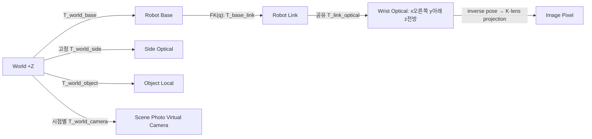

# 03. Camera·Asset·Simulation: 수치와 화면을 연결하기

[처음](README.md) · [구조](01-system-architecture.md) · [재구성](02-scene-reconstruction.md) · [좌표·자산](03-camera-assets-simulation.md) · [학습](04-robot-learning.md) · [결함](05-bug-fixes-explained.md) · [코드 지도](06-source-code-atlas.md) · [실습](07-execution-and-debugging.md) · [용어](08-glossary-and-learning-path.md)


## 목차

- [1. 좌표계와 변환 방향](#geometry-frames)
- [2. measured q와 FK, Side/Wrist](#geometry-fk)
- [3. K·왜곡·픽셀 변환](#geometry-intrinsics)
- [4. World와 Wrist Mount 초기화](#geometry-registration)
- [5. Joint Solver를 수식으로 읽기](#geometry-fit)
- [6. 관측과 Cloud의 수명](#geometry-clouds)
- [7. Object Library와 네이티브 Geometry](#geometry-assets)
- [8. Qt OpenGL Viewer](#geometry-viewer)
- [9. MuJoCo와 Isaac 실행](#geometry-simulation)
- [10. 검증 범위와 코드 읽기 문제](#geometry-validation)

기준 Commit은 `8e02b1ae023a856694a40b947881f76b66410624`다. 이 장의 행렬·코드·시험 해설은 정적 분석이며 이번 문서 작업에서 Solver, Blender, Qt, Isaac, 로봇을 새로 실행하지 않았다.

<a id="geometry-frames"></a>
## 1. 좌표계와 변환 방향

### 1.1 T의 아래첨자는 좌표의 목적지와 출발지다

열벡터를 쓰고 (T^A_B)를 **B 좌표의 점을 A 좌표로 바꾸는 행렬**로 정하자. 코드의 `T_parent_child`, 실행 Package의 `T_parent_from_frame`이 이 뜻이다.

\[
\begin{bmatrix}p_A\\1\end{bmatrix}=T^A_B\begin{bmatrix}p_B\\1\end{bmatrix},\quad
T^A_B=\begin{bmatrix}R^A_B&t^A_B\\0&1\end{bmatrix}.
\]

[scene.transform · L19](../../real2sim_builder/src/real2sim_builder/scene.py#L19)와 [transforms.validate_transform · L9](../../scene_contract/src/scene_contract/transforms.py#L9)은 shape/finite/동차행/직교성/determinant+1을 검사한다. scale이 섞인 4×4를 조용히 회전행렬로 정규화하지 않는다. 따라서 Sim(3)의 scale은 rigid Transform과 별도 값이어야 한다.



화살표의 행렬 표기는 자식 frame의 pose를 부모에서 표현한 것이며, 그림을 따라 센서로 점을 옮기려면 inverse가 필요하다. 예를 들어 World 점의 Camera 좌표는 (p_C=(T^W_C)^{-1}p_W)다. DA3가 주는 world-to-camera extrinsics와 Scene의 camera-to-parent pose를 같은 방향으로 읽으면 컵이 뒤집히거나 카메라 뒤로 이동한다.

### 1.2 저장 Reference와 현재 엔진 Pose

[transforms.resolve_transform · L71](../../scene_contract/src/scene_contract/transforms.py#L71)은 reference frame tree를 읽어 (T^{target}_{source}=(T^W_{target})^{-1}T^W_{source})를 반환한다. `state='reference'` 이외를 거부한다. 이 함수에 “현재 로봇 자세”를 물을 수 없다. 실제 current/live Pose는 MuJoCo Data 또는 Isaac sensor/state에서 읽어야 한다.

<!-- source: scene_contract/src/scene_contract/transforms.py:L90-L90 -->
```python
return np.linalg.inv(world_pose(target)) @ world_pose(source)
```

마지막 행의 inverse는 target의 World pose를 거꾸로 적용한다. `world_pose(source)`를 곱해 두 좌표계를 연결한다. 코드가 inverse 대신 rotation transpose만 사용하지 않는 이유는 번역 성분까지 포함한 완전한 동차변환이기 때문이다. 이 작은 함수의 계약을 이해하면 [scene.frame_world · L249](../../real2sim_builder/src/real2sim_builder/scene.py#L249)와 [scene.world_pose · L255](../../real2sim_builder/src/real2sim_builder/scene.py#L255)의 제작 Scene 트리도 읽을 수 있다.

<a id="geometry-fk"></a>
## 2. measured q와 FK, Side/Wrist

### 2.1 q는 “로봇의 아무 숫자 여섯 개”가 아니다

실제 입력은 joint_names, joint_units, q_measured, URDF/model SHA, mapping SHA, 시간과 sensor role을 함께 가진다. [capture.validate_joint_units · L413](../../real2sim_builder/src/real2sim_builder/capture.py#L413)는 모델에서 회전/직선 Joint를 확인하고 rad/m 단위를 검사한다. [observations.register_sensor_views · L415](../../real2sim_builder/src/real2sim_builder/observations.py#L415)는 observation의 순서·model·mapping identity를 Candidate 모델과 비교한다. 실제 물리 검증이 없는 manual mapping을 calibrated hardware라는 뜻으로 확대하지 않는다.

[calibration.geometry.link_transforms · L129](../../real2sim_builder/src/real2sim_builder/calibration/geometry.py#L129)는 URDF이면 XML tree의 parent→child를 따라 fixed origin과 joint motion을 곱한다. 회전축은 정규화되고 q는 axis-angle Rotation에, prismatic q는 축 방향 translation에 들어간다. MJCF면 named scalar hinge/slide joint를 Data에 넣고 `mj_forward`로 pose를 얻는다. 매번 소스 모델의 joint 집합과 측정 이름이 일치해야 한다.

<!-- source: real2sim_builder/src/real2sim_builder/calibration/geometry.py:L170-L170 -->
```python
poses[child] = poses[parent] @ origin(joint.find('origin')) @ motion
```

첫 행은 **부모 Link pose × URDF joint origin × 그 joint의 motion**이다. 같은 q라도 origin과 axis 또는 joint 순서가 바뀌면 다른 FK다. 따라서 근거 없이 q offset을 덧대 이미지에 맞추는 것이 이 경계의 해결책은 아니다.

### 2.2 관측별 FK는 임시 Scene에만 적용한다

[capture.observation_scene · L345](../../real2sim_builder/src/real2sim_builder/capture.py#L345)는 `view_registrations`의 image SHA와 layout을 확인하고 Scene 사본에 해당 View의 K/pixel affine/pose를 적용한다. 실제 Capture면 measured q로 Link frame을 다시 계산한다. 원본 Robot q나 Calibration 파일을 새 값으로 고치지 않는다.

관측 시각 (q_i)에 대한 Wrist는

\[
T^W_{C_i}=T^W_B\;T^B_L(q_i)\;T^L_C.
\]

여기서 (T^L_C)는 모든 q에 공유되는 Mount다. 이미지 한 장마다 서로 다른 Wrist Extrinsic을 자유 변수로 주면 손목 장착 관계가 사라지므로 실제 Side와 Wrist 역할이 확인돼야 한다. Side는 보통 World/고정 frame에 있고 q에 따라 따라가지 않는다. 역할은 [observations.camera_type · L64](../../real2sim_builder/src/real2sim_builder/observations.py#L64)와 [cameras.camera_roles · L15](../../real2sim_builder/src/real2sim_builder/cameras.py#L15)가 기록 메타데이터에서 읽으며 `camera_01.jpg` 같은 이름으로 추정하지 않는다.

관련 시험은 [Capture Producer→Registration→Stage10](../../real2sim_builder/tests/test_capture_sensor_contract.py), [Photo 두 View와 q가 다른 Wrist](../../real2sim_builder/tests/test_joint_camera_adaptation.py), [Precision 저장→Capture Reader](../../robot_learning_workbench/tests/test_precision_capture_contract.py)다. 핵심은 실제 q를 유지하며 해석하는 것이다.

<a id="geometry-intrinsics"></a>
## 3. K·왜곡·픽셀 변환

### 3.1 Projection과 역투영

\[
K=\begin{bmatrix}f_x&0&c_x\\0&f_y&c_y\\0&0&1\end{bmatrix},\quad
u=f_x X_C/Z_C+c_x,\quad v=f_y Y_C/Z_C+c_y.
\]

[cameras.project_pixels · L138](../../real2sim_builder/src/real2sim_builder/cameras.py#L138)는 왜곡이 없을 때 이 식을 행벡터 배열 `points@K.T`로 계산한다. 왜곡이 있으면 OpenCV projectPoints 및 optical rotation을 사용한다. [cameras.optical_rays · L116](../../real2sim_builder/src/real2sim_builder/cameras.py#L116)는 관측 pixel을 K와 lens 모델로 역변환해 z=1의 광선을 반환한다. Depth가 optical Z이면 (p_C=Z\,ray(u,v))다. Euclidean range를 그대로 이 식에 넣으면 다른 점이 된다.

<!-- source: real2sim_builder/src/real2sim_builder/cameras.py:L127-L128 -->
```python
rays=np.linalg.solve(k,np.c_[pixels,np.ones(len(pixels))].T).T
if not len(pixels)or not d.any():return rays
```

첫 행은 K를 명시적으로 역행렬로 만들지 않고 선형방정식을 푼다. 동차 pixel의 ray가 되고, 왜곡이 없으면 바로 반환한다. 예를 들어 합성 (f_x=f_y=500,c_x=320,c_y=240,Z=1)에서 중심 pixel은 ((0,0,1))이다. 이것은 계산 설명용 값이며 실제 센서 보정값이 아니다.

### 3.2 Resize/Crop은 K의 좌표계도 바꾼다

센서 pixel (p)를 이미지 pixel (p'=A p)로 옮기면 순수 resize/crop에서 (K'=A K)다. resize 배율 s와 crop offset o가 있을 때 `A`의 마지막 열이 principal point 이동을 담는다. K를 그대로 두고 배열 크기만 바꾸면 같은 3D 광선이 아니다.

실제 코드는 EXIF 회전까지 다룬다. [cameras.camera_pixels · L92](../../real2sim_builder/src/real2sim_builder/cameras.py#L92)가 pixel affine A와 optical axes 회전 R을 반환하고, [capture.observation_scene · L345](../../real2sim_builder/src/real2sim_builder/capture.py#L345)는 (K_{image}=A K_{camera}R^T)를 사용한다. lens 계수는 원 센서에 속하므로 `distortion_rotation`을 통해 원 축과 관계를 유지한다. unknown crop이나 aspect-ratio 변경을 임의 scaling이라고 해석하지 않고 거부한다. mirrored EXIF를 지원한다고 추측하지 않는다.

[cameras.distort_render · L164](../../real2sim_builder/src/real2sim_builder/cameras.py#L164)는 원 RGB를 보정 파일로 다시 쓰는 함수가 아니다. 임시 pinhole 렌더를 관측 lens grid로 sample한다. RGB는 보간하고 mask/optical-Z는 nearest를 사용해 서로 다른 면의 label/depth가 섞이지 않게 한다.

### 3.3 Blender/Qt/Isaac은 서로 다른 Camera 경계다

`OPTICAL_TO_RENDER`는 상수가므로 위 심볼 링크 대신 [cameras.py L6](../../real2sim_builder/src/real2sim_builder/cameras.py#L6)의 `diag(1,-1,-1,1)`를 본다. optical +Z 시선을 Blender -Z 시선으로 바꾸며 proper rotation이다. [cameras.blender_intrinsics · L84](../../real2sim_builder/src/real2sim_builder/cameras.py#L84)는 fx/fy 차이와 principal shift를 lens/pixel aspect/shift로 옮긴다.

Isaac 쪽은 [engines.isaac.env_cfg._pinhole_properties · L19](../../robot_learning_workbench/src/robot_learning_workbench/engines/isaac/env_cfg.py#L19) → `RuntimeCamera.set_intrinsic_matrices/_update_intrinsic_matrices` → [engines.isaac.env_cfg._set_native_pinhole · L42](../../robot_learning_workbench/src/robot_learning_workbench/engines/isaac/env_cfg.py#L42) → [engines.isaac.env_cfg._native_pinhole_matrix · L70](../../robot_learning_workbench/src/robot_learning_workbench/engines/isaac/env_cfg.py#L70)다. `RuntimeCamera`는 build_env_cfg 내부 지역 클래스이며 [그 정의](../../robot_learning_workbench/src/robot_learning_workbench/engines/isaac/env_cfg.py#L236)를 직접 연다. Reader가 참조하는 native `OmniLensDistortionOpenCvPinholeAPI`의 fx/fy/cx/cy/imageSize를 session layer에 기록하고 readback한다. aperture에 평균 focal만 넣는 예전 방식과 다르다.

- fx/fy/cx/cy와 해상도를 센서별로 검증한다. skew/비동차행/비유한 값·지원하지 않는 구조는 거부한다.
- env_ids별 batch 전체를 검증한 후 기록하므로 뒤 행이 잘못됐다고 앞 센서만 바뀌지 않게 한다.
- Native USD Schema가 없으면 NOT_SUPPORTED로 실패하며 중앙 principal-point Camera로 대체하지 않는다.
- 이 CPU Schema/config 시험이 실제 RTX 이미지의 reprojection 정확도를 증명하지는 않는다. [Isaac K 시험의 함수별 근거](../../robot_learning_workbench/tests/test_isaac_camera_intrinsics.py)와 [이전 1C 한계](../reviews/phase1c-isaac-camera-intrinsic-fix.md)를 함께 읽는다.

<a id="geometry-registration"></a>
## 4. World와 Wrist Mount 초기화

### 4.1 Support gauge가 Robot World는 아니다

DA3의 relative pose와 Stage4의 support-normal 정렬은 편리한 제작 gauge를 준다. 로봇 Base와 측정 좌표를 연결하려면 독립 대응점/측정이 필요하다. [calibration.registration.align_points · L34](../../real2sim_builder/src/real2sim_builder/calibration/registration.py#L34)는 대응 3D 점의 weighted center와 SVD에서 R,t,선택 scale을 구한다. Stage10은 이 rigid pose와 scale을 구분해 보존한다. 네 개의 점이 있다는 사실만으로 올바른 점 대응이나 미터 정확도가 증명되지는 않는다.

`resolve_sensor_world/register_stage_sensors`의 실제 조율은 [Stage10](02-scene-reconstruction.md)에 있다. 작업판 길이 하나를 안다고 6D Base pose를 자동 결정하지 않는다. source points가 estimated Z라는 provenance도 유지한다.

### 4.2 motion 기반 hand-eye는 공유 미지수를 푼다

[calibration.registration.wrist_from_motion · L135](../../real2sim_builder/src/real2sim_builder/calibration/registration.py#L135)는 공통 relative Camera pose (C_i), FK pose (F_i)에 대해 (s C_i \approx X F_i M)을 푼다. translation만 scale하고, X와 M은 각각 6D pose, log(scale)은 1D라 총13변수다. 코드에서는 다른 scale seed 0.1/1/10으로 최소제곱 후보를 비교하고 rank13 및 residual 기준을 검사한다. 최소4 pose를 요구하며 운동이 비슷하면 실제 독립 식이 늘지 않는다.

이 함수의 gauge는 robot-base 기준이며, 물리적으로 측정한 절대 작업판 World를 인증하는 함수가 아니다. 반환 `physical_verified=False`, `gauge`, `provenance`를 같이 읽는다. 손잡이처럼 특정 시각 특징으로 Mount를 추정하는 [calibration.wrist.fit_gripper_mount · L28](../../real2sim_builder/src/real2sim_builder/calibration/wrist.py#L28)도 별도 관측·mask·렌더 근거가 필요하다. 아무 RGB 한 장에서 FK와 world registration 전체를 결정하는 만능 함수가 아니다.

<a id="geometry-fit"></a>
## 5. Joint Solver를 수식으로 읽기

### 5.1 어떤 값을 변수로 삼는가

[calibration.joint.parameter_blocks · L41](../../real2sim_builder/src/real2sim_builder/calibration/joint.py#L41)는 보호된 measured/calibrated pose와 실측 축을 제외하고 Camera/Photo View/Object/Base 등의 block을 만든다. 일반 공용 block 함수는 K/depth scale/appearance도 지원하지만, **landmark용 `fit_joint_scene`는 dimensions/intrinsics/appearance/lighting/depth scale 최적화를 false로 고정**한다. 공용 helper의 모든 기능이 매번 실행되는 것은 아니다.

[calibration.joint.fit_joint_scene · L353](../../real2sim_builder/src/real2sim_builder/calibration/joint.py#L353)는 등록 View, reviewed landmark, confidence/weight/sigma_px를 읽는다. train 관측만 변수/잔차에 쓰며, group_id train/validation 충돌을 거부한다. 최소4 reviewed point가 필요하다. mask만으로 이 solver가 자동 기하를 구하지 않는다. physical support가 명시됐으면 XY/yaw처럼 제약된 block이 만들어질 수 있다.

| 항목 | 현재 구현에서 확인할 것 |
|---|---|
| input | image ID, CAD object/frame point, uv, split/group, measured q, shared Camera |
| assign | [calibration.joint.apply_parameters · L209](../../real2sim_builder/src/real2sim_builder/calibration/joint.py#L209)로 block의 delta를 Scene 사본에 반영 |
| projection | 매 trial마다 [capture.observation_scene · L345](../../real2sim_builder/src/real2sim_builder/capture.py#L345)를 적용한 Camera로 point projection |
| solve | SciPy `least_squares`, bounded variables, `loss='soft_l1'` |
| report | before/after 그룹별 RMSE, holdout diagnostics, rank/condition/bounds, needs |
| Consumer | Candidate.fit / Stage10 / numeric/hybrid가 서로 다른 채택 정책을 추가 |

### 5.2 residual을 한 점씩 읽기

관측 i의 residual을 다음처럼 읽을 수 있다.

\[
r_i=w_i(\pi(K_i,T_i,P_i)-u_i),\quad
w_i=\frac{\sqrt{weight_i\,confidence_i/n_{group}}}{sigma_{px,i}}.
\]

각 관측에는 camera 뒤쪽 점을 벌하는 (\max(0,0.001-Z_i)10^4)도 들어간다. prior는 변수 x를 허용 반경 radius로 나누어 곱한다. 그룹 정규화는 점이 많은 한 이미지가 모든 관측을 압도하지 않게 한다. prior가 있다는 사실로 데이터 자체가 미지수를 관측했다는 뜻은 아니다.

<!-- source: real2sim_builder/src/real2sim_builder/calibration/joint.py:L475-L487 -->
```python
def residual(x, prior=True):
    assign(x)
    values = []
    for row, delta, depth in errors(train):
        image = by_id[row['observation']]
        group = (image['camera'], row['observation'], row.get('object', row.get('frame', 'world')))
        weight = np.sqrt(float(row.get('weight', 1))*float(row.get('confidence', 1))/counts[group]) / float(row.get('sigma_px', 3))
        values.extend(delta*weight)
        values.append(max(0., .001-depth)*1e4)
    if prior:
        values.extend(x/radius*float(options.get('pose_prior', .2)))
    return np.asarray(values)
# Measure after physical initialization; optimizing pixels cannot undo contact.
```

`assign(x)`는 현재 trial을 적용한다. `errors(train)`은 그 trial Camera/FK/점 투영에서 pixel delta와 depth를 계산한다. weight 줄은 명시 관측 confidence와 불확실성 sigma를 사용한다. depth penalty는 optical z가 양수여야 하는 조건을 수치 잔차로 넣는다. 마지막 prior는 허용 범위 대비 과도한 이동을 억제한다. `soft_l1`은 이 최종 잔차 벡터에 적용된다.

### 5.3 Rank 2/6과 6/6

최적화에서 사용하는 residual 전체에는 prior가 있다. 코드가 관측 Jacobian의 앞 `3*len(train)` 행만 꺼내 radius로 열을 scaling한 후 SVD/rank를 계산하는 이유가 여기 있다. prior까지 넣어 full rank처럼 보이게 하지 않으려는 것이다.

<!-- source: real2sim_builder/src/real2sim_builder/calibration/joint.py:L497-L500 -->
```python
jac = solution.jac[:3*len(train)] * radius[None, :]
singular = np.linalg.svd(jac, compute_uv=False)
rank = int(np.linalg.matrix_rank(jac))
condition = float(singular[0]/singular[-1]) if rank == len(lower) and singular[-1] > 1e-12 else None
```

6변수인데 rank2라면 네 방향은 이 데이터에서 구별되지 않을 수 있다. RMSE가 줄어도 pose가 유일하게 결정됐다고 채택하면 안 된다. rank6이면 적어도 이 선형화된 합성 문제의 여섯 방향이 관측된 것이다. 대응점이 잘못됐거나 모델·렌즈가 부정확하거나 local minimum이면 여전히 틀릴 수 있다. condition number가 큰 경우도 작은 pixel 오차에 pose가 크게 흔들릴 수 있다. 반환 condition은 full rank 조건을 만족할 때 계산하며 None을 0으로 해석하지 않는다.

### 5.4 Solver의 개선과 Caller의 채택은 다르다

`fit_joint_scene`는 rank 부족을 needs에 남겨도 train/group/보호 조건을 만족하면 diagnostic `IMPROVED`를 반환할 수 있다. 따라서 “어느 Caller인지”가 핵심이다.

- [reconstruction_stages.register_stage_sensors · L975](../../real2sim_builder/src/real2sim_builder/reconstruction_stages.py#L975)는 rank < parameter_count이면 pre-fit Scene을 유지하고 UNRESOLVED/scene_adopted=false로 기록한다(FIX-A).
- [candidate.Candidate.fit · L202](../../real2sim_builder/src/real2sim_builder/candidate.py#L202)의 direct joint 경로는 diagnostic draft를 보존할 수 있으나 독립 Calibration 인증은 하지 않는다. 채택할 때 scope/preserve와 종속 Cloud 재투영을 수행한다.
- [automation.refine_numeric_pairs · L636](../../real2sim_builder/src/real2sim_builder/automation.py#L636)와 [calibration.hybrid.fit_scene · L183](../../real2sim_builder/src/real2sim_builder/calibration/hybrid.py#L183)는 관측 가능성·비퇴행/예산 등의 자체 계약이 있다. 동일 함수 결과를 어느 한 경로의 성공 의미로 통일하지 않는다.

[rank2/6·6/6 실제 Solver 회귀](../../real2sim_builder/tests/test_joint_acceptance_policy.py), [direct fit→Cloud Consumer](../../real2sim_builder/tests/test_direct_fit_observation_refresh.py), [고정 World와 Holdout 최종 감사 시험](../../real2sim_builder/tests/test_final_audit_contracts.py)을 순서대로 읽는다. 이들은 합성/Mock·CPU 경계 검증이며 실물 metric 정확도 보증이 아니다.

<a id="geometry-clouds"></a>
## 6. 관측과 Cloud의 수명

### 6.1 Camera를 고쳤는데 왜 Cloud를 다시 다루는가

Raw Z/pixel ray가 같아도 Camera pose가 바뀌면 World point가 달라진다. 반대로 독립 anchor로 이미 World에 고정한 점은 Camera가 바뀌었다고 이동시키면 안 된다. 이 차이를 `geometry_binding`과 저장 배열로 구분한다.

| 관측 종류 | 소스 배열과 의미 | fit 후 처리 |
|---|---|---|
| raw-relative optical | points_camera_relative, 필요 시 uv_original/depth_relative | 새 Camera ray/K·pose·기록 scale로 새 World 배열을 새 NPZ에 저장 |
| fixed_world | anchor로 고정한 points_world_m, geometry_binding=fixed_world | 점/파일/SHA를 그대로 유지하고 해당 Camera bookkeeping signature만 갱신 |
| render_only | raw relative 없이 렌더 비교에 사용 | 지원된 dependencies signature 갱신, 측정 Depth로 발명하지 않음 |
| 구형 불완전 관측 | binding/raw/dependency 근거 부족 | 모두 같다고 복구하지 않음. 다음 Consumer가 stale/unknown을 거부할 수 있음 |

[calibration.hybrid.reproject_observations · L391](../../real2sim_builder/src/real2sim_builder/calibration/hybrid.py#L391)가 이 처리를 소유하고, [calibration.hybrid.cloud_inputs · L102](../../real2sim_builder/src/real2sim_builder/calibration/hybrid.py#L102)가 후속 Consumer다. source NPZ의 SHA, image record SHA, Camera signature, optical geometry를 읽어 유효성을 확인한다. signature가 바뀌는 것과 측정값 자체가 바뀌는 것을 혼동하지 않는다.

<!-- source: real2sim_builder/src/real2sim_builder/calibration/hybrid.py:L409-L413 -->
```python
if 'points_camera_relative'not in raw:
    if (row.get('render_only')or row.get('geometry_binding')=='fixed_world')and row.get('dependencies'):
        # Anchor-registered World samples stay fixed after Camera fitting.
        row['dependencies']['camera_signature']=camera_calibration_signature(result,next(c for c in result['cameras']if c['id']==image['camera']))
    continue
```

raw-relative가 없는 두 명시 분기만 signature를 갱신하고 계속한다. `continue`로 아래 raw point 재투영을 하지 않으므로 fixed World의 값은 움직이지 않는다. 이름만 다르고 근거가 없는 Legacy를 이 분기로 강제로 넣지 않는다.

[reconstruction_stages.stage_sensor_clouds · L869](../../real2sim_builder/src/real2sim_builder/reconstruction_stages.py#L869)는 Stage10에서 original uv/point와 affine을 이용해 typed World cloud·원본 mask·카메라·split/group/units/frame·dependency를 기록한다. 원래 있던 cloud를 전부 덮어쓰지 않고 image/object key로 보존한다. 이 schema가 빠지면 “NPZ는 있는데 정합에서 읽지 못하는” BUG-013이 생겼다.

### 6.2 metric·Confidence·독립성

DA3의 metric 출력이나 CPD residual은 ground truth 치수 측정이 아니다. rgb_source/depth_source와 original/generated mask, scale 근거를 보존한다. Solver에 사용한 validation View는 결과 선택에 영향을 줬으므로 독립 Test가 아니다. [observations._record_holdout_usage · L23](../../real2sim_builder/src/real2sim_builder/observations.py#L23)와 camera assessment의 사용 이력 guard는 이미 소진한 자료를 새 독립 보정 근거로 사용하지 않게 한다. 원본 split의 이름을 바꾸는 것과 실제 사용 이력이 다르다는 점은 [RISK-002](05-bug-fixes-explained.md#risk-002)에서 더 설명한다.

<a id="geometry-assets"></a>
## 7. Object Library와 네이티브 Geometry

### 7.1 Asset, Version, Instance

[object_assets.register_object_asset · L208](../../real2sim_builder/src/real2sim_builder/object_assets.py#L208)는 원본 USDA와 의존 texture/layer 파일을 검사하고, 새 immutable version에 native entry/Visual/Collision 파생물/치수·단위·SHA를 묶는다. `asset_id/v001`은 저장 버전이고 content_sha256은 내용 identity다. 같은 내용은 재사용할 수 있지만 다른 형상은 기존 v001을 덮어쓰지 않는다.

[object_assets.instance_operation · L360](../../real2sim_builder/src/real2sim_builder/object_assets.py#L360)는 Manifest를 Scene Object에 연결할 edit operation을 만든다. Asset의 형상은 공유하더라도 Instance의 Object ID·pose·role은 Scene 소유다. `cup_1`과 `cup_2`가 같은 종류라는 이유만으로 같은 물리 Instance가 아니다. [object_assets.scaled_asset_operation · L386](../../real2sim_builder/src/real2sim_builder/object_assets.py#L386)와 support asset 경계도 새 버전·보호 치수 검사를 거치며 기존 source asset을 편집하지 않는다.

| 생성/Consumer | 입력 | 처리·반환·실패 |
|---|---|---|
| inspect_usda | native USD entry | defaultPrim/closure/geometry 지원 검사. 외부 경로·손상된 의존성 거부 |
| _convert | 검증 Stage | transform을 bake한 Visual/Collision OBJ·texture·bounds. 원본 native bytes는 보존 |
| register_object_asset | source + 명시 ID/치수 근거 | pending→version, manifest와 content/semantic SHA |
| verify_object_asset | Manifest | 실제 dependency SHA와 소비 semantic을 검사. Legacy는 임시 변환 결과와 비교 |
| load_asset_view | Project + manifest path | 임시 derivative를 읽어 vertices/faces/uv/color/PNG payload 반환 |
| library_action | UI 명시 action | list/preview/register/publish/instantiate/assign을 기존 Asset/Candidate API로 전달 |

### 7.2 Triangle Fan이 Concave Polygon에서 실패한 이유

Convex n-gon은 첫 vertex에서 모든 나머지 edge로 triangle fan을 만들어도 안쪽만 채운다. 오목한 다각형은 일부 triangle이 외부까지 나가 채워져야 하지 않는 구멍을 덮는다. [object_assets._face_triangles · L79](../../real2sim_builder/src/real2sim_builder/object_assets.py#L79)는 다음 순서다.

1. 삼각형은 그대로 반환한다. 0면적 cap의 기존 동작과 non-planar convex fan을 무조건 제거하지 않는다.
2. centered coordinates와 cross 합으로 normal/면 크기 tolerance를 계산한다.
3. 지배 normal 축을 제거해 평면 2D 좌표로 투영한다. self-intersection/unsupported degenerate 구조를 검사한다.
4. convex이면 기존 fan을 유지한다. concave이면 평면성도 확인한다.
5. winding에 맞는 볼록 ear를 찾고, 다른 꼭짓점이 ear 내부에 없을 때 하나의 triangle로 자른다. 더 자를 수 없으면 임의 fill 대신 실패한다.

이 helper는 원본 polygon의 **corner index**를 반환한다. [object_assets._convert · L124](../../real2sim_builder/src/real2sim_builder/object_assets.py#L124)는 이 index에 face offset을 더해 UV interpolation/corner를 유지하고 leftHanded면 순서를 뒤집는다. vertex index만 유지하고 UV corner를 잃으면 표면 Geometry를 고쳐도 Texture가 깨진다.

<!-- source: real2sim_builder/src/real2sim_builder/object_assets.py:L171-L175 -->
```python
for triangle in _face_triangles(points[indices[offset:offset+count]]):
    corners=[offset+index for index in triangle]
    if mesh.GetOrientationAttr().Get()=='leftHanded':corners.reverse()
    for corner in corners:
        vertex=indices[corner];texcoord=[0.,0.]
```

각 triangle의 corner를 원 polygon offset으로 복구하는 행, handedness를 처리하는 행, 그리고 각 corner의 vertex/texcoord를 소비하는 흐름을 읽자. source USDA에 삼각화를 다시 기록하는 것이 아니라 임시/버전 파생물을 만드는 경계다. [오목 Polygon area/coverage/UV/material/winding 시험](../../real2sim_builder/tests/test_asset_semantic_geometry.py)의 test_concave_native_polygon_area_coverage_uv_material_and_orientation을 본다.

### 7.3 Semantic digest는 파일 SHA의 다른 이름이 아니다

파일 bytes가 같아도 Manifest의 visual/collision part 목록이나 collision_status가 바뀌면 Consumer의 의미가 바뀐다. [object_assets._semantic_digest · L267](../../real2sim_builder/src/real2sim_builder/object_assets.py#L267)는 consumed field를 content hash와 함께 묶는다. [object_assets.verify_object_asset · L275](../../real2sim_builder/src/real2sim_builder/object_assets.py#L275)는 dependency bytes와 semantic digest를 모두 검사한다. Legacy에 새 digest를 몰래 써 넣는 대신 native USD에서 임시로 얻은 visual/collision/defaultPrim과 기존 record를 대조한다. authored collision은 AUTHORED_UNVALIDATED이며 physically approved가 아니다.

<a id="geometry-viewer"></a>
## 8. Qt OpenGL Viewer

### 8.1 버튼에서 실제 USDA까지

[ui.object_library.ObjectLibraryDialog.call · L54](../../robot_learning_workbench/src/robot_learning_workbench/ui/object_library.py#L54) → BackendJob `object_library` operation → [asset_view.library_action · L41](../../real2sim_builder/src/real2sim_builder/asset_view.py#L41) → [asset_view.load_asset_view · L15](../../real2sim_builder/src/real2sim_builder/asset_view.py#L15) → verified native USD/_convert → UI payload → [ui.asset_viewport.AssetViewport.load · L101](../../robot_learning_workbench/src/robot_learning_workbench/ui/asset_viewport.py#L101) → upload/paintGL이다. 별도의 큐브 proxy를 만들어 컵을 대신 보여주는 경로가 아니다.

`load_asset_view`는 texture를 RGB PNG/base64로 전달하고 최대1024 thumbnail을 사용한다. 원 texture bytes를 바꾸지 않는다. preview는 diffuse/UV 및 제한된 lighting이며 PBR/재질의 물리 정확도를 보증하지 않는다. 화면 좌표를 맞추는 fit/zoom은 Asset의 m scale/Manifest transform을 편집하는 작업이 아니다.

현재 기본 UI는 Visual100%, Collision Front0%, Collision Hidden0%의 세 slider다. X-Ray/Collision Only/Feature Edges/Feature Angle25°는 Advanced/Debug 안에 있다. 이전 문서의 Show Visual/Show Collision 체크박스 배치는 과거 UI다. `ObjectLibraryDialog.display_changed`를 현재 계약으로 읽는다. slider0으로 collision을 끄는 것과 geometry가 없다는 것은 다르다.

### 8.2 Painter sort 대신 실제 Depth Buffer

Viewer는 QOpenGLWidget, OpenGL4.1 Core/GLSL410을 요청한다. [ui.asset_viewport.AssetViewport.initializeGL · L118](../../robot_learning_workbench/src/robot_learning_workbench/ui/asset_viewport.py#L118)에서 실제 Context/version과 shader/buffer를 만들고, [ui.asset_viewport.AssetViewport.paintGL · L217](../../robot_learning_workbench/src/robot_learning_workbench/ui/asset_viewport.py#L217)는 아래 순서로 그린다.

1. Visual의 depth pre-pass. opacity0이어도 show_visual이면 visibility 판정용 depth는 남긴다.
2. 같은 depth인 표면의 texture/color를 그린다. 일반 다중 반투명 PBR renderer가 아니라 front-surface preview다.
3. Collision part 모두로 depth를 구성한다. Visual이 숨겨져도 뒤 Collision과 앞 Collision을 구분한다.
4. X-Ray hidden edge는 GREATER depth test에서 orange/dashed, 보이는 edge는 LEQUAL에서 cyan으로 그린다. Edge depth write는 끄고 alpha blending한다.
5. blend/depth/color mask 상태를 복원한다. 원 Mesh를 옮기지 않는 polygon offset으로 coplanar z-fighting을 줄인다.

<!-- source: robot_learning_workbench/src/robot_learning_workbench/ui/asset_viewport.py:L264-L269 -->
```python
if self.state['collision_mode']=='xray'and hidden>0:
    f.glDepthFunc(GREATER)
    for edge in edges:self.draw(edge,[1.,.5,.12,hidden],primitive=LINES,lit=False,wireframe=True,dashed=True)
f.glDepthFunc(LEQUAL)
if visible>0:
    for edge in edges:self.draw(edge,[.15,.9,1.,visible],primitive=LINES,lit=False,wireframe=True)
```

`GREATER`와 `LEQUAL`은 같은 Geometry를 depth 기준의 두 집합으로 나눈다. depth test를 완전히 꺼서 모든 선을 같은 색으로 표시하는 것과 다르다. hidden opacity가0이면 hidden pass가 생략되며, visible/hidden alpha만 uniform/render 상태에 영향을 주어 Geometry 재로딩이 필요 없다.

### 8.3 Feature Edge는 “Part 경계 65개”라는 이름이 아니다

[ui.collision_wireframe.mesh_topology · L15](../../robot_learning_workbench/src/robot_learning_workbench/ui/collision_wireframe.py#L15)는 exact coordinate로 vertex adjacency를 구성하고 degenerate/duplicate triangle을 분석에서 제외한다. [ui.collision_wireframe.collision_topology · L43](../../robot_learning_workbench/src/robot_learning_workbench/ui/collision_wireframe.py#L43)는 **닫힌 두 Part의 동일한 반대 방향 coplanar patch**가 실제로 일치할 때만 내부 접촉을 지운 display adjacency를 만든다. CSG/실제 Mesh 결합이나 임의 tolerance welding이 아니다. 모호한 다중 patch는 그대로 남긴다.

Feature set은 boundary/nonmanifold 같은 fixed edge, 두 면 normal 각도 ≥Feature Angle인 edge, camera 방향의 silhouette의 합집합이다. [ui.collision_wireframe.feature_base · L96](../../robot_learning_workbench/src/robot_learning_workbench/ui/collision_wireframe.py#L96), [ui.collision_wireframe.silhouette_mask · L101](../../robot_learning_workbench/src/robot_learning_workbench/ui/collision_wireframe.py#L101)를 비교한다. 완만한 컵 곡면의 각도가25°보다 작아도 silhouette이 남는 이유다. All Edges는 각 part의 실제 triangle edge를 유지하는 진단 경로다.

Asset/Version load 때 topology를 cache하고, angle이 바뀌면 base feature를, camera orbit 때 silhouette selection/GPU buffer만 갱신한다. 회전마다 USDA를 다시 읽지 않는다. [ui.asset_viewport.AssetViewport.feature_buffer · L188](../../robot_learning_workbench/src/robot_learning_workbench/ui/asset_viewport.py#L188)가 이 경계다. 우클릭 Orbit, 가운데 Pan, 휠 Zoom, Reset은 display state만 변경한다. `release_meshes/cleanup/closeEvent`는 version 변경·Dialog 종료 때 GPU resource를 반환한다.

관련 시험: [test_asset_view.py](../../real2sim_builder/tests/test_asset_view.py), [collision wireframe 시험](../../real2sim_builder/tests/test_wireframe_features.py), [Object Library UI 시험](../../real2sim_builder/tests/test_asset_view.py). 정확한 이름·Assertion은 [Atlas의 시험 연결](06-source-code-atlas.md)에서 현재 파일로 이동한다. 이번 교재 작성에서 cup GUI screenshot을 새로 만들었다고 주장하지 않는다.

<a id="geometry-simulation"></a>
## 9. MuJoCo와 Isaac 실행

### 9.1 immutable Package가 엔진 입력이 된다

[export.export_revision · L305](../../real2sim_builder/src/real2sim_builder/export.py#L305)는 검증 보고서 signature와 Candidate/Current를 확인한 뒤 새 destination을 staging에 만든다. 네이티브 XML/USD 의존성을 복사·검사하고 USD/MJCF와 Scene Contract metadata를 연결한다. allow_unvalidated Review Export와 승인된 Current를 구분한다. [package.load_scene · L518](../../scene_contract/src/scene_contract/package.py#L518)는 engine code를 실행하지 않고 Manifest·파일 closure·Schema를 검증한다.

[engines.mujoco.model.build_model · L213](../../robot_learning_workbench/src/robot_learning_workbench/engines/mujoco/model.py#L213)는 Scene Package와 ModelConfig에서 실제 robot/object/visual/collision을 가진 MjModel 및 binding을 만든다. fixed/active object, robot Base, Joint/model identity가 수치 모델과 연결된다. [engines.mujoco.state.restore_episode · L26](../../robot_learning_workbench/src/robot_learning_workbench/engines/mujoco/state.py#L26)는 Episode 초기 q/object pose를 엔진에 적용하며 physics state와 단순 Scene reference metadata를 구분한다. [generation.mimic.SO101Kinematics · L319](../../robot_learning_workbench/src/robot_learning_workbench/generation/mimic.py#L319)는 명시 URDF/관절 순서로 Pinocchio FK와 Jacobian을 구성하고 [generation.mimic.solve_dls · L291](../../robot_learning_workbench/src/robot_learning_workbench/generation/mimic.py#L291)가 IK 결과·제약을 검사한다. MuJoCo control.step은 IK가 아니라 실제 6D model-rad target을 actuator에 적용하고 물리를 진행한다. placement와 evaluation predicate는 Python Task 모듈이며 매 step Codex를 호출하지 않는다.

Isaac은 [run._run_stage · L443](../../robot_learning_workbench/src/robot_learning_workbench/run.py#L443)가 해당 Stage에서만 AppLauncher를 초기화하고 [engines.isaac.env_cfg.build_env_cfg · L209](../../robot_learning_workbench/src/robot_learning_workbench/engines/isaac/env_cfg.py#L209)가 Robot/FrameTransformer/Camera/contact sensor와 물체를 구성한다. robot 자산 binding/관절 순서/환경 수와 USD runtime directory를 명시한다. 이 설정 코드를 읽거나 CPU fake/native schema 시험을 통과한 것이 실제 Kit/PhysX 실행의 증거는 아니다.

### 9.2 렌더와 물리 판정을 구분한다

| 경계 | 수행 | 한계 |
|---|---|---|
| Builder Renderer | [rendering.Renderer · L443](../../real2sim_builder/src/real2sim_builder/rendering.py#L443), [rendering.BlenderRenderer · L732](../../real2sim_builder/src/real2sim_builder/rendering.py#L732), [isaac_render.IsaacRenderer · L11](../../real2sim_builder/src/real2sim_builder/isaac_render.py#L11) | 정합을 위한 RGB/mask/depth. 렌더 성공 ≠ 접촉·마찰 인증 |
| Real/Sim NativeRenderer | [robot.scene_render.NativeRenderer · L46](../../robot_learning_workbench/src/robot_learning_workbench/robot/scene_render.py#L46) | measured q에 대한 실제 엔진 RGB/Camera metadata. authored preview와 구분 |
| authored render | [robot.authored_render.py · L1](../../robot_learning_workbench/src/robot_learning_workbench/robot/authored_render.py#L1) | 네이티브 물리 step이 없는 제작 상태 비교. actual_physics_steps=0을 물리 실험으로 바꾸지 않음 |
| passive physics | [validation.physics_probe · L233](../../real2sim_builder/src/real2sim_builder/validation.py#L233) | 실제 step/pose/속도/관통/안정 구간. 속성 unknown/엔진별 검사 범위를 유지 |
| stabilized pose 적용 | [validation.reviewed_stabilized_scene · L211](../../real2sim_builder/src/real2sim_builder/validation.py#L211) | 일치하는 명시 review·실행 provenance·preserve/validate 후 Candidate에만 반영 |
| Policy evaluation | 엔진 evaluation.run + Task evaluation_result | 초기 배치 만족/실제 policy success/max step을 분리해 Attempt를 게시 |

View 카메라는 [cameras.select_render_cameras · L48](../../real2sim_builder/src/real2sim_builder/cameras.py#L48)에서 sensor-role 메타데이터로 선택한다. Side/Wrist가 기본이며 사진 reference는 필요한 한 View만 임시 렌더한다. 사진 Camera를 저장 Scene에서 삭제하는 것과 GPU Render Product를 해제하는 것은 다르다.

<a id="geometry-validation"></a>
## 10. 검증 범위와 코드 읽기 문제

다음 과제는 실행 지시가 아니라 VS Code의 읽기 순서다.

1. `observation_scene`에서 한 Photo의 pixel affine branch와 Wrist FK branch를 구별해 보라. 왜 두 branch를 baseline Camera cache로 대신할 수 없는가?
2. `fit_joint_scene.residual`에 prior가 있는데 rank 계산은 왜 앞 데이터 행만 쓰는가? Stage10과 direct Candidate의 채택 조건은 같은가?
3. raw-relative와 fixed_world cloud의 같은 Camera 변경을 종이에 따라 써 보라. 어떤 NPZ SHA가 달라지고 어떤 SHA가 같아야 하는가?
4. `load_asset_view → _convert → paintGL`에서 USDA bytes를 쓰는 행이 있는가? Opacity slider가 바뀌면 topology/scale/Transform을 다시 만드는가?
5. Native collision/physics가 미검증인 Manifest를 읽어도 Viewer가 표시되는 이유를 설명해 보라. 화면 표시와 physical_verified는 별개다.

이전 최종 회귀 2,151 통과에는 실제 CPU 수학·네이티브 parser·작은 엔진/Qt 검사가 포함되지만, 모든 실제 사진·전체 GPU Reconstruction·실물 Task 성공을 포괄하지 않는다. 각 함수의 호출 가능성, 설정조건, 테스트에서 대체한 부분과 실제 Runtime을 [상태표](README.md#verification-levels)로 돌아가 구별한다.
