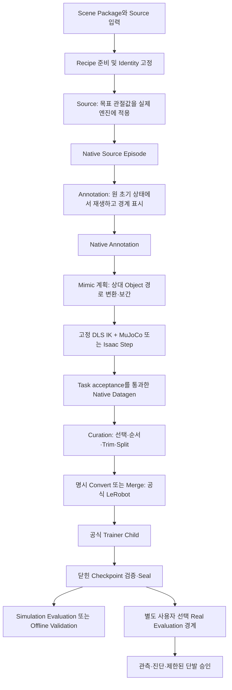
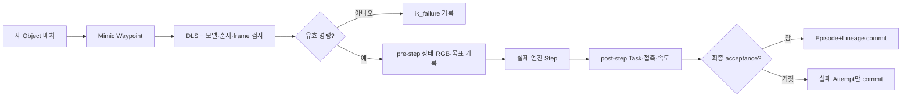
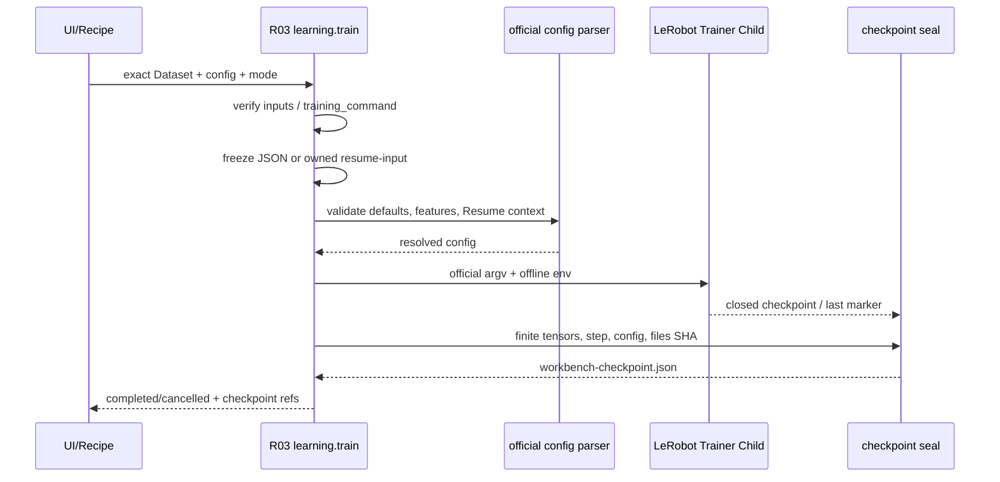

# 04. 로봇학습 — 관측 기록에서 ACT와 평가까지

[교재 처음](README.md) · [아키텍처](01-system-architecture.md) · [재구성](02-scene-reconstruction.md) · [Camera·Asset·Simulation](03-camera-assets-simulation.md) · [버그 해설](05-bug-fixes-explained.md) · [File Atlas](06-source-code-atlas.md) · [실행·디버깅](07-execution-and-debugging.md) · [용어·학습 순서](08-glossary-and-learning-path.md)

기준: `8e02b1ae023a856694a40b947881f76b66410624`, 2026-11-15. 이 장은 제품과 테스트 **소스의 정적 분석**이다. 문서를 작성하며 Dataset을 만들거나 학습·평가·테스트를 실행하지 않았다. 과거 CPU 실행과 회귀 결과는 별도 보고서의 기록으로 표시한다.

## 목차

- [1. 먼저 구별할 다섯 가지 성공](#1-먼저-구별할-다섯-가지-성공)
- [2. Recipe에서 구체적인 Runner로 내려가기](#2-recipe에서-구체적인-runner로-내려가기)
- [3. Source와 Teleoperation — 무엇을 기록하는가](#3-source와-teleoperation--무엇을-기록하는가)
- [4. Native Dataset — Writer와 Consumer의 약속](#4-native-dataset--writer와-consumer의-약속)
- [5. Annotation — 시연을 생성용 자료로 만들기](#5-annotation--시연을-생성용-자료로-만들기)
- [6. Mimic와 Data Generation — 경로를 옮긴 후 실제로 실행하기](#6-mimic와-data-generation--경로를-옮긴-후-실제로-실행하기)
- [7. Curation — 원본을 고치지 않고 선택하기](#7-curation--원본을-고치지-않고-선택하기)
- [8. LeRobot 변환 — 배열의 형식과 제어 의미를 함께 옮기기](#8-lerobot-변환--배열의-형식과-제어-의미를-함께-옮기기)
- [9. 학습 — 공식 Trainer를 감싸는 경계](#9-학습--공식-trainer를-감싸는-경계)
- [10. Checkpoint와 Resume — 무엇을 이어받는가](#10-checkpoint와-resume--무엇을-이어받는가)
- [11. 평가 — 모델 호출과 물리적 성공을 분리하기](#11-평가--모델-호출과-물리적-성공을-분리하기)
- [12. Hub·오류·검증 상태와 읽기 순서](#12-hub오류검증-상태와-읽기-순서)

## 1. 먼저 구별할 다섯 가지 성공

프로젝트에는 `source`, `annotation`, `datagen`, `train`, `simulation_evaluation`, `offline_validation`이라는 **서로 다른 작업**이 있다. UI에서 한 탭의 작업이 끝났다고 다음 탭의 작업까지 자동 실행되는 것은 아니다. 사용자가 각 단계의 입력과 출력 경로를 저장하고 실행한다. `Recipe`가 연결 조건을 확인하고, 파일과 Identity가 다음 작업의 입력이 된다. 전체 화면의 연결은 [01장](01-system-architecture.md), 관측과 Scene의 기원은 [02장](02-scene-reconstruction.md)에서 먼저 확인한다.

| 질문 | 확인할 근거 | 잘못된 해석 |
|---|---|---|
| 소프트웨어 작업이 끝났는가? | R03의 `run.json.status`, `result.json` | `completed`면 로봇이 물체를 옮겼다 |
| 자료가 Reader에 게시됐는가? | 닫힌 Writer, `segment.commit()`, 실제 Catalog | 메모리에 Episode가 있으면 저장 완료다 |
| 설정한 Task 조건을 통과했는가? | 등록한 `acceptance`/`success` 함수와 sample | 시뮬레이션이 step을 실행했으니 Task 성공이다 |
| 학습 Child가 정상 종료했는가? | `training-result.json.exit_code`, 닫힌 Checkpoint | 로그에 loss가 찍히면 학습 완료다 |
| R03 Worker 프로세스가 정상 종료했는가? | 별도 `process_exit.json`, `RunStatus.exit_code` | 게시 후 `completed`면 반드시 exit0이다 |

예를 들어 평가가 100 Step을 실행하고 컵에 물체를 놓지 못해 `max_steps`로 끝나도, 오류 없이 평가 결과를 게시한 R03 작업 자체는 `completed`일 수 있다. 반대로 Episode를 정상 게시한 Worker가 이후 exit7로 죽으면 Dataset은 유지되며 프로세스 진단만 비정상이다. 이 마지막 경계는 [run.py:RunStatus · L89](../../robot_learning_workbench/src/robot_learning_workbench/run.py#L89), [run.py:_monitor · L154](../../robot_learning_workbench/src/robot_learning_workbench/run.py#L154)와 [NEW-03 해설](05-bug-fixes-explained.md)에 연결된다.



마지막 `Real Evaluation`은 모든 관절의 자율 실제 Rollout을 완성했다는 뜻이 아니다. 실제 모드와 장치 권한은 [run.py:_run_stage · L443](../../robot_learning_workbench/src/robot_learning_workbench/run.py#L443), [robot/teleoperation.py:run · L105](../../robot_learning_workbench/src/robot_learning_workbench/robot/teleoperation.py#L105), [robot/live.py:run · L55](../../robot_learning_workbench/src/robot_learning_workbench/robot/live.py#L55)이 결정한다. 이 장의 흐름은 모든 화살표가 무조건 실행된다는 주장이 아니라 **각 산출물을 누가 소비하는지**를 나타낸다.

## 2. Recipe에서 구체적인 Runner로 내려가기

### 2.1 YAML은 실행 프로그램이 아니라 실행할 자료를 지정한다

[recipe.py:read_recipe · L185](../../robot_learning_workbench/src/robot_learning_workbench/recipe.py#L185)는 YAML 원 bytes의 SHA와 기준 디렉터리를 포함한 `RecipeDocument`를 만든다. 중복 키, 알 수 없는 Stage·필드, 잘못된 타입은 `_validate()`에서 거부한다. 상대 경로는 저장된 Recipe 파일의 디렉터리를 기준으로 해석한다. 현재 쉘의 CWD를 기준으로 짐작하지 않는다.

[recipe.py:prepare_recipe · L355](../../robot_learning_workbench/src/robot_learning_workbench/recipe.py#L355)는 실제 Scene Package·Dataset·Training JSON·Task Registry를 읽어 `PreparedRun`을 만든다. 이 객체는 Solver나 Trainer 그 자체가 아니다. **검증된 입력 위치·Identity·실행 설정을 묶은 실행 계약**이다. `resolved_inputs`에 파일/디렉터리의 검증된 기원을, `function_bindings`에 등록된 Task 함수와 검증된 params를, `effective_settings`에 실효값과 코드 Identity를 둔다. Input 변경 검사는 [recipe.py:verify_prepared_inputs · L561](../../robot_learning_workbench/src/robot_learning_workbench/recipe.py#L561)에서 실행 직전 다시 수행한다.

<!-- source: robot_learning_workbench/src/robot_learning_workbench/recipe.py:L234-L248 -->
```python
class PreparedRun:
    recipe_sha256:str
    stage:str
    engine:str|None
    resolved_inputs:Mapping
    scene_identity:Mapping|None
    object_order:tuple
    function_bindings:Mapping
    effective_settings:Mapping
    code_identity:str
    output_path:Path
    pending_checks:tuple
    input_documents:Mapping
    scene:object=None
    tasks:object=None
```

- `recipe_sha256`는 사용자가 준비한 YAML bytes를 구별한다. 같은 파일명이어도 내용을 바꾸면 다른 요청이다.
- `stage`와 `engine`은 실행 대상을 정한다. UI 입력의 `isaaclab`은 준비 과정에서 내부 엔진 이름 `isaac`으로 연결된다.
- `resolved_inputs`와 `scene_identity`는 경로와 내용의 연결을 기록한다. 경로 문자열만 같다고 같은 자료가 아니다.
- `object_order`와 `function_bindings`는 어떤 Object·Predicate·Tracker를 사용할지 보존한다.
- `output_path`는 이번 작업의 쓰기 경계다. 기존 자료를 출력으로 다시 쓰지 않도록 검사한다.
- `scene`과 `tasks`는 준비에 필요한 실제 객체다. `summary()`는 이 무거운 객체 자체를 JSON으로 복제하지 않고 검증 요약을 직렬화한다.

### 2.2 UI → 준비 → R03 → Runner

실제 호출 사슬은 `WorkflowPage`의 Prepare/Start → `BackendJob` → `ui.operations`의 `prepared()/execute()` → `run.start()` → CLI Worker → `run.execute()` → `_run_stage()`다. R03의 Claim·프로세스 종료는 [01장](01-system-architecture.md)과 [07장](07-execution-and-debugging.md)에서 다룬다. 이 장에서 중요한 분기는 다음과 같다.

| Stage | 실제 Consumer | 준비 단계의 핵심 입력 |
|---|---|---|
| source | `engines.{mujoco,isaac}.source.run` | Scene, 명시 Object 배치, Leader 또는 기록된 Source |
| annotation | `engines.{...}.annotation.run` | 완전한 Source Episode, 원 Scene, acceptance·signals |
| datagen | `engines.{...}.datagen.run` | 같은 엔진의 Annotation, 원 모델/물리 설정, Task·seed·예산 |
| convert / merge | `data.lerobot.run` | 정확한 Catalog·Selection, 출력·Task 텍스트 |
| train | `learning.train.train` | 정확히 materialize된 공식 Dataset, 공식 Training JSON |
| offline_validation | `learning.validate.evaluate` | 로컬 Policy, 독립 Episode 근거가 있는 공식 Dataset |
| simulation_evaluation | `engines.{...}.evaluation.run` | Scene, Policy, 명시 success·signals·평가 예산 |

이 연결은 [run.py:_run_stage · L443](../../robot_learning_workbench/src/robot_learning_workbench/run.py#L443)의 조건문과 파일 존재 검사로 확인할 수 있다. Isaac의 네 Simulation Stage는 기존 AppLauncher를 초기화한 뒤 구체 Runner를 호출하고 `finally`에서 닫는다. Native HDF5 API에 `isaaclab`이라는 이름이 있다고 모든 기록 작업이 GPU Isaac 앱을 초기화하는 것은 아니다.

**실패와 보존.** 준비된 입력 SHA가 달라지면 `INPUT_CHANGED`, 지원하지 않는 함수나 모델이면 해당 준비 오류로 중단한다. 입력의 의미가 달라진 상태에서 과거 실행을 조용히 재사용하지 않는다. 시험 [tests/test_recipe_preparation.py:test_scene_object_order_params_and_input_identity_are_fixed · L35](../../robot_learning_workbench/tests/test_recipe_preparation.py#L35)은 준비된 Object 순서·Scene Identity를 확인하고 입력 Device JSON을 바꾼 뒤 `verify_prepared_inputs()`가 `INPUT_CHANGED`를 내는지 검사한다.

## 3. Source와 Teleoperation — 무엇을 기록하는가

### 3.1 실물 Leader, 기록된 Source, Fake는 같은 근거가 아니다

`source`의 목적은 학습 가능한 관측-명령 쌍을 얻는 것이다. 기본 구체 구현은 [engines/mujoco/source.py:run · L190](../../robot_learning_workbench/src/robot_learning_workbench/engines/mujoco/source.py#L190)과 [engines/isaac/source.py:run · L191](../../robot_learning_workbench/src/robot_learning_workbench/engines/isaac/source.py#L191)이다. Leader 경계에서 읽은 목표를 엔진에 적용하거나, `source_dataset`의 기록 목표를 재생하는 별도 `run_recorded()` 경로를 사용한다. `device_profile`과 `source_dataset`을 동시에 선택하면 Recipe가 거부한다. 어느 입력이 명령을 소유하는지 모호하게 두지 않기 위해서다.

Leader의 측정값이 Simulated Follower에 전달된 Source와 실물 Follower를 움직인 Teleoperation은 다른 기능이다. [robot/teleoperation.py:run · L105](../../robot_learning_workbench/src/robot_learning_workbench/robot/teleoperation.py#L105)은 `fake_all`일 때만 Memory/Fake 경로에서 전체 축 Episode를 만든다. 그 밖에는 기존 `robot.live`로 위임한다. `fake_all`은 `hardware_connected=False`, `engine='fake'`, 필요 시 `synthetic_rgb_input=True`를 남긴다. 이를 실물 시연 또는 실제 사진 관측으로 사용할 수 있다고 자동 승인하지 않는다.

실물 명령에는 별도 측정→model-rad 변환과 `checked_target`, 엔진/모델 범위 교집합, 정확한 관절 순서, 최종 SDK 인코딩 검사가 있다. 자세한 Mapping/FK는 [03장](03-camera-assets-simulation.md)에서 다룬다. 여기서는 **requested target**, **실제로 적용한 target**, **측정된 joint state**가 서로 다르다는 점을 먼저 기억한다.

### 3.2 한 프레임의 처리 순서

[engines/mujoco/source.py:collect_episode · L37](../../robot_learning_workbench/src/robot_learning_workbench/engines/mujoco/source.py#L37)는 각 Tick에서 다음 순서를 따른다.

1. Command를 확인한다. Cancel/Discard/Save 또는 Pause/Step을 적용한다.
2. `read_target()`이 반환한 목표를 `source_target()`으로 범위/타입 검증한다.
3. `read_sample(...,'pre_step')`에서 **아직 새 명령을 적용하기 전** 상태를 읽는다.
4. Task Tracker·Metric을 평가하고, 현재 관측과 이번에 적용할 목표를 함께 기록한다.
5. 같은 pre-step 상태에서 Side/Wrist RGB를 저장한다.
6. `step()`이 목표를 실제 엔진에 적용한다.
7. `post_step` sample에서 Task Signal/Metric을 다시 평가하고 Step ACK를 보낸다.
8. 프레임이 존재하면 Video Writer를 닫고 결과를 상위 Publisher에 반환한다.

예를 들어 관측 (q_t)와 목표 (u_t)를 저장한 후 엔진이 (q_{t+1})로 이동한다. 학습용 `observation.state[t]`와 `action[t]`는 원칙적으로 (q_t,u_t)다. 새 상태 (q_{t+1})를 관측 (q_t) 자리로 저장하면 모델이 미래 상태를 보고 명령을 맞추는 데이터가 된다. `record_frame()`의 이름과 pre/post 구분은 이 시간 계약을 지키기 위한 것이다.

### 3.3 `actions`와 학습용 `action`을 혼동하지 않기

[data/recording.py:record_frame · L14](../../robot_learning_workbench/src/robot_learning_workbench/data/recording.py#L14)는 두 계열을 동시에 기록한다.

| Native 필드 | 모양·의미 | 후속 사용 |
|---|---|---|
| `actions` | 프레임당 7개: EE 위치 delta 3 + 회전벡터 delta 3 + gripper 절대 model-rad 1 | Mimic의 원본 시연/Gripper 계산 |
| `joint_targets` | 6개 절대 model-rad 목표 | 로봇용 LeRobot `action`으로 변환 |
| `obs/policy/joint_pos` | pre-step 측정/엔진 joint position 6개 | LeRobot `observation.state` |
| `commands/requested_joint_rad` | 검사 전 요청값 | clipping/포화 진단 |
| `commands/applied_joint_rad` | 최종 엔진 Payload | 적용 명령 근거 |
| `obs/datagen_info/eef_pose/tool0` | robot-base 좌표의 4×4 EE Pose | Mimic source pool |
| `obs/datagen_info/target_eef_pose/tool0` | 목표 EE Pose | 경로 변환·보간 |
| `obs/datagen_info/object_pose/<id>` | Object Pose | Object-relative Mimic |
| `collection/state`, `collection/action` | Legacy 수집 좌표; gripper는 0–1 projection | 별도 진단·호환 Consumer |

<!-- source: robot_learning_workbench/src/robot_learning_workbench/data/recording.py:L19-L21 -->
```python
    action=np.r_[target_pose[:3,3]-previous[:3,3],Rotation.from_matrix(target_pose[:3,:3]@previous[:3,:3].T).as_rotvec(),target[5]]
    add('actions',action);add('joint_targets',target);add('action_timestamp',np.float64(time_s))
    if command_requested is not None:
```

첫 줄은 직전 목표/현재 관측 Pose와 새 목표 Pose의 차이를 7D Mimic action으로 만든다. 두 번째 줄은 그 값과 별개로 최종 관절 목표 및 명령 Timestamp를 기록한다. 세 번째 줄은 추가 명령 진단이 제공됐는지 분기한다. 이 세 줄만 봐도 **7D `actions`를 그대로 6D 관절 학습 target으로 쓰면 안 됨**을 알 수 있다. 실제 학습 의미는 [data/lerobot.py:control_contract · L38](../../robot_learning_workbench/src/robot_learning_workbench/data/lerobot.py#L38)가 확인한다.

모델 데이터는 주로 m/rad/second지만 모든 배열이 rad는 아니다. EE 이동은 m, 회전은 rad, gripper의 `collection` projection은 fraction, `joint_targets`의 gripper는 rad다. 단위를 `recording` 메타데이터와 필드별 계약으로 확인해야 한다.

### 3.4 Source 함수와 Resume Identity

`execution_contract()`는 Scene/URDF/Calibration, Task module bytes, 실제 함수 bindings, engine 설정, 기록 좌표·주기·카메라 조건을 남긴다. `source_functions`에는 실제 사용하는 non-placement 선언이 들어간다. [engines/isaac/source.py:collect_vector · L333](../../robot_learning_workbench/src/robot_learning_workbench/engines/isaac/source.py#L333)도 `plan=plan`을 각 `collection_steps()`로 전달해 단일 경로와 같은 Tracker/Metric을 실행한다. 선언만 해시하고 호출하지 않으면 Resume Identity와 실제 생성 내용이 달라진다. BUG-020의 핵심이 이 계약이다.

**산출물/Consumer.** Source는 닫힌 Native Segment와 Side/Wrist MP4, 초기 canonical state 및 가능하면 엔진의 opaque snapshot을 게시한다. Annotation이 이를 읽는다. `source`의 `episode.success=True`는 “시연 기록됨”이라는 Producer의 표시이며 PickPlace Task 성공의 독립 증명이 아니다.

**오류/취소.** 잘못된 목표가 엔진에 적용되기 전에 거부된다. Cancel 시 현재 Episode가 취소되며 Video Writer의 `finally`가 abort/close를 처리한다. 이미 commit한 Episode를 삭제하지 않는다. Source 수집 Resume는 같은 published HDF5를 쓰기 모드로 열지 않고 새 Segment만 만든다.

**시험.** [tests/test_source_function_contract.py:test_recorded_isaac_vector_keeps_plan_and_records_actual_declared_metrics_and_signal · L73](../../robot_learning_workbench/tests/test_source_function_contract.py#L73)은 기록 목표 입력과 합성 엔진 경계에서 plan·signal·metric 전달을 검사한다. [tests/test_source_function_contract.py:test_single_mujoco_source_records_the_same_task_metrics_and_signals · L125](../../robot_learning_workbench/tests/test_source_function_contract.py#L125)는 같은 역할을 단일 MuJoCo 경로에서 검사한다. 이 시험의 성공을 실제 Leader 연결 성공으로 확장하지 않는다.

## 4. Native Dataset — Writer와 Consumer의 약속

### 4.1 하나의 Dataset은 하나의 HDF5 파일이 아니다

[data/native.py:NativeRun · L211](../../robot_learning_workbench/src/robot_learning_workbench/data/native.py#L211)은 저장 수명을 소유한다. 개별 Episode의 Tensor 직렬화는 설치된 Isaac Lab의 `EpisodeData`와 `HDF5DatasetFileHandler`를 호출한다. 자체 대체 HDF5 형식을 새로 만든 것이 아니다. 그러나 **언제 Reader에 보이게 하는지**, 어느 실행의 자료인지, 재개가 가능한지는 프로젝트가 관리한다.

구조는 코드가 생성하는 이름을 기준으로 다음과 같다. 여기에 표시한 값은 실제 사용자 자료가 아닌 경로 구조 설명이다.

```text
<dataset>/
  run.json                    # kind=native_run, schema_version=1, dataset_id, execution
  provenance.json.gz          # 추가 provenance
  .writer.lock                # 단일 Writer 소유권
  .claims/<intent>.json        # 같은 요청의 중복 생성 차단
  attempts/<attempt>.json      # 시도 번호·seed·claimed/interrupted 근거
  .staging/<pending segment>/  # 아직 게시되지 않은 파일
  segments/<ordinal>-<intent>/
    data.hdf5
    segment.json.gz           # complete, episode_order, episodes, attempts
    media/<key>/side.mp4
    media/<key>/wrist.mp4
```

`NativeRun.segment(intent_id, request=...)`는 같은 Intent가 같은 Payload로 이미 게시됐다면 `PublishedSegment`를 반환한다. Payload SHA가 다르면 `REQUEST_CONFLICT`, Claim만 있고 완료 근거가 없으면 자동 재실행 대신 unknown 오류다. 요청 재전송을 “한 번 더 쓰기”로 해석하지 않는 **Idempotency**다.

### 4.2 쓰기·게시·닫기의 차이

`NativeSegment.write_episode()`는 프레임 수, 알려진 시계열 길이, Video frame count를 검사한 뒤 Writer에 쓰고 메타데이터를 모은다. 이 반환값은 pending key이며 완료 ACK가 아니다. [data/native.py:NativeSegment.commit · L355](../../robot_learning_workbench/src/robot_learning_workbench/data/native.py#L355)은 다음 일을 순서대로 수행한다.

1. Handler flush/close.
2. HDF5를 읽기 모드로 재개방해 Episode key와 sample count 검사.
3. 파일 fsync와 `complete=True` 메타데이터의 원자 저장.
4. MP4도 fsync하고 staging 디렉터리 동기화.
5. staging 디렉터리를 `segments/`로 rename해 게시.
6. 실제 게시 위치를 가리키는 `NativeEpisode` 목록 반환.

<!-- source: robot_learning_workbench/src/robot_learning_workbench/data/native.py:L371-L375 -->
```python
            target=_path(self.owner.root,self.claim['target']);os.rename(self.folder,target);_sync(target.parent)
            self.published=True
            refs=tuple(NativeEpisode(row['episode_id'],target/'data.hdf5',key,row['num_frames'],row['metadata'],
                       {camera:{**info,'path':str(target/info['path'])} for camera,info in row['media'].items()},self.owner.root) for key,row in self.rows.items())
            self.result=PublishedSegment(target,refs);return self.result
```

- 첫 줄: Writer가 소유한 target을 확인하고 파일 집합을 한 번에 게시한다. `.staging`을 부분적으로 읽게 하지 않는 핵심 경계다.
- 두 번째 줄: 메모리의 소유 상태도 “게시됨”으로 바꾼다.
- 셋째·넷째 줄: Consumer 참조는 이제 staging 경로가 아니라 target 아래의 닫힌 HDF5를 가리킨다.
- 다섯째 줄: 게시 경로와 Episode 참조를 `PublishedSegment`로 묶어 반환한다.

“원자적”은 같은 파일시스템의 rename/기록 순서를 말한다. 모든 저장장치 고장·전원 차단을 복구한다고 보장하는 표현이 아니다. Windows·다른 파일시스템으로 옮겨도 동일하게 동작한다고 무조건 단정하지 않는다.

### 4.3 Reader의 Identity 검사는 무엇을 보증하는가

[data/native.py:load_catalog · L145](../../robot_learning_workbench/src/robot_learning_workbench/data/native.py#L145)는 `segments/`만 읽고 각 Segment의 `execution_identity`, `complete`, HDF5 key와 Metadata count, Video 존재/크기를 확인한다. `Catalog.identity`는 `dataset_id`와 내용 요약 SHA의 조합이다. 모든 RGB·HDF5 배열을 매번 전수 해시하는 API는 아니다. 이미 기록된 계약과 Header/Metadata의 일관성을 검사한다는 보증 범위를 이해해야 한다. NativeRun 전체가 아직 `closed=False`여도 이미 commit된 Segment는 읽을 수 있다. Reader에 필요한 것은 각 게시 Segment의 closure/complete이며, 수집 Run 전체가 종료됐다는 가정이 아니다.

[data/native.py:NativeEpisode · L116](../../robot_learning_workbench/src/robot_learning_workbench/data/native.py#L116)는 `episode_id`, 실제 HDF5 `key`, `num_frames`, provenance, media, source root, 선택 범위 `start/stop`, `selection_id`를 구분한다. `demo_0`과 `episode_id`는 서로 다른 이름이다. [data/native.py:Catalog · L131](../../robot_learning_workbench/src/robot_learning_workbench/data/native.py#L131)는 이 Episode 목록과 Dataset Identity, execution, split 정보를 함께 운반한다.

### 4.4 Resume와 중단 복구

두 종류의 Resume가 존재한다.

| API | 동작 | 유지하는 경계 |
|---|---|---|
| `NativeRun(..., append=True)` | 같은 Dataset 디렉터리에 새 Segment 추가 | 과거 HDF5는 다시 쓰지 않음; 한 Writer lock |
| `resume_to(previous, output, execution)` | 새 Dataset ID 아래 이전 닫힌 Segment를 공유하고 계속 생성 | 원 Dataset을 수정하지 않는 명시 새 출력; parent identity |

[data/native.py:_validate_continuation · L424](../../robot_learning_workbench/src/robot_learning_workbench/data/native.py#L424)는 Scene/Calibration/model/Task/IK/기록·seed·Annotation/source-pool 등의 의미가 맞는지 확인한다. `semantic_identity()`가 예산/목표 count 일부를 제외한다고 모든 설정 변경이 허용되는 것은 아니다. append는 일부 orchestration 코드 업데이트를 execution history로 남길 수 있지만 Task·IK·물리 의미는 엄격히 보존한다. `source_functions`가 바뀌면 실제 기록 의미도 달라진다.

`claim_attempt()`는 Attempt를 성공 수가 아니라 시도 순서로 소비한다. Datagen seed는 `SeedSequence([base_seed, attempt_number])`로 정한다. 실패를 없던 시도로 되돌리면 동일 seed를 다른 의미로 재사용하게 된다. 중단된 pending 파일은 진단 자료로 남으며 [data/native.py:recover · L403](../../robot_learning_workbench/src/robot_learning_workbench/data/native.py#L403)의 명시적 acknowledgement 없이는 과거 unknown 실행을 성공으로 복원하지 않는다.

**시험/오해.** [tests/test_native_dataset.py:test_official_segment_multi_episode_pending_then_atomic_publish · L17](../../robot_learning_workbench/tests/test_native_dataset.py#L17)은 commit 전 Catalog가 비어 있고 commit 뒤 두 Episode가 읽히는 것을 검사한다. [tests/test_native_dataset.py:test_partial_official_write_cannot_publish_or_hide_prior_commits · L42](../../robot_learning_workbench/tests/test_native_dataset.py#L42)는 두 번째 Segment에 disk-full 오류를 주입해 첫 게시 Episode의 HDF5 bytes와 Reader 결과가 유지되는지 검사한다. “close했으니 staging도 정식 Dataset” 또는 “Resume니까 과거 Writer 파일을 다시 열어 수정”은 두 가지 모두 잘못된 추론이다.

## 5. Annotation — 시연을 생성용 자료로 만들기

Annotation은 원본 RGB에 Object ID를 붙이는 단순 이미지 라벨링이 아니다. 이 프로젝트의 로봇학습 Annotation은 **Source Episode를 원 초기 상태에서 재생하고, Task의 하위 동작 경계를 기록하는 작업**이다. Scene 이미지 Segmentation과 이름이 비슷하지만 입력·Consumer가 다르다.

[engines/mujoco/annotation.py:replay_episode · L23](../../robot_learning_workbench/src/robot_learning_workbench/engines/mujoco/annotation.py#L23)는 HDF5에서 `joint_targets`와 목표 EE Pose를 읽는다. 가능한 경우 Source의 실제 MuJoCo opaque snapshot을 우선 복원하고, Legacy는 기록된 canonical initial state를 사용한다. Annotation이 새로 저장한 초기 상태를 과거 Source의 원본인 것처럼 사용할 수 없다. 다른 엔진에서 재생하려면 [data/recording.py:replay_settings · L99](../../robot_learning_workbench/src/robot_learning_workbench/data/recording.py#L99)의 명시 engine_config가 필요하고, 그것도 물리 동등성의 보증은 아니다.

Task는 YAML에서 선택한 Registry의 `acceptance`, `signals.*`, `metrics`다. [tasks/execution.py:predicate · L26](../../robot_learning_workbench/src/robot_learning_workbench/tasks/execution.py#L26)는 sample에 필요한 필드가 실제 존재하는지 확인하고 결과가 정확히 bool인지 검사한다. arbitrary 문자열 이름을 eval하거나 매 Step마다 Codex에 질의하지 않는다. 이 Task 수학은 기존 Python 함수가 실행한다.

수동 모드는 사용자가 실제 재생한 중간 Frame에 Mark를 남긴다. [tasks/execution.py:annotation_events · L54](../../robot_learning_workbench/src/robot_learning_workbench/tasks/execution.py#L54)는 경계를 `0→1`의 per-frame signal로 만들고, Episode 범위를 벗어나거나 시작/끝 자체에 둔 잘못된 경계는 거부한다. 자동 모드에서는 등록한 Tracker/acceptance 결과를 사용한다. 관련 정상 acceptance 규칙은 [tasks/evaluation.py:accept_annotation · L6](../../robot_learning_workbench/src/robot_learning_workbench/tasks/evaluation.py#L6)과 실제 Task 함수에서 함께 읽는다.

| 항목 | 실제 저장/검사 |
|---|---|
| 입력 | 완전한 Source Episode, 동일 Scene Identity, recorded initial state, task bindings |
| 처리 | 초기 복원 → pre-step 관측/목표 기록 → 실제 엔진 Step → post-step Signal/Metric → acceptance |
| 출력 | Native Annotation Episode, `obs/events/*`, `obs/datagen_info/subtask_term_signals/*`, 재생 비교 trace·수동 경계·Source lineage |
| Publisher | `publish_annotation`이 Episode와 Attempt를 commit한 뒤 `episode_committed` event 게시 |
| Consumer | 같은 엔진 `datagen.load_inputs` → `mimic.source_pool` |
| 실패 | 부족한 Source fields/Scene 불일치/trimmed Source/acceptance false/skip/cancel 등; 합격 Episode를 꾸며 저장하지 않음 |

[data/recording.py:validate_source_ranges · L93](../../robot_learning_workbench/src/robot_learning_workbench/data/recording.py#L93)가 완전한 Source를 요구하는 이유는 Trim의 시작 Frame이 원 초기 상태가 아니기 때문이다. 단순히 `[100:200]`의 명령을 원 초기 상태에서 재생하면 원 시연과 다른 경로가 된다. Trim은 학습 선택에 유용하지만 모든 Consumer가 같은 방식으로 받아들여야 하는 기능은 아니다.

**시험.** [MuJoCo Workflow 시험](../../robot_learning_workbench/tests/test_mujoco_workflows.py)은 실제 작은 엔진 경계를, [tests/test_mujoco_workflows.py:test_actual_annotation_cancel_never_publishes_partial_episode · L160](../../robot_learning_workbench/tests/test_mujoco_workflows.py#L160)는 실제 Annotation Runner의 Cancel이 부분 Episode를 게시하지 않는지 확인한다. 단위/초기 상태/명령/Task 경계 각각을 보는 것이 중요하며 “Annotation 버튼이 응답함” 하나로 물리적 재현성을 판단하지 않는다.

## 6. Mimic와 Data Generation — 경로를 옮긴 후 실제로 실행하기

### 6.1 어떤 부분이 upstream이고 어떤 부분이 프로젝트인가

`generation/reference/`는 원본 Isaac Lab Mimic의 순수 계산 부분을 보존한 소스다. [UPSTREAM.json](../../robot_learning_workbench/src/robot_learning_workbench/generation/reference/UPSTREAM.json)은 조사한 버전 `1.0.15`, 원본 파일별 SHA, import 위치 변경·수학 부분집합 추출 범위를 기록한다. **DataGenerator 전체 실행기, SkillGen, Scheduler, IK까지 원본 그대로 실행하는 구성이 아니다.**

[generation/mimic.py:Subtask · L48](../../robot_learning_workbench/src/robot_learning_workbench/generation/mimic.py#L48)와 `subtask_configuration()`은 지원되는 단일 Arm의 Subtask 선언을 만든다. 현재 `configuration(pick,place)`는 grasp signal로 종료되는 pick과 마지막 place의 두 Subtask다. Start offset의 일부 확장, SkillGen, action noise 등 미지원 조합은 명시적으로 거부한다. 결과 경로를 변형하는 코드가 존재한다고 모든 원본 Mimic 옵션이 지원되는 것으로 읽으면 안 된다.

### 6.2 실제 계획 과정

Caller는 [engines/mujoco/datagen.py:load_inputs · L18](../../robot_learning_workbench/src/robot_learning_workbench/engines/mujoco/datagen.py#L18) 또는 [engines/isaac/datagen.py:load_inputs · L15](../../robot_learning_workbench/src/robot_learning_workbench/engines/isaac/datagen.py#L15)다. 입력이 Annotation이고 같은 엔진이며 기록 좌표/모델/물리·partition이 맞는지 확인한다. Native Handler가 읽은 원본 시연을 순서가 고정된 `source_pool()`에 전달한다. Trimmed Annotation은 Subtask 경계를 안전하게 다시 정한 자료가 아니므로 거부한다.

[generation/mimic.py:source_pool · L96](../../robot_learning_workbench/src/robot_learning_workbench/generation/mimic.py#L96)는 시연의 7D actions, 4×4 EE/목표/Object Pose, 이진 종료 signal의 길이·유한값·단조 `0→1` 변화를 검사한다. 계획용 float32 복사는 원본 Tensor를 수정하지 않는 Consumer projection이다. float64 측정 저장을 실제 float32로 측정한 것처럼 바꾸지 않는다. 현재 Portable Planning은 CPU만 허용한다.

계획의 핵심은 Object에 대한 상대 경로를 새 Object Pose로 옮기는 것이다. 관측된 원본 Object 변환을 (T^B_{O_s}), 새 Object를 (T^B_{O_n}), 원본 목표 EE를 (T^B_{E_s}(t))라 쓰면 개념적으로 다음을 계산한다.

\[
T^B_{E_n}(t)=T^B_{O_n}\,(T^B_{O_s})^{-1}\,T^B_{E_s}(t).
\]

이 수식은 원본 경로를 Object 좌표에서 보존한다는 뜻이다. 실제 처리 함수는 [reference의 `transform_source_data_segment_using_object_pose`](../../robot_learning_workbench/src/robot_learning_workbench/generation/reference/data_generator.py)와 [generation/mimic.py:plan_subtask · L192](../../robot_learning_workbench/src/robot_learning_workbench/generation/mimic.py#L192)다. 첫 구간의 연결·직전 목표와의 보간, Gripper 값과 Waypoint 구성까지 소스를 따라 읽어야 한다. Object를 움직인 것과 로봇 관절을 같은 delta만큼 움직이는 것은 같지 않다.

`RandomStream.active()`는 NumPy/Torch RNG 상태를 scope 안에서 교환하고 `finally`에서 복구한다. `randomize_boundaries()`는 Subtask 종료 경계를 허용 구간 안에서 이동한다. `plan_subtask()`는 첫 Subtask의 Source selection을 정하고 후속 Subtask는 이전 선택의 identity와 마지막 목표를 이어받는 현재 정책을 검사한다. source pool의 순서를 바꾸면 같은 seed라도 선택 의미가 달라질 수 있으므로 실행 metadata에 순서를 남긴다.

### 6.3 계획은 곧 실행 가능성이 아니다

[engines/mujoco/datagen.py:generate_attempt · L40](../../robot_learning_workbench/src/robot_learning_workbench/engines/mujoco/datagen.py#L40)는 Waypoint마다 measured/engine joint state와 **직전 실제 적용 명령**을 기준으로 [generation/mimic.py:solve_dls · L291](../../robot_learning_workbench/src/robot_learning_workbench/generation/mimic.py#L291)를 호출한다. 고정된 Pinocchio DLS 설정은 위치/자세 weight, damping, 반복 수, tolerance, step size와 최대 Arm command jump를 포함해 Identity로 묶인다. `best_effort`는 허용된 유효한 후보를 실행할 수 있다는 수치 정책이지, 정확한 Pose 도달이나 Grasp를 인증한다는 뜻이 아니다.

DLS의 개념은 가중된 Pose 오차 (e)와 Jacobian (J)에 대해 damping을 둔 보정량을 계산하는 것이다. 실제 행렬의 방향·수치 설정은 [generation/mimic.py:SO101Kinematics · L319](../../robot_learning_workbench/src/robot_learning_workbench/generation/mimic.py#L319)의 구현을 기준으로 읽는다. 계획 결과가 NaN/한계 초과/모델·프레임·관절 순서 불일치이면 엔진에 적용하기 전에 실패한다. MuJoCo의 추가 검사는 직전 적용 Arm command 대비 최대 변화 `0.5 rad`다. 이 수치는 이 코드의 정해진 안전 경계이며 아무 로봇에나 보편적인 허용각이 아니다.

실행 순서는 Source와 같은 pre-step 계약을 유지한다.



### 6.4 합격 Predicate와 Lineage

최종 `acceptance`는 Recipe가 고른 Registry 함수다. PickPlace Tracker일 수 있고 별도의 지원 Predicate일 수도 있다. 임의 Predicate가 참이 된 합성 실험을 실물 Grasp 성공으로 바꾸어 보고하면 안 된다. `publish_generation()`은 성공 Episode에 선택 Source Episode, Annotation Dataset Identity, 원본 `source_lineage`, IK Identity, acceptance 함수 이름을 남긴다. 실패/취소/IK failure도 Attempt로 기록해 seed·예산을 소비한다.

[engines/mujoco/datagen.py:run · L128](../../robot_learning_workbench/src/robot_learning_workbench/engines/mujoco/datagen.py#L128)의 실행 Metadata에는 `annotated_input`, `source_pool_order`, `mimic_configuration`, `task_bindings`, `ik`, `rng_policy`가 들어간다. 단일/동시 MuJoCo 경로와 Isaac generator 경로는 각각의 구체 Runner가 엔진 수명과 Step을 소유한다. 동일 파일을 쓴다고 두 엔진의 물리 결과가 같다고 가정하지 않는다.

**취소·Resume·자원.** Generator는 Waypoint 경계에서 commands를 확인하고, max attempt/max step 예산을 넘지 않는다. 실패한 후보는 `previous_command`를 갱신하지 않는다. Video Writer와 엔진은 `finally`에서 정리한다. 이미 게시한 Segment는 유지하고 새 worker에서 남은 예산을 이어갈 수 있으나, 원 모델/Task/IK/Annotation identity가 다르면 Resume를 거부한다.

**시험.** [Mimic 계산 시험](../../robot_learning_workbench/tests/test_mimic_regression.py), [Datagen Workflow 시험](../../robot_learning_workbench/tests/test_datagen_workflows.py)은 source selection·원본 행렬 곱 순서·Signal·엔진 결과를 나누어 검사한다. `test_source_function_contract.py`는 Source에 선언한 Metric/Signal이 실제 Producer에 전달되는 문제를, `test_conversion_cancel.py`는 후속 변환 취소를 분리해 검사한다. 알고리즘 수학과 실제 엔진 합격, 완전한 실제 사용자 E2E는 서로 다른 검증이다.

## 7. Curation — 원본을 고치지 않고 선택하기

### 7.1 Curation은 편집된 HDF5가 아니라 선택 문서다

[data/curation.py:save_curation · L38](../../robot_learning_workbench/src/robot_learning_workbench/data/curation.py#L38)은 원 Catalog Identity와 Episode별 selection, start/stop, 순서, split membership을 작은 JSON으로 저장한다. `start` 포함·`stop` 제외의 Frame 범위를 사용한다. 원 `data.hdf5`/MP4를 잘라 덮어쓰지 않는다. 새 `view_id`와 문서 digest가 Curation Identity를 만든다.

예를 들어 원본 Episode `epA`가 300 Frame일 때 `[30,180)`만 선택하면 150 Frame의 View다. 원 Episode ID와 파일/key는 그대로 남고 별도의 selection_id와 범위가 붙는다. 두 Trim을 따로 저장해도 같은 원 Episode의 조각이라는 사실은 사라지지 않는다. 이 구분이 나중의 Leakage 방지에 필요하다.

[data/curation.py:load_curation · L88](../../robot_learning_workbench/src/robot_learning_workbench/data/curation.py#L88)은 부모 문서를 재귀적으로 읽고 source identity를 검증한다. source를 옮겼다면 **명시 relocation + 같은 identity**가 필요하다. 경로가 사라졌다고 비슷한 이름의 Dataset을 자동 선택하지 않는다. 문서 순환, 중복 selection, 범위 초과, split 간 중복과 잘못된 provenance는 거부한다.

### 7.2 Split·Quality·Export

[data/curation.py:split_dataset · L286](../../robot_learning_workbench/src/robot_learning_workbench/data/curation.py#L286)는 Episode 단위로 train/val/test membership을 정하고 규칙·seed·원 기원을 남긴다. 같은 Source Episode가 다른 split에 들어가면 `_split_origins()`가 차단한다. 랜덤 배분이 있다고 데이터 독립성이 자동 입증되는 것은 아니다. 동일 Resume family의 복제·재export 문제는 뒤의 origin 검사가 다시 다룬다.

`inspect_dataset()`과 `episode_quality()`는 길이·정지 비율·jitter·위치 등 **기록된 수치 진단**을 제공한다. Target 이동/높이 지표는 active object 목록의 첫 항목이 아니라 명시 Task Object에서 계산한다. Target이 여러 개거나 없으면 단일 scalar를 임의 계산하지 않고 상태를 남긴다. 목표 컵이 아니라 배경 Desk의 이동량을 보고 정책 품질을 판단하는 일을 막기 위해서다.

`export_native()`는 명시 선택을 새 Native Dataset으로 materialize하는 API다. 단순 Curation View 저장과 데이터 복제는 다르다. LeRobot 학습 전에는 필요한 exact selection을 공식 Dataset으로 명시 변환해야 하며, Trainer의 숨은 `episodes=` 필터로 현재 View를 대신하지 않는다.

**입출력·오류·시험.** 입력은 Catalog/기존 View, 출력은 새 JSON revision 또는 명시 Export 경로다. 기존 출력은 덮어쓰지 않고, 부모가 바뀌면 `CURATION_SOURCE_INVALID/INPUT_CHANGED`를 반환한다. [tests/test_quality_target_identity.py:test_lift_and_movement_follow_explicit_target_independent_of_active_order · L10](../../robot_learning_workbench/tests/test_quality_target_identity.py#L10)는 active order를 바꿔도 명시 Target을 따라가는지 검사한다. [tests/test_quality_target_identity.py:test_unavailable_task_target_is_explicit_without_inventing_scalar_motion · L26](../../robot_learning_workbench/tests/test_quality_target_identity.py#L26)는 Target 근거가 없을 때 수치를 발명하지 않는지 검사한다.

## 8. LeRobot 변환 — 배열의 형식과 제어 의미를 함께 옮기기

### 8.1 공식 저장 형식과 프로젝트의 책임

[data/lerobot.py:_pinned · L24](../../robot_learning_workbench/src/robot_learning_workbench/data/lerobot.py#L24)는 설치된 LeRobot이 정확히 `0.4.1`인지 검사한다. 공식 `LeRobotDataset`·Metadata·Parquet feature statistics를 사용한다. 동시에 Converter는 고정 API의 `_save_episode_data` 경계도 사용한다. 이유는 완성된 MP4를 공식 `save_episode()` 경로로 다시 인코딩하지 않고 공유하면서 metadata를 작성하기 위해서다. private API 사용은 버전 Pin이 필요한 실제 유지보수 위험이지 “모든 LeRobot 버전 호환”의 증거가 아니다.

[data/lerobot.py:materialize · L292](../../robot_learning_workbench/src/robot_learning_workbench/data/lerobot.py#L292)의 처리 순서는 다음과 같다.

1. Catalog/선택/split을 실제 Reader로 다시 검증한다.
2. 원 Episode Identity·중복·Resume family와 Control Contract 호환성을 검사한다.
3. 원 관측과 `joint_targets`를 공식 feature schema로 투영한다.
4. 새 `<output>.staging`에 공식 Dataset을 생성한다.
5. Episode별 Parquet와 Task·timestamp·Source provenance를 저장한다.
6. 이미 닫힌 Video는 같은 파일시스템 hardlink로 공유한다. 명시 `independent=True`이면 독립 복사한다.
7. 선택 구간을 decode해 Video offset/표본 통계를 확인한다. 기존 Frame 전체를 다시 인코딩하는 단계는 아니다.
8. Writer finalize, footer/count/fsync 검사 후 디렉터리를 게시한다.

같은 inode를 공유하므로 두 경로의 logical bytes를 실제 디스크 복제량처럼 더하면 안 된다. 공유 파일은 불변이라는 사용 계약이 중요하다. `share_file()`이 실패할 때 무조건 복사로 조용히 바꾸지 않고 명시 independent copy를 요구한다.

### 8.2 로봇 Control Contract

`control_contract()`는 단순 shape뿐 아니라 다음 의미를 검증한다.

| 항목 | 로봇용 변환의 의미 |
|---|---|
| `observation.state` | `obs/policy/joint_pos`의 measured/engine model joint position, 6 rad |
| `action` | `joint_targets`의 absolute model joint position target, 6 rad |
| 영상 | Side/Wrist RGB, 실제 media의 shape/FPS와 metadata 일치 |
| Phase | 관측 pre-step, Action은 해당 Step에 적용할 목표 |
| 좌표/주기 | robot_base, 기록한 control Hz |
| Identity | Scene, Calibration SHA, Robot Model SHA, 관절 순서 |
| Command processing | 포화 정책이 있는 경우 `saturation_inward_v1`, 학습 target은 applied |

이 계약이 확인되지 않은 외부 공식 Dataset도 명시 feature mapping으로 수치 데이터로 읽을 수 있다. 그러나 Reader가 열린다는 사실이 SO-ARM101 관절 명령 권한을 준다는 뜻은 아니다. 모르는 의미를 `rad`로 확정하거나 자동 전처리로 보정하지 않는다.

Task 텍스트도 보존 대상이다. `recorded_task()`가 원 Task를 확인하고 언어 조건 Policy가 필요한 경우 빈 문자열을 임의 학습 지시로 채우지 않는다. 충돌하거나 근거가 부족하면 명시 Task를 요구한다.

### 8.3 Staging과 publication marker

[data/lerobot.py:create_staging · L135](../../robot_learning_workbench/src/robot_learning_workbench/data/lerobot.py#L135)는 `workbench-publication.json`을 staging 상태로 만든다. [data/lerobot.py:_publication_pending · L92](../../robot_learning_workbench/src/robot_learning_workbench/data/lerobot.py#L92)는 `.staging` 이름 또는 미완료 marker가 있는 자료를 정식 Catalog에서 제외한다. [data/curation.py:discover_datasets · L9](../../robot_learning_workbench/src/robot_learning_workbench/data/curation.py#L9)도 같은 함수를 사용해 실패한 부분 자료를 UI Dataset 후보로 올리지 않는다.

<!-- source: robot_learning_workbench/src/robot_learning_workbench/data/lerobot.py:L167-L169 -->
```python
    os.rename(staging,output)
    atomic_json(output/'workbench-publication.json',{'schema_version':1,'state':'complete'})
    _sync(output.parent);return output
```

첫 줄은 파일 집합의 위치를 최종 경로로 옮긴다. 두 번째 줄은 게시 완료 marker를 기록한다. 세 번째 줄은 부모 디렉터리를 동기화하고 최종 경로를 반환한다. rename 직후 marker 저장에 실패해도 marker가 staging인 자료는 Consumer에서 차단되며, 정상 완료했다고 만들지 않는다. marker 자체가 없는 기존/외부 공식 Dataset은 Legacy Reader로 허용한다. 따라서 Legacy 호환과 신규 미완료 자료 차단이 동시에 필요하다.

### 8.4 Convert/Merge 중 Cancel

[data/lerobot.py:run · L461](../../robot_learning_workbench/src/robot_learning_workbench/data/lerobot.py#L461)의 `checkpoint()`는 Episode 사이·Video decode 중·finalize/fsync 경계에서 Cancel을 확인한다. `_ConversionCancelled`만 정상적인 취소 결과로 처리한다. 일반 IO 오류를 cancelled로 바꾸어 숨기지 않는다. `materialize()`의 `finally`가 Writer를 닫은 뒤 Cancel ACK를 보내고 `StageResult('cancelled')`를 반환한다. 실패/취소 staging은 진단용으로 남고 자동 삭제/게시하지 않는다.

**Merge는 파일 붙이기 이상의 검사다.** 여러 Catalog의 IO·Camera·원 Episode·기원/Resume family가 호환되는지 확인하고 같은 materialization writer를 사용한다. 중복 Source를 복제하거나 validation split에 원 Episode의 다른 이름을 추가해 독립 자료인 것처럼 만들지 않는다.

**시험.** [tests/test_dataset_publication_visibility.py:test_failure_after_one_official_episode_is_not_discoverable_or_directly_readable · L9](../../robot_learning_workbench/tests/test_dataset_publication_visibility.py#L9)은 첫 Episode가 써진 뒤 실패해도 UI 발견/직접 Reader 양쪽이 거부하는지 확인한다. [tests/test_conversion_cancel.py:test_cancel_after_first_episode_closes_writer_and_preserves_staging · L12](../../robot_learning_workbench/tests/test_conversion_cancel.py#L12)은 Writer closure·cancelled 상태·부분 자료 보존을, [tests/test_conversion_cancel.py:test_cancel_is_polled_during_video_decode · L42](../../robot_learning_workbench/tests/test_conversion_cancel.py#L42)는 긴 decode 내부의 취소 경계를 확인한다.

## 9. 학습 — 공식 Trainer를 감싸는 경계

### 9.1 자체 ACT 학습 루프를 만든 프로젝트가 아니다

UI의 [ui/training_json.py:TrainingJsonDialog · L9](../../robot_learning_workbench/src/robot_learning_workbench/ui/training_json.py#L9)는 설치된 공식 Policy catalog와 Training JSON을 편집한다. 모델별 parameter form과 별도 optimizer framework를 재구현하지 않는다. [learning/train.py:training_command · L40](../../robot_learning_workbench/src/robot_learning_workbench/learning/train.py#L40)는 `sys.executable -B -m lerobot.scripts.lerobot_train --config_path=...`를 만든다. 실제 batch sampling·loss·backpropagation·optimizer step·공식 checkpoint 저장은 LeRobot Trainer의 책임이다.

정상 실행도 조건이 있다. `validate_config()`는 로컬 Dataset root와 Recipe가 같은지, 출력이 새 경로인지, Scratch/Finetune/Resume의 의미가 맞는지 검사한다. 이 Runner는 자동 Hub Push·WandB·암묵 backbone 다운로드·Trainer 내부 물리 평가를 끈다. `env!=None`, `eval_freq!=0`, 잘못된 pretrained 설정, episodes 필터 등은 명시 오류다. 전체 시스템에 Hub 기능이 별도로 있다는 것과 학습 Child가 업로드 권한을 갖는다는 것은 다르다.

### 9.2 요청 JSON과 공식 해석값

사용자가 JSON에 `optimizer:null`을 적었다고 “Optimizer가 없다”는 뜻이 아닐 수 있다. 공식 `TrainPipelineConfig.validate()`가 Policy의 preset을 채운다. BUG-006은 이 **요청 형태와 정규화된 저장 형태의 차이**를 literal 비교하여 정상 Checkpoint를 거부한 문제와 연결된다.

[learning/policy.py:_training_config · L12](../../robot_learning_workbench/src/robot_learning_workbench/learning/policy.py#L12)는 공식 Parser로 읽고 필요 시 validate한다. 공식 Resume validate가 argv를 참고하므로 프로젝트가 소유한 config_path를 scope 안에 넣고 반드시 원 argv로 복구한다. 이 작업은 모델을 만들어 Forward하는 과정이 아니다. 이미 존재하는 과거 Output을 validate 중 다시 만들려 하지 않도록 임시 nonexistent output을 사용하고 원 선언값을 복구한다.

`features=True`일 때 공식 Dataset metadata를 `dataset_to_policy_features()`로 변환하고, 빈 input/output feature를 채운다. Feature schema의 종류와 shape를 쓰는 것이며 Robot 단위·Calibration을 스스로 추정하는 것은 아니다.

### 9.3 실제 Child를 시작하기 직전의 검사

<!-- source: robot_learning_workbench/src/robot_learning_workbench/learning/train.py:L113-L118 -->
```python
    effective=read_json(config_path)
    if config.get('resume'):effective.update(resume=True,steps=config['steps'],output_dir=config['output_dir'])
    resolved=_training_config(effective,config_path=config_path,features=True)
    if resolved!=_resolved_request(config,config_path=config_path,features=True):raise DataError('TRAIN_CONFIG_INVALID','config','Frozen checkpoint and requested training semantics differ')
    log=plan.output_path.with_name(plan.output_path.name+'.official.log');intent=plan.output_path.with_name(plan.output_path.name+'.training-intent.json')
    atomic_json(intent,{'argv':args,'config':config,'resolved_config':resolved,'recipe_sha256':plan.recipe_sha256,'dataset':dict(plan.resolved_inputs['dataset'])},exclusive=True)
```

- 첫 줄은 이번 Child가 실제 읽을 frozen config를 읽는다.
- 두 번째 줄은 Resume의 누적 목표와 새 output을 현재 요청에 맞춰 투영한다.
- 세 번째 줄은 공식 validate/default/feature 해석을 반영한 `resolved`를 만든다.
- 네 번째 줄은 frozen checkpoint에서 재구성한 의미와 현재 요청을 정규화한 의미가 같은지 검사한다. 이름이 같은 config를 믿는 것이 아니다.
- 다섯 번째 줄은 로그와 intent의 실제 경로를 정한다.
- 여섯 번째 줄은 argv·요청 config·해석값·Recipe SHA·Dataset을 실행 intent로 묶는다.

[learning/train.py:train · L104](../../robot_learning_workbench/src/robot_learning_workbench/learning/train.py#L104)은 그 후에만 소유 process group으로 공식 Trainer를 시작한다. 출력으로 `<output>.official.log`, `<output>.training-intent.json`, fresh training output, `training-result.json`을 남긴다. 선택적인 loss parser는 화면 표시용이며 raw log를 대체하지 않는다. `parse_metrics()`가 읽은 마지막 Step만으로 Tensor/Checkpoint 무결성을 판단하지 않는다.

### 9.4 어떤 Policy를 지원하는가

ACT는 실제 공식 config/loader/trainer 연결이 있는 대표 경로다. 설치된 LeRobot의 `PreTrainedConfig.get_known_choices()`/`get_policy_class()`를 사용하므로 등록된 다른 Policy도 JSON과 해당 Runtime이 준비돼야 한다. “등록됨”은 모든 모델을 이 호스트에서 학습 검증했다는 뜻이 아니다.

SmolVLA는 추가 로컬 VLM snapshot과 액션 의미 조건이 있으며 [learning/smol_compat.py:enable · L57](../../robot_learning_workbench/src/robot_learning_workbench/learning/smol_compat.py#L57)의 고정 source compatibility loader를 사용한다. Source hash/패치 identity를 보존하고 실제 설치 소스를 디스크에 고치지 않는 제한된 경계다. Delta/Aloha 변환 옵션을 SO-ARM의 절대 model-rad와 혼동하지 않는다. Diffusion/VQBeT 등의 이름은 공식 queued inference를 다루는 분기에서도 등장하지만 각각의 학습·성능 완료를 의미하지 않는다.

**CPU/GPU.** Training JSON이 device를 지정한다. CPU 요청에는 `ACCELERATE_USE_CPU=true`가 전달된다. Isaac Simulation은 별도의 GPU Runtime이다. “CPU ACT 가능”과 “Isaac 환경 없이 모든 기능 가능”, “8GB에서 모든 Policy/GPU 학습 가능”은 다른 주장이다. 현재 실제 지원 자원은 독립 실험으로 확인해야 한다.

**오류·Cancel·시험.** `stop_child()`는 Cancel/비유한 loss 때 process group에 SIGTERM을 보내고 10초 내 종료하지 않으면 SIGKILL 후 wait한다. 이미 seal한 유한 Checkpoint는 보존하며 NaN 이후 체크포인트를 정상으로 봉인하지 않는다. [tests/test_official_training.py:test_cancel_ignoring_child_gets_bounded_kill · L36](../../robot_learning_workbench/tests/test_official_training.py#L36)과 [tests/test_official_training.py:test_final_log_preserves_closed_checkpoint_and_frozen_config · L73](../../robot_learning_workbench/tests/test_official_training.py#L73)가 각각 소유 Child·frozen input·최종 로그 경계를 검사한다.

## 10. Checkpoint와 Resume — 무엇을 이어받는가

### 10.1 Checkpoint는 `model.safetensors` 하나가 아니다

[learning/policy.py:seal_checkpoint · L152](../../robot_learning_workbench/src/robot_learning_workbench/learning/policy.py#L152)의 입력은 공식 Child가 저장한 한 checkpoint directory, 이번 Dataset Identity, 요청/해석 Config, Recipe SHA다. 다음이 필요한 이유를 생각해 보자.

| 자료 | Resume에 필요한 의미 |
|---|---|
| `pretrained_model/model.safetensors` | 학습된 모델 파라미터 |
| `config.json`, `train_config.json` | 모델 구조와 실제 학습 설정 |
| `policy_preprocessor.json`, `policy_postprocessor.json` | 관측·Action의 정규화/장치 처리 |
| `training_state/training_step.json` | 현재 누적 update 수 |
| optimizer state/param groups | 단순 weight finetune과 다른 정확한 이어 학습 상태 |
| RNG state, 필요한 scheduler state | 다음 sampling/학습률 진행의 상태 |
| `workbench-checkpoint.json` | 위 파일 SHA·Step·Dataset·Control Contract·Config를 봉인한 프로젝트 record |

Seal은 필수 파일이 존재하고 비어 있지 않은지, Tensor가 유한한지, saved Step이 양수이고 요청 누적 target을 넘지 않는지, 공식 saved config가 정규화된 요청과 맞는지 확인한다. 단지 디렉터리가 존재하거나 `last` symlink가 생겼다고 성공하지 않는다. saved optimizer를 다시 validate해 잘못된 값을 preset으로 덮어쓴 후 비교하면 변조를 놓칠 수 있으므로, 저장된 값과 요청의 해석을 구분해서 비교한다.

**주석보다 실제 Caller를 우선하는 사례.** `seal_checkpoint()`의 docstring에는 공식 Child가 닫힌 뒤만 호출한다고 쓰여 있지만, 현재 `train()`의 `seal_finished()`는 Child가 아직 실행 중인 polling loop에서도 호출된다. 이때 확인하는 것은 공식 `last` marker까지 저장된 Checkpoint 파일 집합이며, 학습 프로세스 전체가 종료됐다는 사실이 아니다. 이 교재는 오래된 docstring을 실행 계약으로 재사용하지 않는다. Marker·Writer 수명·파일 무결성에 의존하는 현재 구현의 경계를 별도로 확인해야 한다.

`checkpoint_record()`는 Consumer가 다시 모든 파일 SHA와 공식 Step/봉인 Step 일치를 확인하는 경계다. 봉인 JSON이 있더라도 파일을 바꾸거나 Step을 다르게 쓰면 거부한다. 이 검사는 물리적으로 좋은 Policy인지 판단하지 않는다.

### 10.2 Scratch·Finetune·Resume의 차이

| 모드 | 입력·허용 | 이어받는 것 |
|---|---|---|
| scratch | 로컬 공식 config, pretrained_path 없음 | 새로운 학습 state |
| finetune | 명시 local Policy와 Recipe policy가 같은 위치, 구조/feature 호환 | 모델 weight를 가져오되 새 학습 의미 |
| resume | explicit closed checkpoint, 동일 Dataset Identity, 허용된 요청 변화만 | 공식 optimizer/RNG/Step을 포함한 상태 |

[learning/policy.py:_resume_config_matches · L56](../../robot_learning_workbench/src/robot_learning_workbench/learning/policy.py#L56)는 공식 parser defaults를 비교하고 steps/output/resume 및 정확한 이전 pretrained 경로 relocation을 다룬다. 새 학습률·다른 Dataset·다른 정규화/모델 구조를 “Resume”라는 이름으로 숨기면 안 된다. 누적 steps 목표는 봉인된 Step보다 커야 한다. 예를 들어 saved Step=1000에서 `steps=500`은 “500 더 수행”이 아니라 잘못된 누적 target으로 거부된다.

[learning/train.py:freeze_inputs · L65](../../robot_learning_workbench/src/robot_learning_workbench/learning/train.py#L65)는 Scratch/Finetune 요청 JSON을 새 `.official-config.json`에 저장한다. Resume는 `.resume-input/pretrained_model/train_config.json`과 필요한 닫힌 파일 집합을 준비하며 JSON은 bytes 복사, 큰 불변 바이너리는 hardlink로 공유한다. 원 체크포인트의 설정 파일을 수정하지 않는다. Child 실행 중 원 UI JSON을 바꾸어도 이번 frozen 입력은 달라지지 않는다.



**시험과 보존.** [tests/test_checkpoint_config_resolution.py:test_full_ui_request_reaches_training_command_and_owned_frozen_resume_seals · L91](../../robot_learning_workbench/tests/test_checkpoint_config_resolution.py#L91)은 UI 형태 요청이 공식 normalization·owned Resume snapshot·Seal까지 도달하는 Producer→Consumer를 검사한다. [tests/test_checkpoint_config_resolution.py:test_finite_checkpoint_integrity_guards_survive_config_resolution · L138](../../robot_learning_workbench/tests/test_checkpoint_config_resolution.py#L138)는 defaults 허용이 Tensor/Step/config 변조 허용으로 변하지 않았는지 확인한다. 새 JSON parser의 편의성 때문에 기존 Checkpoint 무결성 guard를 약화하지 않는 것이 핵심이다.

## 11. 평가 — 모델 호출과 물리적 성공을 분리하기

### 11.1 Policy 로더와 장치

[learning/policy.py:load_policy · L213](../../robot_learning_workbench/src/robot_learning_workbench/learning/policy.py#L213)는 봉인된 프로젝트 Checkpoint 또는 필수 config/weight/processor가 있는 로컬 공식 Policy를 읽는다. 외부 공식 Policy에는 프로젝트의 로봇 의미가 없을 수 있어 `external_official=True`, `control_contract=None`을 남긴다. 사용자가 로봇 IO 계약을 별도 제공해야 하는 경우가 있다.

<!-- source: robot_learning_workbench/src/robot_learning_workbench/learning/policy.py:L232-L237 -->
```python
    requested=torch.device(device)
    if requested.type=='cuda'and(not torch.cuda.is_available()or requested.index is not None and requested.index>=torch.cuda.device_count()):
        raise ValueError('Requested CUDA device is unavailable: '+str(requested))
    if requested.type=='mps'and not torch.backends.mps.is_available():raise ValueError('Requested MPS device is unavailable')
    device=str(requested)
    cfg.device=device
```

요청 device를 파싱하고 CUDA 존재·index 또는 MPS 가용성을 확인한다. 마지막 줄은 **공식 `from_pretrained`보다 먼저** config의 device를 바꾼다. 저장된 config에 `cuda`가 남아 있다는 이유로 CPU 요청에서도 GPU 할당을 시도하던 BUG-015를 막는 순서다. 이후 공식 Loader와 preprocessor의 device override에도 같은 장치를 전달한다. 장치가 없으면 자동 CPU fallback으로 성공시키지 않는다.

현재 live/simulation 입력의 [learning/policy.py:policy_inputs · L272](../../robot_learning_workbench/src/robot_learning_workbench/learning/policy.py#L272)는 CPU loader를 명시한다. `load_policy(device=...)`가 GPU를 다룰 수 있다는 것과 현재 모든 평가 UI가 GPU Policy 추론을 선택한다는 것은 별개다. `predict()`는 공식 preprocessor→`select_action`→postprocessor를 실행하고, `infer()`가 명시 Control Contract의 shape/관절/단위 검증을 추가한다.

### 11.2 Simulation Evaluation의 실제 폐루프

[engines/mujoco/evaluation.py:rollout · L21](../../robot_learning_workbench/src/robot_learning_workbench/engines/mujoco/evaluation.py#L21)과 Isaac의 `rollout_steps()`는 매 Episode Policy 큐를 reset하고 pre-step joint/RGB로 Action을 만든다. `preflight_action()`과 engine의 최종 target 검사를 통과해야 기록·Step을 수행한다. post-step 상태에서 등록 `success`/Tracker/Metric을 판정한다. 정책의 한 호출이 action chunk를 만들더라도 `select_action`은 내부 queue/history를 소유한다. 평가 코드는 저장한 구간을 다시 비교할 때 이 큐를 Episode 사이에 섞지 않는다.

파일 첫 docstring의 “ACT / Placement termination”은 대표 경로를 표현한 설명이다. 현재 본문은 `success_at(plan, row)`와 등록 Task 함수를 호출하며, 모든 평가를 ACT와 하나의 Placement 함수에만 하드코딩한 것은 아니다. 다만 다른 Policy가 로드되거나 다른 Predicate가 등록됐다는 사실로 그 조합의 실제 물리 성능까지 검증됐다고 주장할 수 없다.

초기 상태부터 placement가 참이라면 어떻게 해야 할까? 정책은 아직 한 번도 실행되지 않았다. 이 경우는 [tasks/evaluation.py:evaluation_result · L15](../../robot_learning_workbench/src/robot_learning_workbench/tasks/evaluation.py#L15)가 별도로 다룬다.

<!-- source: robot_learning_workbench/src/robot_learning_workbench/tasks/evaluation.py:L15-L20 -->
```python
def evaluation_result(*,placed,grasp,steps,limit):
    if placed and steps==0:
        return dict(success=False,category='initial_state_satisfied',steps=0,grasp_latched=bool(grasp),placement=True,
                    initial_state_success=True,policy_executed=False)
    return dict(success=bool(placed),category='task_success' if placed else 'max_steps' if steps>=limit else 'task_failure',
                steps=steps,grasp_latched=bool(grasp),placement=bool(placed))
```

- 첫 줄: 평가 의미를 정하는 pure function이며 엔진을 step하지 않는다.
- 둘째 줄: 배치 조건이 이미 참이고 applied step이 0인지 구분한다.
- 셋째·넷째 줄: 이 경우 `success=False`, `initial_state_satisfied`, `policy_executed=False`로 기록한다.
- 다섯째·여섯째 줄: 실제 정책 Step을 거친 일반 Task 성공/시간 초과/실패를 구분한다.

실제 rollout에는 초기 `placed=True`를 임시로 설정하는 코드가 보이지만 최종 판정이 위 함수와 `tick==0` 처리로 다시 정리된다. 줄 하나만 읽고 “초기 배치도 학습 성공”이라고 설명하면 잘못이다. [data/publication.py:publish_attempt · L48](../../robot_learning_workbench/src/robot_learning_workbench/data/publication.py#L48)가 최종 report를 소비한다.

### 11.3 Attempt 게시와 성공률 분모

`publish_attempt()`는 실제 Episode가 있으면 저장하고, 없으면 Attempt 진단만 commit한다. 초기 만족으로 Step이 0이면 가짜 action row를 채워 Episode를 만들지 않는다. `evaluation-summary.json`은 success/failure/cancelled, initial_state_satisfied, safety_rejections, completed_episodes를 별도로 기록한다.

현재 `success_rate`는 **모든 recorded attempt 수**를 분모로 사용한다. 취소/오류/안전 거부를 임의로 빼고 성공률을 높이지 않는다. 이 정의를 다른 벤치마크의 “정상 시작 rollout만” 분모와 비교할 때는 조건을 명시해야 한다. 평가 Runner가 결과를 잘 게시했어도 policy success 0일 수 있고, R03 completed는 이 성공률을 덮어쓰지 않는다.

[tests/test_evaluation_initial_state.py:test_initial_success_is_not_policy_success_and_never_creates_fake_action_rows · L10](../../robot_learning_workbench/tests/test_evaluation_initial_state.py#L10)는 초기 만족/0 Step에서 Policy 호출과 가짜 Episode가 없고 report가 올바른지 검사한다. [tests/test_policy_contract.py:test_policy_output_uses_absolute_radians_and_position_saturation · L5](../../robot_learning_workbench/tests/test_policy_contract.py#L5)은 절대 rad·shape·범위의 정책 출력을 검사한다. invalid 명령을 실제 적용 전에 차단하는 경계다.

### 11.4 Offline Validation과 원 Episode 기원

[learning/validate.py:evaluate · L10](../../robot_learning_workbench/src/robot_learning_workbench/learning/validate.py#L10)는 Simulation을 실행하지 않고 저장된 validation Dataset의 관측을 Policy에 넣어 target과의 수치 차이를 비교한다. 결과는 `validation.json`의 per-axis MAE/RMSE, latency, 체크포인트 Step, lineage 상태다. Control Contract가 없으면 단위를 unspecified로 남기고 `_rad`라는 지표 이름도 쓰지 않는다. `physical_success='unmeasured'`, `robot_control_approved=False`를 유지한다.

이 검증에서 `LeRobotDataset`은 순서대로, shuffle 없이, batch_size=1로 읽힌다. `select_action`의 내부 관측 history/action queue 때문에 학습용 delta timestamp를 그대로 한 번 더 적용하면 history 축을 중복할 수 있다. Episode index가 바뀌면 policy.reset()을 호출한다. 저장된 target과 prediction이 같아도 실제 물리적 closed-loop Task 성공을 의미하지 않는다.

독립성 검사는 Policy 기록의 training Dataset을 정확한 Identity로 다시 읽고 [data/lerobot.py:episode_overlap · L235](../../robot_learning_workbench/src/robot_learning_workbench/data/lerobot.py#L235)으로 수행한다. 함수의 반환은 세 가지다.

| 결과 | 의미 | Workbench 계약이 있는 Validation |
|---|---|---|
| 양수 | 원 Episode UID 또는 Native alias 중복 | `DATA_LEAKAGE`로 추론 전 거부 |
| 0 | 기록된 기원 조건 아래 disjoint로 확인 | 수치 validation 허용 |
| None | Legacy/missing origin/모호한 Resume family | 독립성 UNKNOWN, 로봇 계약이면 거부 |

서로 다른 디렉터리, 다른 dataset_id, 다른 Episode 이름만으로 독립성을 판정하지 않는다. 반대로 우연히 같은 숫자 배열이나 이름만 같다는 이유로 독립적으로 수집한 Episode를 같은 기원으로 만들지도 않는다. `lineage_known`은 원 Dataset·Episode·engine·parent의 실제 기록이 있어야 하며, Resume가 물려받은 개별 creator가 불명확하면 보수적으로 차단한다.

[tests/test_validation_episode_lineage.py:test_inherited_or_reexported_episode_is_rejected_before_inference · L98](../../robot_learning_workbench/tests/test_validation_episode_lineage.py#L98)는 별도 경로로 재export한 동일 기원을 검사한다. [tests/test_validation_episode_lineage.py:test_proven_independent_episodes_allow_validation_even_with_equal_names_or_arrays · L120](../../robot_learning_workbench/tests/test_validation_episode_lineage.py#L120)는 숫자/이름의 우연한 같음과 실제 계보를 구분한다. [tests/test_validation_episode_lineage.py:test_mixed_validation_is_rejected_before_even_the_first_independent_batch · L170](../../robot_learning_workbench/tests/test_validation_episode_lineage.py#L170)는 앞부분만 독립인 혼합 Dataset도 부분 추론 전에 거부하는지 확인한다.

### 11.5 Real Evaluation이라는 이름의 범위

실물 관측·Capture·정밀 Mapping·Policy 수치 진단·제한된 단발 Gripper 승인은 현재 각각 별도 기능이다. `fake_all`은 Memory 장치 전체 축 경계이고, `observe_only`/`offline`은 자율 Arm 명령을 뜻하지 않는다. `gripper_once`는 정확한 proposal SHA·target·TTL·현장 안전 확인과 R03 allowlist를 모두 통과하는 제한된 단발 명령이다. 이를 실행 가능한 전신 자율 Policy Rollout으로 확대하지 않는다.

구체 장치 경계는 [robot/live.py:run · L55](../../robot_learning_workbench/src/robot_learning_workbench/robot/live.py#L55), [robot/offline.py:run · L91](../../robot_learning_workbench/src/robot_learning_workbench/robot/offline.py#L91), [run.py:_poll_commands · L376](../../robot_learning_workbench/src/robot_learning_workbench/run.py#L376)에 있다. 실제 모터 연결/명령을 이 교재에서 수행하지 않는다. [03장](03-camera-assets-simulation.md)의 Calibration/FK 보호와 [07장](07-execution-and-debugging.md)의 안전한 정적 추적부터 읽어야 한다.

## 12. Hub·오류·검증 상태와 읽기 순서

### 12.1 Hub는 학습의 자동 부작용이 아니다

[learning/hub.py:run · L63](../../robot_learning_workbench/src/robot_learning_workbench/learning/hub.py#L63)은 명시 `hub_download/hub_upload` Stage다. 다운로드는 사용자 선택 revision을 실제 immutable Commit으로 먼저 resolve하며 공식 Cache가 blob을 소유한다. 업로드는 repository type/visibility/parent SHA/confirm이 일치해야 하고, 승인 Artifact 밖 symlink·credential/cache 파일은 차단한다. 과거 원격 parent가 바뀌면 `HUB_CONFLICT`이고 자동 overwrite하지 않는다. 인증은 기존 HF store에 두며 Recipe에 토큰을 저장하는 기능이 아니다.

Cancel로 로컬 Child를 종료했다고 이미 원격 서버에 발생한 업로드가 rollback됐다는 증거는 없다. 이 경우 `remote_effect='unknown'`이다. 이는 로컬 process 종료와 원격 transaction 결과를 구별하는 사례다. 문서 작성 중 API 인증/업로드/다운로드는 실행하지 않았다.

### 12.2 파일을 보며 디버깅하는 순서

| 증상 | 먼저 확인할 파일 | 이어갈 함수와 질문 |
|---|---|---|
| Source가 준비에서 거부됨 | 저장 Recipe·prepared summary | `prepare_recipe`: Scene/Task/입력 소유권이 명확한가? |
| Annotation이 비거나 거부됨 | Source Catalog·initial snapshot·annotation report | `replay_episode`: 완전 Episode, 원 initial, 신호 경계와 acceptance를 만족했는가? |
| Datagen이 모두 실패함 | attempts/segment metadata·IK diagnostics | `generate_attempt`: Source selection/목표 Pose/직전 applied target/Task 중 어디서 거부됐는가? |
| 데이터가 UI에서 안 보임 | `.staging`, publication marker, Reader error | `load_catalog`, `_publication_pending`: 미게시 자료를 정상으로 바꾸려는 것은 아닌가? |
| Resume가 막힘 | checkpoint record·training-intent·Dataset identity | `_resume_config_matches`, `_validate_continuation`: 학습 Resume와 수집 Resume를 혼동했는가? |
| 학습은 끝난 듯한데 failed | official.log·training-result·필수 state | `seal_checkpoint`: 실제 닫힌 Step/유한 Tensor/공식 config가 있는가? |
| 모델 평가가 CUDA에서 실패 | saved config·요청 device·loader 위치 | `load_policy`: 저장 device가 아닌 실제 요청 device가 Loader 전에 적용됐는가? |
| completed인데 Task 0% | evaluation-summary·각 attempt | `publish_attempt`: 작업 완료와 Task 결과가 다르다는 정상 표시인가? |
| completed 뒤 exit7 | R03 result·process_exit | `_monitor`: 게시 결과와 프로세스 진단을 분리했는가? |

실행 명령은 [07장](07-execution-and-debugging.md)에서 실제 CLI 계약과 함께 다룬다. 여기서는 기존 사용자 자료를 고쳐 오류를 우회하지 않고 **입력→준비→Runner→Writer→Reader**의 첫 불일치 지점을 찾는다.

### 12.3 구현/검증 수준

| 경계 | 현재 코드에 있는 것 | 기존 기록의 근거 / 남는 한계 |
|---|---|---|
| Native 기록·Catalog·curation·official 변환 | 실제 Producer/Consumer와 원자적 게시 검사 | 기존 회귀 소스·공식 파일 fixture. 새 대규모 사용자 Dataset 실험은 이번에 미실행 |
| Mimic 수학·IK·MuJoCo | 실제 pure math, Pinocchio/엔진 loop, Task 호출 | 합성/작은 CPU 시험과 원본 수학 대조를 구분. 물리적 실제 Task 성공을 일반화하지 않음 |
| Isaac Source/Annotation/Datagen/Eval | AppLauncher 뒤 구체 Runner와 센서 경계 | 코드/Mock/native schema 검증과 실제 RTX/PhysX/실사용 검증을 분리 |
| ACT Scratch/Resume | 공식 Trainer Child·config·Seal·Resume 경계 | [Phase 1D 보고서](../reviews/phase1d-learning-lineage-fix.md)의 CPU Tiny ACT 각1 update, [Phase 2B](../reviews/phase2b-final-architecture-audit.md)의 제한 CPU 통합 기록. 정책 품질의 증거 아님 |
| 다른 Policy/SmolVLA | 공식 catalog와 loader, 제한 compatibility 경계 | 각 모델·VLM Cache·VRAM·성능은 별도. 등록됨과 학습 완료를 구분 |
| Offline Validation | 실제 순차 inference/계보 검사 | 수치 오차와 실제 Task·독립 새 사진/센서 정확도는 별개 |
| 실물 Policy Task | 관측·진단·제한 Gripper 승인 경계 | 실제 자율 full-arm Task 완료 미검증 |
| 최종 Worker 종료 | 실제 exit와 task result 별도 Record/UI | [Final Patch](../reviews/final-r03-worker-exit-fix.md)의 실제 Child0/7·Qt·Native 보존 근거. 실제 Isaac/hardware shutdown 미검증 |

최종 전체 **2,151 passed/exit0은 기존 보고서의 결과**다. 이 장을 쓰며 테스트·학습·추론을 재실행하지 않았다. 과거 임시 원시 로그가 현재 남아 있다고 가정하지 않는다. 검증 범위가 불명확하면 해당 소스와 보고서를 함께 확인하고 `NOT_TESTED/UNKNOWN`을 유지한다.

### 12.4 이 장을 읽은 뒤 직접 설명해 볼 질문

1. `actions` 7D와 `joint_targets` 6D 중 어느 것이 ACT의 학습 target이며, 왜 두 값이 함께 필요한가?
2. `write_episode()`가 반환한 key와 `commit()`이 반환한 `PublishedSegment`는 무엇이 다른가?
3. Annotation의 Trim이 왜 단순 Curation Trim과 다른가?
4. Mimic가 만든 목표 경로를 실제 로봇이 실행할 수 있다고 말하기 전에 어떤 검사와 물리 Step이 필요한가?
5. `optimizer:null`이 공식 저장 설정과 달라도 같은 의미일 수 있는 이유는 무엇인가?
6. Resume의 “Step 2000”은 2000 추가인가, 누적 목표인가?
7. Policy `completed`, Task 성공, Dataset 게시, actual process exit가 각각 어디에 기록되는가?
8. 서로 다른 Dataset ID인데도 Leakage일 수 있는 이유와, 같은 숫자 배열이어도 다른 독립 시연일 수 있는 이유는 무엇인가?

다음은 [05장 버그 해설](05-bug-fixes-explained.md)에서 BUG-006/007/009/015/017/019/020/021을 이 실행 흐름에 다시 놓고 읽는다. 전체 파일 이름은 [06장](06-source-code-atlas.md), 실제 breakpoint/로그 추적은 [07장](07-execution-and-debugging.md)을 따른다.
