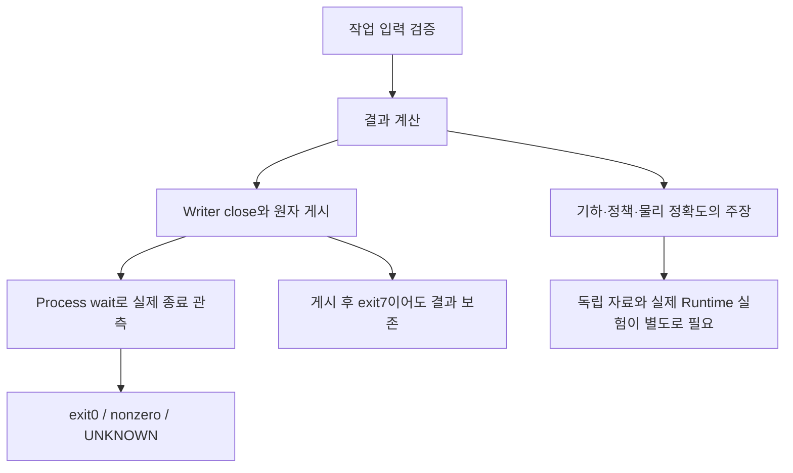

# 05. 결함으로 배우는 데이터·상태·수학 계약

[교재 처음](README.md) · [구조](01-system-architecture.md) · [재구성](02-scene-reconstruction.md) · [Camera·Asset·Simulation](03-camera-assets-simulation.md) · [로봇학습](04-robot-learning.md) · [File Atlas](06-source-code-atlas.md) · [실행 추적](07-execution-and-debugging.md) · [용어·학습 순서](08-glossary-and-learning-path.md)

기준 Commit은 `8e02b1ae023a856694a40b947881f76b66410624`다. 이 장은 **현재 수정된 코드가 왜 필요한지** 읽는 교재이며 새 제품/시험 수정이나 실행을 하지 않았다. 과거 전체 회귀 **2,151 passed / exit0**은 [Final 보고서](../reviews/final-r03-worker-exit-fix.md)의 기록이지 이번 문서 작성의 새 검증 수치가 아니다.

## 읽는 방법과 증거 범위

각 결함은 열 항목으로 읽는다. Before는 공통 안정화 부모 `97c029e195ab8587603fb3f240f2c1a6c0f91f52`의 실제 `git show` 소스, After는 현재 Commit의 연속된 짧은 범위다. 중간 Phase별 Commit이 있는 것처럼 꾸미지 않았다. 발췌가 전체 함수를 대체하지 않으므로 링크에서 주변 검증/Caller를 확인하자. 학습용 예시와 실제 시험 입력은 구별해서 표기했다.

원인·실패 사례는 현재 source, 부모 source, 회귀 Assertion을 우선해 확인했다. 보고서는 당시 snapshot이므로 Phase2B의 NEW03 Backlog를 현재 상태로 읽으면 안 된다. 반대로 코드/Mock 성공을 실제 GPU·사진·Isaac·실물·독립 Test 검증으로 확장하지 않는다.

## 목차

| 분류 | 결함 | 학습 주제 |
|---|---|---|
| 최초 감사 | [BUG-001](#bug-001) | Current Calibration: trial 계산과 원본 게시를 분리하기 |
| 최초 감사 | [BUG-002](#bug-002) | Precision Enum: Producer의 정상 결과를 Consumer가 거부하기 |
| 최초 감사 | [BUG-003](#bug-003) | Capture Binding: Camera 이름과 물리 역할의 차이 |
| 최초 감사 | [BUG-004](#bug-004) | Trial별 K·Pose·Pixel Transform을 잔차에 반영하기 |
| 최초 감사 | [BUG-005](#bug-005) | Isaac Intrinsic: 평균 focal로 K를 보존할 수 없는 이유 |
| 최초 감사 | [BUG-006](#bug-006) | 요청 Config와 공식 Trainer의 resolved Config를 비교하기 |
| 최초 감사 | [BUG-007](#bug-007) | Dataset 이름이 달라도 같은 Episode는 독립 Validation이 아니다 |
| 최초 감사 | [BUG-008](#bug-008) | Stop 유실: 경로를 읽는 것과 파일을 소유하는 것은 다르다 |
| 최초 감사 | [BUG-009](#bug-009) | 닫힌 Staging Dataset과 게시 완료 Dataset 구별하기 |
| 최초 감사 | [BUG-010](#bug-010) | Concave n-gon: Triangle Fan이 가짜 표면을 만드는 조건 |
| 최초 감사 | [BUG-011](#bug-011) | Asset Semantic Digest: bytes가 같아도 의미가 바뀔 수 있다 |
| 최초 감사 | [BUG-012](#bug-012) | Direct Joint Fit 후 오래된 World Cloud를 남기지 않기 |
| 최초 감사 | [BUG-013](#bug-013) | Stage10 Cloud를 실제 Consumer의 Schema로 전달하기 |
| 최초 감사 | [BUG-014](#bug-014) | Infill-only 결과도 검토와 Stage7에 전달하기 |
| 최초 감사 | [BUG-015](#bug-015) | CPU 요청은 공식 Loader보다 먼저 적용해야 한다 |
| 최초 감사 | [BUG-016](#bug-016) | Step 두 번 누르기는 Worker 실패가 아니라 명령 충돌이다 |
| 최초 감사 | [BUG-017](#bug-017) | 초기부터 만족한 Task를 Policy 성공으로 세지 않기 |
| 최초 감사 | [BUG-018](#bug-018) | 승인 Schema와 R03 Allowlist는 다른 Gate다 |
| 최초 감사 | [BUG-019](#bug-019) | Convert/Merge의 취소는 loop와 Writer 수명까지 연결한다 |
| 최초 감사 | [BUG-020](#bug-020) | Source 함수 Parameters도 Resume Fingerprint에 들어가야 한다 |
| 최초 감사 | [BUG-021](#bug-021) | Curation Lift의 대상은 첫 물체가 아니라 Task Object다 |
| 추가 수정 | [FIX-A](#fix-a) | Stage10의 RMSE 개선과 Full Rank 자동 채택은 다르다 |
| 추가 수정 | [FIX-B](#fix-b) | 선택한 Capture의 Layout/Source를 끝까지 유지하기 |
| 추가 수정 | [NEW-01](#new-01) | Fixed World Cloud는 Camera가 바뀌어도 고정된다 |
| 추가 수정 | [NEW-02](#new-02) | Holdout을 봤다는 사실도 사용 이력이다 |
| 추가 수정 | [NEW-03](#new-03) | 작업 완료·게시·프로세스 종료는 별도의 사실이다 |
| 설계 위험 | [RISK-001](#risk-001) | 환경 경로와 저장 보호 |
| 설계 위험 | [RISK-002](#risk-002) | Validation/독립 Test의 사용 이력 |

[검증 수준과 문서 차이](#verification) · [실패 유형별 다시 읽기](#patterns)


<a id="bug-001"></a>
## BUG-001. Current Calibration: trial 계산과 원본 게시를 분리하기

**① 정상 목적**

Current는 사용자가 저장한 현재 Scene이다. 자동 정합은 이를 출발점으로 추정할 수 있지만 measured/calibrated Camera를 움직이거나 실패한 trial을 Current에 남겨서는 안 된다. 입력·시험 중 Candidate·검증 뒤 게시 결과는 서로 다른 수명이다.

**② 수정 전 구현**

구형 공개 reconstruction.run은 analyze 이후와 반복 중간에 project.save_scene을 호출했다. fit_cameras에는 보호 provenance를 건너뛰는 조건이 없었다. 뒤에서 실패하거나 Stop이 나도 이미 Current로 쓴 중간 추정이 남을 수 있었다.

**③ 정확한 원인**

Solver 수학보다 쓰기 권한과 게시 시점의 문제다. Camera 파라미터 선택과 파일 게시 경계가 일치하지 않았다. dict만 복원하면 사용자 YAML 주석·표현은 복구되지 않으므로 원 bytes 보존도 필요했다.

**④ 구체적인 실패 시나리오**

실제 시험은 Camera x에 0.035m 오차를 주고 measured/calibrated로 설정한다. 잔차를 줄일 수 있어도 수정 금지다. 별도 estimated run에서는 needs/error/stop을 두 번 반복하고 Current의 주석까지 같은지 검사한다.

**⑤ 현재 수정의 위치와 순서**

fit_cameras는 PROTECTED를 제외한다. run의 stage_scene은 validate/preserve한 trial을 scratch에만 저장한다. 최종 게시에서만 Current를 쓰고 Export/상태 게시 실패 시 원 bytes를 복원한다. Current가 없던 image-only 호출의 최초 unresolved draft는 유지한다.

연결해 읽을 실제 구현: [camera.py:fit_cameras L45](../../real2sim_builder/src/real2sim_builder/calibration/camera.py#L45) · [reconstruction.py:run L270](../../real2sim_builder/src/real2sim_builder/reconstruction.py#L270) · [editing.py:preserve L10](../../real2sim_builder/src/real2sim_builder/editing.py#L10).

**⑥ 실제 Before / After**

**Before — 안정화 부모 Commit**

[camera.py L46–48](https://github.com/HYEONHEE5739/real2sim-learning-studio/blob/97c029e195ab8587603fb3f240f2c1a6c0f91f52/real2sim_builder/src/real2sim_builder/calibration/camera.py#L46)

<!-- source-before: 97c029e195ab8587603fb3f240f2c1a6c0f91f52:real2sim_builder/src/real2sim_builder/calibration/camera.py:L46-L48 -->
```python
    for camera in candidate['cameras']:
        rows=[r for r in landmarks if r['camera']==camera['id'] and r.get('split','train')=='train']
        if len(rows)<4 or camera['K']['value'] is None:continue
```

**After — 현재 코드**

[camera.py L47–50](../../real2sim_builder/src/real2sim_builder/calibration/camera.py#L47)

<!-- source: real2sim_builder/src/real2sim_builder/calibration/camera.py:L47-L50 -->
```python
    for camera in candidate['cameras']:
        if camera['pose']['provenance'] in PROTECTED:continue
        rows=[r for r in landmarks if r['camera']==camera['id'] and r.get('split','train')=='train']
        if len(rows)<4 or camera['K']['value'] is None:continue
```

Before 1행은 모든 Camera를 순회해 관측을 모은다. After 2행의 continue가 보호 Camera를 solver 입력 생성 전에 제외한다. train 선택과 최소 관측 조건은 그대로다. 파일 게시/복구는 run의 stage_scene→current_written/completed 순서를 함께 읽어야 한다.

**⑦ 동일 입력에 대한 수정 후 동작**

보호 Camera는 불변이고 estimated Camera의 정상 fitting은 계속된다. 오류·Stop에서도 run.lock을 정리한다. 이것은 모든 전원/디스크 장애에 대한 분산 트랜잭션이나 Scene 자동 승인 권한을 새로 구현한 것은 아니다.

**⑧ 테스트로 확인할 계약**

현재 회귀 소스의 입력/기대 안내다. 이번에 시험을 실행했다는 표가 아니다.

| 실제 테스트 함수 | 입력/재현 | 소스에서 확인한 Assertion 또는 거부 기대 |
|---|---|---|
| [test_current_calibration_protection.py:test_camera_fitter_never_changes_protected_pose L26](../../real2sim_builder/tests/test_current_calibration_protection.py#L26) | measured/calibrated, +0.035m 오차 | `assert result == original and scene == original` |
| [test_current_calibration_protection.py:test_unsuccessful_legacy_run_and_retry_preserve_current_bytes L63](../../real2sim_builder/tests/test_current_calibration_protection.py#L63) | needs/error/stop 각각2회, YAML 주석 포함 | `assert path.read_bytes() == before；assert not (p.root / 'working/run.lock').exists()；assert run(p, max_iterations=1)['status'] == ('STOPPED' if ending == 'stop' else 'NEEDS_MORE_DATA')` |
**⑨ 설계적으로 배울 점**

Transactional Publication과 불변식. 수치 개선은 쓰기 권한이 아니다. 최종 게시 전 trial을 격리해 검증하고 실패 복구에는 값뿐 아니라 bytes 동일성도 고려한다.

**⑩ 다른 기능과의 보존 경계**

Projection/least-squares와 원 measured q/Object/Capture를 보존한다. 실패가 Current를 바꾸지 않는다는 것과 실제 Calibration 정확도는 별도다.


<a id="bug-002"></a>
## BUG-002. Precision Enum: Producer의 정상 결과를 Consumer가 거부하기

**① 정상 목적**

PrecisionSession이 저장한 수동 Encoder→관절 변환은 Capture Reader가 같은 의미로 읽어야 한다. q는 모델 rad·Joint 순서를 따르며 수동 검토를 외부 물리 보정 인증으로 바꾸면 안 된다.

**② 수정 전 구현**

Producer의 정상 상태 CALIBRATED_MANUAL을 Capture.mapping_contract가 허용하지 않았다. Reader는 REVIEWED_MANUAL/VALIDATED_MANUAL만 받아 파일 SHA·계산이 정상인 새 Capture도 거부했다.

**③ 정확한 원인**

Writer/Reader의 Enum 계약이 어긋났다. CALIBRATED라는 이름은 물리 검증 승인이 아니지만 정상 수동 계산을 무효로 삼는 근거도 아니다. Python bool이 int처럼 동작하므로 계수 검증도 명목 숫자 판정과 분리해야 한다.

**④ 구체적인 실패 시나리오**

시험은 capture/snapshot × 세 수동 상태를 실제 Writer→Reader로 연결한다. 첫 관절 q=pi/4, model/mapping SHA·JOINTS가 같은데 CALIBRATED_MANUAL만 실패하던 경계다.

**⑤ 현재 수정의 위치와 순서**

mapping_contract에 CALIBRATED_MANUAL을 추가하되 identity/URDF/hash/order/units와 유한 비영 계수 검사를 유지했다. 계수 type은 int/float로 한정하고 joint/mapping physical_verified=false를 강제한다.

연결해 읽을 실제 구현: [capture.py:mapping_contract L88](../../real2sim_builder/src/real2sim_builder/capture.py#L88) · [precision.py:PrecisionSession L10](../../robot_learning_workbench/src/robot_learning_workbench/robot/precision.py#L10).

**⑥ 실제 Before / After**

**Before — 안정화 부모 Commit**

[capture.py L96–99](https://github.com/HYEONHEE5739/real2sim-learning-studio/blob/97c029e195ab8587603fb3f240f2c1a6c0f91f52/real2sim_builder/src/real2sim_builder/capture.py#L96)

<!-- source-before: 97c029e195ab8587603fb3f240f2c1a6c0f91f52:real2sim_builder/src/real2sim_builder/capture.py:L96-L99 -->
```python
        if name not in manifest['joint_names'] or entry.get('status') not in ('REVIEWED_MANUAL', 'VALIDATED_MANUAL'):
            raise ValueError('Unsupported precision joint review state')
        if not np.isfinite(entry.get('rad_per_count', np.nan)) or entry['rad_per_count'] == 0:
            raise ValueError('Invalid precision mapping coefficient')
```

**After — 현재 코드**

[capture.py L116–122](../../real2sim_builder/src/real2sim_builder/capture.py#L116)

<!-- source: real2sim_builder/src/real2sim_builder/capture.py:L116-L122 -->
```python
        if name not in manifest['joint_names'] or entry.get('status') not in ('CALIBRATED_MANUAL', 'REVIEWED_MANUAL', 'VALIDATED_MANUAL'):
            raise ValueError('Unsupported precision joint review state')
        if entry.get('physical_verified', False) is not False:
            raise ValueError('Manual precision joint is not externally physically verified')
        coefficient = entry.get('rad_per_count')
        if type(coefficient) not in (int, float) or not np.isfinite(coefficient) or coefficient == 0:
            raise ValueError('Invalid precision mapping coefficient')
```

Before 1행 tuple에 Producer 상태가 빠졌다. After 1행이 세 상태를 받고 3–4행은 수동 결과의 physical_verified를 차단한다. 이어지는 coefficient/type 검사는 허용 범위 확대가 숫자 검증 완화가 되지 않게 한다.

**⑦ 동일 입력에 대한 수정 후 동작**

정상 수동 세 상태는 읽힌다. unknown 상태·bool/zero/nonfinite 계수·잘못된 model/order/units와 가짜 물리 인증은 거부한다. 과거 Archive/Calibration을 새 형식으로 다시 쓰지 않는다.

**⑧ 테스트로 확인할 계약**

현재 회귀 소스의 입력/기대 안내다. 이번에 시험을 실행했다는 표가 아니다.

| 실제 테스트 함수 | 입력/재현 | 소스에서 확인한 Assertion 또는 거부 기대 |
|---|---|---|
| [test_precision_capture_contract.py:test_precision_calculate_save_metadata_reaches_capture_reader L139](../../robot_learning_workbench/tests/test_precision_capture_contract.py#L139) | 두 Writer × 세 수동 Enum, q=pi/4 | `assert manifest['joint_mapping'] == original_mapping == mapping；assert manifest['source_robot_sha256'] == file_sha256(model)；assert manifest['joint_names'] == list(JOINTS) and manifest['joint_units'] == ['rad'] * 6` |
| [test_precision_capture_contract.py:test_precision_capture_reader_keeps_identity_and_numeric_guards L163](../../robot_learning_workbench/tests/test_precision_capture_contract.py#L163) | hash/URDF/order/units/coefficient/physical flag 변조 | `pytest.raises / Qt Child 内部 Assertion을 해당 함수에서 확인` |
**⑨ 설계적으로 배울 점**

Producer/Consumer Contract. Enum 수용을 맞추면서 그 상태가 부여하지 않는 권한인 물리 인증은 계속 거부해야 한다.

**⑩ 다른 기능과의 보존 경계**

Precision 계산식·원 mapping·measured q는 수정하지 않는다. SDK Calibration과 수동 Precision의 구분을 유지하며 Reader 호환성이 실물 명령 권한을 늘리지 않는다.


<a id="bug-003"></a>
## BUG-003. Capture Binding: Camera 이름과 물리 역할의 차이

**① 정상 목적**

Side/Wrist Capture는 RGB와 함께 센서 역할·Robot 모델·Mapping·q 순서/단위를 전달해야 한다. Consumer는 이 Identity로 공유 Side Camera/Wrist Mount를 등록하고 Stage10에 연결한다.

**② 수정 전 구현**

Writer는 camera id/해상도 중심이었고 import Observation에 camera_type·robot_model_sha256·mapping_sha256·joint_units 전달이 빠졌다. Stage10의 명시 역할 필터는 자료가 있어도 등록 입력으로 찾지 못할 수 있었다.

**③ 정확한 원인**

Adapter가 Writer 문맥을 버리면 이후 계층은 이름으로 역할을 추정해야 한다. rgb_A라는 Side 센서와 오해를 부르는 파일명을 일반 규칙으로 판별할 수 없다. 이름·Identity·역할은 서로 다른 계약이다.

**④ 구체적인 실패 시나리오**

시험은 side/wrist 외에 rgb_A/rgb_B ID를 사용한다. 명시 camera_type은 유지되고 잘못된 URDF/Mapping/order/units 결합이나 역할 없는 arbitrary ID는 Candidate 변경 전에 실패해야 한다.

**⑤ 현재 수정의 위치와 순서**

Writer가 camera_type을 기록한다. _sensor_fields는 검증한 역할·model/mapping SHA·단위를 Observation으로 전달한다. register_sensor_views가 실제 bytes·순서·단위를 재검사한다. 구형 고정 side/wrist stream 의미는 제한적으로 읽는다.

연결해 읽을 실제 구현: [capture.py:save_session L327](../../robot_learning_workbench/src/robot_learning_workbench/robot/capture.py#L327) · [snapshots.py:SnapshotStore L10](../../robot_learning_workbench/src/robot_learning_workbench/robot/snapshots.py#L10) · [capture.py:_sensor_fields L14](../../real2sim_builder/src/real2sim_builder/capture.py#L14) · [observations.py:register_sensor_views L415](../../real2sim_builder/src/real2sim_builder/observations.py#L415).

**⑥ 실제 Before / After**

**Before — 안정화 부모 Commit**

[snapshots.py L38–38](https://github.com/HYEONHEE5739/real2sim-learning-studio/blob/97c029e195ab8587603fb3f240f2c1a6c0f91f52/robot_learning_workbench/src/robot_learning_workbench/robot/snapshots.py#L38)

<!-- source-before: 97c029e195ab8587603fb3f240f2c1a6c0f91f52:robot_learning_workbench/src/robot_learning_workbench/robot/snapshots.py:L38-L38 -->
```python
            source_robot_sha256=file_sha256(self.model),robot={'path':model_relative,'mapping_verified':False},cameras=[{'id':n,'resolution':[640,480]}for n in('side','wrist')],
```

**After — 현재 코드**

[snapshots.py L38–38](../../robot_learning_workbench/src/robot_learning_workbench/robot/snapshots.py#L38)

<!-- source: robot_learning_workbench/src/robot_learning_workbench/robot/snapshots.py:L38-L38 -->
```python
            source_robot_sha256=file_sha256(self.model),robot={'path':model_relative,'mapping_verified':False},cameras=[{'id':n,'camera_type':n,'resolution':[640,480]}for n in('side','wrist')],
```

같은 camera 행에 After는 camera_type을 추가한다. Writer의 키 추가만으로 끝내지 않고 _sensor_fields→Observation→register_sensor_views가 실제로 소비하는 전체 연결을 시험한다.

**⑦ 동일 입력에 대한 수정 후 동작**

명시 역할을 가진 비표준 ID는 등록된다. 정보 없는 역할을 추측하거나 모델 불일치를 허용하지 않는다. REGISTERED_ESTIMATED는 실제 물리 보정 완료 상태가 아니다.

**⑧ 테스트로 확인할 계약**

현재 회귀 소스의 입력/기대 안내다. 이번에 시험을 실행했다는 표가 아니다.

| 실제 테스트 함수 | 입력/재현 | 소스에서 확인한 Assertion 또는 거부 기대 |
|---|---|---|
| [test_capture_sensor_contract.py:test_explicit_roles_survive_nonstandard_ids_and_misleading_filenames L296](../../real2sim_builder/tests/test_capture_sensor_contract.py#L296) | rgb_A=side, rgb_B=wrist | `assert {image['camera']: image.get('camera_type') for image in project.evidence['images']} == {'rgb_A': 'side', 'rgb_B': 'wrist'}；assert {row['camera']: row['camera_type'] for row in result['views']} == {'rgb_A': 'side', 'rgb_B': 'wrist'}；assert not report['missing_capture_ids'] and report['status'] == 'REGISTERED_ESTIMATED'` |
| [test_capture_sensor_contract.py:test_sensor_registration_rejects_measured_identity_conflicts L333](../../real2sim_builder/tests/test_capture_sensor_contract.py#L333) | URDF/mapping/order/units 충돌 | `assert sha(candidate.root / 'candidate_scene.yaml') == before；assert source_before == _source_hashes(source)` |
**⑨ 설계적으로 배울 점**

Data Provenance가 있는 Adapter. Producer의 의미 필드는 Consumer까지 살아 있어야 하며 이름 추정은 잃어버린 근거를 복구하지 못한다.

**⑩ 다른 기능과의 보존 경계**

Archive·measured q를 재작성/재보정하지 않는다. Pair/Package/FK 검사를 보존하며 Scene Photo/Model Reference를 센서 관측으로 바꾸지 않는다.


<a id="bug-004"></a>
## BUG-004. Trial별 K·Pose·Pixel Transform을 잔차에 반영하기

**① 정상 목적**

휴대폰 View는 서로 다르며 Wrist는 서로 다른 q에서도 하나의 Mount를 공유한다. Joint residual은 현재 trial을 해당 View의 K/Pose/FK/pixel grid로 투영한 값이어야 한다.

**② 수정 전 구현**

fit_joint_scene은 baseline observation_scene을 cached에 저장했다. trial의 _posed는 Object frame/pose만 교체해 바뀐 Camera/K·pixel affine·공유 Mount를 매 잔차 평가에 온전히 반영하지 못했다.

**③ 정확한 원인**

최적화 변수가 Camera/Base/Mount라면 baseline 파생 변환은 불변 cache가 아니다. 오래된 투영을 쓰면 유한차분 Jacobian도 잘못된 함수의 미분이다. global pose=null이어도 view_registrations의 View pose로 계산 가능해야 한다.

**④ 구체적인 실패 시나리오**

두 registered Photo의 global pose는 null이고 extrinsic은 서로 다르다. 하나만 perturb하면 그 View residual만 증가해야 한다. validation Photo 변경이 train 해/활성 변수를 바꾸면 누출이다.

**⑤ 현재 수정의 위치와 순서**

_posed baseline cache를 없애고 errors 평가마다 observation_scene(candidate, by_id[key], ..., complete=False)를 쓴다. 같은 평가 안에서는 View별1회지만 다음 trial은 새 Camera/K/FK/affine을 반영한다.

연결해 읽을 실제 구현: [joint.py:fit_joint_scene L353](../../real2sim_builder/src/real2sim_builder/calibration/joint.py#L353) · [capture.py:observation_scene L345](../../real2sim_builder/src/real2sim_builder/capture.py#L345).

**⑥ 실제 Before / After**

**Before — 안정화 부모 Commit**

[joint.py L457–459](https://github.com/HYEONHEE5739/real2sim-learning-studio/blob/97c029e195ab8587603fb3f240f2c1a6c0f91f52/real2sim_builder/src/real2sim_builder/calibration/joint.py#L457)

<!-- source-before: 97c029e195ab8587603fb3f240f2c1a6c0f91f52:real2sim_builder/src/real2sim_builder/calibration/joint.py:L457-L459 -->
```python
                posed[key] = _posed(candidate, cached[key])
            cam = next(c for c in posed[key]['cameras'] if c['id'] == by_id[key]['camera'])
            uv, depth = project_point(posed[key], cam, row)
```

**After — 현재 코드**

[joint.py L451–453](../../real2sim_builder/src/real2sim_builder/calibration/joint.py#L451)

<!-- source: real2sim_builder/src/real2sim_builder/calibration/joint.py:L451-L453 -->
```python
                posed[key] = observation_scene(candidate, by_id[key], project.root, complete=False)
            cam = next(c for c in posed[key]['cameras'] if c['id'] == by_id[key]['camera'])
            uv, depth = project_point(posed[key], cam, row)
```

마지막 두 행은 두 버전 모두 Camera 선택→project_point다. 첫 행만 After에서 현재 candidate와 image record를 Adapter에 넣는다. residual 임계값을 완화해 문제를 숨긴 수정이 아니다.

**⑦ 동일 입력에 대한 수정 후 동작**

변수와 residual이 연결돼 합성 오차를 줄인다. validation은 변수/훈련에서 제외되고 고정 Side·공유 Wrist 조건을 유지한다. pixel 오차가 작다는 사실은 실물 Mount 정확도 인증이 아니다.

**⑧ 테스트로 확인할 계약**

현재 회귀 소스의 입력/기대 안내다. 이번에 시험을 실행했다는 표가 아니다.

| 실제 테스트 함수 | 입력/재현 | 소스에서 확인한 Assertion 또는 거부 기대 |
|---|---|---|
| [test_joint_camera_adaptation.py:test_joint_fit_changes_only_the_perturbed_view_residual_and_updates_its_extrinsic L115](../../real2sim_builder/tests/test_joint_camera_adaptation.py#L115) | 두 Photo 중 하나만 perturb | `assert before == pytest.approx(expected, abs=1e-08)；assert before['registered:' + images[0]['id']] < 1e-06；assert before['registered:' + changed_id] > 1.0` |
| [test_joint_camera_adaptation.py:test_joint_fit_excludes_validation_photo_from_variables_and_training_solution L143](../../real2sim_builder/tests/test_joint_camera_adaptation.py#L143) | held-out Photo만 크게 이동 | `assert report['status'] == changed_report['status'] == 'IMPROVED'；assert first == second；assert report['after'] == changed_report['after']` |
**⑨ 설계적으로 배울 점**

Derived State의 수명. 변수에 의존하는 Adapter 결과는 현재 trial 안에서 계산한다. 잘못된 cache는 속도 문제가 아니라 다른 최적화 문제를 푸는 결함이다.

**⑩ 다른 기능과의 보존 경계**

원 q/URDF/Mapping·보호 Camera/Object를 유지한다. q마다 Wrist extrinsic을 독립 변수로 풀어 공유 Mount 제약을 없애지 않는다.


<a id="bug-005"></a>
## BUG-005. Isaac Intrinsic: 평균 focal로 K를 보존할 수 없는 이유

**① 정상 목적**

K는 fx/fy/cx/cy와 이미지 해상도에 연결된다. Isaac RGB와 기록된 intrinsic이 같은 투영을 나타내야 downstream Annotation/Policy가 올바른 pixel ray를 해석한다.

**② 수정 전 구현**

build_env_cfg는 f=(fx+fy)/2로 aperture를 만들었다. 서로 다른 fx/fy와 중심을 벗어난 cx/cy가 사라졌다. Lab의 일반 Camera update가 physical aperture만 읽으면 native RTX projection의 K와 metadata도 달라질 수 있었다.

**③ 정확한 원인**

초점거리 하나는 비등방 pixel 배율과 principal point를 표현하지 못한다. USD 속성에 값이 있다는 것과 실제 native Lens Schema가 그 값을 소비하는 것은 별도 계약이다. Sensor 해상도를 고정한 Metadata도 문제다.

**④ 구체적인 실패 시나리오**

학습 예시 K는 fx500/fy700/cx300/cy210, 640×480이다. 평균600·중심320/240은 다른 투영이다. 실제 회귀는 Side/Wrist의 다른 K·해상도·Mount와 env별 batch 갱신을 검사한다.

**⑤ 현재 수정의 위치와 순서**

_pinhole_properties는 zero-skew·양수 focal·동차행·finite float32 범위를 검증한다. RuntimeCamera가 session layer의 native OpenCvPinhole Schema에 fx/fy/cx/cy/imageSize를 쓰고 읽는다. 전체 batch를 먼저 검증해 부분 쓰기를 막는다.

연결해 읽을 실제 구현: [env_cfg.py:_pinhole_properties L19](../../robot_learning_workbench/src/robot_learning_workbench/engines/isaac/env_cfg.py#L19) · [env_cfg.py:_set_native_pinhole L42](../../robot_learning_workbench/src/robot_learning_workbench/engines/isaac/env_cfg.py#L42) · [env_cfg.py:build_env_cfg L209](../../robot_learning_workbench/src/robot_learning_workbench/engines/isaac/env_cfg.py#L209).

**⑥ 실제 Before / After**

**Before — 안정화 부모 Commit**

[env_cfg.py L212–214](https://github.com/HYEONHEE5739/real2sim-learning-studio/blob/97c029e195ab8587603fb3f240f2c1a6c0f91f52/robot_learning_workbench/src/robot_learning_workbench/engines/isaac/env_cfg.py#L212)

<!-- source-before: 97c029e195ab8587603fb3f240f2c1a6c0f91f52:robot_learning_workbench/src/robot_learning_workbench/engines/isaac/env_cfg.py:L212-L214 -->
```python
        width,height=camera['resolution'];raw=np.asarray(camera['K']);f=(raw[0,0]+raw[1,1])/2;pos,quat=pose(camera['T_parent_camera'])
        path='Robot/'+camera['parent']+'/'if camera['parent']!='world'else''
        setattr(scene,'camera_'+view,CameraCfg(class_type=RuntimeCamera,prim_path='{ENV_REGEX_NS}/'+path+'Camera_'+view,width=width,height=height,data_types=['rgb'],update_period=0.,update_latest_camera_pose=True,
```

**After — 현재 코드**

[env_cfg.py L55–59](../../robot_learning_workbench/src/robot_learning_workbench/engines/isaac/env_cfg.py#L55)

<!-- source: robot_learning_workbench/src/robot_learning_workbench/engines/isaac/env_cfg.py:L55-L59 -->
```python
        attributes={'omni:lensdistortion:model':'opencvPinhole',
            _PINHOLE_PREFIX+'imageSize':Gf.Vec2i(*resolution)}
        attributes.update({_PINHOLE_PREFIX+name:float(value)for name,value in
            [('fx',matrix[0,0]),('fy',matrix[1,1]),('cx',matrix[0,2]),('cy',matrix[1,2])]})
        attributes.update({_PINHOLE_PREFIX+name:0. for name in _PINHOLE_COEFFICIENTS})
```

Before 1행은 두 focal을 하나로 평균한다. After 1–2행은 native Lens model과 imageSize, 3–5행은 개별 intrinsic attribute다. 아래 session author/readback을 함께 읽어야 한다. API 존재는 실제 RTX 실행 성공의 증거가 아니다.

**⑦ 동일 입력에 대한 수정 후 동작**

지원 K의 native prim/readback과 Metadata가 일치하고 Schema 부재는 명시 거부한다. 이전 검증은 CPU prim/readback 수학이며 실제 Kit/RTX 영상 정밀 검증은 NOT_TESTED였다.

**⑧ 테스트로 확인할 계약**

현재 회귀 소스의 입력/기대 안내다. 이번에 시험을 실행했다는 표가 아니다.

| 실제 테스트 함수 | 입력/재현 | 소스에서 확인한 Assertion 또는 거부 기대 |
|---|---|---|
| [test_isaac_camera_intrinsics.py:test_runtime_intrinsic_setter_validates_entire_batch_before_writes L276](../../robot_learning_workbench/tests/test_isaac_camera_intrinsics.py#L276) | 뒤 env의 잘못된 K/env_id | `assert sensor.stage.GetSessionLayer().ExportToString() == before；assert torch.equal(sensor._data.intrinsic_matrices, data)` |
| [test_isaac_camera_intrinsics.py:test_native_projection_has_only_schema_float32_rounding_error L293](../../robot_learning_workbench/tests/test_isaac_camera_intrinsics.py#L293) | native K 투영과 float32 반올림 범위 | `assert np.all(np.abs(project(native, optical) - project(k, points)) <= quantization + arithmetic)` |
**⑨ 설계적으로 배울 점**

End-to-end Consumer Contract. Writer에 값이 존재하는지보다 실제 SDK Sensor가 무엇을 읽는지가 중요하다. resolution/왜곡/convention/단위를 함께 보존하고 중앙 K로 fallback하지 않는다.

**⑩ 다른 기능과의 보존 경계**

원 Scene/Calibration/Mount를 쓰지 않고 runtime session layer만 author한다. URDF/FK·센서 선택은 그대로이며 intrinsic 보존이 extrinsic/hand-eye 정확도를 인증하지 않는다.


<a id="bug-006"></a>
## BUG-006. 요청 Config와 공식 Trainer의 resolved Config를 비교하기

**① 정상 목적**

UI JSON은 학습 의도이고 공식 LeRobot parser/validate는 default/features/optimizer를 해석한다. 닫힌 Checkpoint 봉인과 Resume는 요청·실행 의미·저장 상태가 일치하는지 검사해야 한다.

**② 수정 전 구현**

seal_checkpoint는 requested dict를 saved train_config.json과 재귀적으로 문자 그대로 비교했다. job_name/optimizer=null이 공식 act/adamw로 채워진 정상 결과를 거부했다. 무조건 재validate하면 반대로 saved optimizer 변조가 덮여 숨을 수 있다.

**③ 정확한 원인**

입력 표현과 실행 의미가 다르다. Resume validator는 sys.argv/config_path와 pretrained relocation도 소비한다. weight 하나만 유한하다고 Dataset Identity·step·RNG/optimizer/scheduler까지 정상이라고 볼 수 없다.

**④ 구체적인 실패 시나리오**

실제 시험은 UI의 job_name=None/optimizer=None을 공식 parser/validate한 Tiny Checkpoint를 봉인한다. step1 뒤 누적 target4 Resume는 가능해야 하고 실제 hyperparameter 변경은 거부해야 한다.

**⑤ 현재 수정의 위치와 순서**

_training_config/_resolved_request가 공식 parser와 scoped argv로 정규화한다. train은 owned frozen config와 요청 의미를 Child 전에 대조한다. saved evidence는 validate=False로 읽어 변조를 덮지 않고 positive step/finite tensor/state files/Dataset root·SHA를 봉인한다.

연결해 읽을 실제 구현: [policy.py:_training_config L12](../../robot_learning_workbench/src/robot_learning_workbench/learning/policy.py#L12) · [policy.py:_resolved_request L46](../../robot_learning_workbench/src/robot_learning_workbench/learning/policy.py#L46) · [policy.py:seal_checkpoint L152](../../robot_learning_workbench/src/robot_learning_workbench/learning/policy.py#L152) · [train.py:train L104](../../robot_learning_workbench/src/robot_learning_workbench/learning/train.py#L104).

**⑥ 실제 Before / After**

**Before — 안정화 부모 Commit**

[policy.py L101–104](https://github.com/HYEONHEE5739/real2sim-learning-studio/blob/97c029e195ab8587603fb3f240f2c1a6c0f91f52/robot_learning_workbench/src/robot_learning_workbench/learning/policy.py#L101)

<!-- source-before: 97c029e195ab8587603fb3f240f2c1a6c0f91f52:robot_learning_workbench/src/robot_learning_workbench/learning/policy.py:L101-L104 -->
```python
    def compare(wanted,actual):
        if isinstance(wanted,dict):return isinstance(actual,dict) and all(key in actual and compare(value,actual[key]) for key,value in wanted.items())
        return wanted==actual
    if not compare(config,saved):raise DataError('CHECKPOINT_INCOMPLETE','config','Official saved configuration differs from declared training request')
```

**After — 현재 코드**

[policy.py L172–176](../../robot_learning_workbench/src/robot_learning_workbench/learning/policy.py#L172)

<!-- source: robot_learning_workbench/src/robot_learning_workbench/learning/policy.py:L172-L176 -->
```python
    actual=_training_config(saved,validate=False)
    # Do not validate the saved optimizer again: the preset would overwrite
    # tampered values and hide a real training-semantics mismatch.
    expected_features=_training_config(resolved,validate=False,features=True)
    legacy=_training_config(config,validate=False)
```

Before는 원시 요청값을 재귀 비교한다. After 1행은 saved config를 재validate하지 않고 읽고, 다음 행들은 공식 resolved/feature 및 호환 Legacy 표현을 수용 집합으로 만든다. 아래 actual not in accepted와 explicit optimizer 비교가 실제 변조를 차단한다.

**⑦ 동일 입력에 대한 수정 후 동작**

정상 default/공식 Resume relocation은 허용하고 optimizer/scheduler/Dataset 의미 변경은 거부한다. parent Checkpoint를 수정하지 않는다. 공식 Trainer가 학습하고 자체 코드는 검증·프로세스·봉인을 소유한다.

**⑧ 테스트로 확인할 계약**

현재 회귀 소스의 입력/기대 안내다. 이번에 시험을 실행했다는 표가 아니다.

| 실제 테스트 함수 | 입력/재현 | 소스에서 확인한 Assertion 또는 거부 기대 |
|---|---|---|
| [test_checkpoint_config_resolution.py:test_full_ui_act_defaults_seal_after_official_normalization L77](../../robot_learning_workbench/tests/test_checkpoint_config_resolution.py#L77) | UI null → 공식 act/adamw, step1 | `assert requested['job_name'] is None and requested['optimizer'] is None；assert actual['job_name'] == 'act' and actual['optimizer']['type'] == 'adamw'；assert record['complete'] is True and record['step'] == 1` |
| [test_checkpoint_config_resolution.py:test_resume_rechecks_request_against_frozen_official_config_before_child L243](../../robot_learning_workbench/tests/test_checkpoint_config_resolution.py#L243) | 요청과 frozen 학습 의미 불일치 | `assert not plan.output_path.exists()` |
**⑨ 설계적으로 배울 점**

Canonicalization과 Integrity의 분리. 같은 의미의 표현은 정규화하되, 검증할 saved evidence를 고쳐서 같게 만들면 안 된다. 요청·실행·결과의 계보를 함께 확인한다.

**⑩ 다른 기능과의 보존 경계**

공식 학습 loop/optimizer를 자체 구현으로 대체하지 않는다. parent weight/RNG/state와 Dataset은 불변이며 Tiny CPU 학습을 GPU/정책 품질 검증으로 확대하지 않는다.


<a id="bug-007"></a>
## BUG-007. Dataset 이름이 달라도 같은 Episode는 독립 Validation이 아니다

**① 정상 목적**

Offline Validation은 학습에 사용하지 않은 원 Episode로 해야 한다. Curation/Export/Resume에서 경로·Dataset ID·inode가 바뀌어도 원 제작 계보가 같으면 train/test 누출이다.

**② 수정 전 구현**

evaluate는 official metadata의 source_episode_uid 집합만 비교했다. Native alias와 Resume family 제작자 정보가 불명확한 사례를 충분히 판별하지 못해 재export/복사의 동일 계보를 독립으로 볼 수 있었다.

**③ 정확한 원인**

Dataset Identity와 Episode 원본 Identity는 다른 계층이다. 같은 배열이 반드시 같은 Episode도 아니고 다른 uid가 반드시 새 제작자도 아니다. saved lineage가 불완전하면 독립이라는 근거가 없다.

**④ 구체적인 실패 시나리오**

시험은 original Episode 상속/재export를 만든다. 표시 uid가 달라도 원 origin/native alias가 겹치면 첫 infer 전에 DATA_LEAKAGE다. 반대로 이름/배열이 같아도 독립 생성과 계보가 증명된 자료는 허용한다.

**⑤ 현재 수정의 위치와 순서**

_origin/_origin_keys/episode_overlap가 saved UID·native alias·engine·parent family를 검사한다. 알려진 겹침은 양수, 증명된 불교차는0, 모호함은None이다. evaluate는 첫 batch 평가 전에 이를 소비한다.

연결해 읽을 실제 구현: [lerobot.py:episode_overlap L235](../../robot_learning_workbench/src/robot_learning_workbench/data/lerobot.py#L235) · [lerobot.py:_ambiguous_resume_families L225](../../robot_learning_workbench/src/robot_learning_workbench/data/lerobot.py#L225) · [validate.py:evaluate L10](../../robot_learning_workbench/src/robot_learning_workbench/learning/validate.py#L10).

**⑥ 실제 Before / After**

**Before — 안정화 부모 Commit**

[validate.py L29–31](https://github.com/HYEONHEE5739/real2sim-learning-studio/blob/97c029e195ab8587603fb3f240f2c1a6c0f91f52/robot_learning_workbench/src/robot_learning_workbench/learning/validate.py#L29)

<!-- source-before: 97c029e195ab8587603fb3f240f2c1a6c0f91f52:robot_learning_workbench/src/robot_learning_workbench/learning/validate.py:L29-L31 -->
```python
            overlap=len(ids(dataset)&ids(training))
            if overlap:raise DataError('DATA_LEAKAGE','validation','Original train/validation Episodes overlap')
        elif contract is not None:raise DataError('DATA_LEAKAGE','validation','Known Workbench lineage missing')
```

**After — 현재 코드**

[validate.py L27–29](../../robot_learning_workbench/src/robot_learning_workbench/learning/validate.py#L27)

<!-- source: robot_learning_workbench/src/robot_learning_workbench/learning/validate.py:L27-L29 -->
```python
        overlap=episode_overlap(training,dataset)
        if overlap:raise DataError('DATA_LEAKAGE','validation','Original train/validation Episodes or Native aliases overlap')
        if overlap is None and contract is not None:raise DataError('DATA_LEAKAGE','validation','Original Episode/Resume lineage is unproven')
```

Before는 UID 교집합만 센다. After 1행은 계보 helper, 2행은 알려진 overlap, 3행은 증명되지 않은 Workbench lineage의 거부다. None을0으로 쓰지 않는 것이 핵심이다.

**⑦ 동일 입력에 대한 수정 후 동작**

확실한 overlap과 Workbench 자료의 unproven lineage를 거부한다. 외부 Legacy의 제한 진단과 verified independence를 구분한다. 검증 완료가 robot_control_approved=true를 뜻하지 않는다.

**⑧ 테스트로 확인할 계약**

현재 회귀 소스의 입력/기대 안내다. 이번에 시험을 실행했다는 표가 아니다.

| 실제 테스트 함수 | 입력/재현 | 소스에서 확인한 Assertion 또는 거부 기대 |
|---|---|---|
| [test_validation_episode_lineage.py:test_inherited_or_reexported_episode_is_rejected_before_inference L98](../../robot_learning_workbench/tests/test_validation_episode_lineage.py#L98) | 원 Episode Resume 상속/재export | `assert training['original_episode_id'] == validation['original_episode_id'] == 'ep0'；assert error.value.code == 'DATA_LEAKAGE'；assert not calls and (not plan.output_path.exists())` |
| [test_validation_episode_lineage.py:test_proven_independent_episodes_allow_validation_even_with_equal_names_or_arrays L120](../../robot_learning_workbench/tests/test_validation_episode_lineage.py#L120) | 같은 표시 이름/배열이나 독립 origin | `assert before['episode_uid'] != after['episode_uid'] and before['native_alias'] != after['native_alias']；assert result.status == 'completed' and calls == [0]；assert report['lineage_status'] == 'verified' and report['train_val_episode_overlap'] == 0` |
**⑨ 설계적으로 배울 점**

Data Lineage와 3값 논리. overlap=0과UNKNOWN은 다르다. 배열 유사성 대신 원 제작 증거를 따라가며 불확실성을 통과로 바꾸지 않는다.

**⑩ 다른 기능과의 보존 경계**

원 Dataset·split·Episode metadata를 평가 목적으로 다시 쓰지 않는다. 정상 canonical Resume의 새 Episode 선택은 유지한다. Camera Holdout 이력은 별도 평가 계층이다.


<a id="bug-008"></a>
## BUG-008. Stop 유실: 경로를 읽는 것과 파일을 소유하는 것은 다르다

**① 정상 목적**

checkpoint는 현재 control 명령을 한 번 소비한다. Worker가 이전 resume를 읽는 동안 UI가 새 stop을 보내면 새 명령은 소비되거나 다음 checkpoint에 남아 있어야 한다.

**② 수정 전 구현**

기존 코드가 control.json을 read한 뒤 같은 경로를 unlink했다. 사이에 UI가 새 stop으로 atomic replace하면 Reader는 읽지도 않은 새 파일을 삭제했다. pause loop에도 같은 패턴이 있었다.

**③ 정확한 원인**

고정 경로는 시간에 따라 다른 파일을 가리킨다. Writer의 atomic replace만으로 Reader의 read→unlink가 한 트랜잭션이 되지는 않는다. 내가 읽은 파일의 소유권을 먼저 확보하지 않은 TOCTOU race다.

**④ 구체적인 실패 시나리오**

A가 resume를 읽은 직후 B가 control.json을 stop으로 교체하고 A가 경로를 삭제하는 interleaving이다. 실제 시험은 그 순간 Stop을 주입하고 pause loop가 무한히 대기하지 않도록 확인한다.

**⑤ 현재 수정의 위치와 순서**

Project._consume_control은 고유 claimed 파일로 control.json을 atomic rename한 뒤 자기 파일만 read/unlink한다. checkpoint의 일반 경로와 pause 대기가 같은 helper를 소비한다.

연결해 읽을 실제 구현: [project.py:checkpoint L173](../../real2sim_builder/src/real2sim_builder/project.py#L173) · [project.py:_consume_control L189](../../real2sim_builder/src/real2sim_builder/project.py#L189).

**⑥ 실제 Before / After**

**Before — 안정화 부모 Commit**

[project.py L178–179](https://github.com/HYEONHEE5739/real2sim-learning-studio/blob/97c029e195ab8587603fb3f240f2c1a6c0f91f52/real2sim_builder/src/real2sim_builder/project.py#L178)

<!-- source-before: 97c029e195ab8587603fb3f240f2c1a6c0f91f52:real2sim_builder/src/real2sim_builder/project.py:L178-L179 -->
```python
        instruction = read(command)['command']
        command.unlink()
```

**After — 현재 코드**

[project.py L194–199](../../real2sim_builder/src/real2sim_builder/project.py#L194)

<!-- source: real2sim_builder/src/real2sim_builder/project.py:L194-L199 -->
```python
            command.rename(claimed)
        except FileNotFoundError:
            return None
        try:
            return read(claimed)['command']
        finally:
```

Before는 read 뒤 같은 이름을 지운다. After 첫 행의 rename이 대상을 claim하고 파일이 없으면 None이다. 이어 read 대상도 claimed이며 finally 삭제도 그 파일만 한다. 새 control.json과 수명이 분리된다.

**⑦ 동일 입력에 대한 수정 후 동작**

claim 뒤 도착한 새 control.json은 보존된다. Stop은 기존 checkpoint에서 InterruptedError로 올라간다. 최신 한 슬롯 교체 의미는 유지하고 영구 명령 Queue나 blocking SDK 내부 즉시 중단을 구현한 것은 아니다.

**⑧ 테스트로 확인할 계약**

현재 회귀 소스의 입력/기대 안내다. 이번에 시험을 실행했다는 표가 아니다.

| 실제 테스트 함수 | 입력/재현 | 소스에서 확인한 Assertion 또는 거부 기대 |
|---|---|---|
| [test_reconstruction_control_race.py:test_new_stop_written_after_resume_read_is_preserved_or_consumed L14](../../real2sim_builder/tests/test_reconstruction_control_race.py#L14) | resume read 직후 stop replace | `assert seen == ['resume-read']；assert not (project.root / 'working/control.json').exists()；assert len(sleeps) < 4, 'Pause loop lost the resume or stop command'` |
| [test_reconstruction_control_race.py:test_pause_resume_stop_remain_available_while_worker_owns_project_lock L44](../../real2sim_builder/tests/test_reconstruction_control_race.py#L44) | 실제 작업 Lock 유지 중 Pause/Resume/Stop | `assert not (project.root / 'working/run.lock').exists()；assert project.state['status'] == 'PAUSED'；assert (project.root / 'working/run.lock').is_file()` |
**⑨ 설계적으로 배울 점**

Atomic Ownership. Writer의 원자적 저장과 Consumer의 원자적 claim을 함께 설계한다. 읽은 대상만 지워야 다른 주체의 새 명령을 보존할 수 있다.

**⑩ 다른 기능과의 보존 경계**

Project exclusive lock/read-only/Stop 예외는 그대로다. 사용자 Scene을 고치거나 최신 슬롯 사이 모든 중간 명령의 전달을 보장하지 않는다.


<a id="bug-009"></a>
## BUG-009. 닫힌 Staging Dataset과 게시 완료 Dataset 구별하기

**① 정상 목적**

목록과 직접 Reader는 최종 게시된 Dataset만 학습 입력으로 제공해야 한다. 생성 실패의 부분 파일은 진단용으로 남기되 정상 Dataset으로 소비되면 안 된다.

**② 수정 전 구현**

공식 Writer가 finalize해 meta/info.json·footer를 쓰면 Discovery가 이를 Dataset으로 인식했다. 첫 Episode 뒤 실패한 .staging이나 rename 실패 후 닫힌 Metadata도 정상처럼 읽힐 수 있었다.

**③ 정확한 원인**

구조적으로 읽을 수 있음과 전체 요청 게시 완료는 다르다. 유효한 Parquet footer는 일부 bytes의 완결성이지 변환 작업 전체의 성공 증거가 아니다. 별도 게시 상태가 필요했다.

**④ 구체적인 실패 시나리오**

실제 시험은 두 Episode 중 첫 저장 뒤 IO 오류를 만들거나 finalize 뒤 rename을 실패시킨다. 부분 폴더는 남아도 목록의 정상 항목/직접 load_catalog로 접근할 수 없어야 한다.

**⑤ 현재 수정의 위치와 순서**

새 변환은 workbench-publication.json을 staging으로 쓴다. publish는 finalize/footer/count/fsync/checkpoint 뒤 rename하고 complete를 원자 기록한다. Discovery와 lerobot_catalog 양쪽이 .staging/미완료 marker를 거부한다.

연결해 읽을 실제 구현: [lerobot.py:_publication_pending L92](../../robot_learning_workbench/src/robot_learning_workbench/data/lerobot.py#L92) · [lerobot.py:publish L149](../../robot_learning_workbench/src/robot_learning_workbench/data/lerobot.py#L149) · [curation.py:discover_datasets L9](../../robot_learning_workbench/src/robot_learning_workbench/data/curation.py#L9).

**⑥ 실제 Before / After**

**Before — 안정화 부모 Commit**

[lerobot.py L147–147](https://github.com/HYEONHEE5739/real2sim-learning-studio/blob/97c029e195ab8587603fb3f240f2c1a6c0f91f52/robot_learning_workbench/src/robot_learning_workbench/data/lerobot.py#L147)

<!-- source-before: 97c029e195ab8587603fb3f240f2c1a6c0f91f52:robot_learning_workbench/src/robot_learning_workbench/data/lerobot.py:L147-L147 -->
```python
    os.rename(staging,output);_sync(output.parent);return output
```

**After — 현재 코드**

[lerobot.py L167–169](../../robot_learning_workbench/src/robot_learning_workbench/data/lerobot.py#L167)

<!-- source: robot_learning_workbench/src/robot_learning_workbench/data/lerobot.py:L167-L169 -->
```python
    os.rename(staging,output)
    atomic_json(output/'workbench-publication.json',{'schema_version':1,'state':'complete'})
    _sync(output.parent);return output
```

Before는 rename 직후 성공이다. After는 rename 다음 complete marker를 원자 기록하고 부모를 sync한다. Reader helper가 이 marker와 staging 이름을 확인하므로 파일 존재만으로 완료를 추정하지 않는다.

**⑦ 동일 입력에 대한 수정 후 동작**

부분 자료는 삭제하지 않고 비노출·직접 읽기 거부로 남긴다. 이름이 final이어도 marker=staging이면 성공이 아니다. marker 없는 정상 외부/Legacy Dataset의 기존 읽기는 유지한다.

**⑧ 테스트로 확인할 계약**

현재 회귀 소스의 입력/기대 안내다. 이번에 시험을 실행했다는 표가 아니다.

| 실제 테스트 함수 | 입력/재현 | 소스에서 확인한 Assertion 또는 거부 기대 |
|---|---|---|
| [test_dataset_publication_visibility.py:test_failure_after_one_official_episode_is_not_discoverable_or_directly_readable L9](../../robot_learning_workbench/tests/test_dataset_publication_visibility.py#L9) | 첫 official Episode 뒤 합성 IO 실패 | `assert pending.is_dir() and (not (base / 'failed').exists())；assert all((Path(row['path']) != pending for row in during))；assert all((Path(row['path']) != pending for row in c.discover_datasets(base.parent)))` |
| [test_dataset_publication_visibility.py:test_published_and_external_legacy_official_datasets_remain_readable L49](../../robot_learning_workbench/tests/test_dataset_publication_visibility.py#L49) | 새 정상 게시와 외부 Legacy 각2Episode | `assert len(n.load_catalog(good).episodes) == 2 and len(n.load_catalog(legacy).episodes) == 2；assert {row['name'] for row in c.discover_datasets(base.parent) if row['readable']} == {'good', 'external'}` |
**⑨ 설계적으로 배울 점**

Publication Boundary. Writer close·파일 유효성·최종 게시를 별도 사실로 검사한다. 실패 자료 보존과 정상 Consumer 접근 차단은 동시에 성립한다.

**⑩ 다른 기능과의 보존 경계**

공식 LeRobot payload를 다른 형식으로 바꾸지 않는다. 사용자 실패 폴더를 삭제하거나 Legacy에 marker를 강제하지 않는다. 목록만 숨기지 않고 직접 Reader도 동일 Gate를 쓴다.


<a id="bug-010"></a>
## BUG-010. Concave n-gon: Triangle Fan이 가짜 표면을 만드는 조건

**① 정상 목적**

USD polygon을 삼각형으로 바꿔도 영역·면적·UV corner·material subset·winding을 유지해야 한다. 존재하지 않는 오목 영역을 채우면 Viewer와 Collision의 형상이 달라진다.

**② 수정 전 구현**

_convert는 모든 n-gon을 첫 corner를 중심으로 fan 분할했다. convex에는 맞지만 concave에서는 대각선이 polygon 밖으로 나가 가짜 면·뒤집힌 삼각형을 만들었다.

**③ 정확한 원인**

삼각형 n−2개라는 개수 조건은 영역 동일성을 보장하지 않는다. vertex와 face-corner index를 혼동하면 UV seam까지 손상된다. 렌더 Depth 오류로 보이는 현상의 원인이 실제 변환 topology일 수 있다.

**④ 구체적인 실패 시나리오**

회귀의 L-shaped 면은 오른쪽 위 모서리가 비고 면적3, 삼각형4개다. 시작 corner3종과 handedness2종을 바꿔도 빈 L 모서리를 삼각형이 덮으면 실패다.

**⑤ 현재 수정의 위치와 순서**

_face_triangles는 원 corner index로 planar concave ear clipping을 한다. 법선/주축 평면·cross 부호·자기교차·ear 안 vertex를 검사한다. 정상 convex fan/기존 rank<2 cap을 유지하고 지원 불가 concave nonplanar/self-intersection은 거부한다.

연결해 읽을 실제 구현: [object_assets.py:_face_triangles L79](../../real2sim_builder/src/real2sim_builder/object_assets.py#L79) · [object_assets.py:_convert L124](../../real2sim_builder/src/real2sim_builder/object_assets.py#L124).

**⑥ 실제 Before / After**

**Before — 안정화 부모 Commit**

[object_assets.py L125–127](https://github.com/HYEONHEE5739/real2sim-learning-studio/blob/97c029e195ab8587603fb3f240f2c1a6c0f91f52/real2sim_builder/src/real2sim_builder/object_assets.py#L125)

<!-- source-before: 97c029e195ab8587603fb3f240f2c1a6c0f91f52:real2sim_builder/src/real2sim_builder/object_assets.py:L125-L127 -->
```python
            for index in range(1,count-1):
                corners=[offset,offset+index,offset+index+1]
                if mesh.GetOrientationAttr().Get()=='leftHanded':corners.reverse()
```

**After — 현재 코드**

[object_assets.py L171–173](../../real2sim_builder/src/real2sim_builder/object_assets.py#L171)

<!-- source: real2sim_builder/src/real2sim_builder/object_assets.py:L171-L173 -->
```python
            for triangle in _face_triangles(points[indices[offset:offset+count]]):
                corners=[offset+index for index in triangle]
                if mesh.GetOrientationAttr().Get()=='leftHanded':corners.reverse()
```

Before 1행은 convex fan 가정이다. After 1행은 실제 shape에서 corner triple을 선택하고 2행은 offset을 붙인다. 3행의 leftHanded 반전은 유지된다. UV를 재발명하지 않고 원 corner addressing을 보존한다.

**⑦ 동일 입력에 대한 수정 후 동작**

원 영역만 분할하고 _convert가 같은 corner로 UV/material을 읽는다. 원 USDA/Collision을 재생성하지 않는다. 모든 손상 polygon을 자동 수리하는 알고리즘은 아니며 지원 불가는 authoring에서 정리해야 한다.

**⑧ 테스트로 확인할 계약**

현재 회귀 소스의 입력/기대 안내다. 이번에 시험을 실행했다는 표가 아니다.

| 실제 테스트 함수 | 입력/재현 | 소스에서 확인한 Assertion 또는 거부 기대 |
|---|---|---|
| [test_asset_semantic_geometry.py:test_concave_native_polygon_area_coverage_uv_material_and_orientation L38](../../real2sim_builder/tests/test_asset_semantic_geometry.py#L38) | L polygon, 시작점3 × orientation2 | `assert count == 4 and area == pytest.approx(3.0)；assert sha(path) == original and verify_object_asset(project, record) == record；assert cross > 0 if orientation == 'rightHanded' else cross < 0` |
| [test_asset_semantic_geometry.py:test_existing_convex_nonplanar_quad_keeps_the_original_fan L92](../../real2sim_builder/tests/test_asset_semantic_geometry.py#L92) | 기존 convex nonplanar quad | `assert _face_triangles(points) == [(0, 1, 2), (0, 2, 3)]` |
**⑨ 설계적으로 배울 점**

Geometry Invariant. 개수 외에 면적/coverage/법선/corner 속성을 시험한다. 고쳐야 할 topology 분기만 바꾸고 정상 Legacy 지원은 보존한다.

**⑩ 다른 기능과의 보존 경계**

Viewer Renderer 전면 교체나 원 Asset 수정이 아니다. canonical USD Converter의 원인을 고치며 기존 Material/UV/winding/parser/export를 유지한다.


<a id="bug-011"></a>
## BUG-011. Asset Semantic Digest: bytes가 같아도 의미가 바뀔 수 있다

**① 정상 목적**

Manifest는 native dependency bytes와 Instance가 소비할 Visual/Collision pose/type/material/entry를 연결한다. 최초 바인딩에서도 metadata가 실제 USDA와 같아야 한다.

**② 수정 전 구현**

content_sha256 입력에는 files/dimensions/origin/default_prim/units/up_axis가 있었지만 소비되는 Visual/Collision 의미 전체는 없었다. 파일 SHA를 유지한 채 pose/color/type/entry를 바꿔도 content 검사만 통과할 수 있었다.

**③ 정확한 원인**

파일 Integrity와 의미 Integrity의 집합이 달랐다. Consumer가 믿는 필드가 hash closure 밖에 있으면 검증된 파일과 미검증 의미를 섞는다. 기존 content SHA를 바꾸면 이미 저장된 Version/Scene binding도 깨진다.

**④ 구체적인 실패 시나리오**

실제 시험은 원 dependency bytes/content SHA를 그대로 둔 채 collision_pose/visual_pose/visual_type/material/entry를 변조한다. 신규 Manifest와 semantic_sha가 없는 Legacy 모두 첫 바인딩에서 거부해야 한다.

**⑤ 현재 수정의 위치와 순서**

_semantic_digest는 content SHA와 entry/default prim/치수/단위/Visual/Collision/status/physical flag 등을 결합한다. 새 등록은 semantic_sha256을 쓴다. Legacy는 임시 폴더의 native 변환 metadata와 대조하며 기존 SHA/Version은 유지한다.

연결해 읽을 실제 구현: [object_assets.py:_semantic_digest L267](../../real2sim_builder/src/real2sim_builder/object_assets.py#L267) · [object_assets.py:verify_object_asset L275](../../real2sim_builder/src/real2sim_builder/object_assets.py#L275).

**⑥ 실제 Before / After**

**Before — 안정화 부모 Commit**

[object_assets.py L238–239](https://github.com/HYEONHEE5739/real2sim-learning-studio/blob/97c029e195ab8587603fb3f240f2c1a6c0f91f52/real2sim_builder/src/real2sim_builder/object_assets.py#L238)

<!-- source-before: 97c029e195ab8587603fb3f240f2c1a6c0f91f52:real2sim_builder/src/real2sim_builder/object_assets.py:L238-L239 -->
```python
    inspect_usda(base/record['entry'])
    return record
```

**After — 현재 코드**

[object_assets.py L295–300](../../real2sim_builder/src/real2sim_builder/object_assets.py#L295)

<!-- source: real2sim_builder/src/real2sim_builder/object_assets.py:L295-L300 -->
```python
    if record.get('semantic_sha256')is not None:
        if record['semantic_sha256']!=_semantic_digest(record):raise ValueError('Object asset semantic digest mismatch')
    else:
        # Legacy immutable manifests retain their content/version SHA. Derive
        # their consumed metadata from native USD in temporary storage only.
        with tempfile.TemporaryDirectory(prefix='real2sim-asset-verify-')as folder:
```

Before는 native 파일을 열고 반환한다. After 1–2행은 새 digest, else는 Legacy metadata 재도출이다. 임시 변환은 읽기 검증용 파생물이며 원 Asset을 재저장하는 과정이 아니다.

**⑦ 동일 입력에 대한 수정 후 동작**

신규 의미 변조는 digest 불일치로 거부한다. Legacy metadata가 USDA와 다르면 실패한다. 검증을 이유로 원 Manifest/USDA를 다시 쓰거나 새 Version으로 몰래 이전하지 않는다.

**⑧ 테스트로 확인할 계약**

현재 회귀 소스의 입력/기대 안내다. 이번에 시험을 실행했다는 표가 아니다.

| 실제 테스트 함수 | 입력/재현 | 소스에서 확인한 Assertion 또는 거부 기대 |
|---|---|---|
| [test_asset_semantic_geometry.py:test_first_binding_rejects_manifest_semantic_tampering_with_same_dependency_bytes L59](../../real2sim_builder/tests/test_asset_semantic_geometry.py#L59) | 5필드 × 신규/Legacy, 원bytes 불변 | `assert changed['content_sha256'] == old_content and before == {f: sha(path.parent / f) for f in record['files']}；assert verify_object_asset(project, record) == record` |
| [test_asset_semantic_geometry.py:test_legacy_asset_schema_binding_and_portable_export_remain_readonly L77](../../real2sim_builder/tests/test_asset_semantic_geometry.py#L77) | Legacy 새 Instance/portable Export | `assert record['schema'] == 'real2sim.object-asset/1'；assert path.read_bytes() == original and files == {f: sha(path.parent / f) for f in record['files']}` |
**⑨ 설계적으로 배울 점**

Semantic Closure. 신뢰 단위는 Consumer가 읽는 전체 의미다. 새 digest로 보완하되 이미 발행한 Identity를 소급 바꾸지 않는 Migration 원칙을 함께 적용한다.

**⑩ 다른 기능과의 보존 경계**

USDA/Texture/Collision bytes를 보호한다. AUTHORED_UNVALIDATED/physical_verified=false를 유지하며 digest 일치를 물리 Collision 검증으로 승격하지 않는다.


<a id="bug-012"></a>
## BUG-012. Direct Joint Fit 후 오래된 World Cloud를 남기지 않기

**① 정상 목적**

Camera/Mount/Base를 채택하면 그 Camera에서 파생한 World cloud와 signature도 같은 Scene을 가리켜야 한다. Raw Optical 관측은 불변이고 파생 World 표현만 다시 계산한다.

**② 수정 전 구현**

Hybrid에는 reproject_observations가 있었지만 직접 Candidate.fit(joint:scene)은 IMPROVED에서 save만 했다. Camera는 새 값인데 cloud path/World points/signature가 이전 값이라 다음 Consumer가 stale을 발견했다.

**③ 정확한 원인**

같은 Solver를 사용해도 Caller별 후처리는 다를 수 있다. Camera와 cloud는 dependency graph다. signature만 덮으면 좌표가 옛 값인 거짓 일관성이 되므로 실제 raw 재투영이 필요하다.

**④ 구체적인 실패 시나리오**

시험은 raw-relative NPZ를 두고 직접 Camera fit을 반복한다. 두 번째도 이미 변환된 World points가 아니라 원 Optical points에서 새 pose로 계산해야 누적 변환 오류가 없다.

**⑤ 현재 수정의 위치와 순서**

Candidate.fit은 joint:scene의 IMPROVED에서 check_scope/preserve를 통과한 뒤 공통 reproject_observations를 호출하고 save한다. optical ray·depth scale·현재 Camera pose로 새 NPZ와 shared signature를 만든다.

연결해 읽을 실제 구현: [candidate.py:fit L202](../../real2sim_builder/src/real2sim_builder/candidate.py#L202) · [hybrid.py:reproject_observations L391](../../real2sim_builder/src/real2sim_builder/calibration/hybrid.py#L391).

**⑥ 실제 Before / After**

**Before — 안정화 부모 Commit**

[candidate.py L207–209](https://github.com/HYEONHEE5739/real2sim-learning-studio/blob/97c029e195ab8587603fb3f240f2c1a6c0f91f52/real2sim_builder/src/real2sim_builder/candidate.py#L207)

<!-- source-before: 97c029e195ab8587603fb3f240f2c1a6c0f91f52:real2sim_builder/src/real2sim_builder/candidate.py:L207-L209 -->
```python
            if report['status'] == 'IMPROVED':
                self.save(scene)
            write(self.root / 'fit.json', report)
```

**After — 현재 코드**

[candidate.py L208–213](../../real2sim_builder/src/real2sim_builder/candidate.py#L208)

<!-- source: real2sim_builder/src/real2sim_builder/candidate.py:L208-L213 -->
```python
                if target == 'joint:scene':
                    self.check_scope(scene)
                    preserve(self.scene, scene)
                    from .calibration.hybrid import reproject_observations
                    scene = reproject_observations(self.project, scene, {}, self.root / 'fit-observations')
                self.save(scene)
```

Before는 바로 save한다. After는 target 한정→scope→preserve→reproject→save다. 원본 쓰기 권한을 늘리지 않고 파생 NPZ만 새 경로에 저장한다.

**⑦ 동일 입력에 대한 수정 후 동작**

채택 Camera와 cloud Consumer가 맞고 원 NPZ/Current/Evidence는 불변이다. 미개선은 Scene/path를 바꾸지 않는다. Direct의 low-rank 미검증 draft 허용과 Stage10 자동 채택은 별개다.

**⑧ 테스트로 확인할 계약**

현재 회귀 소스의 입력/기대 안내다. 이번에 시험을 실행했다는 표가 아니다.

| 실제 테스트 함수 | 입력/재현 | 소스에서 확인한 Assertion 또는 거부 기대 |
|---|---|---|
| [test_direct_fit_observation_refresh.py:test_direct_joint_fit_reprojects_raw_cloud_and_refreshes_shared_dependencies L84](../../real2sim_builder/tests/test_direct_fit_observation_refresh.py#L84) | Camera 이동과 raw-relative cloud | `assert report['status'] == 'IMPROVED' and report['jacobian_rank'] == 2；assert row['path'] != old_row['path'], 'Accepted shared Camera calibration left the old World cloud in place'；assert row['sha256'] == sha(project.root / row['path'])` |
| [test_direct_fit_observation_refresh.py:test_repeated_direct_joint_fit_uses_original_optical_points_not_accumulated_world L111](../../real2sim_builder/tests/test_direct_fit_observation_refresh.py#L111) | 두 번 fit, 누적 +0.08m Camera 이동 | `assert len(set(paths)) == 2；assert candidate.scene['cameras'][0]['pose']['value'][0][3] == pytest.approx(initial['cameras'][0]['pose']['value'][0][3] + 0.08)；assert sha(source_npz) == source_sha` |
**⑨ 설계적으로 배울 점**

Derived Data Invalidation. 모델 변경 때 파생 cache/좌표를 갱신해야 한다. 모든 직접 API Caller까지 추적해야 빠진 후처리를 찾을 수 있다.

**⑩ 다른 기능과의 보존 경계**

원 관측을 새 결과로 덮어쓰지 않는다. Solver Rank/목적함수·Caller별 채택·보호 provenance를 유지한다. fixed World 예외는 NEW-01에서 따로 구분한다.


<a id="bug-013"></a>
## BUG-013. Stage10 Cloud를 실제 Consumer의 Schema로 전달하기

**① 정상 목적**

Sensor Registration의 대응점은 이후 registered_images/cloud_inputs/Hybrid가 읽어야 한다. 좌표와 함께 원 Photo/Mask/units/frame/split/group/SHA/Camera dependency가 필요하다.

**② 수정 전 구현**

stage_sensor_clouds는 기존 clouds를 새 불완전 행으로 교체했다. 점 파일·일부 Identity는 있었지만 Consumer의 units/frame/mask/split/group/dependencies 계약이 빠져 다음 단계에서 실패했다.

**③ 정확한 원인**

Producer가 파일을 만들었다고 Consumer 계약까지 만족한 것은 아니다. 같은 컬렉션의 전체 교체는 정상 이전 관측도 없앤다. 처리 grid의 Mask를 원 Photo로 그대로 붙이면 pixel ray도 달라진다.

**④ 구체적인 실패 시나리오**

실제 시험은 Stage10 대응점 생성 뒤 실제 cloud_inputs까지 읽는다. 미리 넣은 typed row는 보존해야 하며 DA3 Mask는 inverse affine으로 원 Photo resolution에 대응해야 한다.

**⑤ 현재 수정의 위치와 순서**

기존 clouds를 setdefault로 유지하고 (image_id,object_id) 중복 없이 새 row만 추가한다. inverse affine Mask와 SHA, m/world, split/group, image record SHA, camera_signature, fixed World provenance를 명시한다.

연결해 읽을 실제 구현: [reconstruction_stages.py:stage_sensor_clouds L869](../../real2sim_builder/src/real2sim_builder/reconstruction_stages.py#L869) · [hybrid.py:cloud_inputs L102](../../real2sim_builder/src/real2sim_builder/calibration/hybrid.py#L102).

**⑥ 실제 Before / After**

**Before — 안정화 부모 Commit**

[reconstruction_stages.py L856–858](https://github.com/HYEONHEE5739/real2sim-learning-studio/blob/97c029e195ab8587603fb3f240f2c1a6c0f91f52/real2sim_builder/src/real2sim_builder/reconstruction_stages.py#L856)

<!-- source-before: 97c029e195ab8587603fb3f240f2c1a6c0f91f52:real2sim_builder/src/real2sim_builder/reconstruction_stages.py:L856-L858 -->
```python
    scene=copy.deepcopy(scene);clouds=[]
    for obj in previous[6]['objects']:
        file=obj.get('original_points')
```

**After — 현재 코드**

[reconstruction_stages.py L876–878](../../real2sim_builder/src/real2sim_builder/reconstruction_stages.py#L876)

<!-- source: real2sim_builder/src/real2sim_builder/reconstruction_stages.py:L876-L878 -->
```python
    scene=copy.deepcopy(scene);clouds=scene.setdefault('reconstruction_observations',{}).setdefault('clouds',[])
    existing={(row['image_id'],row['object_id'])for row in clouds}
    images={image['id']:image for image in candidate.project.evidence['images']}
```

Before는 빈 목록으로 시작한다. After 1행은 기존 목록, 2행은 기존 관측 쌍, 3행은 원 image record lookup을 준비한다. 아래 append는 실제 Consumer가 요구하는 Metadata를 채운다.

**⑦ 동일 입력에 대한 수정 후 동작**

후속 Reader가 좌표/근거/의존성을 읽을 수 있다. Sensor/Metric 근거가 없으면 기존 Gate/NOT_REQUESTED/NOT_AVAILABLE을 유지한다. Stage10이 실제 센서 Metric Depth를 측정한 것은 아니다.

**⑧ 테스트로 확인할 계약**

현재 회귀 소스의 입력/기대 안내다. 이번에 시험을 실행했다는 표가 아니다.

| 실제 테스트 함수 | 입력/재현 | 소스에서 확인한 Assertion 또는 거부 기대 |
|---|---|---|
| [test_stage_cloud_contract.py:test_stage10_sensor_registration_reaches_real_cloud_contract_before_render L83](../../real2sim_builder/tests/test_stage_cloud_contract.py#L83) | Stage10→등록→실제 cloud_inputs | `assert report['status'] == 'REGISTERED_ESTIMATED' and len(checked) == 2；assert all((sha(path) == before for (path, before) in source.items()))；assert len(observations.registered_images(project, 'layout', scene=result)[0]) >= 2` |
| [test_stage_cloud_contract.py:test_stage_sensor_correspondences_do_not_replace_existing_typed_clouds L103](../../real2sim_builder/tests/test_stage_cloud_contract.py#L103) | 기존 typed cloud에 새 대응점 추가 | `assert all((row['path'] in current and current[row['path']] == row for row in old))；assert candidate.scene == before` |
**⑨ 설계적으로 배울 점**

Typed Producer→Consumer Integration. 파일 존재 대신 다음 계층이 실제 소비할 Schema/frame/units/dependency를 검사한다. add와 replace는 다른 연산이다.

**⑩ 다른 기능과의 보존 경계**

원 RGB/DA3 Z/Mask와 이전 cloud를 보호한다. generated/estimated를 measured로 바꾸지 않는다. Camera가 바뀔 때 fixed World의 의미는 NEW-01을 따른다.


<a id="bug-014"></a>
## BUG-014. Infill-only 결과도 검토와 Stage7에 전달하기

**① 정상 목적**

Stage6의 원 Crop/선택 Infill/선택 Upsample 중 실제 최종 이미지를 Blender 제작에 넘겨야 한다. validity는 그 파일 SHA를 검토해야 하고 생성 RGB에 원 Depth가 새로 정합됐다고 하면 안 된다.

**② 수정 전 구현**

validity는 Upsample 내부에만 있었고 Stage7 crop 목록에도 enhanced만 추가했다. infill=true/upsample=false이면 생성 파일이 검토/모델링 참조에서 빠질 수 있었다.

**③ 정확한 원인**

처리 결과 존재와 최종 Consumer의 결과 선택은 별개다. 옵션 조합마다 특별 경로를 만들면 중간 결과가 누락된다. 검토한 파일과 사용한 파일이 다르면 validity 근거도 끊긴다.

**④ 구체적인 실패 시나리오**

실제 시험은 infill/upsample/check_valid 각각 true/false인8조합이다. Infill-only+check_valid에서 VLM 마지막 이미지와 Stage7 crop 경로/SHA가 실제 final과 같아야 한다.

**⑤ 현재 수정의 위치와 순서**

prepare_objects는 enhanced→infilled→observed focus를 prepared_image로 기록한다. 생성이 있으면 공통 validity와 finite/alpha/grid 검사 뒤 meshes가 final 참조를 중복 없이 modeling_tasks에 넘긴다.

연결해 읽을 실제 구현: [reconstruction_stages.py:prepare_objects L533](../../real2sim_builder/src/real2sim_builder/reconstruction_stages.py#L533) · [reconstruction_stages.py:meshes L629](../../real2sim_builder/src/real2sim_builder/reconstruction_stages.py#L629).

**⑥ 실제 Before / After**

**Before — 안정화 부모 Commit**

[reconstruction_stages.py L593–595](https://github.com/HYEONHEE5739/real2sim-learning-studio/blob/97c029e195ab8587603fb3f240f2c1a6c0f91f52/real2sim_builder/src/real2sim_builder/reconstruction_stages.py#L593)

<!-- source-before: 97c029e195ab8587603fb3f240f2c1a6c0f91f52:real2sim_builder/src/real2sim_builder/reconstruction_stages.py:L593-L595 -->
```python
                if setting.get('check_valid',False):
                    validity=provider('vlm',{'images':[obj['observed_rgb'],str(obj['mask']),enhanced['path']],'task':'object_validity',
                        'response_schema':object_validity_schema(),
```

**After — 현재 코드**

[reconstruction_stages.py L619–621](../../real2sim_builder/src/real2sim_builder/reconstruction_stages.py#L619)

<!-- source: real2sim_builder/src/real2sim_builder/reconstruction_stages.py:L619-L621 -->
```python
        final=enhanced or infilled or crops['focus']
        prepared_image={'path':final['path'],'sha256':sha(final['path']),'source':'enhanced'if enhanced else'infilled'if infilled else'observed_crop','depth_frame':'observed_original_only'}
        result.append({**obj,'crops':crops,'prepared_image':prepared_image,'provider_crop':provider_crop,'enhanced':enhanced,'infilled':infilled,'validity':validity,'validity_gate':validity_gate,'camera_points':str(cloud),
```

Before는 Upsample 내부에서 enhanced를 검토한다. After 1행은 최종 우선순위, 2행은 실제 SHA·출처·Depth 제한이다. 공통 validity는 바로 앞 generated=enhanced or infilled 경계에서 수행한다.

**⑦ 동일 입력에 대한 수정 후 동작**

Infill-only/Upsample-only 모두 final이 Consumer에 도달한다. 빈 alpha/grid 오류는 Stage7 tasks 전에 거부한다. 원 RGB/Mask/Depth는 불변이고 depth_frame은 observed_original_only다.

**⑧ 테스트로 확인할 계약**

현재 회귀 소스의 입력/기대 안내다. 이번에 시험을 실행했다는 표가 아니다.

| 실제 테스트 함수 | 입력/재현 | 소스에서 확인한 Assertion 또는 거부 기대 |
|---|---|---|
| [test_prepared_image_handoff.py:test_final_prepared_image_reaches_validity_and_stage7_with_same_actual_sha L70](../../real2sim_builder/tests/test_prepared_image_handoff.py#L70) | 3옵션8조합, 최종 경로/SHA | `assert len(matching) == 1, 'Stage7 omitted the actual final generated Object reference'；assert matching[0]['sha256'] == sha(final)；assert ref['original'] == obj['observed_rgb'] and ref['masks'][0]['sha256'] == protected[Path(obj['mask'])]` |
| [test_prepared_image_handoff.py:test_empty_generated_alpha_never_becomes_a_stage7_reference L94](../../real2sim_builder/tests/test_prepared_image_handoff.py#L94) | 전부0인 RGBA alpha Fake provider | `assert not (candidate.root / 'modeling/tasks.json').exists()；assert all((sha(path) == digest for (path, digest) in before.items()))` |
**⑨ 설계적으로 배울 점**

End-to-end Handoff. 중간 이미지 생성 성공보다 마지막 Consumer가 동일 파일 Identity를 받았는지가 중요하다. 검토와 사용의 참조를 묶는다.

**⑩ 다른 기능과의 보존 경계**

SAM Mask/observed NPZ를 재작성하거나 생성 RGB를 실측으로 승격하지 않는다. 과거 VLM 전환 문서의 infill-only validity 없음 설명은 현재 코드보다 이전 상태다.


<a id="bug-015"></a>
## BUG-015. CPU 요청은 공식 Loader보다 먼저 적용해야 한다

**① 정상 목적**

저장 Policy는 원 학습 장치 정보를 보존하고 실행은 이번 CPU/CUDA 요청을 따라야 한다. 메모리 config·모델·입력 Processor의 장치가 일치해야 한다.

**② 수정 전 구현**

load_policy는 saved cfg를 그대로 from_pretrained에 넘긴 뒤 .to(device)를 했다. saved CUDA config는 CPU-only 환경에서 Loader 내부의 CUDA 초기화가 먼저 실패할 수 있었다.

**③ 정확한 원인**

나중의 to(cpu)는 이미 발생한 CUDA 오류를 복구하지 못한다. 모델 이동과 Processor 장치도 맞춰야 하며 unavailable CUDA 요청을 조용히 CPU로 바꾸면 조건 위반을 숨긴다.

**④ 구체적인 실패 시나리오**

시험은 saved CUDA/requested CPU에서 공식 Loader가 처음 받은 cfg.device를 검사한다. CUDA가 없는 cuda 요청 사례에서는 Loader/Processor 호출 전 오류가 나야 한다.

**⑤ 현재 수정의 위치와 순서**

torch.device로 요청을 해석하고 CUDA availability/index 또는 MPS를 검증한다. cfg.device를 메모리에서 먼저 바꿔 공식 Loader/Processor를 호출한다. 파일 config는 다시 저장하지 않는다.

연결해 읽을 실제 구현: [policy.py:load_policy L213](../../robot_learning_workbench/src/robot_learning_workbench/learning/policy.py#L213).

**⑥ 실제 Before / After**

**Before — 안정화 부모 Commit**

[policy.py L148–150](https://github.com/HYEONHEE5739/real2sim-learning-studio/blob/97c029e195ab8587603fb3f240f2c1a6c0f91f52/robot_learning_workbench/src/robot_learning_workbench/learning/policy.py#L148)

<!-- source-before: 97c029e195ab8587603fb3f240f2c1a6c0f91f52:robot_learning_workbench/src/robot_learning_workbench/learning/policy.py:L148-L150 -->
```python
    cfg=PreTrainedConfig.from_pretrained(folder,local_files_only=True)
    # Official config argument avoids redundant backbone downloads; all trained
    # parameters are then restored from the local model.safetensors.
```

**After — 현재 코드**

[policy.py L236–238](../../robot_learning_workbench/src/robot_learning_workbench/learning/policy.py#L236)

<!-- source: robot_learning_workbench/src/robot_learning_workbench/learning/policy.py:L236-L238 -->
```python
    device=str(requested)
    cfg.device=device
    # Official config argument avoids redundant backbone downloads; all trained
```

Before는 saved cfg 뒤 Loader 준비로 넘어간다. After 1행은 검증한 요청을 문자열로 만들고 2행이 cfg.device를 바꾼다. 아래 from_pretrained는 이 cfg를 받으며 원 파일을 쓰지 않는다.

**⑦ 동일 입력에 대한 수정 후 동작**

CUDA로 저장한 Tiny ACT를 CPU-only Child로 로딩하고 원 파일 SHA를 보존한다. 지원되지 않는 요청은 거부한다. 이 로딩 결과는 대형 모델 Forward/학습/GPU 메모리 검증이 아니다.

**⑧ 테스트로 확인할 계약**

현재 회귀 소스의 입력/기대 안내다. 이번에 시험을 실행했다는 표가 아니다.

| 실제 테스트 함수 | 입력/재현 | 소스에서 확인한 Assertion 또는 거부 기대 |
|---|---|---|
| [test_policy_requested_device.py:test_requested_device_reaches_official_loader_and_input_processor_first L11](../../robot_learning_workbench/tests/test_policy_requested_device.py#L11) | savedCUDA↔requestedDevice; 첫 Loader/Processor 관측 | `assert seen == {'loaded_device': requested, 'to': requested, 'processor': requested}；assert before == {p: file_sha256(p) for p in tmp_path.iterdir()}；assert config.device == requested, 'Official loader received the saved device before the request was applied'` |
| [test_policy_requested_device.py:test_actual_tiny_official_act_saved_as_cuda_loads_on_cpu_without_cuda L54](../../robot_learning_workbench/tests/test_policy_requested_device.py#L54) | CUDA 비가시 실제 TinyACT 로드 | `assert all((p.device.type == 'cpu' for p in loaded.parameters())) and loaded.config.device == 'cpu'；assert any((getattr(step, 'device', None) in ('cpu', torch.device('cpu')) for step in pre.steps))；assert before == {p: file_sha256(p) for p in tmp_path.iterdir() if p.is_file()}` |
**⑨ 설계적으로 배울 점**

Temporal Ordering. 어떤 값을 적용했는지만큼 의존 Library가 소비하기 전에 적용했는지가 중요하다. 저장 증거와 실행 선택을 분리한다.

**⑩ 다른 기능과의 보존 경계**

공식 Policy/Processor를 재구현하지 않는다. 원 config/weights·feature/control contract를 보존하고 Silent Device Fallback도 만들지 않는다.


<a id="bug-016"></a>
## BUG-016. Step 두 번 누르기는 Worker 실패가 아니라 명령 충돌이다

**① 정상 목적**

Step은 유한한 물리 Step을 진행하고 실제 끝난 시점에 ACK한다. 같은 ID 재전송/다른 ID 충돌이 첫 명령의 count와 완료 의미를 손상하면 안 된다.

**② 수정 전 구현**

control_commands는 진행 중 state.steps가 있는데 Step이 오면 ValueError를 올렸다. 예상 가능한 사용자 충돌이 run.execute 바깥 실패로 전파돼 Worker 전체를 끝낼 수 있었다.

**③ 정확한 원인**

명령 Rejected와 작업 예외를 혼동했다. 같은 ID replay는 새 실행도 완료도 아니며 원 ACK를 기다려야 한다. accepted는 요청 접수이지 물리 Step 완료 증거가 아니다.

**④ 구체적인 실패 시나리오**

실제 시험은 first가2Step 남은 상태에서 second를 보낸다. second만 rejected이고 first count/id/paused는 유지한다. 같은 ID replay에는 임시 completed가 없고 실제 tick9 완료만 남는다.

**⑤ 현재 수정의 위치와 순서**

다른 ID는 rejected ACK 후 continue, 같은 pending ID는 원 처리 대기다. Cancel 이후 추가 Step을 막는다. UI는 pending_step_id를 기억해 matching terminal ACK까지 버튼을 잠근다.

연결해 읽을 실제 구현: [commands.py:control_commands L4](../../robot_learning_workbench/src/robot_learning_workbench/commands.py#L4) · [workflow.py:command L139](../../robot_learning_workbench/src/robot_learning_workbench/ui/workflow.py#L139) · [workflow.py:poll L245](../../robot_learning_workbench/src/robot_learning_workbench/ui/workflow.py#L245).

**⑥ 실제 Before / After**

**Before — 안정화 부모 Commit**

[commands.py L17–18](https://github.com/HYEONHEE5739/real2sim-learning-studio/blob/97c029e195ab8587603fb3f240f2c1a6c0f91f52/robot_learning_workbench/src/robot_learning_workbench/commands.py#L17)

<!-- source-before: 97c029e195ab8587603fb3f240f2c1a6c0f91f52:robot_learning_workbench/src/robot_learning_workbench/commands.py:L17-L18 -->
```python
            if state['steps']:raise ValueError('A step command is already in progress')
            state['steps']=payload['count'];state['paused']=True;state['step_command']=row['command_id']
```

**After — 현재 코드**

[commands.py L17–21](../../robot_learning_workbench/src/robot_learning_workbench/commands.py#L17)

<!-- source: robot_learning_workbench/src/robot_learning_workbench/commands.py:L17-L21 -->
```python
            if state['steps']:
                # Replayed IDs must keep waiting for the original completion ACK.
                if state.get('step_command')!=row['command_id']:
                    events({'kind':'command_ack','payload':{'command_id':row['command_id'],'status':'rejected','reason':'A step command is already in progress'}})
                continue
```

Before 1행은 busy를 예외로 만든다. After 3행은 ID를 구분하고 4행은 다른 ID에 Rejected ACK, 5행은 continue다. first의 상태를 교체하거나 조기 완료시키지 않는다.

**⑦ 동일 입력에 대한 수정 후 동작**

충돌이 Worker failed를 만들지 않고 첫 Step과 ACK가 유지된다. vector per-env Step 미지원은 그대로 거부하며 Cancel이 실행하지 않은 Step을 완료했다고 만들지 않는다.

**⑧ 테스트로 확인할 계약**

현재 회귀 소스의 입력/기대 안내다. 이번에 시험을 실행했다는 표가 아니다.

| 실제 테스트 함수 | 입력/재현 | 소스에서 확인한 Assertion 또는 거부 기대 |
|---|---|---|
| [test_step_command_conflicts.py:test_second_distinct_step_is_rejected_without_losing_first_or_failing_worker L23](../../robot_learning_workbench/tests/test_step_command_conflicts.py#L23) | first steps2 중 second ID | `assert state['steps'] == 2 and state['step_command'] == 'first' and state['paused']；assert not _acks(events, 'first')；assert len(rejection) == 1 and rejection[0]['status'] == 'rejected' and rejection[0].get('reason')` |
| [test_step_command_conflicts.py:test_same_pending_step_replay_does_not_send_premature_terminal_ack L39](../../robot_learning_workbench/tests/test_step_command_conflicts.py#L39) | 같은 pending ID 반복 후 실제 tick9 | `assert state['steps'] == 2 and state['step_command'] == 'same'；assert not _acks(events, 'same')；assert _acks(events, 'same') == [{'command_id': 'same', 'status': 'completed', 'applied_tick': 9}]` |
**⑨ 설계적으로 배울 점**

Idempotency와 State Machine. 접수/적용/완료를 구별하고 복제된 요청이 완료를 앞당기거나 원 ACK를 가리지 않게 한다. 정상적 충돌은 명령 단위 결과다.

**⑩ 다른 기능과의 보존 경계**

엔진 Step Loop·Cancel 우선순위·Episode/env 바인딩·R03 dedup은 유지한다. UI 버튼만 막은 것이 아니라 Backend도 충돌을 안전하게 처리한다.


<a id="bug-017"></a>
## BUG-017. 초기부터 만족한 Task를 Policy 성공으로 세지 않기

**① 정상 목적**

Evaluation 성공률은 Policy Action을 수행한 Task 결과여야 한다. 처음부터 물체가 목표 안에 있는 상태는 predicate가 true라도 Policy가 해낸 성공이 아니다.

**② 수정 전 구현**

evaluation_result는 placed만으로 success를 반환했다. steps0/epNone에서 success=true가 가능했고 publication은 성공 Episode를 쓰려 해 Native 불변식과 충돌할 수 있었다.

**③ 정확한 원인**

상태 만족과 정책이 만든 변화는 다르다. 성공률 분자·Action row·Episode 존재는 같은 실행 증거를 가져야 한다. 빈 가짜 Action을 만들면 데이터 의미를 더 손상한다.

**④ 구체적인 실패 시나리오**

실제 시험은 두 엔진의 episode_start/pre_step0/post_step에 성공을 주입한다. 초기 두 경우 infer/Action 없이 failure Attempt 사유만 남아야 하고 실제 step 뒤만 성공률1의 성공 Episode를 낸다.

**⑤ 현재 수정의 위치와 순서**

placed and steps==0은 initial_state_satisfied, success=false, initial_state_success=true, policy_executed=false로 분기한다. 기존 failure Attempt에 진단을 저장하고 summary에 category 집계를 추가한다.

연결해 읽을 실제 구현: [evaluation.py:evaluation_result L15](../../robot_learning_workbench/src/robot_learning_workbench/tasks/evaluation.py#L15) · [publication.py:publish_attempt L48](../../robot_learning_workbench/src/robot_learning_workbench/data/publication.py#L48).

**⑥ 실제 Before / After**

**Before — 안정화 부모 Commit**

[evaluation.py L16–17](https://github.com/HYEONHEE5739/real2sim-learning-studio/blob/97c029e195ab8587603fb3f240f2c1a6c0f91f52/robot_learning_workbench/src/robot_learning_workbench/tasks/evaluation.py#L16)

<!-- source-before: 97c029e195ab8587603fb3f240f2c1a6c0f91f52:robot_learning_workbench/src/robot_learning_workbench/tasks/evaluation.py:L16-L17 -->
```python
    return dict(success=bool(placed),category='task_success' if placed else 'max_steps' if steps>=limit else 'task_failure',
                steps=steps,grasp_latched=bool(grasp),placement=bool(placed))
```

**After — 현재 코드**

[evaluation.py L16–18](../../robot_learning_workbench/src/robot_learning_workbench/tasks/evaluation.py#L16)

<!-- source: robot_learning_workbench/src/robot_learning_workbench/tasks/evaluation.py:L16-L18 -->
```python
    if placed and steps==0:
        return dict(success=False,category='initial_state_satisfied',steps=0,grasp_latched=bool(grasp),placement=True,
                    initial_state_success=True,policy_executed=False)
```

Before는 성공 판단에 steps를 쓰지 않는다. After 1행은 초기 만족을 먼저 분기하고 2–3행은 성공 대신 진단을 명시한다. 일반 placed/max_steps 결과는 아래에 유지된다.

**⑦ 동일 입력에 대한 수정 후 동작**

초기 만족도 기록 Attempt 분모에는 들어가지만 Policy 성공 분자에는 안 들어간다. 가짜 Episode/Action이 없고 실제 post-step 성공은 유지된다. Worker completed는 평가 작업 완료의 의미다.

**⑧ 테스트로 확인할 계약**

현재 회귀 소스의 입력/기대 안내다. 이번에 시험을 실행했다는 표가 아니다.

| 실제 테스트 함수 | 입력/재현 | 소스에서 확인한 Assertion 또는 거부 기대 |
|---|---|---|
| [test_evaluation_initial_state.py:test_initial_success_is_not_policy_success_and_never_creates_fake_action_rows L10](../../robot_learning_workbench/tests/test_evaluation_initial_state.py#L10) | MuJoCo/Isaac 경계 × 세 success phase, 실제 Native 게시 | `assert before == {p: n.file_sha256(p) for p in owner.root.rglob('*') if p.is_file()}；assert summary['attempts'] == 1 and summary['successes'] == int(success_phase == 'post_step')；assert summary['success_rate'] == float(success_phase == 'post_step')` |
**⑨ 설계적으로 배울 점**

Causal Evaluation. 성공 상태 관찰과 정책 성과를 분리한다. Attempt/Episode/Task success/Worker completion이 각기 세는 것을 명시한다.

**⑩ 다른 기능과의 보존 경계**

기존 성공률 분모·Native enum을 바꾸지 않는다. 초기 배치를 인위적으로 움직이거나 임계값을 낮추지 않는다. 실제 Grasp/Physics 정확도는 별도다.


<a id="bug-018"></a>
## BUG-018. 승인 Schema와 R03 Allowlist는 다른 Gate다

**① 정상 목적**

제한된 gripper_once에서 현재 Proposal 승인이 Runner에 전달돼야 한다. 그렇다고 Arm 전체/연속 motion 권한이나 Calibration 우회를 부여해서는 안 된다.

**② 수정 전 구현**

gripper_approve는 Schema와 Runner에 있었지만 R03 _poll_commands의 stage allowlist에는 없었다. 정상 승인도 Runner에 도달하기 전에 unsupported로 거부됐다.

**③ 정확한 원인**

명령은 Schema→전달 허용→소유 Worker→Device Capability/TTL/Proposal을 모두 통과해야 한다. 한 계층의 구현 존재가 전체 경로 실행 가능성을 뜻하지 않는다.

**④ 구체적인 실패 시나리오**

시험은 Memory SDK를 쓴다. gripper_once/full-motion OFF/명시 command calibration/양수 delta budget에서 정확한 승인만 goal write1회다. 잘못된 Proposal·Cancel·timeout이면0회여야 한다.

**⑤ 현재 수정의 위치와 순서**

_poll_commands는 PreparedRun과 stage가 맞고 제한 모드/Scene/Calibration ID/budget이 검증될 때만 gripper_approve를 허용한다. 실제 Proposal/TTL/mapping/일회성 소비는 기존 Runner가 계속 검사한다.

연결해 읽을 실제 구현: [run.py:_poll_commands L376](../../robot_learning_workbench/src/robot_learning_workbench/run.py#L376) · [offline.py:run L91](../../robot_learning_workbench/src/robot_learning_workbench/robot/offline.py#L91).

**⑥ 실제 Before / After**

**Before — 안정화 부모 Commit**

[run.py L370–372](https://github.com/HYEONHEE5739/real2sim-learning-studio/blob/97c029e195ab8587603fb3f240f2c1a6c0f91f52/robot_learning_workbench/src/robot_learning_workbench/run.py#L370)

<!-- source-before: 97c029e195ab8587603fb3f240f2c1a6c0f91f52:robot_learning_workbench/src/robot_learning_workbench/run.py:L370-L372 -->
```python
    if stage=='sdk_calibration':allowed.add('calibration_response')
    for row in rows:
        if type(row.get('protocol_version')) is not int or row['protocol_version']!=1 or row.get('run_id')!=root.name or type(row.get('seq')) is not int or row['seq']<1:_fail('PROTOCOL_INVALID','command','stream identity/sequence mismatch')
```

**After — 현재 코드**

[run.py L390–397](../../robot_learning_workbench/src/robot_learning_workbench/run.py#L390)

<!-- source: robot_learning_workbench/src/robot_learning_workbench/run.py:L390-L397 -->
```python
    if plan is not None and plan.stage==stage and stage in('teleoperation','real_evaluation'):
        opts=plan.effective_settings['execution'];device=plan.input_documents.get('device_profile',{})
        if (opts.get('mode')=='gripper_once'and not opts.get('enable_motion')and plan.scene is not None
                and isinstance(device.get('command_calibration_id'),str)and device['command_calibration_id']
                and type(opts.get('max_gripper_delta_raw'))is int and opts['max_gripper_delta_raw']>0):
            # Dispatch only. The runner still validates the current proposal,
            # exact command mapping, device TTL and one-shot hardware capability.
            allowed.add('gripper_approve')
```

Before는 SDK calibration 허용 뒤 바로 loop다. After 첫 행은 Plan/stage를 일치시키고 3–5행 제한 조건 뒤 단일 명령만 추가한다. 주석대로 dispatch이며 실제 Proposal 검사는 Runner 책임이다.

**⑦ 동일 입력에 대한 수정 후 동작**

정상 envelope만 Runner로 간다. 다른 모드·권한 누락·Cancel·TTL 오류는 거부된다. Memory SDK write 관측은 실제 모터/물리 실행 성공이 아니다.

**⑧ 테스트로 확인할 계약**

현재 회귀 소스의 입력/기대 안내다. 이번에 시험을 실행했다는 표가 아니다.

| 실제 테스트 함수 | 입력/재현 | 소스에서 확인한 Assertion 또는 거부 기대 |
|---|---|---|
| [test_gripper_r03_approval.py:test_one_shot_memory_gripper_consumes_r03_approval_without_expanding_arm_authority L23](../../robot_learning_workbench/tests/test_gripper_r03_approval.py#L23) | approve/wrong/cancel/timeout, Memory SDK | `assert len(writes) == int(case == 'approve')；assert result.status == ('completed' if case == 'approve' else 'cancelled')；assert ack.status == ('completed' if case == 'approve' else 'rejected')` |
| [test_gripper_r03_approval.py:test_other_prepared_modes_and_missing_command_capability_keep_approval_blocked L71](../../robot_learning_workbench/tests/test_gripper_r03_approval.py#L71) | 다른 mode/command calibration 누락 | `assert not _poll(handle, state, 'real_evaluation', plan)；assert worker.send_command(handle, command).status == 'rejected'` |
**⑨ 설계적으로 배울 점**

Least Authority와 Routing. 알려진 명령을 모든 stage에 풀지 않는다. 전달 허용과 실행 승인을 구별하고 양쪽 검증 책임을 보존한다.

**⑩ 다른 기능과의 보존 경계**

기존 Device TTL·budget·model/calibration SHA·단발 소비를 유지한다. Arm 명령 권한을 늘리거나 실물 연결을 실행하지 않는다.


<a id="bug-019"></a>
## BUG-019. Convert/Merge의 취소는 loop와 Writer 수명까지 연결한다

**① 정상 목적**

긴 Episode/video 변환 중 Cancel은 유한 checkpoint에서 처리해야 한다. Writer를 닫고 최종 Dataset을 게시하지 않은 뒤 cancelled를 알려야 한다.

**② 수정 전 구현**

run은 변환 시작 전에 commands를 한 번만 확인하고 긴 materialize/merge를 호출했다. 작업 중 도착한 Cancel은 완료/실패까지 읽히지 않았다.

**③ 정확한 원인**

취소는 실제 loop의 제어점이다. Cancel ACK를 먼저 보내고 파일을 계속 쓰면 표시와 실행이 달라진다. 일반 오류와 명시 취소도 구분해야 한다.

**④ 구체적인 실패 시나리오**

실제 시험은 첫 Episode 저장 뒤 Cancel, video decode 세 번째 frame에서 Cancel을 준다. Writer와 staging은 남지만 최종 output/성공 refs는 없어야 한다. 일반 IO 오류는 cancelled가 아니다.

**⑤ 현재 수정의 위치와 순서**

materialize/merge/video/publish에 선택적 checkpoint를 전달해 Episode/각 frame/게시 직전 검사한다. _ConversionCancelled가 올라오면 materialize finally가 Writer를 닫고 바깥 run이 ACK와 cancelled를 반환한다.

연결해 읽을 실제 구현: [lerobot.py:run L461](../../robot_learning_workbench/src/robot_learning_workbench/data/lerobot.py#L461) · [lerobot.py:materialize L292](../../robot_learning_workbench/src/robot_learning_workbench/data/lerobot.py#L292) · [lerobot.py:_video_window L172](../../robot_learning_workbench/src/robot_learning_workbench/data/lerobot.py#L172) · [lerobot.py:publish L149](../../robot_learning_workbench/src/robot_learning_workbench/data/lerobot.py#L149).

**⑥ 실제 Before / After**

**Before — 안정화 부모 Commit**

[lerobot.py L404–408](https://github.com/HYEONHEE5739/real2sim-learning-studio/blob/97c029e195ab8587603fb3f240f2c1a6c0f91f52/robot_learning_workbench/src/robot_learning_workbench/data/lerobot.py#L404)

<!-- source-before: 97c029e195ab8587603fb3f240f2c1a6c0f91f52:robot_learning_workbench/src/robot_learning_workbench/data/lerobot.py:L404-L408 -->
```python
    for command in commands():
        if command['kind']=='cancel':
            events({'kind':'command_ack','payload':{'command_id':command['command_id'],'status':'completed'}})
            return StageResult('cancelled',(),0,{})
    task=plan.effective_settings['execution'].get('task_instruction')
```

**After — 현재 코드**

[lerobot.py L478–482](../../robot_learning_workbench/src/robot_learning_workbench/data/lerobot.py#L478)

<!-- source: robot_learning_workbench/src/robot_learning_workbench/data/lerobot.py:L478-L482 -->
```python
    except _ConversionCancelled as cancelled:
        # materialize's finally has closed the official writers before this ACK.
        events({'kind':'command_ack','payload':{'command_id':cancelled.args[0],'status':'completed'}})
        return StageResult('cancelled',(),0,{})
    return StageResult('completed',(str(output),),0,{'official_dataset':str(output)})
```

Before는 진입 시1회 polling이다. After는 loop에서 올라온 전용 취소만 받고 2행의 finally 종료를 전제로 ACK→cancelled를 기록한다. 일반 실패는 이 except가 잡지 않는다.

**⑦ 동일 입력에 대한 수정 후 동작**

긴 변환 경로에서 협력적 취소가 작동하고 원본/부분 staging이 유지된다. blocking IO 내부 즉시 중단은 보장하지 않으며 일반 Exception을 취소로 삼키지 않는다.

**⑧ 테스트로 확인할 계약**

현재 회귀 소스의 입력/기대 안내다. 이번에 시험을 실행했다는 표가 아니다.

| 실제 테스트 함수 | 입력/재현 | 소스에서 확인한 Assertion 또는 거부 기대 |
|---|---|---|
| [test_conversion_cancel.py:test_cancel_after_first_episode_closes_writer_and_preserves_staging L12](../../robot_learning_workbench/tests/test_conversion_cancel.py#L12) | Convert/Merge 첫 Episode 뒤 Cancel | `assert result.status == 'cancelled' and (not result.output_refs)；assert len(saved) == 1 and output.with_name('out.staging') in closed；assert not output.exists() and output.with_name('out.staging').is_dir()` |
| [test_conversion_cancel.py:test_cancel_is_polled_during_video_decode L42](../../robot_learning_workbench/tests/test_conversion_cancel.py#L42) | 세 번째 decode frame에서 Cancel | `assert count == 3` |
**⑨ 설계적으로 배울 점**

Cooperative Cancellation과 Resource Lifetime. 실제 loop에 취소 지점이 있고 자원 종료 뒤 ACK해야 한다. 전용 취소 예외로 오류 의미를 보존한다.

**⑩ 다른 기능과의 보존 경계**

공식 Writer 형식·정상 Merge/Feature Mapping/video link와 기존 필수 인자는 그대로다. 실패 staging을 지우거나 partial을 정상 게시하지 않는다.


<a id="bug-020"></a>
## BUG-020. Source 함수 Parameters도 Resume Fingerprint에 들어가야 한다

**① 정상 목적**

Source는 어떤 Task function/Parameters로 metric/signal을 계산했는지 재현 가능해야 한다. 같은 Dataset에 Append/Resume할 때 생성 의미가 바뀌면 섞지 않는다.

**② 수정 전 구현**

source_functions는 live wrapper에만 붙고 recorded/vector의 execution_contract에는 빠졌다. Isaac collect_vector의 collection_steps에는 plan도 없어 선언 metric/signal을 평가하지 못하는 경로가 있었다.

**③ 정확한 원인**

Source 이름/Robot 모델이 같아도 threshold0.2→0.3은 다른 의미다. wrapper별 metadata 추가는 입력 종류에 따라 Native continuation이 다른 계약을 보게 한다.

**④ 구체적인 실패 시나리오**

회귀는 metric/signal threshold0.2와 변경된 Parameters의 semantic_identity가 달라지는지 본다. Recorded Isaac vector 두 Episode의 metric/signal 배열과 MuJoCo single 경로도 확인한다.

**⑤ 현재 수정의 위치와 순서**

양 엔진의 execution_contract에 placement 제외 function bindings/Parameters를 기록한다. vector collection_steps에 plan=plan을 넘겨 같은 evaluator를 사용한다. 기존 Native semantic identity가 append drift를 거부한다.

연결해 읽을 실제 구현: [source.py:execution_contract L122](../../robot_learning_workbench/src/robot_learning_workbench/engines/isaac/source.py#L122) · [source.py:collect_vector L333](../../robot_learning_workbench/src/robot_learning_workbench/engines/isaac/source.py#L333) · [source.py:execution_contract L106](../../robot_learning_workbench/src/robot_learning_workbench/engines/mujoco/source.py#L106).

**⑥ 실제 Before / After**

**Before — 안정화 부모 Commit**

[source.py L364–364](https://github.com/HYEONHEE5739/real2sim-learning-studio/blob/97c029e195ab8587603fb3f240f2c1a6c0f91f52/robot_learning_workbench/src/robot_learning_workbench/engines/isaac/source.py#L364)

<!-- source-before: 97c029e195ab8587603fb3f240f2c1a6c0f91f52:robot_learning_workbench/src/robot_learning_workbench/engines/isaac/source.py:L364-L364 -->
```python
                streams[i]=collection_steps(env, segment, kinematics[i], episode_id='source-' + str(attempt), frames=len(targets), read_target=lambda stream=iter(targets): next(stream), events=send, commands=polls[i], env_index=i)
```

**After — 현재 코드**

[source.py L361–361](../../robot_learning_workbench/src/robot_learning_workbench/engines/isaac/source.py#L361)

<!-- source: robot_learning_workbench/src/robot_learning_workbench/engines/isaac/source.py:L361-L361 -->
```python
                streams[i]=collection_steps(env, segment, kinematics[i], plan=plan, episode_id='source-' + str(attempt), frames=len(targets), read_target=lambda stream=iter(targets): next(stream), events=send, commands=polls[i], env_index=i)
```

두 긴 행의 차이는 plan=plan이다. 이 인자가 실제 function binding의 소비 문맥을 전한다. 저장 source_functions는 execution_contract에서 별도로 읽는다. 인자 연결과 fingerprint 둘 다 필요하다.

**⑦ 동일 입력에 대한 수정 후 동작**

선언이 있으면 모든 Source 입력에서 Parameters를 기록한다. 없는 Legacy에는 빈 필드를 강제하지 않는다. 과거 미기록 Parameters가 새 요청과 같았다고 추측해 append하지 않는다.

**⑧ 테스트로 확인할 계약**

현재 회귀 소스의 입력/기대 안내다. 이번에 시험을 실행했다는 표가 아니다.

| 실제 테스트 함수 | 입력/재현 | 소스에서 확인한 Assertion 또는 거부 기대 |
|---|---|---|
| [test_source_function_contract.py:test_source_execution_binds_actual_function_parameters_for_every_input_kind L57](../../robot_learning_workbench/tests/test_source_function_contract.py#L57) | metric/signal threshold0.2와 다른Parameters | `assert one['source_functions']['metrics']['params']['threshold'] == 0.2；assert one['source_functions']['signals.seen']['params']['threshold'] == 0.2；assert n.semantic_identity(one) != n.semantic_identity(two)` |
| [test_source_function_contract.py:test_recorded_isaac_vector_keeps_plan_and_records_actual_declared_metrics_and_signal L73](../../robot_learning_workbench/tests/test_source_function_contract.py#L73) | 명시 Fake Isaac vector 두Recorded Episode | `assert result.status == 'completed' and result.completed_episodes == 2；assert before == {p: n.file_sha256(p) for p in run.root.rglob('*') if p.is_file()}` |
**⑨ 설계적으로 배울 점**

Reproducible Fingerprint. schema가 같아도 생성 논리가 다르면 의미가 다르다. 모든 진입점이 같은 contract를 쓰고 실제 evaluator에 Plan이 도달해야 한다.

**⑩ 다른 기능과의 보존 경계**

기존 registry/metric 함수/Native continuation을 재사용한다. 엔진 loop 통합이나 사용자 Source 재작성은 하지 않으며 Fake vector를 PhysX 성공으로 표시하지 않는다.


<a id="bug-021"></a>
## BUG-021. Curation Lift의 대상은 첫 물체가 아니라 Task Object다

**① 정상 목적**

lift_height_m/target_movement_m는 Task 대상의 움직임이어야 한다. distractor나 active_objects 순서가 Quality Hint를 바꾸면 안 된다.

**② 수정 전 구현**

episode_quality는 active_objects의 첫 항목을 선택했다. 이는 동적 물체 목록이지 Task 대상 목록이 아니므로 같은 Episode도 순서에 따라 Lift가 달라질 수 있었다.

**③ 정확한 원인**

컬렉션 순서는 도메인 Identity가 아니다. 여러 대상의 움직임을 단일 scalar로 압축하는 것도 의미가 모호하다. 미기록을0으로 쓰면 관측 부재와 실제0m를 혼동한다.

**④ 구체적인 실패 시나리오**

실제 시험은 distractor를 고정하고 target z=[0,.1,.2,.2]m로 기록한다. active 순서 두 방향 모두 target Lift/이동 .2m여야 한다. 대상 없음/복수/미기록은 각 명시 상태와 null이다.

**⑤ 현재 수정의 위치와 순서**

task_object_ids로 단일 Task 대상을 선택한다. 그 pose가 존재할 때만 AVAILABLE을 표시한다. 0개/복수/미기록은 NO_TASK_OBJECT/MULTIPLE_TASK_OBJECTS/NOT_RECORDED, pose 배열 shape/finite도 검사한다.

연결해 읽을 실제 구현: [quality.py:episode_quality L32](../../robot_learning_workbench/src/robot_learning_workbench/data/quality.py#L32) · [native.py:task_object_ids L607](../../robot_learning_workbench/src/robot_learning_workbench/data/native.py#L607).

**⑥ 실제 Before / After**

**Before — 안정화 부모 Commit**

[quality.py L44–45](https://github.com/HYEONHEE5739/real2sim-learning-studio/blob/97c029e195ab8587603fb3f240f2c1a6c0f91f52/robot_learning_workbench/src/robot_learning_workbench/data/quality.py#L44)

<!-- source-before: 97c029e195ab8587603fb3f240f2c1a6c0f91f52:robot_learning_workbench/src/robot_learning_workbench/data/quality.py:L44-L45 -->
```python
        pick=next(iter(catalog.execution.get('active_objects',())),None);object_key='obs/datagen_info/object_pose/'+str(pick)
        objects=_chunks((ep,),object_key,2048,official)if group is not None and metric_poses and object_key in group else None
```

**After — 현재 코드**

[quality.py L34–36](../../robot_learning_workbench/src/robot_learning_workbench/data/quality.py#L34)

<!-- source: robot_learning_workbench/src/robot_learning_workbench/data/quality.py:L34-L36 -->
```python
    names=task_object_ids(catalog.execution);pick=names[0]if len(names)==1 else None
    result=dict(flags=[],flag_details=[],duration=None,stop_fraction=None,command_stop_fraction=None,jitter=None,gripper_jitter=None,initial_objects=initial_positions(catalog,ep),target_movement_m=None,lift_height_m=None,
        target_object_id=pick,target_objects=list(names),target_metric_status='NO_TASK_OBJECT'if not names else'MULTIPLE_TASK_OBJECTS'if len(names)>1 else'NOT_RECORDED')
```

Before 첫 active Object 선택이 의미 오류다. After 1행은 명시 Task ID, 뒤 두 행은 대상 수에 따른 상태를 만든다. 실제 pose가 있을 때만 AVAILABLE로 바뀐다.

**⑦ 동일 입력에 대한 수정 후 동작**

명시 대상의 Quality Hint를 계산하고 Legacy 단일 대상 힌트도 유지한다. 원 Episode success/split/include-exclude는 바꾸지 않으며 힌트만으로 Task 성공을 자동 확정하지 않는다.

**⑧ 테스트로 확인할 계약**

현재 회귀 소스의 입력/기대 안내다. 이번에 시험을 실행했다는 표가 아니다.

| 실제 테스트 함수 | 입력/재현 | 소스에서 확인한 Assertion 또는 거부 기대 |
|---|---|---|
| [test_quality_target_identity.py:test_lift_and_movement_follow_explicit_target_independent_of_active_order L10](../../robot_learning_workbench/tests/test_quality_target_identity.py#L10) | distractor 고정, target z0→.2m; 순서2종 | `assert quality['lift_height_m'] == pytest.approx(0.2) and quality['target_movement_m'] == pytest.approx(0.2)；assert quality['target_object_id'] == 'target' and quality['target_metric_status'] == 'AVAILABLE'；assert set(quality['initial_objects']) == {'target'}` |
| [test_quality_target_identity.py:test_unavailable_task_target_is_explicit_without_inventing_scalar_motion L26](../../robot_learning_workbench/tests/test_quality_target_identity.py#L26) | 대상 없음/복수/미기록 | `assert quality['target_movement_m'] is None and quality['lift_height_m'] is None；assert quality['target_metric_status'] == status` |
**⑨ 설계적으로 배울 점**

Explicit Identity. 목록의 첫 요소는 의미를 대체하지 못한다. 값 부재·대상 모호함·실제0m를 구분해 해석의 신뢰 수준을 보존한다.

**⑩ 다른 기능과의 보존 경계**

Dataset/Task Schema·Recorded 배열·Curation split을 보존한다. 다른 대상을 자동 선택하거나 Hint를 정책/물리 성공 인증으로 쓰지 않는다.


<a id="fix-a"></a>
## FIX-A. Stage10의 RMSE 개선과 Full Rank 자동 채택은 다르다

**① 정상 목적**

Solver는 후보 수치와 관측 가능성을 보고하고 Caller는 자동 채택을 결정한다. Camera/Base/Object 자동 등록은 data Jacobian이 실제 변수 수를 구속하는지 확인해야 한다.

**② 수정 전 구현**

fit_joint_scene의 IMPROVED 결과를 Stage10이 Rank 확인 없이 채택했다. Numeric의 기존 Full Rank Gate와 달라 같은 해를 실행 경로마다 다르게 수용했다.

**③ 정확한 원인**

2D 한 점의 두 residual로6자유도 Pose를 유일하게 정할 수 없다. prior가 수치 해를 안정시켜도 관측 데이터 Rank는 늘지 않는다. 개선 진단과 승인 정책을 혼동한 문제다.

**④ 구체적인 실패 시나리오**

실제 fixture는 parameter_count6/rank2인데 train RMSE가 감소한다. 독립3D 모서리 관측은 rank6/6 사례를 만든다. 둘 다 잔차가 줄었다는 이유로 동일 승인하면 안 된다.

**⑤ 현재 수정의 위치와 순서**

register_stage_sensors는 fit 전 Scene을 보존한다. IMPROVED이나 rank<parameter_count면 이전 Scene으로 복원하고 UNRESOLVED/solver_status=IMPROVED/scene_adopted=false를 기록한다. 공통 Solver·Direct/Hybrid draft 정책은 유지한다.

연결해 읽을 실제 구현: [reconstruction_stages.py:register_stage_sensors L975](../../real2sim_builder/src/real2sim_builder/reconstruction_stages.py#L975) · [joint.py:fit_joint_scene L353](../../real2sim_builder/src/real2sim_builder/calibration/joint.py#L353).

**⑥ 실제 Before / After**

**Before — 안정화 부모 Commit**

[reconstruction_stages.py L992–994](https://github.com/HYEONHEE5739/real2sim-learning-studio/blob/97c029e195ab8587603fb3f240f2c1a6c0f91f52/real2sim_builder/src/real2sim_builder/reconstruction_stages.py#L992)

<!-- source-before: 97c029e195ab8587603fb3f240f2c1a6c0f91f52:real2sim_builder/src/real2sim_builder/reconstruction_stages.py:L992-L994 -->
```python
        scene,report['joint_refinement']=fit_joint_scene(candidate.project,scene,{k:v for k,v in joint.items()if k!='enabled'})
        from .calibration.hybrid import reproject_observations
        scene=reproject_observations(candidate.project,scene,{},folder/'joint_observations')
```

**After — 현재 코드**

[reconstruction_stages.py L1033–1037](../../real2sim_builder/src/real2sim_builder/reconstruction_stages.py#L1033)

<!-- source: real2sim_builder/src/real2sim_builder/reconstruction_stages.py:L1033-L1037 -->
```python
        if solver.get('status')=='IMPROVED'and solver.get('jacobian_rank',-1)<solver.get('parameter_count',0):
            scene=before
            report['joint_refinement']={**solver,'status':'UNRESOLVED','solver_status':'IMPROVED','scene_adopted':False,
                'needs':solver.get('needs',[])+['Rank-deficient shared Camera/Base/Object fit retained as diagnostic; pre-fit Scene is unchanged']}
        else:
```

Before는 solve 뒤 바로 reprojection이다. After 1행은 data Rank와 변수 수를 비교하고 2행은 이전 Scene을 복원한다. 3–4행은 수치 개선 사실과 자동 채택 거부를 함께 보존한다.

**⑦ 동일 입력에 대한 수정 후 동작**

Rank2/6은 진단 Artifact로 남고 자동 Scene 채택은 안 한다. Rank6/6도 보호/후처리 Gate를 통과해야 한다. Full Rank는 outlier/scale/모델오차·실물 정확도의 증명이 아니므로 physical_verified=false다.

**⑧ 테스트로 확인할 계약**

현재 회귀 소스의 입력/기대 안내다. 이번에 시험을 실행했다는 표가 아니다.

| 실제 테스트 함수 | 입력/재현 | 소스에서 확인한 Assertion 또는 거부 기대 |
|---|---|---|
| [test_joint_acceptance_policy.py:test_stage10_rejects_rank_two_of_six_even_when_training_rmse_improves L87](../../real2sim_builder/tests/test_joint_acceptance_policy.py#L87) | 실제 합성 solve rank2/6와 RMSE감소 | `assert diagnostic['status'] == 'IMPROVED'；assert diagnostic['jacobian_rank'] == 2 and diagnostic['parameter_count'] == 6；assert diagnostic['after']['rmse_px'] < diagnostic['before']['rmse_px']` |
| [test_joint_acceptance_policy.py:test_stage10_accepts_independent_full_rank_landmarks_but_does_not_certify_calibration L113](../../real2sim_builder/tests/test_joint_acceptance_policy.py#L113) | 독립 모서리 관측 rank6/6 | `assert joint['status'] == 'IMPROVED', report；assert joint['jacobian_rank'] == joint['parameter_count'] == 6；assert joint['after']['rmse_px'] < 1e-06` |
**⑨ 설계적으로 배울 점**

Numerical Observability와 책임 분리. Solver의 진단과 자동화의 승인 기준을 구별한다. prior가 만든 정칙성과 관측 데이터 식별성은 같은 수치가 아니다.

**⑩ 다른 기능과의 보존 경계**

Direct Candidate의 low-rank OPTIMIZED_UNVERIFIED_DRAFT 저장은 유지한다. Stage10/Numeric 자동 채택만 일치시키며 train/validation split·원 Scene 보호는 그대로다.


<a id="fix-b"></a>
## FIX-B. 선택한 Capture의 Layout/Source를 끝까지 유지하기

**① 정상 목적**

선택한 Capture의 실제 Layout·Source Revision·q/RGB 묶음으로 Refit해야 한다. 명시 ID를 버리거나 최신 Layout으로 대체하면 다른 장면을 맞추게 된다.

**② 수정 전 구현**

UI는 목록 전체 ID나 Project 마지막 scene_state를 썼다. Backend는 layout/source 필터 후 ID를 확인해 명시 집합 일부가 없어도 남은 부분집합으로 진행할 수 있었다.

**③ 정확한 원인**

명시 선택 검증 전에 필터하면 잘못된 전체 요청을 정상 부분집합으로 바꾼다. Snapshot ID와 archive dataset/session ID, observation image ID는 서로 다른 필드다.

**④ 구체적인 실패 시나리오**

시험은 이전 Layout의 Capture 하나를 선택한 뒤 새 Layout도 등록한다. 이전 선택으로 실행해야 한다. 누락 ID/mixed Layout/Source/중복 Archive snapshot은 Candidate 생성 전 거부한다.

**⑤ 현재 수정의 위치와 순서**

select_refit_pairs가 ID 전체/Archive 모호성/Pair SHA/완전 Source/단일 Layout을 먼저 검사한다. 실제 UI 선택 행·Dialog config/재사용·Backend가 같은 resolver를 쓴다. 오류가 기존 Candidate 보고서를 덮는 부수 효과도 제거했다.

연결해 읽을 실제 구현: [automation.py:select_refit_pairs L727](../../real2sim_builder/src/real2sim_builder/automation.py#L727) · [automation.py:refit_pairs L783](../../real2sim_builder/src/real2sim_builder/automation.py#L783) · [ui_reconstruction.py:_refit_selection L145](../../real2sim_builder/src/real2sim_builder/ui_reconstruction.py#L145) · [real_sim_page.py:open_refinement L51](../../robot_learning_workbench/src/robot_learning_workbench/ui/real_sim_page.py#L51).

**⑥ 실제 Before / After**

**Before — 안정화 부모 Commit**

[ui_reconstruction.py L35–36](https://github.com/HYEONHEE5739/real2sim-learning-studio/blob/97c029e195ab8587603fb3f240f2c1a6c0f91f52/real2sim_builder/src/real2sim_builder/ui_reconstruction.py#L35)

<!-- source-before: 97c029e195ab8587603fb3f240f2c1a6c0f91f52:real2sim_builder/src/real2sim_builder/ui_reconstruction.py:L35-L36 -->
```python
        states=[i.get('scene_state_id')for i in (photos or project.evidence['images'])if i.get('scene_state_id')and i.get('role')!='model_reference']
        if states:result['scene_state_id']=states[-1]
```

**After — 현재 코드**

[ui_reconstruction.py L158–161](../../real2sim_builder/src/real2sim_builder/ui_reconstruction.py#L158)

<!-- source: real2sim_builder/src/real2sim_builder/ui_reconstruction.py:L158-L161 -->
```python
            selected=self._refit_selection()
            result['refit_source_identity']=selected['source_identity']
            result['refit_capture_ids']=selected['capture_ids']
            result['scene_state_id']=selected['scene_state_id']
```

Before는 전체 Project states의 마지막 값을 골랐다. After는 검증 선택에서 Source/IDs/Layout을 한꺼번에 채운다. 생성 시와 실행 config 시 같은 resolver로 재확인한다.

**⑦ 동일 입력에 대한 수정 후 동작**

같은 Source/Layout의 명시 집합 전체만 실행한다. UI 빈 선택은 오류다. CLI의 ID 없는 명시 --scene-state 그룹 선택은 유지하지만 마지막 Layout 추정은 안 한다. 같은 Source/Layout의 OPEN Candidate만 재사용한다.

**⑧ 테스트로 확인할 계약**

현재 회귀 소스의 입력/기대 안내다. 이번에 시험을 실행했다는 표가 아니다.

| 실제 테스트 함수 | 입력/재현 | 소스에서 확인한 Assertion 또는 거부 기대 |
|---|---|---|
| [test_refit_capture_selection.py:test_explicit_capture_selects_its_layout_through_actual_backend L115](../../real2sim_builder/tests/test_refit_capture_selection.py#L115) | 이전/새Layout 중 이전 Capture 선택 | `assert result['status'] == 'REFINED_DRAFT', result；assert result['selected_layout'] == layout；assert len(result['selected_images']) == 2` |
| [test_refit_capture_selection.py:test_backend_never_silently_drops_an_explicit_capture_selection L131](../../real2sim_builder/tests/test_refit_capture_selection.py#L131) | 누락 ID/mixedSource/Layout | `assert result['status'] == 'NEEDS_MORE_DATA', result；assert result.get('code'), result；assert not calls` |
**⑨ 설계적으로 배울 점**

Explicit Selection과 Fail Closed. 명시 집합의 누락을 조용히 버리지 않는다. 같은 resolver를 UI/Backend가 쓰면 표시 선택과 실행 선택의 차이를 줄인다.

**⑩ 다른 기능과의 보존 경계**

기존 Pair/Package closure·Robot/Mapping/q 검사를 유지한다. 다른 Capture를 자동 Import하거나 선택 실패로 기존 Candidate/Best/보고서/Memo를 다시 쓰지 않는다.


<a id="new-01"></a>
## NEW-01. Fixed World Cloud는 Camera가 바뀌어도 고정된다

**① 정상 목적**

Camera-relative Depth cloud와 명시 Anchor로 World에 고정한 대응점은 다르다. Camera fit 뒤 전자는 World 점을 재계산하고 후자는 좌표를 보존하면서 의존성 bookkeeping만 맞춰야 한다.

**② 수정 전 구현**

reproject_observations는 raw-relative NPZ가 없으면 render_only만 signature를 갱신했다. Stage10 World 대응점은 둘 다 아니라 Camera fit 뒤 signature가 stale로 남았다.

**③ 정확한 원인**

World point 파일 존재만으로 Camera 종속성을 알 수 없다. 명시 geometry_binding 없이 모두 재투영하면 World Anchor가 움직이고, 모두 무시하면 Consumer stale 검사가 실패한다.

**④ 구체적인 실패 시나리오**

실제 회귀는 points_world_m/uv_original NPZ에 fixed_world를 붙여 실제 full-rank Joint Fit을 한다. path/SHA는 유지하고 Camera signature만 새 값으로 맞춰 cloud_inputs가 읽어야 한다.

**⑤ 현재 수정의 위치와 순서**

Stage10이 geometry_binding=fixed_world를 기록한다. helper는 raw-relative가 없는 명시 fixed_world의 signature만 갱신하고 raw-relative는 기존 Optical 재투영을 한다. unknown Legacy를 fixed로 추측하지 않는다.

연결해 읽을 실제 구현: [hybrid.py:reproject_observations L391](../../real2sim_builder/src/real2sim_builder/calibration/hybrid.py#L391) · [reconstruction_stages.py:stage_sensor_clouds L869](../../real2sim_builder/src/real2sim_builder/reconstruction_stages.py#L869).

**⑥ 실제 Before / After**

**Before — 안정화 부모 Commit**

[hybrid.py L407–409](https://github.com/HYEONHEE5739/real2sim-learning-studio/blob/97c029e195ab8587603fb3f240f2c1a6c0f91f52/real2sim_builder/src/real2sim_builder/calibration/hybrid.py#L407)

<!-- source-before: 97c029e195ab8587603fb3f240f2c1a6c0f91f52:real2sim_builder/src/real2sim_builder/calibration/hybrid.py:L407-L409 -->
```python
            if row.get('render_only')and row.get('dependencies'):
                row['dependencies']['camera_signature']=camera_calibration_signature(result,next(c for c in result['cameras']if c['id']==image['camera']))
            continue
```

**After — 현재 코드**

[hybrid.py L410–413](../../real2sim_builder/src/real2sim_builder/calibration/hybrid.py#L410)

<!-- source: real2sim_builder/src/real2sim_builder/calibration/hybrid.py:L410-L413 -->
```python
            if (row.get('render_only')or row.get('geometry_binding')=='fixed_world')and row.get('dependencies'):
                # Anchor-registered World samples stay fixed after Camera fitting.
                row['dependencies']['camera_signature']=camera_calibration_signature(result,next(c for c in result['cameras']if c['id']==image['camera']))
            continue
```

Before는 render_only만 안다. After는 명시 fixed_world를 조건에 더하고 signature만 바꾼다. continue 때문에 이 branch의 World points는 재투영하지 않는다. 좌표계의 고정 대상을 보존하는 수정이다.

**⑦ 동일 입력에 대한 수정 후 동작**

World coordinates bytes는 그대로고 Consumer dependency만 새 Camera를 가리킨다. unknown Legacy stale Gate를 완화하거나 없는 raw/metric 근거를 발명하지 않는다.

**⑧ 테스트로 확인할 계약**

현재 회귀 소스의 입력/기대 안내다. 이번에 시험을 실행했다는 표가 아니다.

| 실제 테스트 함수 | 입력/재현 | 소스에서 확인한 Assertion 또는 거부 기대 |
|---|---|---|
| [test_final_audit_contracts.py:test_actual_joint_fit_keeps_stage_world_points_consumable_without_inventing_raw_depth L20](../../real2sim_builder/tests/test_final_audit_contracts.py#L20) | 실제 rank6/6 JointFit과 fixedWorld NPZ | `assert report['status'] == 'IMPROVED' and report['jacobian_rank'] == report['parameter_count'] == 6；assert retained['path'] == fixed['path'] and sha(project.root / retained['path']) == fixed_sha；assert all((sha(path) == digest for (path, digest) in protected.items()))` |
**⑨ 설계적으로 배울 점**

좌표계별 Dependency Semantics. 모든 cloud를 같은 방식으로 invalidate/recompute하면 안 된다. 값이 무엇에 고정돼 있는지를 명시하고 필요한 후처리만 한다.

**⑩ 다른 기능과의 보존 경계**

BUG012의 raw 재투영·원 NPZ 보호는 유지한다. 추정 Anchor 등록을 실측 World 점으로 승격하지 않고 불명확 Legacy도 자동 복구하지 않는다.


<a id="new-02"></a>
## NEW-02. Holdout을 봤다는 사실도 사용 이력이다

**① 정상 목적**

최종 Camera 검증은 모델을 고정하고 선택/보정에 안 쓴 독립 자료로 해야 한다. Solver veto/Candidate 비교/반복 진단에 쓴 validation을 fresh Test로 다시 승인하면 안 된다.

**② 수정 전 구현**

Candidate.fit 일부는 journal을 썼지만 direct Joint/DepthBundle/metrics/Hybrid render·validation에는 빠진 경로가 있었다. assess_camera가 journal만 보면 이미 소비한 자료를 새 Test로 오인할 수 있었다.

**③ 정확한 원인**

사용은 보정 성공뿐 아니라 평가 내용이 선택에 영향을 줄 수 있었는지의 문제다. report를 본 뒤 사람이 모델을 바꿔도 선택이다. journal 부재는 과거 미사용의 증명이 아니다.

**④ 구체적인 실패 시나리오**

시험은 validation pose_3를 direct fit/metric/render에서 소비한 뒤 같은 자료로 assess_camera를 한다. fresh holdout 필요로 거부해야 한다. 실제 새로 분리한 fixed Scene의 제한 감사는 유지한다.

**⑤ 현재 수정의 위치와 순서**

_record_holdout_usage가 소비 전 eligible validation IDs/purpose/Scene digest를 기존 journal에 남긴다. direct Caller들이 이를 재사용하고 반복 report는 independent_verification=false/DIAGNOSTIC 의미를 명시한다.

연결해 읽을 실제 구현: [observations.py:_record_holdout_usage L23](../../real2sim_builder/src/real2sim_builder/observations.py#L23) · [geometry.py:metrics L290](../../real2sim_builder/src/real2sim_builder/calibration/geometry.py#L290) · [geometry.py:assess_camera L496](../../real2sim_builder/src/real2sim_builder/calibration/geometry.py#L496) · [reconstruction.py:validate_scene L140](../../real2sim_builder/src/real2sim_builder/reconstruction.py#L140).

**⑥ 실제 Before / After**

**Before — 안정화 부모 Commit**

[geometry.py L290–292](https://github.com/HYEONHEE5739/real2sim-learning-studio/blob/97c029e195ab8587603fb3f240f2c1a6c0f91f52/real2sim_builder/src/real2sim_builder/calibration/geometry.py#L290)

<!-- source-before: 97c029e195ab8587603fb3f240f2c1a6c0f91f52:real2sim_builder/src/real2sim_builder/calibration/geometry.py:L290-L292 -->
```python
def metrics(project,scene,rows):
    observations={i.get('id'):i for i in annotation_evidence(project,scene)['images'] if i.get('id')}
    grouped={};errors=[];behind=0
```

**After — 현재 코드**

[geometry.py L292–295](../../real2sim_builder/src/real2sim_builder/calibration/geometry.py#L292)

<!-- source: real2sim_builder/src/real2sim_builder/calibration/geometry.py:L292-L295 -->
```python
    from ..observations import _record_holdout_usage
    _record_holdout_usage(project,[observations[r['observation']]for r in rows
        if r.get('visible',True)and r.get('weight',1)>0 and observations[r['observation']].get('eligible',False)],scene,'pose_metrics')
    grouped={};errors=[];behind=0
```

Before는 관측 읽기 뒤 바로 집계였다. After는 실제 소비할 eligible 관측을 helper로 먼저 기록한다. metric 결과를 보고 난 뒤가 아니라 소비 전에 남기는 시점이 중요하다.

**⑦ 동일 입력에 대한 수정 후 동작**

소비 자료를 새 독립 Test로 재승인하지 않는다. split 원본이나 결과 파일을 삭제하지 않고 사용 맥락을 기록한다. fresh 제한 감사도 실물 Mount/FK/Task 인증은 아니다.

**⑧ 테스트로 확인할 계약**

현재 회귀 소스의 입력/기대 안내다. 이번에 시험을 실행했다는 표가 아니다.

| 실제 테스트 함수 | 입력/재현 | 소스에서 확인한 Assertion 또는 거부 기대 |
|---|---|---|
| [test_final_audit_contracts.py:test_consumed_holdout_cannot_be_reused_as_independent_camera_audit L99](../../real2sim_builder/tests/test_final_audit_contracts.py#L99) | pose_3 소비 후 재감사 | `assert audit['status'] == 'NEEDS_MORE_DATA' and 'fresh holdout' in audit['need']；assert retained == scene；assert 'pose_3' in {identity for line in journal.read_text().splitlines() for identity in json.loads(line)['holdout_observations']}` |
| [test_final_audit_contracts.py:test_repeated_scene_validation_reports_diagnostics_not_independent_geometry_validation L132](../../real2sim_builder/tests/test_final_audit_contracts.py#L132) | 동일 fixedScene 반복 진단 | `assert report['passed'] is True；assert report['validation_scope'] == 'MULTIPOSE_GEOMETRY_DIAGNOSTIC'；assert report['independent_verification'] is False` |
**⑨ 설계적으로 배울 점**

Evaluation Provenance. train/validation/test는 이름보다 사용 이력으로 구분한다. veto/report-only도 기록하고 진단과 독립 일반화 평가를 분리한다.

**⑩ 다른 기능과의 보존 경계**

기존 journal·RGB/landmark split/measured는 유지한다. 모든 과거 사용을 복구했다거나 실제 센서 독립성을 자동 판정했다고 하지 않는다. RISK002의 실험 설계가 남는다.


<a id="new-03"></a>
## NEW-03. 작업 완료·게시·프로세스 종료는 별도의 사실이다

**① 정상 목적**

R03는 원자 게시된 작업 결과와 프로세스 실제 종료를 함께 보여야 한다. completed는 결과 계산/게시 상태이며 모든 Interpreter shutdown이 exit0이었다는 증거가 아니다.

**② 수정 전 구현**

_monitor는 wait 반환값을 받았지만 terminal이면 기록을 하지 않았다. RunStatus/UI도 exit 필드가 없었다. 단기 시작 Backend 안의 daemon Monitor는 부모 종료 시 함께 사라질 수 있었다.

**③ 정확한 원인**

terminal 작업을 덮어쓰지 않는 보호는 맞지만 종료를 별도 기록하지 않은 것이 결함이다. 상태를 failed로 바꾸는 단순 해결은 정상 게시 Dataset을 손상 자료처럼 오인시킨다. Worker는 자기 종료 뒤 실제 코드를 미리 알 수 없다.

**④ 구체적인 실패 시나리오**

실제 회귀는 Native Episode commit/close→execute fixture completed 게시 뒤 Child를 gate로 멈춘다. 조회는 null이다. exit7 뒤에는 completed/정상 Dataset bytes는 유지하고 별도 비정상 진단/UI가 있어야 한다.

**⑤ 현재 수정의 위치와 순서**

_monitor는 실제 execution Child의 wait 반환값/PID/관측시각을 process_exit.json에 원자 기록한다. RunStatus에 기본None 필드를 추가했다. 기존 CLI worker --monitor가 Child를 소유해 시작 Backend 뒤에도 기다리고 Workflow/Session이 늦은 exit를 읽는다.

연결해 읽을 실제 구현: [run.py:_monitor L154](../../robot_learning_workbench/src/robot_learning_workbench/run.py#L154) · [run.py:read_status L130](../../robot_learning_workbench/src/robot_learning_workbench/run.py#L130) · [cli.py:main L20](../../robot_learning_workbench/src/robot_learning_workbench/cli.py#L20) · [workflow.py:poll L245](../../robot_learning_workbench/src/robot_learning_workbench/ui/workflow.py#L245) · [session_client.py:poll L53](../../robot_learning_workbench/src/robot_learning_workbench/ui/session_client.py#L53).

**⑥ 실제 Before / After**

**Before — 안정화 부모 Commit**

[run.py L148–150](https://github.com/HYEONHEE5739/real2sim-learning-studio/blob/97c029e195ab8587603fb3f240f2c1a6c0f91f52/robot_learning_workbench/src/robot_learning_workbench/run.py#L148)

<!-- source-before: 97c029e195ab8587603fb3f240f2c1a6c0f91f52:robot_learning_workbench/src/robot_learning_workbench/run.py:L148-L150 -->
```python
        if current['status'] not in ('completed','cancelled','failed'):
            _status(run_dir,'failed','terminal',error={'code':'WORKER_EXITED','message':f'worker exited with {code} before terminal record','issues':[],'effect':'unknown'})
    except (RunError,OSError):pass
```

**After — 현재 코드**

[run.py L166–168](../../robot_learning_workbench/src/robot_learning_workbench/run.py#L166)

<!-- source: robot_learning_workbench/src/robot_learning_workbench/run.py:L166-L168 -->
```python
    if type(code) is int:
        _atomic(run_dir/'process_exit.json',{'exit_code':code,'pid':process.pid,'observed_at_ns':time.time_ns()})
    return code
```

Before는 nonterminal 실패 처리 뒤 terminal exit를 기록하지 않는다. After 1행은 관측한 int만 받고 2행은 별도 파일에 쓴다. run.json task 상태를 바꾸는 write가 아니다. Launcher와 실제 Worker PID를 구분한 소유 Monitor가 수집한다.

**⑦ 동일 입력에 대한 수정 후 동작**

completed+0/7을 구분하며 failed/cancelled task error는 유지한다. signal은 실제 음수, Legacy/미관측은null, 손상 기록은 WORKER_EXIT_UNKNOWN이다. 게시 파일 삭제/자동 재시작은 없다.

**⑧ 테스트로 확인할 계약**

현재 회귀 소스의 입력/기대 안내다. 이번에 시험을 실행했다는 표가 아니다.

| 실제 테스트 함수 | 입력/재현 | 소스에서 확인한 Assertion 또는 거부 기대 |
|---|---|---|
| [test_worker_exit_status.py:test_observed_exit_is_independent_of_published_task_result L28](../../robot_learning_workbench/tests/test_worker_exit_status.py#L28) | 실제 completed0/7, failed3, cancelled0/9 | `assert child.returncode == code；assert status.status == task_status and status.error == error；assert status.progress == record['progress'] and status.last_event_seq == 2` |
| [test_worker_exit_status.py:test_nonzero_shutdown_does_not_invalidate_an_atomically_published_native_dataset L103](../../robot_learning_workbench/tests/test_worker_exit_status.py#L103) | Native commit/close→exit7→Catalog 배열/SHA 보존 | `assert status.status == 'completed' and status.exit_code == 7；assert current.identity == identity and len(current.episodes) == 1；assert native.read_array(current.episodes[0], 'actions').tobytes() == actions.tobytes()` |
| [test_worker_exit_integration.py:test_actual_producer_exit_backend_and_qt_display_agree L53](../../robot_learning_workbench/tests/test_worker_exit_integration.py#L53) | 실제 Producer/CLI/Qt/Session과 늦은 exit0/7 | `assert len(catalog.episodes) == 1 and catalog.episodes[0].episode_id == 'kept'；assert native.read_array(catalog.episodes[0], 'actions').shape == (3, 7)` |
**⑨ 설계적으로 배울 점**

Separation of Concerns와 관측 사실. 작업 결과와 프로세스 수명은 별도 state dimension이다. 모르는 종료는0이 아니며 후속 shutdown 오류로 이미 게시한 가치를 파괴하지 않는다.

**⑩ 다른 기능과의 보존 경계**

기존 status/result.json/Artifact/Writer를 유지한다. 새 Manager 없이 기존 CLI/Monitor/Record/UI를 연결한다. Observer/호스트·디스크 자체 실패면UNKNOWN이며 Isaac/실물 shutdown 인증은 아니다.


<a id="risk-001"></a>
## RISK-001. 현재 계정의 경로를 시스템 공통 규칙으로 착각하지 않기

**왜 위험했나.** 이전 Launcher는 특정 계정의 Backend/IsaacLab 절대 경로를 사용하고 Recipe/Training JSON의 저장 보호도 그 경로 문자열에 묶었다. 다른 PC에서는 정상 환경을 못 찾거나 다른 사용자의 설치를 덮어쓸 수 있다. 실행 환경 선택과 원본 저장 보호는 모두 이식성에 포함된다.

**현재 코드.** Launcher는 자기 위치의 Repository, 현재 HOME, `QT_PYTHON/BACKEND_PYTHON/ISAACLAB_ROOT/WORKBENCH_WORKSPACE`, 기존 CLI override를 사용한다. 명시 경로가 없으면 설정 이름을 포함해 실패한다. `protected_destination`은 실제 소유 Backend Interpreter/부모의 BackendJob·symlink target·설치 prefix를 확인한다. `/no/worker`의 부모를 root `/`로 추정해 모든 정상 Script 저장을 막던 중간 회귀도 수정됐다. `bin/python` 모양이 아닌 임의 wrapper의 부모를 설치 prefix로 단정하지 않는다.

**남은 조건.** 새 PC에 SDK/Interpreter/CUDA/모델이 자동 설치되는 것은 아니다. 로컬 Runtime YAML은 Git Checkpoint에 없고 각 환경의 실제 설치를 연결해야 한다. 현재 합성 재배치·소유 Backend 저장 보호 시험과 실제 타 PC의 전체 E2E 설치 검증은 다르다.

실제 코드: [paths.py:protected_destination L24](../../robot_learning_workbench/src/robot_learning_workbench/ui/paths.py#L24) · [recipe_editor.py:save L24](../../robot_learning_workbench/src/robot_learning_workbench/ui/recipe_editor.py#L24) · [Launcher](../../run_workbench_ui.sh#L1).

테스트를 따라가려면 [test_runtime_portability.py:test_relocated_launcher_uses_explicit_existing_runtimes_and_workspace L40](../../robot_learning_workbench/tests/test_runtime_portability.py#L40)의 argv/환경 Assertion과 [test_runtime_portability.py:test_source_and_device_editors_protect_their_owned_backend_without_launcher_env L138](../../robot_learning_workbench/tests/test_runtime_portability.py#L138)의 실제 Qt 경계를 비교한다. 경로 문자열을 제거하는 것만이 아니라 선택→검증→소유권→저장 금지를 함께 이해해야 한다.

<a id="risk-002"></a>
## RISK-002. Validation을 여러 번 사용한 뒤 독립 Test라 부르지 않기

**버그 수정만으로 끝나지 않는 이유.** Holdout residual을 보고 Solver 결과를 veto하거나 최선 Candidate/모델을 고르면 그 자료는 선택용 Validation이다. 나중에 같은 error를 다시 출력해도 독립 Test가 아니다. RISK002는 실험 설계이며 NEW02는 그중 코드가 사용 이력을 빠뜨린 경계의 수정이다.

**현재 자동화.** 저장 `split=validation`을 강제 이전하지 않고 소비 IDs/purpose/Scene digest를 기존 journal에 남긴다. `assess_camera`는 소진 자료를 fresh holdout으로 재승인하지 않는다. 반복 `validate_scene`의 passed=true도 `MULTIPOSE_GEOMETRY_DIAGNOSTIC`/`independent_verification=false`다. [Scene Rules](../../real2sim_builder/SCENE_RULES.md#L31)는 최종 Test와 선택용 Validation의 차이를 명시한다.

**실제 준비.** Scene/Asset/K/Mount·URDF/Mapping과 지표를 고정한 뒤 fitting/veto/사람의 수정 판단에 안 쓴 새 Side/Wrist q/이미지를 분리해야 한다. 결과를 보고 수정하면 그 자료는 다음 최종 Test가 아니다. journal 부재를 과거 미사용으로 해석하거나 임계값·실측/q를 조정해 통과시키면 독립 평가가 아니다.

현재 코드: [geometry.py:assess_camera L496](../../real2sim_builder/src/real2sim_builder/calibration/geometry.py#L496) · [reconstruction.py:validate_scene L140](../../real2sim_builder/src/real2sim_builder/reconstruction.py#L140). [test_final_audit_contracts.py:test_fresh_fixed_scene_audit_still_reports_its_limited_scope L123](../../real2sim_builder/tests/test_final_audit_contracts.py#L123)는 fresh 제한 감사에서도 physical_verified=false를 유지하는 기대를 확인한다. 실제 독립 센서 데이터를 새로 수집한 시험은 아니다.

<a id="verification"></a>
## 수정 이력과 검증 수준

| 기록 | 당시 범위/과거 전체 회귀 | 현재 읽을 때의 한계 |
|---|---|---|
| [Phase1A](../reviews/phase1a-regression-fix.md) | BUG001–004, 1,927 passed | 뒤 수정이 누적된 현재 코드가 우선 |
| [Phase1B](../reviews/phase1b-fitting-refit-fix.md) | FIX-A/B, 1,963 passed | Caller별 draft와 자동 채택 정책 구분 |
| [Phase1C](../reviews/phase1c-isaac-camera-intrinsic-fix.md) | BUG005, 1,984 passed | native Schema/readback과 실제 RTX RGB 구분 |
| [Phase1D](../reviews/phase1d-learning-lineage-fix.md) | BUG006/007, 2,024 passed | Tiny CPU Scratch/Resume와 정책 성능 구분 |
| [Phase2A](../reviews/phase2a-remaining-bugs-fix.md) | BUG008–021, 2,117 passed | 지원된 입출력 계약과 실환경 Task 성공 구분 |
| [Phase2B](../reviews/phase2b-final-architecture-audit.md) | NEW01/02 등, 2,131 passed | NEW03 Backlog는 당시 시점 |
| [Final R03](../reviews/final-r03-worker-exit-fix.md) | NEW03, 2,151 passed | 실제 Isaac/실물 shutdown 인증은 아님 |

회귀 수는 누적되므로 합산하지 않는다. 이번 문서화에서 새 테스트·SDK 초기화·모델 Forward·실험을 실행하지 않았다. 과거 `/tmp` 원시 자료가 항상 남는다는 보장도 없다. 먼저 현재 함수와 Assertion으로 의미를 읽고 실제 실행은 별도 허용 범위/Runtime에서 해야 한다.

오래된 설명과 현재 코드가 다른 지점은 특히 다음과 같다.

- Stage6 infill-only에도 현재 `check_valid` 공통 경계가 적용되고 final 이미지가 Stage7에 전달된다. 과거 Codex VLM 이전 문서의 `infill-only validity 없음`은 당시 상태다.
- Phase2B의 NEW03 미수정 설명은 Final Patch 이전이다. 현재는 별도 exit metadata/Backend/Qt 표시가 있지만 미관측 종료를0으로 복구하지 않는다.
- `IMPROVED`는 모든 Caller의 승인 상태가 아니다. Direct Candidate/Hybrid의 low-rank 미검증 draft와 Stage10/Numeric의 Full Rank 자동 채택을 구분해야 한다.

<a id="patterns"></a>
## 실패 유형별 다시 읽기



- 원자성/수명: BUG001·008·009·019·NEW03. 파일 존재, 게시 완료, 프로세스 정상 종료는 다른 사실이다.
- 의미 전달: BUG002·003·013·014·018·020. 중간 생성 성공보다 최종 Consumer가 정확한 값과 Identity를 받는지가 중요하다.
- 수학/관측 일치: BUG004·005·012·FIX-A·NEW01. 변수·좌표계·cache·Rank는 각기 다른 계약이다.
- 평가 독립성/원인성: BUG007·017·021·NEW02·RISK002. 지표가 있다는 것만으로 정책 성과나 독립 검증은 아니다.


[교재 처음](README.md) · [구조](01-system-architecture.md) · [재구성](02-scene-reconstruction.md) · [Camera·Asset·Simulation](03-camera-assets-simulation.md) · [로봇학습](04-robot-learning.md) · [File Atlas](06-source-code-atlas.md) · [실행 추적](07-execution-and-debugging.md) · [용어·학습 순서](08-glossary-and-learning-path.md)
