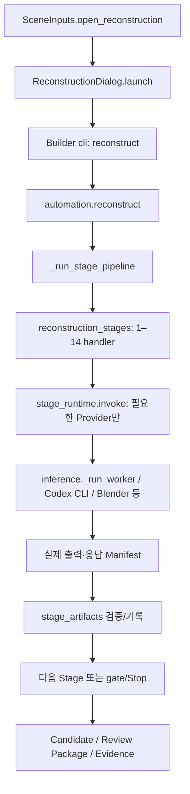

# 07. 실행 경로와 디버깅 실습: 버튼부터 최종 Reader까지

[처음](README.md) · [구조](01-system-architecture.md) · [재구성](02-scene-reconstruction.md) · [좌표·자산](03-camera-assets-simulation.md) · [학습](04-robot-learning.md) · [결함](05-bug-fixes-explained.md) · [코드 지도](06-source-code-atlas.md) · [실습](07-execution-and-debugging.md) · [용어](08-glossary-and-learning-path.md)

이 장은 VS Code에서 소스를 **읽으며** 따라갈 수 있는 실습 안내다. 아래 명령은 실제 parser/launcher에서 확인해 기재했지만, 이번 문서화에서는 실행하지 않았다. 모델·엔진·사용자 입력을 사용하는 실행 예제는 별도 작업이며, 준비되지 않은 `examples/` 경로를 그대로 실행하는 Quick Start가 아니다.

## 목차

- [1. 실행 대신 먼저 안전하게 읽기](#debug-environment)
- [2. 실습 A — Scene 저장](#debug-scene)
- [3. 실습 B — Auto Reconstruction](#debug-reconstruction)
- [4. 실습 C — Camera Fit](#debug-fit)
- [5. 실습 D — Mimic에서 ACT까지](#debug-learning)
- [6. 상태·로그로 실패 위치 좁히기](#debug-errors)
- [7. Code/자료 불변성 확인](#debug-preservation)

<a id="debug-environment"></a>
## 1. 실행 대신 먼저 안전하게 읽기

### 1.1 기준 Commit을 유지한다

현재 교재의 기준은 `8e02b1ae023a856694a40b947881f76b66410624`다. `git checkout`할 필요가 없다. 아래는 읽기 전용 예시다.

```bash
pwd
git status --short --branch
git rev-parse HEAD
git diff 8e02b1ae023a856694a40b947881f76b66410624 -- robot_learning_workbench/src real2sim_builder/src scene_contract/src
```

문서 작성 기준에서는 HEAD가 위 Commit과 같고 시작 Working Tree가 clean이었다. 향후 변경 뒤 읽는다면 함수의 line 번호도 이동할 수 있으므로 [Atlas](06-source-code-atlas.md)의 모듈명/심볼로 다시 찾는다. 이전 구현을 보려면 `git show 97c029e195ab8587603fb3f240f2c1a6c0f91f52:robot_learning_workbench/src/robot_learning_workbench/run.py`로 읽는다. 현재 파일을 이전 버전으로 덮어쓰지 않는다.

### 1.2 Interpreter를 구별한다

Qt Python과 backend Python이 다르다. launcher는 QT_PYTHON/BACKEND_PYTHON/ISAACLAB_ROOT/WORKBENCH_WORKSPACE와 기존 CLI override를 해석한다. [run_workbench_ui.sh](../../run_workbench_ui.sh)와 [ui.app.main · L110](../../robot_learning_workbench/src/robot_learning_workbench/ui/app.py#L110)이 근거다. 아래 `/path/to/...`는 각자 이미 설치한 경로로 바꿀 설명용 값이다. 설치·자동 다운로드 명령은 아니다.

```bash
R2S_ROOT='/path/to/real2sim-learning-studio'
R2S_BACKEND='/path/to/existing/backend/bin/python'
export PYTHONPATH="$R2S_ROOT/scene_contract/src:$R2S_ROOT/real2sim_builder/src:$R2S_ROOT/robot_learning_workbench/src${PYTHONPATH:+:$PYTHONPATH}"
"$R2S_BACKEND" -B -m robot_learning_workbench.cli --help
"$R2S_BACKEND" -B -m real2sim_builder.cli --help
```

**실행 주의:** 실제 UI launcher는 선택 Workspace 디렉터리를 만들고 카탈로그를 읽을 수 있다. UI가 뜬 뒤 장치 연결/Precision/Teleop/SDK Calibration 버튼은 실물 권한을 가질 수 있다. 이 교재를 읽기 위해 누를 필요는 없다. 일반적인 whole-stack 설치나 테스트 실행도 이번 문서 작업 범위가 아니다.

### 1.3 Breakpoint는 두 Interpreter를 자동으로 건너지 않는다

UI debugger에서 `WorkflowPage.start_run`에 멈췄다고 단기 QProcess Backend나 Popen Worker의 `execute` breakpoint도 자동으로 연결된 것은 아니다. 코드를 읽을 때는 아래 세 창을 따로 연다.

- Qt: `ui/workflow.py`, `ui/jobs.py`.
- 단기 Backend: `ui/operations.py`의 execute/prepared, stdin/stdout JSON.
- Worker: `run.py`의 start/execute/_run_stage, `cli.py`의 worker --monitor.

실제 debugger attach는 실행 허가를 받은 테스트 Workspace에서만 한다. 여기서는 이미 저장된 request/status/event를 읽고 해당 source line과 대응시키는 것으로 충분하다.

<a id="debug-scene"></a>
## 2. 실습 A — Scene 저장

### 2.1 UI 버튼에서 Project까지

1. [ui.app.Window.__init__ · L13](../../robot_learning_workbench/src/robot_learning_workbench/ui/app.py#L13)에서 첫 탭이 CapturePage인 것을 찾는다.
2. [ui.scene_inputs.SceneInputs · L14](../../robot_learning_workbench/src/robot_learning_workbench/ui/scene_inputs.py#L14)에서 Scene 입력·메모·Object Library/Reconstruction 버튼의 signal 연결을 본다. main 화면의 어떤 버튼이 BackendJob을 부르는지 확인한다.
3. 현재 새 Scene 버튼의 실제 경로는 [ui.session_page.CapturePage.new_project · L116](../../robot_learning_workbench/src/robot_learning_workbench/ui/session_page.py#L116) → BackendJob의 `session_new_project` → [ui.operations.execute · L134](../../robot_learning_workbench/src/robot_learning_workbench/ui/operations.py#L134)의 `session_` dispatch → [ui.session_operations.execute · L99](../../robot_learning_workbench/src/robot_learning_workbench/ui/session_operations.py#L99) → [project.Project.create · L94](../../real2sim_builder/src/real2sim_builder/project.py#L94)다. 자료 저장은 [ui.session_page.CapturePage.store_materials · L107](../../robot_learning_workbench/src/robot_learning_workbench/ui/session_page.py#L107) → `session_materials` → 같은 session_operations → [scene_preparation.save_inputs · L37](../../robot_learning_workbench/src/robot_learning_workbench/scene_preparation.py#L37)다. `scene_preparation.create_scene` helper도 존재하지만 현재 버튼의 직접 Caller라고 연결하지 않는다.
4. [project.Project.create · L94](../../real2sim_builder/src/real2sim_builder/project.py#L94)에서 Project ID, 사람 이름의 폴더, owner marker와 state를 구별한다.
5. [observations.register_image · L107](../../real2sim_builder/src/real2sim_builder/observations.py#L107) → [evidence.add_image · L43](../../real2sim_builder/src/real2sim_builder/evidence.py#L43) / [evidence.save_scene_memo · L397](../../real2sim_builder/src/real2sim_builder/evidence.py#L397)의 원 RGB·메모 저장과 SHA를 읽는다.
6. 다시 [scene_preparation.scene_details · L20](../../robot_learning_workbench/src/robot_learning_workbench/scene_preparation.py#L20)로 돌아와 `inputs`, `notes_saved`, `reconstruction_ready`, `needs`의 Consumer를 본다.

단순 저장이 metric 3D 복원 완료인 것은 아니다. 다음 경로가 생기는 이유를 확인한다.

| 파일/자료 | Producer | 디버깅 질문 |
|---|---|---|
| project.yaml | Project.create | display name과 내부 project ID를 혼동하지 않았는가? |
| working/owner.json | Project.create | 현재 프로젝트가 수정 가능한 소유 사본인가? |
| working/state.json | Project.update | 입력 저장·실행 상태와 기하 완성을 구분하는가? |
| input/evidence.yaml | register_image/add_video 등 | role, image_id, scene_state_id, group, SHA가 있는가? |
| input/scene_photos / model_references | evidence copy/등록 | 실제 입력 역할과 보존 파일이 연결되는가? |
| Scene Memo record | save_scene_memo/scene_memo | 원문 저장 여부와 SHA가 downstream 분석에 들어가는가? |

현재 Memo 저장 경로는 `input/scene_memo.txt`다. [evidence.save_scene_memo · L397](../../real2sim_builder/src/real2sim_builder/evidence.py#L397)가 이 경로에 저장하고, [evidence.scene_memo · L381](../../real2sim_builder/src/real2sim_builder/evidence.py#L381)는 부재 시 Legacy brief를 읽기 전용으로 fallback한다. 빈 원문과 미저장 상태도 구별한다. 새로운 저장이 Legacy 파일을 덮어쓰는 것으로 이해하지 않는다. Model Reference는 형상 외형 참고이며 Scene Photo의 DA3 multi-view batch에 섞이지 않는다.

### 2.2 실제 Validation을 어디서 읽는가

UI에서 파일이 선택됐다고 검증이 끝나지 않는다. `save_inputs`는 입력 파일 존재/역할/정적 layout을 확인하고, `register_image`는 upright metadata/해상도/SHA를 연결한다. Candidate의 3D 값은 [scene.validate · L90](../../real2sim_builder/src/real2sim_builder/scene.py#L90)와 [editing.preserve · L10](../../real2sim_builder/src/real2sim_builder/editing.py#L10)가 별도로 검사한다. `scene_details`는 complete=True 검증 실패를 needs로 노출하므로 입력 자료만 저장한 Project도 목록에서 확인할 수 있다.

읽기 과제: 같은 RGB를 다른 scene_state에 재등록하려고 할 때 어떤 분기가 거부하는지 찾는다. 이 조건은 단순 파일 중복 방지보다 “다른 배치를 같은 Scene pose로 합치지 않기”와 연결된다. [Photo/Video/Memo handoff 시험](../../real2sim_builder/tests/test_stage_video_authoring.py)과 [prepared image 시험](../../real2sim_builder/tests/test_prepared_image_handoff.py)을 정적으로 읽는다.

<a id="debug-reconstruction"></a>
## 3. 실습 B — Auto Reconstruction

### 3.1 실제 호출 지도



[ui_reconstruction.ReconstructionDialog.launch · L291](../../real2sim_builder/src/real2sim_builder/ui_reconstruction.py#L291)와 [automation.reconstruct · L305](../../real2sim_builder/src/real2sim_builder/automation.py#L305)부터 읽는다. `refit_only`는 기존 Source 기반 재정합 경로로 가고, 신규 기본 경로는 Stage Pipeline이다. UI에서 필요한 Runtime이 없어 표시되는 needs와, 실제 Child가 출력 계약을 어긴 실패는 다른 곳에서 발생한다.

**실행 주의: 아래 명령은 새 Candidate, GPU/온라인 Codex/Blender/Provider 호출과 비용·파일 생성을 수반할 수 있다. 이번 문서 작업에서는 실행하지 않았다.** 명시된 테스트용 Project/설정·Runtime/예산을 준비하고 별도 실행 범위를 정한 뒤에만 사용한다.

```bash
R2S_PROJECT='/path/to/owned/test-project'
R2S_CONFIG='/path/to/reviewed/reconstruction.yaml'
"$R2S_BACKEND" -B -m real2sim_builder.cli reconstruct "$R2S_PROJECT" \
  --candidate study_candidate --config "$R2S_CONFIG" --run-modeling
```

명령은 현재 [cli.main · L8](../../real2sim_builder/src/real2sim_builder/cli.py#L8) parser의 reconstruct/project/--candidate/--config/--run-modeling을 따른다. `--stage 10` 같은 단독 Stage 실행 옵션은 이 CLI에 없으므로 만들지 않았다. 개별 Stage 학습은 [02장의 14개 절](02-scene-reconstruction.md)과 [기존 Synthetic Stage 시험](../../real2sim_builder/tests/test_stage_pipeline.py)을 읽어 진행한다.

### 3.2 실패한 Stage를 찾는 순서

1. Project `working/state.json`의 stage/status/needs/error를 읽는다.
2. Candidate `reconstruction.json` 및 Stage progress/report를 확인한다.
3. `reconstruction/simfoundry/stage_XX/attempt_XXX`의 Artifact record가 COMPLETE인지, 실행 provenance가 mock/real인지 확인한다.
4. record가 가리키는 실제 response/output 파일과 SHA를 확인한다. 임의 폴더에 PNG 하나가 있다고 성공 Artifact가 아니다.
5. Stage 내부 invoke의 Worker response/로그를 본다. missing Runtime·OOM·JSON schema 실패·identity mismatch·모호한 geometry를 구별한다.
6. 상위 Stage가 실패해도 완료된 독립 Worker Manifest는 입력 identity 검증 뒤 재사용될 수 있다. 이를 “다음 Stage까지 완료”로 읽지 않는다.

[stage_artifacts.verify_manifest · L56](../../real2sim_builder/src/real2sim_builder/stage_artifacts.py#L56)와 [stage_artifacts.cache_key · L29](../../real2sim_builder/src/real2sim_builder/stage_artifacts.py#L29)를 연다. 입력 이미지를 바꾼 뒤 예전 Mask/Depth를 그대로 쓰면 안 되는 이유가 SHA/설정/Runtime/가이드/구현 identity로 드러난다. Memo/Reference는 각 Stage의 필요한 identity에만 연결되므로 Memo가 바뀌었다고 항상 DA3를 다시 실행하는 것은 아니다.

### 3.3 Stop/Resume의 파일을 읽는다

Builder의 control은 [project.Project.control · L135](../../real2sim_builder/src/real2sim_builder/project.py#L135) → `working/control.json` → [project.Project._consume_control · L189](../../real2sim_builder/src/real2sim_builder/project.py#L189)다. Worker가 unique claimed 이름으로 먼저 rename한 뒤 읽는다. “read 후 원 경로 unlink”였을 때는 그 사이 교체된 새 Stop을 지울 수 있었다. 이 장면은 [BUG-008](05-bug-fixes-explained.md#bug-008)에서 실제 Before/After로 읽는다.

Resume는 부분 파일을 성공으로 바꾸는 절차가 아니다. 완료 Stage/Worker closure를 다시 검사하고 입력/Asset/current Candidate가 바뀌지 않았을 때 재사용한다. 상태를 직접 JSON 편집해 COMPLETE로 만드는 연습은 하지 않는다.

<a id="debug-fit"></a>
## 4. 실습 C — Camera Fit

### 4.1 어떤 정합 경로인지 먼저 고른다

이 저장소에는 여러 fit Caller가 있다. 직접 Candidate.fit, Stage10 sensor fitting, Source Pair numeric refinement, render hybrid가 같은 이름의 solver 결과를 다르게 소비할 수 있다. 다음 표를 따라 구분한다.

| 경로 | 시작 | 핵심 처리 | 최종 Consumer |
|---|---|---|---|
| Candidate direct | [candidate.Candidate.fit · L202](../../real2sim_builder/src/real2sim_builder/candidate.py#L202) | joint/geometry/wrist target dispatch | IMPROVED 중 target=joint:scene이면 scope/preserve → reproject; 모든 IMPROVED는 self.save(scene) |
| Stage10 sensors | [reconstruction_stages.register_stage_sensors · L975](../../real2sim_builder/src/real2sim_builder/reconstruction_stages.py#L975) | register_sensor_views → optional joint/render | rank 부족 결과는 원 Scene 유지, diagnostic만 보존 |
| Source Pair refit | [automation.select_refit_pairs · L727](../../real2sim_builder/src/real2sim_builder/automation.py#L727), [automation.refit_pairs · L783](../../real2sim_builder/src/real2sim_builder/automation.py#L783) | ID/Source/단일Layout 검증 → 기존 numeric/render 경계 | 선택하지 않은 최신 Capture를 대신 쓰지 않음 |
| Hybrid | [calibration.hybrid.fit_scene · L183](../../real2sim_builder/src/real2sim_builder/calibration/hybrid.py#L183) | 원관측/렌더 지표·관측가능성·예산·비퇴행 | best-scene, report, 갱신 관측 dependency |

**실행 주의:** 아래 명령은 Candidate 파일·fit report·파생 Cloud를 바꿀 수 있다. 원본 사용자의 Candidate에 교재 실습으로 실행하지 않는다. 명시적으로 만든 별도 합성/테스트 Candidate가 필요하다.

```bash
R2S_OPTIONS='/path/to/reviewed/joint-fit-options.json'
"$R2S_BACKEND" -B -m real2sim_builder.cli candidate "$R2S_PROJECT" fit study_candidate \
  --target joint:scene --options "$R2S_OPTIONS"
```

### 4.2 debugger에서 볼 값

1. [observations.annotation_evidence · L563](../../real2sim_builder/src/real2sim_builder/observations.py#L563): 어떤 image_id/landmark/split/group이 실제 사용되는가?
2. [calibration.joint.parameter_blocks · L41](../../real2sim_builder/src/real2sim_builder/calibration/joint.py#L41): 어떤 camera/view/object/base가 변수이고 보호된 값은 제외됐는가?
3. [calibration.joint.fit_joint_scene · L353](../../real2sim_builder/src/real2sim_builder/calibration/joint.py#L353)의 residual: trial assign → 관측별 K/FK/pose → uv delta/weight/depth penalty/prior.
4. SciPy 결과의 jacobian_rank/parameter_count, singular values, condition_number, group_regressions, holdout diagnostics.
5. Caller가 solver.status=IMPROVED만 보는지 추가 rank Gate를 보는지.
6. [calibration.hybrid.reproject_observations · L391](../../real2sim_builder/src/real2sim_builder/calibration/hybrid.py#L391): raw-relative는 새 NPZ, fixed_world는 기존 점/SHA 유지·Camera signature만 갱신.
7. Candidate.save의 validate/scope/preserve 후 후속 [calibration.hybrid.cloud_inputs · L102](../../real2sim_builder/src/real2sim_builder/calibration/hybrid.py#L102)가 다시 읽을 수 있는지.

순수 수학만 읽고 멈추면 BUG-012/013/NEW-01을 놓친다. Camera의 새 값이 후속 Reader의 identity와 맞아야 한다. [test_direct_fit_observation_refresh.py](../../real2sim_builder/tests/test_direct_fit_observation_refresh.py)의 repeated/direct/protected 사례를 읽고 각 입력 SHA와 출력 참조가 어떻게 비교되는지 확인한다.

### 4.3 Refit UI에서 확인할 ID

[ui.real_sim_page.RealSimPage.open_refinement · L51](../../robot_learning_workbench/src/robot_learning_workbench/ui/real_sim_page.py#L51)는 선택된 Snapshot 행 ID만 넘긴다. [automation.select_refit_pairs · L727](../../real2sim_builder/src/real2sim_builder/automation.py#L727)가 ID 존재·archive·Source Revision/Manifest·layout을 검증한다. 서로 다른 layout을 선택하면 NEEDS_MORE_DATA이며 일부 ID를 조용히 빼고 최신 layout을 쓰지 않는다. 이 검증이 끝나기 전에 임의 기존 Candidate report를 덮어써서도 안 된다. [FIX-B](05-bug-fixes-explained.md#fix-b)가 이 흐름의 실습이다.

<a id="debug-learning"></a>
## 5. 실습 D — Mimic에서 ACT까지

### 5.1 실행 전 Source와 action 의미를 확인한다

[examples/source-mujoco.yaml](../../examples/source-mujoco.yaml), [annotation-isaac.yaml](../../examples/annotation-isaac.yaml), [datagen-mujoco-random.yaml](../../examples/datagen-mujoco-random.yaml), [train-act.yaml](../../examples/train-act.yaml)은 parser 형태를 보여준다. `assets-private/`, `datasets/`, `checkpoints/` 등은 Git에 들어 있는 데이터가 아닐 수 있다. 경로가 보인다고 실행 준비가 끝난 것은 아니다.

Source/Annotation/Mimic은 원 Native Episode의 recorded q/object pose와 signal/subtask metadata를 소비한다. Native actions7D와 LeRobot 학습 action6D를 잘못 대응하면 shape만 맞춘 듯한 다른 정책이 된다. [data.recording.record_frame · L14](../../robot_learning_workbench/src/robot_learning_workbench/data/recording.py#L14) → [data.lerobot.control_contract · L38](../../robot_learning_workbench/src/robot_learning_workbench/data/lerobot.py#L38)/materialize를 먼저 읽는다.

### 5.2 정적 추적 순서

| 단계 | 함수와 저장 결과 | 읽을 assertion |
|---|---|---|
| Source | engines.*.source.run / execution_contract → Native segment | source function parameter/plan이 vector에도 전달되는가? |
| Annotation | engines.*.annotation.run → signal/acceptance 결과 | original measured input과 제어 target의 의미를 보존하는가? |
| Mimic | generation.mimic → 엔진 datagen loop → publish_generation | IK 실패/취소/성공 attempt와 seed가 구별되는가? |
| Curation | save_curation/save_revision → 선택/trim/split | payload를 복사하지 않아도 원 Episode identity가 남는가? |
| Convert/Merge | data.lerobot.run/materialize → .staging → publish | Writer가 열리거나 marker가 staging이면 Reader에서 거부하는가? |
| Train | training_command/freeze_inputs/train → official-config/intent/log | 요청·resolved·저장 config와 Dataset이 서로 묶이는가? |
| Checkpoint | seal_checkpoint → workbench-checkpoint.json | 필수 tensor/state/step/finite 값과 Scheduler/Optimizer가 유효한가? |
| Resume | checkpoint_record + _resume_config_matches | 허용된 누적 step/출력 변경 외 실제 의미 변경을 차단하는가? |
| Evaluation | policy loader/processors → 엔진 steps → publish_attempt | zero-step initial state와 policy Task success가 분리되는가? |

각 함수의 실제 소스와 시험은 [04장](04-robot-learning.md)에 연결했다. 이 장의 목적은 폴더를 찾아 위 표의 Producer/Consumer를 연결하는 것이다.

### 5.3 실행이 허용된 별도 작업에서 사용할 CLI 형태

**아래는 학습/엔진/새 Dataset을 실제 실행·생성하는 명령이다. 이번 문서 작업에서는 실행하지 않았다.** Runtime·모델·Task·새 output·입력 SHA를 검토한 별도 실험에서만 사용한다. 실물 robot Recipe는 이 예제에 포함하지 않는다.

```bash
# 먼저 실제 저장 Recipe를 작성/검토하고 변수를 지정해야 한다.
R2S_RECIPE='/path/to/reviewed/one-stage.yaml'
R2S_TASK_MODULES="$R2S_ROOT/robot_learning_workbench/task_modules.yaml"
"$R2S_BACKEND" -B -m robot_learning_workbench.cli validate "$R2S_RECIPE"
"$R2S_BACKEND" -B -m robot_learning_workbench.cli prepare "$R2S_RECIPE" --task-modules "$R2S_TASK_MODULES"
# run은 새 claim/output을 만든다. 같은 intent 재전달에만 같은 ID를 사용한다.
"$R2S_BACKEND" -B -m robot_learning_workbench.cli run "$R2S_RECIPE" \
  --request-id study-reviewed-intent-001 --task-modules "$R2S_TASK_MODULES"
```

원래 명령에는 expected SHA 옵션도 있다. UI는 이를 준비 응답과 함께 전달한다. CLI 예제에서 새로운 intent의 ID를 임의로 재사용하면 REQUEST_CONFLICT가 날 수 있다. 저장 Recipe에 어떤 Stage가 있느냐가 실행 대상을 결정하며, Source 하나를 run했다고 이후 전체 학습 흐름이 자동으로 이어지지 않는다.

Checkpoint의 학습 Resume는 source Dataset Resume나 UI reopen과 다르다. 새 cumulative steps/new output과 mode=resume, 지정 Checkpoint를 가진 공식 training JSON을 기존 Editor에서 저장하고 새로운 Recipe/intent로 준비한다. 실제 허용 필드는 [learning.train.validate_config · L12](../../robot_learning_workbench/src/robot_learning_workbench/learning/train.py#L12), [learning.train.training_command · L40](../../robot_learning_workbench/src/robot_learning_workbench/learning/train.py#L40), [learning.policy._resume_config_matches · L56](../../robot_learning_workbench/src/robot_learning_workbench/learning/policy.py#L56)를 기준으로 하며 “weights만 같은 파일로 바꾸기”는 Resume가 아니다.

<a id="debug-errors"></a>
## 6. 상태·로그로 실패 위치 좁히기

### 6.1 읽기 전용 상태 명령

기존 Run 폴더가 있을 때 아래 명령은 소유 Worker를 새로 실행하지 않고 저장 상태/이벤트를 읽는다. 예시 값은 실제 이미 존재하는 폴더로 바꾼다. credentials·Memo 원문을 공유 로그에 복사할 필요는 없다.

```bash
R2S_RUN='/path/to/existing/.workbench-runs/run-id'
"$R2S_BACKEND" -B -m robot_learning_workbench.cli status "$R2S_RUN"
"$R2S_BACKEND" -B -m robot_learning_workbench.cli events "$R2S_RUN" --after-seq 0 --limit 100
"$R2S_BACKEND" -B -m real2sim_builder.cli status "$R2S_PROJECT"
```

Backend status는 `run.json.status`만 cat하는 것과 다르다. [run.read_status · L130](../../robot_learning_workbench/src/robot_learning_workbench/run.py#L130)가 별도 process_exit.json과 /proc identity를 읽기 때문이다. `completed + exit7 + process_error`와 “completed이므로 exit0일 것”을 구별한다. Legacy에서는 exit_code=null을 정상 종료로 추정하지 않는다.

### 6.2 증상별 첫 확인 지점

| 증상 | 먼저 볼 자료 | 실제 확인 함수 | 하지 말아야 할 해석 |
|---|---|---|---|
| 버튼이 비활성 | Editor dirty/path, 준비 상태, active handle | WorkflowPage.buttons/start_run | UI가 고장났다고 모델을 재설치 |
| Backend 응답 실패 | QProcess return code/stdout JSON/stderr | BackendJob.done, operations.main | Worker stdout의 임의 JSON을 응답으로 사용 |
| 같은 request 시작 거부 | requests claim/payload SHA/spawn | run.start | claim 삭제 후 재시작으로 중복 게시 |
| completed인데 exit 미확인 | process_exit.json/관측 PID | run._monitor/read_status | 미관측0 채우기 또는 게시 Artifact 삭제 |
| 같은 Step 반복 실패 | commands/id, acks/id, pending_step_id | control_commands/WorkflowPage.poll | queued를 완료로 표시 |
| GPU Child 실패 | 해당 Stage request/response/런타임/로그 | stage_runtime.invoke / inference._run_worker | 각 모델을 동시 로딩해 원인 흐리기 |
| Scene metric 불명 | World registration/anchor/scale/provenance | Stage10 / registration.align_points | 지원면 +Z를 로봇 World 실측으로 승격 |
| Camera fit 뒤 stale | cloud/image record/Camera signature | hybrid.cloud_inputs | 기존 raw를 새 World point로 이름만 변경 |
| Dataset이 안 보임 | staging marker / Native pending intent | data.curation.discover_datasets / lerobot_catalog | 손상 Dataset을 완료 카탈로그에 강제 추가 |
| 학습 설정 불일치 | .official-config.json, training-intent, Checkpoint config | _resolved_request / seal_checkpoint | null/default를 실제 모델 변경과 구분하지 않음 |
| 학습 실패 | .official.log, training-result.json, last marker | learning.train.train | 로그 마지막 줄만 보고 최종 Checkpoint가 완성됐다고 단정 |
| 좋은 평가값이 독립인지 불명 | 원 Episode lineage/holdout usage ledger | episode_overlap / _record_holdout_usage | 경로가 다르거나 validation 이름이면 독립이라고 가정 |

### 6.3 이벤트는 bounded Control, RGB는 별도 채널이다

[run._append_event · L259](../../robot_learning_workbench/src/robot_learning_workbench/run.py#L259)는 event를 최대64KiB로 제한하고 events.idx에 byte offset을 기록한다. [run.read_events · L279](../../robot_learning_workbench/src/robot_learning_workbench/run.py#L279)는 seq/offset에 따라 page를 읽는다. 큰 image bytes를 이벤트 JSON에 넣어 로그처럼 보내는 구조가 아니다. Preview는 최신 frame/세대 번호를 가진 제한된 슬롯이며 Snapshot/Pair의 불변 보존 자료와 다르다.

### 6.4 재현 문제를 작게 만든다

실행이 허용된 별도 개발 때도 처음부터 사용자 Scene 전체를 돌리지 않는다. 먼저 깨진 Producer/Consumer 두 경계의 합성 입력·실패 assertion을 정한다. 실제 Stage Runtime, engine, VLM 응답을 대체한 부분과 실제 실행한 부분을 기록한다. 이 교재에서는 그 원리를 기존 시험의 source로만 설명한다. [NEW-03 실제 child/Qt 시험](../../robot_learning_workbench/tests/test_worker_exit_integration.py)은 기존 Dataset을 손상시키지 않고 “게시 후 비정상 종료”라는 한 조건을 따로 검증하는 예다.

<a id="debug-preservation"></a>
## 7. Code/자료 불변성 확인

변경 없는 읽기 작업에서도 상태를 먼저 확인하는 습관을 갖자. 사용자 Scene을 열어 자동 변환·rectification·cache migration을 실행하는 것과 source를 읽는 것은 다르다. 이 교재는 다음 경계를 유지했다.

- 제품·시험·설정·기존 문서 내용 변경 없이 새 `docs/codebase-guide/*.md`만 작성.
- 시험/학습/엔진/모델 Forward/장치/Provider 실행0회. 새 “통과” 수를 만들지 않음.
- Commit/Push/Checkout/Reset/Clean/Stash 없음. 2,151 passed는 이전 최종 보고서의 역사적 결과로 인용.
- 소스 경로·함수·line·발췌와 Markdown 링크는 정적 검사한다. 이 검사가 Runtime 호환성/기하 정확도를 검증하는 것은 아님.

도중 실제 버그나 오래된 문장을 발견하면 코드와 문서의 차이를 기록한다. 이번 문서화 범위에서 “읽다가 발견한 김에” 소스를 수정하지 않는다. 전체 개념을 다시 보고 싶으면 [01장](01-system-architecture.md), 읽을 순서를 정하려면 [08장](08-glossary-and-learning-path.md#learning-ten-files)로 돌아간다.
