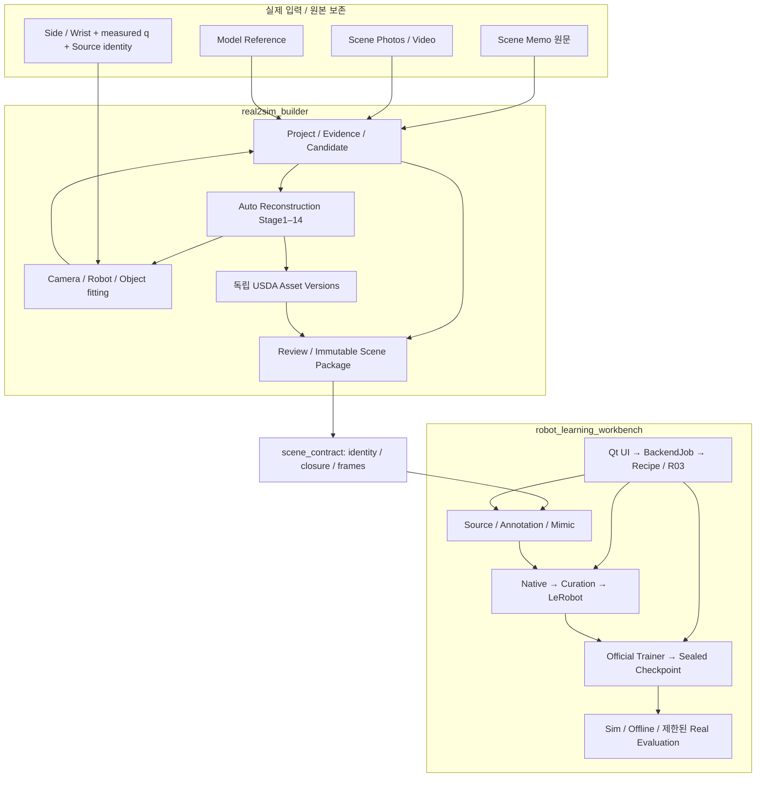

# Real2Sim Learning Studio — 코드를 처음 읽는 소유자를 위한 개발 교재

[처음](README.md) · [구조](01-system-architecture.md) · [재구성](02-scene-reconstruction.md) · [좌표·자산](03-camera-assets-simulation.md) · [학습](04-robot-learning.md) · [결함](05-bug-fixes-explained.md) · [코드 지도](06-source-code-atlas.md) · [실습](07-execution-and-debugging.md) · [용어](08-glossary-and-learning-path.md)

2026-11-15, `HYEONHEE5739/real2sim-learning-studio`의 `feat/simfoundry-style-reconstruction`, 안정화 Commit **`8e02b1ae023a856694a40b947881f76b66410624`**를 기준으로 작성했다. 시작 HEAD는 이 Commit과 같았고 Working Tree는 clean이었다. 이 교재는 **현재 제품 소스와 실제 Caller·Consumer·시험 코드의 정적 분석**이다. 작성 중 제품/시험/설정·사용자 자료를 수정하거나 테스트·AI·엔진·장치를 실행하지 않았다. 현재 추가되는 파일은 이 디렉터리의 Markdown뿐이다.

## 목차

- [1. 이 프로젝트가 연결하는 것](#guide-purpose)
- [2. 전체 구조를 먼저 보기](#guide-workflow)
- [3. 교재 구성과 학습 순서](#guide-chapters)
- [4. 자료와 성공의 의미부터 구분하기](#guide-contracts)
- [5. 구현과 검증 수준](#verification-levels)
- [6. 기존 문서와 현재 코드의 차이](#guide-mismatches)
- [7. 범위·집계·정적 검증 방법](#guide-audit)
- [8. 처음 열 파일과 다음 행동](#guide-start)
- [문서 검증 결과](#guide-verification)

## 1. 이 프로젝트가 연결하는 것

프로젝트의 목표는 실제 작업 공간의 RGB·사용자 Memo·로봇/센서 자료를 바탕으로 **수정 가능한 3D Scene과 개별 Object Asset**을 만들고, 그 자료를 Simulation·데모·Mimic·Dataset·정책 학습·평가로 연결하는 것이다. 서로 다른 단계의 근거와 원본을 보존하는 것이 핵심이다. 사진에서 추정한 치수와 실측, 화면에 그린 Visual과 실제 Collision, 저장에 성공한 Episode와 물리 Task 성공을 같은 뜻으로 쓰지 않는다.

코드는 세 package의 **제품 Python 177개**로 구성된다. `scene_contract` 5개는 불변 실행 Package·좌표·파일 계약, `real2sim_builder` 48개는 입력·제작·보정·자산·Export, `robot_learning_workbench` 124개는 UI·Recipe·Worker·장치/엔진·데이터/학습/평가를 맡는다. 제품 소스는37,927줄, 함수 정의1,909개와 클래스152개다. 메서드·내부 함수/지역 클래스 포함이며 “모든 함수가 같은 깊이로 검증됐다”는 뜻이 아니다. [전체 File Atlas](06-source-code-atlas.md)는 177개를 한 파일도 빼지 않고 역할·주요 정의·정적 참조·시험과 연결한다.

이 프로젝트를 전부 이해하려면 Robot Geometry를 아는 것에 더해 세 질문을 함께 해야 한다.

1. **어떤 자료인가?** 단위, 좌표계, schema, source SHA와 provenance는 무엇인가?
2. **누가 실행/변경하는가?** UI, 단기 Backend, 실제 Worker, 엔진과 Provider의 책임은 무엇인가?
3. **언제 다음 단계가 믿고 읽어도 되는가?** staging/commit/validation/approval/종료가 각각 완료됐는가?

## 2. 전체 구조를 먼저 보기

화살표는 자료의 Consumer 관계를 뜻한다. **Stage1–14 완료 뒤 자동으로 실물 로봇이 구동되는 전역 루프가 아니다.** Source·Annotation·Datagen·Convert/Training/Evaluation은 각 저장 Recipe와 명시 실행을 갖는다. 물리 센서의 Calibration·공유 Mount·Robot World와 독립 평가 자료는 별도 근거가 필요하다. Stage13의 unapproved Review Package를 곧바로 실물 Task 승인이라고 해석하지 않는다.

소프트웨어의 세 수명을 구별하자. Qt는 화면과 입력을 처리한다. BackendJob의 단기 QProcess는 파일 준비/실행 요청을 처리한다. R03 Worker와 Builder Provider Child는 긴 실행을 맡는다. “Backend 응답 성공”과 “긴 작업 완료”와 “실제 OS exit0”은 다르다. [01장 sequence diagram](01-system-architecture.md#architecture-start)에서 이것부터 읽는다.

## 3. 교재 구성과 학습 순서

| 순서 / 문서 | 이 장에서 답할 질문 | 읽은 뒤 직접 열 코드 |
|---|---|---|
| [01 시스템 구조](01-system-architecture.md) | UI/Backend/Worker가 왜 분리됐고 파일 상태가 어떻게 연결되는가? | ui.app → jobs/operations → recipe/run |
| [02 Scene 재구성](02-scene-reconstruction.md) | Memo·Photos가 14 Stage를 지나 실제 Mesh/Scene이 되는가? 어디서 막히는가? | scene_preparation/evidence → automation → reconstruction_stages/runtime/workers |
| [03 Camera·Asset·Simulation](03-camera-assets-simulation.md) | FK/K/pose·residual/rank가 code와 어떻게 대응하는가? 실제 USDA는 어떻게 보이는가? | capture/cameras → calibration.joint/hybrid → object_assets → viewport/engines |
| [04 Robot Learning](04-robot-learning.md) | Source→Mimic→Native/LeRobot→ACT/Checkpoint→평가가 어떻게 이어지는가? | engines/generation → data → learning |
| [05 결함 해설](05-bug-fixes-explained.md) | 정상 목적을 어떤 경계에서 놓쳤고 수정/시험이 왜 해결하는가? | BUG001–021·FIXA/B·NEW01–03, RISK001/002의 실제 Before/After |
| [06 File Atlas](06-source-code-atlas.md) | 내가 연 파일의 책임·Caller·의존성·관련 시험은 무엇인가? | 제품177개·시험/Fixture209개의 전체 지도 |
| [07 추적·디버깅 실습](07-execution-and-debugging.md) | VS Code에서 클릭부터 파일 Reader까지 어떻게 따라가는가? | Scene 저장·재구성·Camera Fit·Mimic/ACT의 실습 A–D |
| [08 용어와 학습 경로](08-glossary-and-learning-path.md) | 이 프로젝트의 software 용어와 처음 열10개 파일은 무엇인가? | 핵심10파일의 함수·다음 파일·이해 목표 |

처음에는 01→02→03을 읽되, 모르는 단어는08에서 찾는다. 그 다음 실제 관심 기능 하나를07의 추적 순서로 따라가며06을 지도로 쓴다. 04에서 학습 자료를 이해한 뒤05의 결함을 기능별로 읽으면 좋다. 05를 전부 외우기보다 자신이 보고 있는 Producer/Consumer가 깨지면 무엇을 보존해야 하는지를 생각한다.

각 주요 장은 실제 source link와 짧은 원문 발췌·줄별 의미를 포함한다. `<!-- source: ... -->`는 검증용 주석으로 보통 렌더된 본문에는 보이지 않는다. Before는 안정화 부모 Commit `97c029e...`의 `git show`로 확인한 원문이며, 현재 파일을 과거 버전으로 checkout하지 않았다. 26개 결함은 각①정상 목적 ②수정 전 ③원인 ④시나리오 ⑤수정 ⑥Before/After ⑦수정 후 ⑧시험 ⑨원칙 ⑩다른 경계 보존을 설명한다.

## 4. 자료와 성공의 의미부터 구분하기

| 쉽게 섞이는 말 | 실제 구분 |
|---|---|
| Project / Scene / Candidate / Revision | 입력·작업 소유권 / 제작 geometry / 별도 수정 후보 / 불변 실행 Package |
| Scene Photo / Model Reference / Capture | 초기 static geometry 관측 / 특정 Object 외형 참고 / 실제 Side·Wrist와 measured q |
| K/Pose | 센서·처리 image pixel grid 및 transform 방향을 가진 값. 배열 shape만 같은 값이 아님 |
| Asset / Instance | 불변 Geometry/Material/Collision version / Scene Object ID·pose·role |
| Native actions / 학습 action | EE delta+gripper7D / joint_targets에서 온 model-rad6D. 같은 의미가 아님 |
| Dataset 파일 있음 / 게시 성공 | staging/미완료 intent / Reader가 확인하는 완료 segment·publication |
| Checkpoint 폴더 / sealed Checkpoint | 일부 저장 파일 / 필수 tensor·optimizer/RNG/step·config/Dataset identity 검증 |
| completed / Task success / exit0 | 작업 결과 게시 / 실제 predicate 목표 달성 / OS 프로세스 정상 종료 |
| validation / 독립 Test | 선택·veto·반복 검토에 소비한 자료 / 고정 Scene·Policy의 새 미사용 평가 자료 |

Native Dataset의 run.json, Project working/state.json, R03 run.json은 서로 다른 schema다. 같은 key 이름을 보고 파일을 대체하지 않는다. Camera pose는 Camera-to-parent인 반면 DA3 extrinsics는 world-to-camera다. 상세한 행렬 방향은 [03장](03-camera-assets-simulation.md#geometry-frames)에서 확인한다.

## 5. 구현과 검증 수준

### 5.1 무엇을 근거로 “된다”고 말하는가

| 수준 | 뜻 | 단독으로 증명하지 못하는 것 |
|---:|---|---|
| 1 코드 존재 | 호출과 검증 분기가 있음 | 설치/Runtime/API/품질 성공 |
| 2 Unit Test | 특정 입력·Assertion으로 한 계약을 검증한 기록 | 전체 Provider/엔진·실물 성공 |
| 3 Mock 통합 | 무거운 Provider를 대체해 실제 Runner/Manifest/Consumer 연결 | 실제 모델 출력 품질 |
| 4 CPU 통합 | 실제 수학·Writer/Reader·parser·일부 CPU 엔진/Trainer가 동작한 기록 | GPU·실제 센서·물리 정확도 |
| 5 GPU Runtime | 특정 입력/설정에서 실제 가중치·Forward·자원 사용 기록 | 임의 실제 사진 E2E·일반 품질 |
| 6 실제 사진 Reconstruction | 실제 입력을 해당 pipeline으로 완주·결과 검증 | 측정 정확도·물리·실물 Task 성공 |
| 7 Isaac/PhysX | 실제 Kit/엔진/센서·접촉·step 검증 | Real2Sim 정량 일치·실물 성능 |
| 8 실물 Task | 실제 로봇의 명시된 안전/관측 조건에서 작업 성공 | 다른 배치/q/정책의 일반화 |
| 9 독립 Test | 선택/fit에 미사용 자료로 정량 평가 | 새로운 domain/미관측 failure 전체 |

다음 표의 “기록”은 Git에 남은 기존 보고서·시험 소스 근거다. 이번 교재 작업에서 재실행한 것이 아니다. 현재 Runtime·가중치 설치 상태와 원시 `/tmp` Evidence는 별도로 재확인하지 않았다. 과거 기록과 현재 소스의 일치까지 실제 Forward로 확인했다고 말하지 않는다.

| 주요 기능 | 코드/Unit/Mock | 실제 CPU 근거 | GPU/사진/Isaac/실물·독립 검증 |
|---|---|---|---|
| Scene 입력·Candidate·Artifact | 구현/회귀·Mock 연결 기록 | 실제 파일/네이티브 parser 기록 | 임의 사용자 Scene의 전체 E2E 성공은 미검증 |
| DA3/SAM3.1/PDA/FLUX/Bria | 현재 Adapter/Worker/gate와 회귀 | Mask/좌표/known-depth 보존·Bria 과거 합성 CPU 기록 | 과거 일부 단독 GPU/합성 Forward 기록은 있음. 현재14 Stage 실사진 품질·독립 metric 정확도는 별도 |
| Codex VLM | 공통 CLI/Schema/권한·cache/오류/중단 계약 | Backend·handoff/Mock/원자 출력 기록 | 과거 합성 컵 online1회 성공 기록. 일반 Instance/Memo/geometry/Task 정확도는 미검증 |
| Stage7 Native Mesh | Codex+Sandbox Blender/새Asset 경계 | parser/Mock handoff·합성 Native 자산 기록 | 실제 사용자 Object의 모델링 정확도는 별도 |
| Camera FK/Joint/Cloud | 수학/좌표/보호·rank/holdout 회귀 | 실제 SciPy/원본Archive→관측→Candidate/Cloud 합성 통합 기록 | 실제 shared Hand-Eye/Robot World·센서 정확도·새 독립 Test는 미검증 |
| Object Library/Qt Viewer | 실제USD/Texture/depth/feature·UI 경로 | 과거 Qt/OpenGL·네이티브 geometry 시험 기록 | display가 authored Collision의 물리 검증을 뜻하지 않음 |
| MuJoCo/Physics | concrete engine·passive probe·Task 경계 | 과거 합성 CPU stepping/contact/parser 기록 | 실제 물성·실물 grasp/task 인증 아님 |
| Isaac K/Scene/MDP | native schema/setter/readback·Mock/CPU 시험 | 합성 USD/수학/config/Renderer metadata 기록 | Phase1C/2B의 실제 Kit/RTX/PhysX·센서 품질은 NOT_TESTED |
| Source/Annotation/Mimic | concrete 단일/vector loop·등록 Task·Native | 과거 합성 Source→Annotation→DLS/MuJoCo 생성 기록 | 성공 Predicate/품질 scope를 유지. 실제 GPU Isaac Mimic 전체·실물 성공은 별도 |
| Native/Curation/LeRobot | Writer·selection·lineage·publication·Cancel 회귀 | 실제 HDF5/Parquet/Video·Reader/공식 API 기록 | 다른 설치/원본 family의 독립성이 자동으로 증명되지 않음 |
| ACT/Checkpoint/Resume | 공식0.4.1 Trainer·config resolution·seal/device | 과거 Tiny ACT CPU Scratch/Resume 각1update 기록 | 대형 GPU 학습·실물 Policy 품질은 미검증 |
| Evaluation | actual engine/Policy·initial-state/attempt 의미 회귀 | 과거 작은 CPU rollout/validation/provenance 기록 | 작업 실행 완료를 Task 성공이나 독립 Real 평가로 승격하지 않음 |
| R03 Process Exit | actual Child/Backend/Qt·Legacy/보존 회귀 | 과거 실제 exit0/7·signal·게시 Dataset SHA 기록 | 실제 Isaac/하드웨어 shutdown 모든 경우 인증은 아님 |

역사적 근거는 [최초 감사](../reviews/full-codebase-audit.md), [Phase1D](../reviews/phase1d-learning-lineage-fix.md), [Phase2B](../reviews/phase2b-final-architecture-audit.md), [Final R03](../reviews/final-r03-worker-exit-fix.md), [로컬 Runtime 기록](../local-runtime-validation.md), [FLUX·Bria 기록](../flux-inpainting-validation.md), [Codex online 기록](../codex-vlm-timeout-analysis.md)이다. 최종 **2,151 passed/exit0**는 [Final R03 보고서](../reviews/final-r03-worker-exit-fix.md)에 기록된 이전 전체 회귀 결과다. 이번에는 새 pytest/Forward를 실행하지 않았다.

## 6. 기존 문서와 현재 코드의 차이

문서를 현재 코드처럼 읽으면 잘못 이해할 수 있는 항목을 다음처럼 구분했다. 기존 문서와 제품을 이번에 수정하지 않았다.

| 기존 주장/표현 | 현재 source에서 확인한 것 | 교재의 처리 |
|---|---|---|
| 원본 SAM3와 Open3D/SBERT를 같은 GPU 환경에 둔 과거 Runtime 계획 | stage_runtime.invoke가 SAM3.1 raw GPU와 support/segments CPU 후처리를 분리, 로컬 SBERT CPU | 현재 invoke와 실제 Child 함수로 설명 |
| PDA/SAM 경로가 fingerprint뿐이었던 이전 설명 | 현재 explicit SAM checkpoint와 PDA vitl/vitb binding/검사 | 과거 Runtime 조사와 현재 Adapter를 분리 |
| infill-only에는 validity가 없다는 옛 VLM 문서 | Stage6 공통 generated 결과 check_valid 및 prepared_image→Stage7 | BUG014 수정 후 소비 경로 설명 |
| AGENTS의 반복제거/Inpainting 기본 제외 정책 | 현재 Stage5 decompose는 채택 Object별 필수 제거·검토·Depth/PDA 연속 절차 | **정책/실행 코드의 실제 미일치로 명시**, 이번 교재가 정책 변경을 승인하는 것은 아님 |
| Phase2B의 NEW03 미수정 Backlog | Final현재는 process_exit.json/Backend/UI 진단 구현 | snapshot별 역사로 구분하고 과거 보고서 재작성 안 함 |
| seal_checkpoint docstring의 공식 Child 종료 뒤 호출 | train.seal_finished는 Child 실행 중 polling에서도 last marker까지 닫힌 checkpoint를 봉인 | Checkpoint closure와 전체 Child 종료를 구별 |
| evaluation 모듈 설명의 ACT/Placement 한정 표현 | 실제 Task predicate는 Recipe/Registry의 success function과 연결 | 실제 success_at/predicate Caller를 따라 설명 |
| 손쉬운 “IMPROVED면 full rank 채택” 해석 | direct diagnostic Solver와 Stage10/Numeric/Hybrid Gate의 목적이 다름 | rank2/6과6/6·holdout·preserve·Cloud Consumer를 각각 설명 |
| 과거 Object Library 표시 컨트롤/긴 metadata overlay | 현재 기본은 Visual/Collision Front/Hidden slider와 Advanced/Debug 분리 | 실제 object_library.py/asset_viewport.py의 현재 UI 설명 |

대규모 시스템에서 함수 주석·역사 보고서·현재 Caller가 다른 것은 중요한 조사 결과다. 존재하지 않는 함수나 새로운 권한을 만들어 설명을 맞추지 않는다. 미확인한 Runtime/외부 SDK 동작은 미확인으로 남긴다.

## 7. 범위·집계·정적 검증 방법

### 7.1 조사한 범위

세 제품 package의 모든 Python 파일을 읽기/AST 조사하고 module 정의/import/정적 역참조를 모았다. 핵심 경로는 UI signal → Backend dispatch → 준비/Worker → 계산/Writer → 다음 Consumer를 직접 따라갔다. Git 추적 시험/Fixture209개는 AST와 필요한 문자열 내장 Qt code를 정적으로 읽고 구현별로 연결했다. package 설정3개, launcher, Task module 목록, Runtime/Comfy 예제, 학습 Recipe/JSON 예제와 reference subset 라이선스/원본 metadata도 조사했다.

Source 링크는 line anchor를 제공하고 실제 정의 이름을 AST와 대조한다. Atlas는 177제품파일 전체를 한 행씩, 시험/Fixture209개는 접을 수 있는 전체 목록으로 제공한다. 핵심 해설의 source 참조 수는 파일 존재 개수와 구별한다. 내부 함수/메서드가많기 때문에 “링크 한 번 = 전체 분기 완전 이해/Runtime 검증”이라고 셈하지 않는다.

### 7.2 문서 자체에서 검사한 것

- Markdown 파일 간 링크와 section anchor, source/test 경로와 line 범위.
- 실제 소스의 연속 발췌와 text 일치. Before26개는 부모 Commit의 `git show` 원문과 대조.
- Stage1–14 독립 소절, BUG21+FIX2+NEW3=26개 각10항목, RISK2개 존재.
- 제품177개 File Atlas 누락·중복, 실제 namespace/클래스/함수의 존재.
- 기존 Git 추적533개 파일의 SHA·HEAD·Index 불변, 새 파일이 지정 Markdown9개뿐인지 확인.

정적 검사 결과의 최종 수치는 이 문서 하단의 “문서 검증 결과”에 기록한다. 링크 검사·발췌 대조는 테스트나 모델 실행이 아니다. 외부 GitHub 링크는 고정 Commit의 로컬 Git 원문으로 참조를 확인했으며 인터넷 접속 가능성까지 실제 재검증한 것은 아니다.

## 8. 처음 열 파일과 다음 행동

먼저 [ui.app](../../robot_learning_workbench/src/robot_learning_workbench/ui/app.py)의 Window를 보고, [01장의 start sequence](01-system-architecture.md#architecture-start)를 따라 `WorkflowPage → BackendJob → operations → run`을 연결한다. 수학이 먼저 익숙하다면 [03장의 변환/Projection](03-camera-assets-simulation.md#geometry-frames)에서 시작해도 좋다. 다만 계산이 끝난 뒤 누가 어떤 파일에 결과를 쓰고 다음 Reader가 무엇을 확인하는지는 반드시 따라간다.

소유자가 처음 열어볼 **핵심 코드10개**의 읽는 이유·첫 함수·다음 파일·이해 목표는 [08장 표](08-glossary-and-learning-path.md#learning-ten-files)에 정리했다. 새로운 실물/모델 실험을 시작하는 명령 대신, [07장 실습 A–D](07-execution-and-debugging.md)에서 읽기 과제와 위험이 있는 실행 예제를 구별해 학습한다.

실제 설치·사진 품질·물리·하드웨어와 독립 Test는 여전히 명시적 검증이 필요하다. 이 교재는 그 실험을 대신하지 않고, 무엇을 어디에서 검증해야 하는지 현재 코드를 통해 이해하도록 돕는다.

## 문서 검증 결과

완성한 Markdown은 **9개**다. 제품 Python **177개**를 Atlas에 누락·중복 없이 포함했고, 시험/Fixture Python **209개**의 전체 목록을 연결했다. 전체 제품 AST의 함수 정의는1,909개, 클래스는152개이며, Atlas를 제외한 핵심 해설에서 정의 위치를 직접 참조한 것은 **함수234개·클래스27개**다. 이 수는 상세 해설의 코드 연결 범위이며 Runtime 검증 횟수가 아니다.

- 로컬 문서·소스 링크 **2,906건**의 경로·줄 범위·문서 anchor 대조에서 오류0건. 같은 대상의 반복 참조를 포함한 수다.
- 현재 코드 발췌 **50개**, 실제 부모 Commit의 Before 발췌 **26개**, 총 **76개**가 해당 원문과 일치한다. 시험 함수 참조 **468건**도 실제 정의와 대조해 이름 불일치0건이었다.
- Stage **14개**의 독립 설명, 결함 **26개×10항목=260항목**, 설계 위험 **2개**, Mermaid **12개**를 확인했다. 표의 열 수·코드 fence·후속 문서 탐색도 정적으로 검사했다. Mermaid의 실제 그래픽 렌더링과 외부 링크26개의 인터넷 도달 여부는 검증하지 않았다.
- 작업 시작 시 기록한 Git 추적 **533개** 파일의 SHA가 모두 유지됐다. HEAD·브랜치·Index도 동일하며 새 미추적 파일은 이 교재의 Markdown9개뿐이다. 이전 안정화 체크포인트의 보호 ledger와도 **19,612개 파일 변경0·누락0·신규0**을 대조했다. 후자는 이번 문서 작업 시작 시 새로 작성한 사용자 자료 기준선이 아니라, 이전 체크포인트 기준선과의 비교다.

`git diff --check`와 새 Markdown의 whitespace 검사도 확인했다. **테스트·모델·엔진·장치 실행, 설치, 제품/시험 코드 수정, Commit/Push는 수행하지 않았다.** 기존2,151개 회귀 통과는 위 역사적 보고서의 결과이며 이번 문서 검사 결과와 구별한다.
