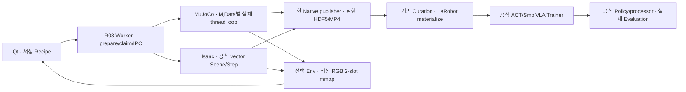

# Resume · Multi-Env · SmolVLA · Preview 통합

2026-10-28. **현재 v8 Scene·1/4-env의 요청 범위 구현·실행 검증을 완료했다. 실시간30FPS·production 학습 성능·실물 검증은 별개다.** 첨부 요청의 **R01/M01/M02/L04/U05/X02** 확장 결과다. 이 번호는 이번 요청의 단계명이며 기존 Recipe R01·Hub L04의 완료 이력을 대체하지 않는다. [직전 Saturation](position-saturation-recovery.md)을 먼저 확인하고 그 계약을 유지했다. 실제 장치·Hub·v9·SDK 설치/업그레이드는 수행하지 않았다.

## 실제 구조와 변경 이유

| 경계 | 실제 파일·함수 | 변경과 책임 |
|---|---|---|
| 기존 경로 추가 | `data/native.py`: `NativeRun(append=True)`, `collection_settings`, `_validate_continuation`, `resume_to` | 기존 공식 HDF5를 다시 열어 쓰지 않고 신규 immutable segment를 게시한다. 추가 목표/예산을 누적 runtime counter로 바꾼다. |
| 준비·실행 | `recipe.py`, `run.py`: `prepare_recipe`, `start`, `execute`, command IPC | `resume/num_episodes/env_num`·수치 Source 입력, 같은 출력의 단일 소유권·중복 요청·Env별 명령 context를 검증한다. |
| MuJoCo | `engines/mujoco/{source,annotation,datagen,evaluation,state}.py` | 읽기 전용 `MjModel` 하나, Env별 `MjData`·IK Data·Tracker·Renderer·영상 Writer·Policy queue를 사용한다. 실제 Env loop는 ThreadPoolExecutor에서 실행하고 메인 thread만 Native를 게시한다. |
| Isaac | `engines/isaac/{source,annotation,datagen,evaluation,state,mdp}.py` | 공식 vector Scene의 per-env pre/target/post generator를 한 `env.step`으로 진행한다. `advance_streams`는 완료 Env의 게시/부분 Reset 동안 다른 Env의 준비된 pre-row를 보존한다. |
| 공식 학습 | `learning/{train,policy,smol_compat}.py` | 공식 Trainer/optimizer/scheduler·Policy/processor를 사용한다. Smol의 한 고정 모듈만 명시 backport로 import한다. |
| Preview·UI | `run.py`, `data/video.py`, `ui/{app,workflow,learning,operations,curation}.py` | 선택 Env의 실제 RGB만 640×480 two-slot mmap으로 전달한다. Dataset 영상은 모든 Env를 원래 품질로 저장한다. |
| 재사용 | `tasks/placement.py`, `data/curation.py`, 기존 `data/lerobot.py` | Workspace Random을 Evaluation에도 등록하고 Env 정보를 검토 결과에 노출했다. Curation/Export/Merge Writer를 새로 만들지 않았다. |



엔진 공통 Adapter·새 Manager·범용 Scheduler·Trainer·Dataset Serializer·Streaming Server는 없다. Fixed/Random은 같은 `generate_attempt`/`generation_steps`를 사용하고 배치 입력만 다르다. MuJoCo ThreadPool은 native step/render의 독립 상태를 처리하며 Python/DLS/렌더·IPC 비용까지 모두 병렬이라는 뜻은 아니다.

## R01 — 같은 Dataset 경로 Resume

기존 Recipe의 `execution`/`output`에 다음처럼 지정한다. DataGen은 기존 Scene/Annotation·objects/acceptance 선언을 유지한다.

```yaml
execution:
  resume: true
  num_episodes: 2      # 이번에 추가할 성공 Episode 수
  max_attempts: 4      # DataGen의 이번 추가 attempt 예산
  env_num: 4
  seed: 1047          # Mimic/attempt seed. Random Pose seed가 아님
output:
  directory: /절대/경로/기존-native-dataset
```

Source에서는 `max_attempts`를 쓰지 않는다. Source의 완료 수는 `recording_only` 수집 개수이며 작업 성공 개수가 아니다. Evaluation의 Episode budget·학습 checkpoint Resume와도 별개다. `resume=false`의 기존 경로는 빈 폴더라도 덮어쓰지 않는다. 과거 cumulative `episodes/target_successes`·새 출력 `resume_dataset/resume_to`는 기존 계약으로 남고 새 `num_episodes`와 중복 지정할 수 없다. UI는 추가 개수와 같은 Dataset 경로를 노출한다.

같은 경로 추가는 `.writer.lock`과 R03 output reservation을 먼저 획득한다. Scene/model/Calibration/joint order/recording·Task·IK·pool/partition/seed가 다르면 거부한다. 실행 중 파일 변경도 기존 Prepared identity로 거부한다. orchestration 코드 변경을 허용하는 append는 producer execution 이력을 남긴다. **state/model/MDP/control/Calibration/Mimic 등 semantic core hash는 제외하지 않는다.** 과거 segment header·수치·영상에 새 코드 identity를 덮어쓰지 않는다. mixed-producer Dataset의 새 출력 Resume도 이 이력을 계승하고 inherited segment를 staging→rename으로 게시한다.

비정상 종료 후 **명시적으로** append하면 inactive 미완료 claim/attempt를 `interrupted_unknown`으로 남기고 ID/예산을 소비한다. 이전 실행을 재시도하거나 staging을 성공으로 승격하지 않는다. 중간 physics tick·Policy queue·Smol sampling noise의 재현 Resume는 제공하지 않는다.

실제 Source/DataGen 각각 MuJoCo·Isaac에서 **2개 생성→종료→같은 경로 추가2개→누적4개**를 확인했다. 기존 HDF5/MP4 SHA·Episode ID 유일성을 검사했다. Isaac Source 첫 harness는 두 worker 완료 후 이미 import한 구 Reader가 새 producer-history를 몰라 실패했으며, 새 process Reader로4개를 확인했다. 이 harness 문제를 엔진 재실행이나 데이터 수정으로 숨기지 않았다. [실제 결과](evidence/workbench-expansion/r01-mujoco/results.json), [Isaac Source 재개방](evidence/workbench-expansion/r01-isaac-source/fresh-consumer.json), [Isaac Random](evidence/workbench-expansion/r01-isaac-random/results.json).

실제 MuJoCo 수집 worker 하나만 SIGKILL한 시험에서는 먼저 닫힌 Episode가 유지됐다. 같은 경로를 **env_num 4→1**로 명시 재개해1개를 추가했고 이전 SHA/고유 ID·unknown attempt 이력이 보존됐다. [장애/재개](evidence/workbench-expansion/crash-resume-mujoco/results.json). 같은 원본에 대한 model/phase/control 불일치와 동시 writer는 별도 회귀로 거부했다.

Curation은 기존 exact-parent snapshot 계약을 유지한다. append 후 이전 Revision을 새 Catalog에 묵시적으로 rebase하지 않는다. 갱신된 원본 Catalog를 열고 새 Revision을 생성한다. 추가4개 Catalog에서 선택/trim·train/val·공식 Export도 확인했다. [검증](evidence/workbench-expansion/resumed-curation/results.json).

## M01/M02 — 실제 Multi-Env

`env_num` 기본값은1이고 실제 시험은1/4다. 내부 공식 API에는 `num_envs`로 전달한다. 기존 parser의 `num_envs` 입력은 유지하되 두 이름 동시 지정은 거부하고 새 UI에서는 `env_num`만 사용한다. 4개를 넘는 환경 수·모든 Scene·장시간/OOM을 검증한 것은 아니다.

MuJoCo는 독립 `MjData`·Pinocchio Data·렌더 컨텍스트를 Env thread에서 소유한다. 실제 네 스레드/서로 다른 q·두 카메라·한 환경 Reset 후 나머지 상태 불변을 시험했다. 실험 중 Renderer/Writer를 thread 간에 공유하지 않았다. 동일 실제 모델의 Env별 native1000step 비교는 직렬0.208s/병렬0.056s, process CPU/wall 비3.89였고 qpos는 serial/parallel exact였다. 이는 [native stepping만의 시험](evidence/workbench-expansion/mujoco-native-parallel-benchmark.json)이며 카메라·IK·저장 포함4배 속도 주장이 아니다. Mimic의 기존 CPU RNG lock과 계산 순서는 유지하며 Random Pose는 호출별 인자 없는 `default_rng()`다. 실패/게시 오류가 발생하면 내부 stop을 먼저 전달한 뒤 executor를 닫아 paused peer를 무기한 기다리지 않는다. 실제 정상 종료·Task 실패와 통제된 fault 시험을 구분한다.

Isaac은 실제 4개 Articulation·독립 물체·8개 Camera·ContactSensor를 만들었다. origin은 `(1,-1,0),(1,1,0),(-1,-1,0),(-1,1,0)m`였다. 기록 initial의 `scene_world`와 실제 engine world origin을 분리하고 복원 시 origin을 한 번만 적용한다. Workspace 검사도 Scene의 로컬 World 기준이며 실제 float32 world payload를 원점 offset 제거 후 재검사한다. 관측/Task/force·카메라·previous applied target은 Env별 index다.

실제 partial Reset probe에서 Env1만 q가 복원됐고 다른 세 Env의 q는 exact 불변이었다. 모든 카메라는640×480 RGB, force 배열은 `[4,1,3,3]`이었다. [probe](evidence/workbench-expansion/m02-vector-probe/result.json). 이후 길이8/16/24/32의 명시 Source stream을 각각 배정해 **양 엔진 각각8 Episode**를 수집했다. Env0/1/2가 먼저 끝나 다음 Episode로 넘어가는 동안 다른 Env의 기록이 이어졌다. [MuJoCo](evidence/workbench-expansion/mixed-source-mujoco/results.json), [Isaac](evidence/workbench-expansion/mixed-source-isaac/results.json).

Vector Isaac의 **pause/resume는 전체 Scene**에 적용한다. 공식 vector step은 전체 Scene을 전진시키므로 Env별 single-step은 명시 거부한다. Manual mark/skip·Preview 대상은 Env/Episode/frame별이다. pause 중 준비된 pre-row를 다음 physics 없이 post로 진행하지 않는다. Source/Annotation의 busy loop가 vector 전체 command polling을 막지 않도록 cooperative yield를 사용했다. MuJoCo의 독립 state thread에서는 Env별 제어 경계를 사용한다.

| 실제 흐름 | MuJoCo | Isaac |
|---|---|---|
| Source original initial·수치 입력 |2+2 추가/4개, 실제 새 Step·렌더 |2+2 추가/4개, 같은 앱 반복 복원 |
| Auto Annotation4 |388frame×4, grasp post222→저장223 |388frame×4, grasp post221→저장222 |
| Random DataGen4 |399frame×4 성공 |399frame×4 성공 |
| 서로 다른 stream·독립 재시작 |8/16/24/32 frame 순환, 완료8 |동일 길이 구성, 완료8 |
| ACT/SmolVLA Evaluation |Fixed/Random·1/4 모두 실제 저장 |Fixed/Random·1/4 모두 실제 저장 |

마지막으로 **단일 Isaac 앱·env_num1에서도 Source4개를 연속 Auto Annotation**했다. 모두388frame·성공4개, 최초 post221→저장222였으며 각 Source의 원래 initial을 각각 복원했다. 단일 Episode 제한만 제거했고 전체 구간·recording/model/Prepared identity 검사는 유지했다. [실제 실행](evidence/workbench-expansion/isaac-single-annotation-four/results.json), [공식 Reader·영상](evidence/workbench-expansion/single-annotation-consumer-results.json). Annotation의 기존 저장 계약에 없는 full post-state 필드를 요구했던 최초 소비자 스크립트 오류는 수정했으며, 데이터나 엔진 결과를 바꾸지 않았다.

DataGen4는 최초 검증 표본이며 성공률 추정이 아니다. [MuJoCo](evidence/workbench-expansion/m01-mujoco-datagen/results.json), [Isaac](evidence/workbench-expansion/m02-isaac-datagen-second/results.json). 이후 실제 Qt에서도 **양 엔진4-env Random 성공4→같은 경로 추가2→누적 성공6**을 별도 검증했다. 각399frame이며 상속분을 새 생성으로 중복 계산하지 않는다. Env ID는 simulation state 식별자, Episode ID는 global attempt 기반 고유 ID다. 완료 순서가 달라도 publisher가 중복 없이 게시하고 in-flight attempt가 남은 성공 slot을 예약해 목표를 초과하지 않는다.

Source의 수치 stream은 보존된 명령을 실제 신규 simulation에 입력하는 기능이다. 실물 Teleoperation이나 서로 다른 인간 시연을 수집했다고 주장하지 않는다. placement를 생략한 수치 Source는 원 Source initial을 사용하고, 명시 placement가 있으면 새 배치를 사용한다. 초기 개발의 임의 Fixed 배치와 과거 pickup 명령 조합에서는 Annotation4가 물리 실패했다. 이후 원 initial의 Source→Annotation4는 양 엔진 모두 통과했다. **Trim된 Source를 Annotation에서 full replay하거나 새 initial로 추측하지 않는다.** Annotation은 complete Source만, 수치 Source 수집/학습 Curation은 명시 구간을 허용한다.

## L04 — 고정 SmolVLA loss 수정·학습

설치0.4.1 원 `modeling_smolvla.py` SHA는 `f3195d94eac083b3360e0b8596f8fb6816f375d576f4d579698153b6e6846ec3`다. 공식 [키 수정1717](https://github.com/huggingface/lerobot/pull/1717)과 [padding 정규화 문제3433](https://github.com/huggingface/lerobot/issues/3433), 공식 현재 구현을 설치본과 대조했다. 최신 SDK로 교체하지 않았다.

`learning/smol_compat.py`는 명시적으로 선택한 worker에서 **해당 한 모듈의 정확한 원 bytes**만 검증하고 patch 후 compile한다. 원 SDK 파일·클래스 attribute를 덮어쓰지 않는다. 별도 Smol 모델/Trainer는 없다. Training child는 이 진입점에서 수정하지 않은 공식 `lerobot_train` loop를 실행한다. 모듈이 이미 비패치 상태로 import됐거나 source SHA가 다르면 거부한다. checkpoint에 patch ID·upstream SHA·patch SHA를 기록하고 Resume/로딩도 이를 비교한다.

수정은 `action_is_pad` 사용, 실제 Action 차원6개만 loss에 사용, valid timestep×6으로 나누는 reduction이다. 추가로 padded target을 model 입력에서0으로 만들어 suffix attention을 통한 padded 값의 영향도 제거했다. Dataset 원 Action은 변경하지 않는다.

```text
loss = sum(elementwise_loss[B,chunk,6] * valid[B,chunk,1])
       / max(number_of_valid_timesteps * 6, 1)
```

실제 공식 SmolVLA의 chunk4 forward에서 padded Action 값만10000만큼 바꿔도 loss exact, 독립 elementwise 수식 exact, finite gradient/backward20 Tensor와 no-padding forward를 확인했다. chunk1 회피나 Dataset mask key 치환은 없다. [실제 forward](evidence/workbench-expansion/smol-padding-results.json).

새 Multi-Env DataGen 자료를 기존 Curation/merge로 **train4 Episode/304frame, val4/304frame**에 나눴다. 영상은 원 MP4 hardlink이며 선택 구간만 공식 row가 소비한다. 같은 Scene/Calibration/model-rad joint order·camera/control 계약을 확인한 양 엔진만 Merge했다. [Curation·Export](evidence/workbench-expansion/curation-export-results.json).

공식 SmolVLA는 cached SmolVLM2-500M의 **실제 pretrained VLM weights**와 1-layer VLM/1-layer expert·chunk4/n_action_steps4·flow steps2, batch1 CPU로 smoke 학습했다. action expert의 완성된 pretrained SmolVLA base 성능을 시험한 것은 아니다. 외부 다운로드는 없다. 실제2 optimizer step→checkpoint2→새 출력 누적4 step Resume를 실행했다. 새 자료의 ACT도 공식 scratch2→누적4 Resume를 수행했다. 초기 진단의 random-VLM 실행과 구 L03 자료 학습도 별도 폴더에 남으며 최종 새 자료 학습으로 섞지 않는다.

[새 자료 학습](evidence/workbench-expansion/integrated-learning/results.json), [ACT Resume](evidence/workbench-expansion/integrated-learning/act-resume-result.json), [독립 Validation](evidence/workbench-expansion/independent-validation/results.json). Validation은 각 모델8 batch·별도 worker·train/val Episode UID 교집합0 검사다. 전체304 frame Validation이나 학습 수렴/일반화 성능을 주장하지 않는다. CPU 설정은 공식 Accelerate의 `ACCELERATE_USE_CPU=true`도 child에 전달한다. 초기에는 공식 Accelerator가 GPU를 선택해 CPU processor와 충돌했고 이를 실제 재현 후 수정했다.

학습 Action은 계속 **실제 적용 절대 model rad6**, Observation은 명령 이전 measured rad6이다. original requested/applied/saturation·post-state·IK/Task는 구분하며 후자를 학습 target으로 바꾸지 않았다. SmolVLA에는 실제 문장 `task_instruction`을 전달한다. Policy queue는 Env별로 복제/Reset하며 normalized action을 엔진에 보내지 않는다. 최종 Saturation·finite/shape/limits·DataGen previous-applied0.5rad guard는 유지한다.

## 실제 Evaluation과 비용

[조합별 원본](evidence/workbench-expansion/execution-summary.json)의 canonical matrix는 **각 엔진 ACT/SmolVLA×Fixed/Random×env_num1/4 총8 run,20 Episode**다. 각 Episode12 applied step, Placement 성공0·max_steps 실패20, 안전 거부/엔진 오류0이다. 두 엔진 합40개 실패 Episode를 공식 Native에 저장했다. 성공률은 각0/20이며 smoke 모델의 결과다. 별도 UI의30step/취소·개발 실행은 이 분모에 합치지 않았다.

Saturation은 SmolVLA matrix에서 실제 발생했고 Native에 원 Action/실제 payload/mask/delta를 남겼다. MuJoCo17 step, Isaac14 step이며 성공으로 재분류하지 않았다. 기존 ACT matrix 출력에서는0이었다. Evaluation gate는 **Placement**다. Annotation/DataGen의 StableGrasp AND Placement를 Evaluation gate로 사용하지 않는다.

| canonical Fixed 평가 | worker 전체 s | Episode control FPS | process Peak RSS MiB |
|---|---:|---|---:|
| MuJoCo ACT1 / ACT4 |9.36 /11.16|10.81 /4.03~4.38|2410 /3462|
| MuJoCo Smol1 / Smol4 |22.92 /34.22|2.85 /.87~.93|3483 /6477|
| Isaac ACT1 / ACT4 |91.16 /82.41|3.68 /2.02~2.04|7033 /7744|
| Isaac Smol1 / Smol4 |87.60 /101.70|2.66 /.79|7713 /11090|

FPS는12step/해당 Episode wall time이며4-env의 합산 throughput과 다르다. worker에는 초기화·모델 로딩·렌더·저장·종료가 포함된다. CPU inference와 GPU physics/render가 섞이고 병행 검증 부하도 있으므로 전용 benchmark가 아니다. MuJoCo4가1보다4배 빠르다는 결과가 아니다. Smol4는 독립 queue/모델 복제로 메모리가 증가한다. GPU는 해당 matrix의 whole-device polling peak약5005MiB였으며 desktop 포함·순간 allocator peak는 아니다. [GPU polling](evidence/workbench-expansion/gpu-memory-polling.json).

## U05/X02 — 실제 Qt·최신 Preview

`./run_workbench_ui.sh`를 사용한다. Source는 실제 수치 simulation 수집/저장 Source 검토 탭, DataGen은 같은 Dataset Path·Resume 체크·추가 성공 수·예산·env_num, Training은 ACT/SmolVLA **실제 공식 JSON**·cached VLM 선택·checkpoint/학습 Resume, Evaluation은 실제 Policy model 표시·문장·Fixed/Random·env_num을 제공한다. 다른 모델의 config를 타입 이름만 바꿔 재사용하지 않는다. Manual/Preview Env 선택과 Curation의 Env 정보도 연결했다.

Preview는 모든 Env의 영상 encode 이전 실제 pre-step RGB 중 **선택 Env의 Side/Wrist만** 사용한다. 원본 저장은 전체 Env의640×480·30FPS/PTS를 유지한다. camera당 두 mmap PPM slot, generation/run identity·쓰기 중 invalidation·header-last commit·읽기 전후 header 확인으로 최신 프레임만 전달한다. Qt timer는34ms이며 이것이 실제30FPS를 뜻하지 않는다. 포화 queue·중복 이미지를 새 camera frame으로 만드는 기능은 없다.

같은 실제 저장 RGB를 반복한 **I/O workload**에서 legacy half PPM .93ms, full 파일2.60ms, 기존 durable metadata 포함21.83ms, 최종 mmap+ephemeral metadata **.95ms/frame**이었다. mmap 단순 복사 .02ms는 동기화/header 없는 비동등 비교라 성능 보장에 쓰지 않는다. [전후 측정](evidence/workbench-expansion/preview-benchmark-results.json), [최종](evidence/workbench-expansion/preview-benchmark-mapped-results.json). Native durability를 낮춘 것이 아니라 폐기 가능한 Preview의 fsync만 없앴다.

실제 Qt에서는640×480을 확인했다. Source1의 관측 Preview약13Hz, Source4 MuJoCo약6.5Hz/Isaac약3Hz, 실제30step Smol4 약1.26Hz/.87Hz였다. 최종 mapped ACT4 UI는 MuJoCo약7.3Hz/Isaac약2.7Hz였다. mapped Run 재열기 관찰은 약2.4~3.4Hz·평균 전달지연 약16~19ms 표본도 남겼다. 각 수치는 다른 workload/선택 Env이므로 전후 물리 속도 향상으로 단정하지 않는다. 상세 frame count·generation skip·지연은 UI `results.json`과 [통합 요약](evidence/workbench-expansion/execution-summary.json)에 있다. 현재 병목은 실제 physics/다중 camera render·CPU Policy/데이터 이동이며 **wall-clock30FPS는 미달**이다.

Qt offscreen QTest는 실제 버튼·설정·기존 Run/모델/공식 loss 재열기·Env 선택·실제 RGB를 사용했다. 파일 대화상자만 자동화했고 engine/Policy/Native 결과는 대체하지 않았다. Source UI 같은 경로2+2,4-env Source, **양 엔진4-env Manual Annotation 각4 Episode/388frame·수동 first203**,4-env Random DataGen/append, 양 엔진 ACT/Smol Evaluation·취소를 수행했다. Manual은 실제 physical gate를 통과한 뒤 채택했으며 automatic 최초 post tick을203으로 바꾸지 않았다. 별도 실제 cancel은 각4 attempt·완료0 Episode이며 incomplete를 정상 Episode로 공개하지 않았다. 사람이 데스크톱에서 장시간 사용하는 UX 검증과는 구분한다.

## 검증·보존과 남은 범위

[공식 소비자](evidence/workbench-expansion/consumer-results.json)는 실제 HDF5 Reader·Applied=`joint_targets`, pre[t+1]=post[t], Side/Wrist 전체 PTS·frame count·실제 RGB decode를 확인했다. 공식 LeRobotDataset `__getitem__`/DataLoader가 새 train/val state/action6·RGB `[B,3,480,640]`를 소비했다. native archive/IK 진단을 별도 학습 포맷으로 감싸지 않았다. [현재 MuJoCo Fixed7 배열](evidence/workbench-expansion/fixed-regression-release/baseline-comparison.json)은 dtype/shape/값 exact다. Isaac의 모든 궤적/pixel 동등성이나 E01 물체 잔차 해소를 뜻하지 않는다.

최종 전체 **966 passed, skipped0**, 기존 torchvision warning2개다. [JUnit](evidence/workbench-expansion/unit-tests-final-release.xml), [suite](evidence/workbench-expansion/logs/136-final-suite.log), [wheel](evidence/workbench-expansion/build-workbench.json). wheel source/config bytes·compile·isolated CLI 및 실제 invalid-config worker를 확인했고 환경에 설치하지 않았다. 별도 lint/type 도구를 설치하지 않았다. Git 저장소/commit을 만들지 않았다.

독립 [Spec](evidence/workbench-expansion/spec-review-final.md)/[Standards](evidence/workbench-expansion/standards-review-final.md) 검토에서 Env0 post-state 혼입, paused peer 종료, vector pause, producer-history 새 출력 clone, patch identity/Prepared coverage를 수정하고 회귀했다. 최종 검토 범위의 High/Medium 잔여0이다. 개발 중 잘못된 시험 경로·구 UI 기대·입력 initial/배치 차이·snapshot API의 tensor env_ids 필요·보호된 SDK cache warning도 로그에 남는다. 이를 정상 실행 성적으로 섞지 않는다.

[보존](evidence/workbench-expansion/preservation-after.json)은 원본56,100개 stat·선택193개 SHA·작업 전 제품/시험 사본, 원 Scene 전체 Manifest를 비교한다. 전체 corpus/SDK binary 전수 hash는 아니다. 새 제품/시험·명시 문서 외 기존 소스/환경·Dataset·이전 증거의 미승인 변경은 없었다. 상세 명령·버전·변경 파일은 [최종 검증](evidence/workbench-expansion/verification.json)에 연결한다.

기존 **E01 cube–cup1.197188790mm 잔차**, Follower command binding/motor range·physical_verified=false, v9/실측 Calibration은 OPEN이다. 이번 범위에서1/4-env·반복/partial Reset·실제 Smol padding/학습/추론 관문을 검증했지만 모든 Scene/로봇·장시간·GPU OOM/전원 장애·production SmolVLA 학습 성능까지 완료한 것은 아니다. inherited Native의 원래 requested-target 계약을 applied로 바꾸거나 과거 자료를 자동 Merge/Resume하지 않는다. Source의 실물 장치 수집은 미검증이며 활성화하지 않았다.

사람이 확인할 것은 Dataset Path/추가 목표·budget과 학습 Resume의 구분, 선택 Env의 실제 화면·Manual 대상, global vector pause 안내, 모델별 실제 config/Checkpoint·언어 지시문, Frame/Task 결과와 worker terminal의 구분이다. 이번 확장 범위에서 멈추며 실물/v9/Hub 등 후속 작업은 시작하지 않는다.

공식 API 근거: [Lab2.3 vector/reset](https://isaac-sim.github.io/IsaacLab/v2.3.0/source/api/lab/isaaclab.envs.html), [MuJoCo3.3.7 Python/native](https://mujoco.readthedocs.io/en/3.3.7/python.html), [LeRobot0.4.1 Trainer](https://github.com/huggingface/lerobot/blob/v0.4.1/src/lerobot/scripts/lerobot_train.py), [Qt6.11 QProcess](https://doc.qt.io/qt-6.11/qprocess.html). 실제 설치 소스·고정 SHA와 실행 결과를 우선한다.
