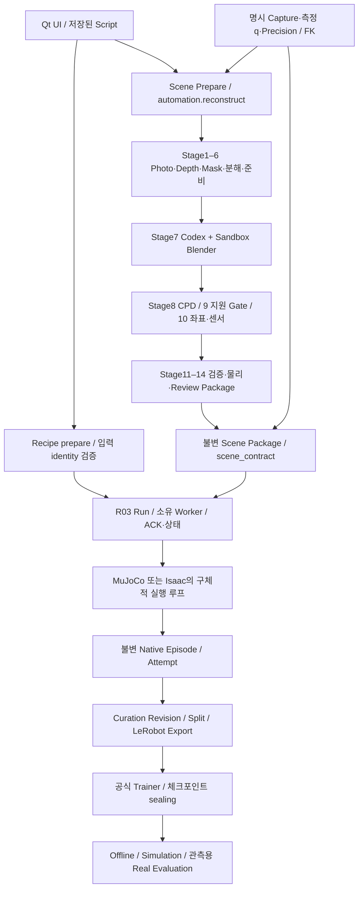

# Real2Sim Learning Studio — 전체 코드베이스 심층 감사

2026-11-14 · 분석 전용 · 기준 브랜치 `feat/simfoundry-style-reconstruction` · HEAD `97c029e195ab8587603fb3f240f2c1a6c0f91f52`.

시작 작업 트리는 **clean**이었다. 과거 대화의 HEAD·staged23개·통과1,751개를 이번 상태로 간주하지 않았다. 현재 추적 파일499개와 제품 Python177개/37,288줄의 구조·함수·import·진입점을 조사하고, 아래 핵심 실행 경로를 실제 소스로 심층 검토했다. 제품·기존 시험·설정·Scene·Asset을 고치지 않았다. 허용된 새 파일은 이 보고서 하나다.

`code-review`의 Spec/Standards 병렬 검토를 사용자의 **현재 전체 트리 감사** 범위에 맞춰 적용하고, 주요 문제는 별도 호출 경로·보호 로직·격리 재현과 대조했다. 문서의 완료 선언을 실행 증거로 삼지 않았다. 모든 분기·외부 SDK 내부·장치 동작을 검증했다는 의미는 아니다.

## 1. Executive Summary

**현재 아키텍처는 유지하는 편이 타당하다. 다만 전체 파이프라인을 실제 검증 완료로 볼 수는 없다.** 개별 모듈의 방어·불변 저장·프로세스 소유권은 상당히 구체적이다. 반면 현재 writer→reader→solver→publisher 사이의 계약 차이 때문에 정상 준비 후 다음 단계에서 막히거나 평가의 의미가 달라지는 결함이 남아 있다.

기존 세 패키지 전체 회귀는 **1,864 passed / 실패0 / 오류0 / skipped0**, 경고5개, Console559.93초였다. 추가 격리 재현에서 그 시험들이 놓친 결함을 확인했다. 이 통과 수치는 실제 AI 모델·사용자 Scene·Isaac·로봇 E2E 성공을 뜻하지 않는다.

### 강점과 유지할 부분

- `scene_contract`는 package closure/SHA/파일 경로/중복 JSON/유한값/정상 회전·Frame graph·Calibration 적용 순서와 모델 binding을 검증한다. 읽은 Scene은 frozen mapping으로 다룬다.
- 기본 재구성의 기존 Candidate/Stage Artifact/Runtime/Worker 경계를 유지한다. 실제 완료 파일·SHA와 실행 provenance로 Cache 재사용을 판정하며 Mock을 Real로 자동 승격하지 않는다.
- Asset은 새 불변 USDA Version이며 원본 Visual/Collision과 파생물을 구분한다. 기존 Scene은 Manifest SHA로 자산을 결속한다. measured 축·명시 Support·Robot World 근거 Gate가 있다.
- Native Dataset은 process lock, intent/attempt, sealed HDF5와 atomic publication을 사용한다. 단위·joint order·pre-step 관측/post-step 판정이 명시되어 있다.
- Qt의 GPU Depth Buffer, visible/hidden edge 두 pass, Angle 기반 Feature와 view별 silhouette 캐시, resource cleanup을 이미 갖췄다. 새 Viewer/렌더링 Framework는 필요 없다.
- 하드웨어는 읽기 연결·명시 Teleoperation capability·raw command bounds·heartbeat/deadline·관측/명령 mapping을 분리한다. 이 감사에서는 실제 장치/모터를 실행하지 않았다.

### 가장 중요한 위험 5가지

| 우선 | 위험 | 관련 항목 | 판단 |
|---|---|---|---|
| 1 | 구형 CLI가 보호된 Current Camera Calibration을 덮어씀 | BUG-001 | P0, 35mm 변경을 격리 재현. 발행 Revision 손상은 아님 |
| 2 | Precision→Capture→센서/사진 공동 정합 계약 불일치 | BUG-002–004 | P1, 각각 상태 enum/누락 metadata/per-view Camera 유실 |
| 3 | Isaac의 실제 Camera 설정이 Scene K와 다름 | BUG-005 | P1, 비대칭 초점·주점 정보 손실. Native GPU 확인은 별도 |
| 4 | 정상 공식 설정/Resume 체크포인트가 sealing에서 거부됨 | BUG-006 | P1, 공식 정규화와 요청 literal 비교 충돌 |
| 5 | Resume로 물려받은 같은 Episode를 독립 검증으로 표시 | BUG-007 | P1, 동일 원본 alias인데 overlap0/verified |

우선 P0/P1을 producer→consumer 연결 시험으로 수정해야 한다. 모든 Solver·Renderer·Manager를 재작성하거나 정상 Gate를 완화하는 방식은 권하지 않는다. 문제 수를 늘리기 위해 하나의 원인을 반복 등록하지 않았고, 아래 P2/P3는 각기 다른 조건·원인을 가진다.

## 2. Architecture Review

### 패키지와 실행 경계

| 패키지 | 실제 책임·주요 경로 | 외부 경계 |
|---|---|---|
| `scene_contract` — 5파일/746줄 | `package.load_scene`, identity/manifest/Calibration, `transforms.resolve_transform`, Object membership | Package reader, NumPy; Simulator/모터 실행 없음 |
| `real2sim_builder` — 48파일/17,391줄 | `cli`/`ui_reconstruction`→`automation.reconstruct`; `authoring`, `inference`, Stage1–14, Candidate, 자산·Export, Camera/Object/FK 정합 | Codex CLI·Blender·DA3/SAM/Comfy/PDA/RemBG/CPD, MuJoCo/Isaac Child |
| `robot_learning_workbench` — 124파일/19,151줄 | Scene Prepare/Session UI, Recipe prepare/run, 엔진 Source/Annotation/Mimic/Evaluation, Dataset/Curation, 공식 LeRobot 학습·검증·Hub | Qt/backend Python 분리, Native 엔진, 공식 Dataset/Policy API, 명시 장치 adapter |

### 주요 Workflow



- **정적 입력:** Photo/Video는 Scene 관측, Model Reference는 Object 외형, Memo는 Codex 의미 입력이다. Side/Wrist는 measured-q와 FK가 있는 실제 센서 근거다. 서로 다른 배치를 임의 합치지 않는 정책을 유지한다.
- **Stage 경로:** prepare→depth→support→world→decompose→prepare_objects→meshes→poses→articulate→compile_scene→simulation_ready→stabilize→package_scene→simulator_integration. Stage9 신규 관절 미지원은 명시 Gate이며 실행 코드가 있다는 것과 모든 Runtime 완료는 다르다.
- **조율:** `automation.py`는 실행/재개와 Candidate 소유권, `stage_artifacts.py`는 완료 파일 계약, `stage_runtime.py`는 Runtime 선택/Identity, `stage_workers.py`는 구체 외부 호출을 소유한다. 그 분리는 유지할 가치가 있다.
- **RealSim:** 세션은 측정 q·mapping·모델 identity와 동기/안정성 근거를 보존한다. `capture.observation_scene`이 per-view optical Camera/FK를 만들고 joint/hybrid가 수치 정합한다. 실패는 주로 이 데이터가 다른 caller로 전달되는 지점에 있다.
- **Library:** Backend에서 검증된 USDA를 Converter로 읽고 `asset_view.load_asset_view`가 임시 파생 payload만 만든다. GUI는 VBO/Texture를 올린다. `_convert`와 Manifest metadata가 USD/OBJ/canonical Scene 사이의 중요한 의미 경계다.
- **Workspace Pipeline:** 저장 Script→prepare identity→R03 Worker→엔진 루프→Native publisher→Curation→공식 LeRobot→학습·평가다. UI의 단계 선택은 이 경로들의 사용자 조작이며 한 번의 클릭으로 모든 실제 Runtime을 인증하는 관리자가 아니다.
- **학습/하드웨어:** 공식 LeRobot와 작은 adapter를 재사용한다. Dataset의 rad/absolute action 의미와 물리 성공은 구분된다. 관측용 Real Evaluation을 전체 자율 로봇 Task 성공으로 보고할 수 없다.

### 결합이 높은 지점

`reconstruction_stages.py`, `authoring.py`, `automation.py`는 서로 다른 Stage 데이터를 dict로 주고받는다. `capture.py`와 Workbench Calibration은 같은 enum/identity를 별도로 검증한다. `Candidate.fit`, Stage10, numeric-pairs는 fit 뒤 의존 관측을 다르게 갱신한다. Dataset 원 Episode 계보도 Curation/Merge/Validation에서 별도로 해석한다. 길이 자체보다 **같은 계약을 여러 caller가 조금씩 다르게 구현하는 점**이 실제 결함 원인이다.

Spec 축은 Stage/보호 정책/Camera/캡처 의미, Standards 축은 상태·IPC·게시·공식 API·Dataset 계보를 확인했다. Object Library/공유 Package 경계는 별도로 검토했다. BUG-002/003처럼 두 생산자·소비자가 각자 시험에서 정상이어도 연결 시 실패하는 사례가 핵심이다.

## 3. Bug & Risk Findings

등급은 사용자 기준을 따른다. `CONFIRMED_BUG`에는 격리 실행뿐 아니라 전체 호출 경로로 확정한 결함도 포함한다. **어떤 경계를 Mock했는지와 Native 미실행 여부는 각 근거에 명시했다.** 실제 재현이 없는 위험은 별도 `DESIGN_RISK`로 구분한다. 코드 위치는 위 HEAD 기준이다.

### BUG-001 — 구형 CLI가 보호된 Current Camera 보정을 직접 덮어쓴다

**ID:** BUG-001

**심각도:** P0 · **판정:** CONFIRMED_BUG
**영향 범위:** 명시적 real2sim_builder.cli run → 기존 Current Scene 재구성

**위치:**

- `real2sim_builder/src/real2sim_builder/calibration/camera.py:44–71`
- `real2sim_builder/src/real2sim_builder/reconstruction.py:290–306`
- `real2sim_builder/src/real2sim_builder/project.py:196–199`
- `real2sim_builder/src/real2sim_builder/cli.py:206–209`

**문제:** fit_cameras는 measured/calibrated Camera를 제외하지 않고 pose와 provenance를 바꾼다. run은 Candidate/preserve 없이 이를 working/current_scene.yaml에 저장한다.

**발생 조건:** 기존 calibrated Camera와 K, 비공선 train 대응점 4개 이상이 있고 관측 잔차가 있는 경우.

**호출 경로:** cli.run → reconstruction.run → fit_cameras → Project.save_scene; Source 기반 Candidate 보호 경계를 우회한다.

**영향:** 재구성이 NEEDS_MORE_DATA로 끝나도 기존 보정값이 이미 바뀐다. 사용자 기준의 보호 원본/Calibration 상태 손상이므로 P0다. 기본 Stage1–14 전체가 이 경로라는 뜻은 아니며 불변 발행 Revision은 그대로다.

**근거:** spec-legacy-protected-probe.py/.out: 임시 Project의 calibrated x=0.635m가 약0.600m로 35mm 바뀌고 provenance=optimized, Current SHA 변경. 실제 run(max_iterations=1)이 미확정 Visual 때문에 NEEDS_MORE_DATA를 반환했다. Native 렌더 실행 전 재현.

**대조한 보호 로직:** Candidate.save의 preserve, fit_geometry의 보호 Object 제외는 존재한다. 이 CLI는 둘을 통과하지 않는다. 기존 test_builder_calibration의 calibrated Camera fit 기대값은 오히려 이 구형 동작을 허용한다.

**해결 방향:** 자동 Camera fit에서 보호 필드를 제외하고 Current 게시 전에 기존 preserve/validate 경계를 반드시 거친다. 가능하면 기존 Candidate 트랜잭션을 사용한다. 보호 provenance를 optimized로 낮춰 우회하면 안 된다.

**필요한 테스트:** 상충하는 landmark가 있어도 measured/calibrated Camera 값·provenance·Current 파일을 보존. estimated Camera fit은 유지. fit 직후 실패/Stop도 원본 불변.

### BUG-002 — 현재 수동 Precision 보정의 저장 상태를 Capture 로더가 거부한다

**ID:** BUG-002

**심각도:** P1 · **판정:** CONFIRMED_BUG
**영향 범위:** Precision 수동 기준각 기록 → 저장/자동 적용 → Capture/Snapshot/Pair

**위치:**

- `robot_learning_workbench/src/robot_learning_workbench/robot/precision.py:53–57`
- `robot_learning_workbench/src/robot_learning_workbench/robot/precision.py:84–90`
- `robot_learning_workbench/src/robot_learning_workbench/robot/calibration.py:230–245`
- `real2sim_builder/src/real2sim_builder/capture.py:71–103`
- `robot_learning_workbench/src/robot_learning_workbench/robot/snapshots.py:30–42`

**문제:** 현재 저장자는 CALIBRATED_MANUAL을 쓰고 PrecisionMapper도 허용하지만 Builder mapping_contract는 REVIEWED_MANUAL/VALIDATED_MANUAL만 허용한다.

**발생 조건:** 현재 UI 경로로 기준 자세를 계산·저장하여 하나 이상 CALIBRATED_MANUAL joint가 있는 경우.

**호출 경로:** PrecisionSession.calculate/save → PrecisionMapper.metadata → SnapshotStore.prepare → load_session/mapping_contract.

**영향:** 저장/적용은 정상처럼 끝난 뒤 새 Capture를 검증·게시할 때 Unsupported precision joint review state로 막힌다. BUG-003의 관측 필드 누락과는 별도 원인이다.

**근거:** spec-manual-mapping-probe.py/.out: 실제 PrecisionSession.calculate 결과 CALIBRATED_MANUAL, PrecisionMapper.metadata→mapper_from_metadata 왕복 성공, 같은 hash-consistent manifest에 Builder mapping_contract 적용 시 실패. 장치 연결/토크 조작 없음.

**대조한 보호 로직:** 물리 검증 false와 coefficient/URDF/hash 검사는 정상이다. 저장 뒤 별도 REVIEWED 상태로 변환하는 단계가 없고 현재 자동 적용도 이 상태를 그대로 쓴다.

**해결 방향:** 허용 관측용 수동 보정 상태를 두 경계에서 일치시킨다. CALIBRATED_MANUAL을 독립 물리 검증으로 승격하지 말고 physical_verified=false를 유지한다.

**필요한 테스트:** 현재 Precision 계산/저장→metadata→Capture/Snapshot reader까지 연결. 구형 reviewed/validated와 변조된 계수·URDF·physical_verified 거부도 유지.

### BUG-003 — Capture 가져오기가 센서 등록에 필요한 Identity와 역할을 빠뜨린다

**ID:** BUG-003

**심각도:** P1 · **판정:** CONFIRMED_BUG
**영향 범위:** Workbench Capture/Snapshot/Pair → Builder import → Stage10/RealSim 등록

**위치:**

- `real2sim_builder/src/real2sim_builder/capture.py:22–43`
- `real2sim_builder/src/real2sim_builder/capture.py:269–294`
- `real2sim_builder/src/real2sim_builder/observations.py:450–464`
- `real2sim_builder/src/real2sim_builder/reconstruction_stages.py:946–952`

**문제:** Bound import 행에는 robot_model_sha256/mapping_sha256/joint_units/camera_type이 없다. Unbound import는 hash/단위를 남기지만 camera_type이 없다. 소비자는 다른 계약을 요구한다.

**발생 조건:** 기존 writer로 생성한 정상 Capture를 가져오는 경우. Bound fixture에는 실제 계약에 맞는 합성 K/Mount/Base와 static eligibility를 준비했다.

**호출 경로:** save_session/SnapshotStore → import_session/register_unbound → evidence.images → register_sensor_views/register_stage_sensors.

**영향:** Bound Wrist는 identity mismatch로 등록이 중단된다. Unbound Capture는 Stage10의 camera_type 필터에서 빠져 실제 센서 자료가 있는데도 NOT_AVAILABLE/needs=[]가 된다.

**근거:** spec-bound-capture-probe.py/.out: writer→reader→import 후 eligible 이미지2개지만 register_sensor_views가 Sensor q/model/mapping identity mismatch. spec-import-capture-probe.py/.out: Capture2개를 보유한 Stage10이 NOT_AVAILABLE. 모두 임시 파일.

**대조한 보호 로직:** 원 Manifest의 모델/측정 q/단위/SHA 검증은 통과한다. 누락 필드를 나중에 채우는 postprocessor는 없다. 역사적 camera_type()의 ID fallback도 Stage10의 직접 필터에는 적용되지 않는다.

**해결 방향:** Bound/Unbound 가져오기에서 원 Manifest의 정확한 model/mapping identity·단위·센서 역할을 하나의 관측 계약으로 전달한다. 누락 hash를 무조건 허용하거나 파일명으로 센서를 추측하지 않는다.

**필요한 테스트:** 실제 writer→import→register→Stage10 연결을 Bound/Unbound/Snapshot/Pair별 검사. 비표준 Camera ID+명시 role, shared Wrist FK, 원본 SHA 포함.

### BUG-004 — 공동 landmark solver가 등록된 사진별 Camera 변환을 버린다

**ID:** BUG-004

**심각도:** P1 · **판정:** CONFIRMED_BUG
**영향 범위:** 외부 Scene Photo 등록 → Candidate.fit(joint:scene)

**위치:**

- `real2sim_builder/src/real2sim_builder/calibration/joint.py:41–49`
- `real2sim_builder/src/real2sim_builder/calibration/joint.py:374–380`
- `real2sim_builder/src/real2sim_builder/calibration/joint.py:451–465`
- `real2sim_builder/src/real2sim_builder/capture.py:318–336`

**문제:** cached observation_scene에는 view별 T_world_camera/K/pixel 변환이 있지만 _posed는 FK frame과 robot-linked Object만 복사한다. projection은 Candidate의 전역 Camera를 사용한다.

**발생 조건:** 같은 렌즈 Camera에 view별 등록 Pose가 있고 전역 Pose는 null인 정상 외부 사진 표현. 또는 전역 Pose와 view별 Pose가 서로 다른 경우.

**호출 경로:** fit_joint_scene → cached observation_scene → _posed → camera.project_point; cached Camera adaptation 유실.

**영향:** 전역 Pose null이면 유한4×4 변환 예외로 실행 실패. 전역 Pose가 있으면 잘못된 view의 잔차를 계산하며 view별 변수의 효과를 잃는다.

**근거:** spec-probes.py/.out: register_views는 REGISTERED_ESTIMATED, per-view 변환 finite, global Pose null. fit_joint_scene→errors→project_point→world_pose에서 Expected finite 4x4 homogeneous transform. 최적화 전 실패.

**대조한 보호 로직:** 등록 SHA/K 검사와 per-view-only Camera 허용 분기는 통과했다. shared sensor만 쓰는 정상 경로가 존재하지만 외부 Photo 경로를 보호하지 않는다.

**해결 방향:** 각 trial의 projection에 기존 observation Camera adapter를 적용한다. FK 캐시 최적화는 유지하되 별도의 불완전한 Camera 합성 수학을 만들지 않는다.

**필요한 테스트:** K 공유·서로 다른 Pose의 두 Photo, global Pose null, 한 view만 perturb한 residual, EXIF180°/pixel affine, Wrist shared FK.

### BUG-005 — Isaac Workbench Camera가 보정된 fx/fy와 주점을 손실한다

**ID:** BUG-005

**심각도:** P1 · **판정:** CONFIRMED_BUG
**영향 범위:** Isaac Source/Annotation/Datagen/Sim Evaluation 및 native SceneView

**위치:**

- `robot_learning_workbench/src/robot_learning_workbench/engines/isaac/env_cfg.py:211–215`
- `robot_learning_workbench/src/robot_learning_workbench/engines/isaac/env_cfg.py:271–279`

**문제:** 전체 K를 읽은 뒤 f=(fx+fy)/2 하나로 aperture를 만들고 cx/cy offset을 전달하지 않는다. RuntimeCamera는 Pose만 갱신한다.

**발생 조건:** fx≠fy 또는 중심에서 벗어난 cx/cy를 가진 허용된 Side/Wrist Camera. 중심·동일 초점 K는 해당 손실을 드러내지 않는다.

**호출 경로:** Scene Camera K → scene_execution_inputs → build_env_cfg → PinholeCameraCfg; full K→평균 초점으로 축약.

**영향:** Scene/Dataset이 가리키는 Calibration과 실제 엔진 projection이 달라져 systematic pixel 오차가 생긴다. 이를 extrinsics/Geometry 문제로 오인할 수 있다.

**근거:** standards_camera_results.json: 640×480, fx600/fy800/cx300/cy210 입력을 현재 식으로 계산하면 명목700/700/320/240이 된다. 설정 단계 정보 손실은 소스·수학으로 확정. 실제 Isaac GPU 렌더는 NOT_TESTED.

**대조한 보호 로직:** scene_execution_inputs는 distortion을 거부하지만 해당 일반 K를 허용한다. 뒤에서 intrinsic 복원 호출이 없다. 별도 Builder isaac_render의 aperture offset 구현은 Workbench 경로에 적용되지 않는다.

**해결 방향:** 현재 Camera 경계에서 fx/fy·cx/cy를 지원하는 aperture/offset 또는 intrinsic API로 정확히 전달하고 생성된 sensor K를 대조한다. 엔진/View 전체 교체 불필요.

**필요한 테스트:** 비대칭/off-center K 설정 왕복 검사. 후속 승인된 Isaac 단독 시험에서 sensor.intrinsic_matrices와 알려진 3D 표적 projection을 Side/Wrist 각각 비교.

### BUG-006 — 공식 설정 정규화 때문에 정상 학습 체크포인트를 불완전으로 거부한다

**ID:** BUG-006

**심각도:** P1 · **판정:** CONFIRMED_BUG
**영향 범위:** 학습 UI의 공식 JSON 생성/학습 및 Resume → 체크포인트 sealing

**위치:**

- `robot_learning_workbench/src/robot_learning_workbench/learning/policy.py:99–107`
- `robot_learning_workbench/src/robot_learning_workbench/learning/train.py:50–63`
- `robot_learning_workbench/src/robot_learning_workbench/learning/train.py:121–133`
- `robot_learning_workbench/src/robot_learning_workbench/ui/operations.py:155–163`

**문제:** 공식 Trainer가 정규화해 저장한 설정을 정규화 전 요청과 literal 비교한다. null/default와 Resume의 checkpoint path 변경까지 변경 오류로 취급한다.

**발생 조건:** UI가 만드는 full default JSON(job_name=null, optimizer=null 등), 또는 기존 pretrained_path와 달라지는 Resume.

**호출 경로:** TrainingJsonDialog→operations.training_config→train→official validate/save→seal_finished→seal_checkpoint.compare.

**영향:** 유효한 파일을 CHECKPOINT_INCOMPLETE로 거부한다. 학습 중 seal_finished에서 발생하면 첫 저장 뒤 Child 정리로 학습도 끝날 수 있다. 모든 수동 최소 scratch 설정이 실패한다는 뜻은 아니다.

**근거:** standards_probe_results.json: 실제 설치된 공식 TrainPipelineConfig.validate가 null→act, optimizer→AdamW preset, Resume pretrained_path→소유 checkpoint로 바꾼다. 작은 유효 safetensors로 실제 seal_checkpoint를 호출하면 scratch/Resume 모두 실패. 학습/추론은 실행하지 않음.

**대조한 보호 로직:** 기존 시험은 정규화 대상 키를 생략한 축약 설정이나 Resume argv를 검사한다. 파일·finite·SHA 보호는 정상이며 해제하면 안 된다.

**해결 방향:** 같은 공식 parser/validation으로 resolved 설정을 확정하고 raw request와 resolved identity를 모두 보존한다. 문서화된 런타임 변경만 명시 처리하고 실제 모델/optimizer/dataset 변경 검사는 유지한다.

**필요한 테스트:** UI full ACT JSON→공식 validate/save→tiny checkpoint seal, 새 출력으로 Resume. 정상 정규화 통과와 실제 architecture/optimizer/dataset 변경 거부를 함께 검사.

### BUG-007 — Resume에서 물려받은 동일 Episode를 독립 Validation으로 인증한다

**ID:** BUG-007

**심각도:** P1 · **판정:** CONFIRMED_BUG
**영향 범위:** Native Resume → 서로 다른 LeRobot Export → 학습/Offline Validation

**위치:**

- `robot_learning_workbench/src/robot_learning_workbench/learning/validate.py:23–31`
- `robot_learning_workbench/src/robot_learning_workbench/learning/validate.py:60–60`
- `robot_learning_workbench/src/robot_learning_workbench/data/lerobot.py:174–193`
- `robot_learning_workbench/src/robot_learning_workbench/data/lerobot.py:382–383`
- `robot_learning_workbench/src/robot_learning_workbench/data/native.py:463–490`

**문제:** Validation은 source_episode_uid만 비교한다. Resume는 dataset_id를 바꾸므로 같은 원 Episode도 UID가 달라지지만 이미 저장한 source_native_alias/parent lineage는 비교하지 않는다.

**발생 조건:** 원 Native Run의 Export로 학습하고, 원 Episode를 포함하는 resumed Run을 별도 Export해 검증하는 경우.

**호출 경로:** resume_to → _origin의 새 UID+동일 alias → materialize → evaluate의 UID-only 교집합.

**영향:** 학습 데이터가 독립 검증처럼 통과해 수치가 과도하게 좋아지고 lineage_status=verified로 표시된다. 데이터 bytes 손상 없이 평가 의미가 잘못된다.

**근거:** standards_lineage_results.json: 실제 Native original/resume_to가 같은 HDF5 inode·배열을 공유하고 native_alias도 같다. 실제 LeRobot materialize 두 개는 서로 다른 UID. 추론만 Mock한 실제 evaluate는 overlap=0, lineage_status=verified, completed를 반환.

**대조한 보호 로직:** 두 Dataset identity는 실제로 다르므로 동일 Dataset 차단은 통과한다. Curation/Merge에는 alias/Resume-family 보호가 있으나 Validation은 사용하지 않는다. robot_control_approved=false는 유지되어 자동 모터 승인을 뜻하지 않는다.

**해결 방향:** 기존 원 Episode key/alias 판정을 재사용하고, creator lineage가 불명확한 Resume 계열은 보수적으로 처리한다. UID가 다르다는 사실만으로 verified를 정하지 않는다.

**필요한 테스트:** 원본/Resume hardlink와 independent copy, trim된 inherited Episode, 진짜 disjoint 새 Episode. 겹침은 추론 전에 DATA_LEAKAGE.

### BUG-008 — Builder 명령 소비 경쟁으로 새 Stop이 삭제될 수 있다

**ID:** BUG-008

**심각도:** P2 · **판정:** CONFIRMED_BUG
**영향 범위:** Reconstruction Pause/Resume/Stop → Project.checkpoint

**위치:**

- `real2sim_builder/src/real2sim_builder/project.py:135–139`
- `real2sim_builder/src/real2sim_builder/project.py:173–194`

**문제:** 한 control.json을 읽은 뒤 같은 경로를 unlink한다. 그 사이 새 Stop이 atomic replace되면 소비자가 읽지 않은 새 파일을 삭제한다.

**발생 조건:** Worker가 Resume를 읽은 직후 UI/CLI가 Stop을 쓰고, Worker가 unlink하는 순서. Pause loop에도 같은 패턴이 있다.

**호출 경로:** Project.control의 replace ↔ checkpoint의 read/unlink가 서로 분리된 트랜잭션.

**영향:** 명시 Stop이 유실되어 작업이 계속되거나 pause 상태가 남는다. 별도 Workbench R03 명령의 로봇 동작 문제로 확대하지 않는다.

**근거:** root_probes.py/root-probe-results.json: 실제 Project.control/checkpoint의 read 경계에만 결정적 interleaving을 넣었다. resume read 직후 stop write; checkpoint는 예외 없이 반환하고 새 stop 파일도 사라짐(new_stop_preserved=false, raised_stop=false).

**대조한 보호 로직:** write의 os.replace는 개별 파일 원자성만 보장한다. 실행 Project lock은 Worker가 소유해 UI Stop writer의 이 경쟁을 직렬화하지 않는다.

**해결 방향:** 기존 파일 I/O에서 먼저 atomic rename으로 소비할 명령을 claim한 뒤 그 소유 파일을 읽고 지우거나, 새 버전 파일을 지우지 않는 직렬화 방법을 쓴다. 새 프로세스 Manager는 불필요.

**필요한 테스트:** 정상 checkpoint와 pause loop에서 Resume read→새 Stop write 순서를 결정적으로 재현. Stop 보존/처리 및 더 새로운 명령 불변.

### BUG-009 — 실패한 LeRobot staging prefix가 일반 Dataset 목록에 노출된다

**ID:** BUG-009

**심각도:** P2 · **판정:** CONFIRMED_BUG
**영향 범위:** LeRobot Export/Merge 중간 실패 → Data Curation/후속 입력 선택

**위치:**

- `robot_learning_workbench/src/robot_learning_workbench/data/curation.py:19–31`
- `robot_learning_workbench/src/robot_learning_workbench/data/lerobot.py:123–129`
- `robot_learning_workbench/src/robot_learning_workbench/data/lerobot.py:333–396`

**문제:** 공식 writer를 finally에서 finalize하므로 실패 prefix도 읽을 수 있는 metadata를 갖는다. discovery는 점으로 시작한 폴더만 제외하고 output.staging은 정상 Dataset으로 분류한다.

**발생 조건:** 최소 한 Episode 저장 후 뒤 Episode의 dtype/shape 오류 등으로 변환이 실패하는 경우.

**호출 경로:** create_staging → materialize 일부 저장/finally finalize → discover_datasets(meta/info.json 기준) → Dataset picker.

**영향:** 최종 출력은 없는데 일부 Episode만 있는 staging이 readable Dataset으로 최신 목록에 나타나 후속 학습/편집 입력으로 선택될 수 있다.

**근거:** standards_data_results.json: 실제 합성 Native2 Episode 중 두 번째 mixed dtype 오류. final output 부재, discovery는 export.staging을 readable=true/category=lerobot/episodes=1/frames=3/error 빈 값으로 반환.

**대조한 보호 로직:** 최종 publish rename과 기존 staging 재사용 거부는 정상이다. 정상 Dataset discovery/direct-open가 이 불완전 prefix를 구분하지 못하는 문제다.

**해결 방향:** 소유 staging을 일반 discovery에서 제외하고 direct-open도 게시 상태를 확인한다. 실패 파일은 명시 진단용으로 보존하고 자동 삭제/성공 승격하지 않는다.

**필요한 테스트:** 실제 첫 Episode 저장 후 실패·진행 중 discovery, final path 부재, staging 보존 및 일반 Dataset 목록 제외.

### BUG-010 — 오목한 유효 USD n-gon을 fan으로 잘못 삼각분할한다

**ID:** BUG-010

**심각도:** P2 · **판정:** CONFIRMED_BUG
**영향 범위:** Object Library USDA 등록/Preview → 파생 OBJ·MuJoCo Geometry

**위치:**

- `real2sim_builder/src/real2sim_builder/object_assets.py:109–143`
- `real2sim_builder/src/real2sim_builder/asset_view.py:23–34`

**문제:** 모든 n-gon을 첫 vertex 기준 triangle fan으로 바꾼다. 오목 면에서는 polygon 밖 삼각형/겹침과 반전 면을 만들 수 있으며 Visual은 이를 거부하지 않는다.

**발생 조건:** 첫 꼭짓점이 polygon 전체를 볼 수 없는 오목 Visual face. 삼각형 또는 해당 fan에 안전한 볼록 면에는 이 반례가 없다.

**호출 경로:** register_object_asset → _convert fan → OBJ/asset_view upload; native USD reference exporter는 원 면을 유지한다.

**영향:** 원 USDA와 파생 Viewer/MuJoCo의 형상이 다를 수 있다. 열린 면/가림/표면 아티팩트의 원인이 되며 Collision 재생성으로 고칠 문제가 아니다.

**근거:** root_ngon_probe.py/root-ngon-results.json: 높이0.1m인 닫힌 L 압출 Mesh를 새 임시 USDA로 만들고 실제 register→verify→load_asset_view. USD ValidateTopology=true, bounds[2,2,0.1], 원 top face 면적3인데 Preview top triangles 면적 합4(2+1+0.5+0.5). Asset 검증은 통과.

**대조한 보호 로직:** 잘못된 index/count 검사는 정상이고 Collision convexity 검사도 있다. 이 반례는 유효 topology의 Visual이므로 그 검사들이 막지 않는다. 실제 cup_1이 이 문제를 가진다고 주장하지 않는다.

**해결 방향:** 올바른 polygon tessellation을 기존 Converter에 적용하거나, 지원하지 않는 오목 n-gon은 명시 거부해 제작 시 triangulate를 요구한다. 원 Asset 파일은 수정하지 않는다.

**필요한 테스트:** 닫힌 오목 압출체·순환 vertex 시작점·orientation·UV faceVarying·material subset의 면적/coverage 비교. 기존 cup/삼각형 Viewer 품질 유지.

### BUG-011 — Asset 검증 digest가 실제 Instance에 쓰는 파생 의미 필드를 보호하지 않는다

**ID:** BUG-011

**심각도:** P2 · **판정:** CONFIRMED_BUG
**영향 범위:** Library manifest 외부 손상 후 새 Instance/다른 Project에서 최초 사용

**위치:**

- `real2sim_builder/src/real2sim_builder/object_assets.py:196–203`
- `real2sim_builder/src/real2sim_builder/object_assets.py:220–239`
- `real2sim_builder/src/real2sim_builder/object_assets.py:291–314`
- `real2sim_builder/src/real2sim_builder/exporters/usd.py:52–59`
- `real2sim_builder/src/real2sim_builder/exporters/mjcf.py:54–78`

**문제:** content digest에는 files/dimensions/origin/default_prim/units/up_axis만 있다. 실제 canonical Instance가 신뢰하는 visual/collision part pose·material 등의 Manifest 의미 필드는 빠져 있다.

**발생 조건:** USD/OBJ/Texture bytes와 기존 content_sha256는 그대로인 채 Manifest의 collision part pose 또는 visual metadata가 손상된 뒤 새로 binding하는 경우. 정상 UI가 이런 변조를 생성한다는 뜻은 아니다.

**호출 경로:** verify_object_asset의 부분 content 검증 → instance_operation의 파생 metadata 신뢰 → USD reference와 canonical geometry 경로 분기.

**영향:** verify 통과 후 canonical Collision이 원 USDA와 달라질 수 있다. Native USD 참조와 canonical 기반 엔진 사이에 형상 차이가 생긴다.

**근거:** root_probes.py/root-probe-results.json: 자체 임시 Asset Manifest의 collision[0].pose.x만2m로 바꾸고 visual color도 변경. verify_object_asset 통과·content hash 불변, instance_operation/apply의 collision x=2m, 원 USDA 유래 값0m.

**대조한 보호 로직:** 기존 Scene에 이미 binding된 Asset은 전체 Manifest SHA를 별도로 저장하고 검증하므로 나중 변조를 차단한다. 지적 범위는 외부 손상 후 최초/새 binding의 검증 공백이며 기존 SHA 보호 전체가 무효라는 뜻이 아니다.

**해결 방향:** 소비되는 semantic Manifest 부분도 버전된 digest에 넣거나 native USDA에서 재도출·대조한다. 기존 Manifest와 호환되는 명시 schema/이전 정책 없이 hash 식만 바꾸면 안 된다.

**필요한 테스트:** 파일 bytes는 유지하고 part pose/color/type/entry만 변조한 최초 binding 거부. 기존 Scene Manifest SHA 검출·구형 자산 읽기와 새 버전 불변성 유지.

### BUG-012 — 성공한 직접 Joint Fit이 자신의 관측 등록을 stale로 만든다

**ID:** BUG-012

**심각도:** P2 · **판정:** CONFIRMED_BUG
**영향 범위:** Candidate.fit(joint:scene) → 저장 → evaluate/다음 fit

**위치:**

- `real2sim_builder/src/real2sim_builder/candidate.py:202–211`
- `real2sim_builder/src/real2sim_builder/calibration/geometry.py:304–308`
- `real2sim_builder/src/real2sim_builder/calibration/joint.py:545–555`
- `real2sim_builder/src/real2sim_builder/observations.py:80–84`

**문제:** shared Camera/Mount/Base를 바꿔 저장한 뒤 binding의 camera_signature와 raw-ray 기반 World cloud를 갱신하지 않는다.

**발생 조건:** 관측 등록이 있는 Candidate에서 shared Camera가 성공적으로 최적화되는 직접 API/CLI 경로.

**호출 경로:** Candidate.fit → fit_joint_scene(IMPROVED) → save → registered_images의 camera_signature guard.

**영향:** IMPROVED로 저장됐지만 다음 registered_images부터 Camera calibration changed 오류. 성공 결과의 재사용/연속 정합이 막힌다.

**근거:** spec-joint-dependencies-probe.py/.out: 실제 Side 등록과 landmark6개로 fit 결과 IMPROVED, RMSE2.827px→약6.49e-14px. 저장 Candidate에 registered_images를 호출하면 stale Camera 예외.

**대조한 보호 로직:** 변경 감지 guard는 올바르게 실패한다. Stage10/numeric-pairs의 reproject_observations 호출은 있지만 직접 Candidate.fit에는 없다.

**해결 방향:** 모든 accepted fit이 기존 dependency 재투영/게시 절차를 거치게 한다. stale cloud에 새 hash만 찍지 말고 원 raw optical 관측으로 실제 World 값을 갱신한다.

**필요한 테스트:** 직접 fit→registered_images→evaluate→두 번째 fit. Camera/Base 변경, cloud 좌표/SHA 일치, 원 raw ray 불변.

### BUG-013 — Stage10의 선택 Render Refinement가 불완전 cloud 계약으로 실패한다

**ID:** BUG-013

**심각도:** P2 · **판정:** CONFIRMED_BUG
**영향 범위:** Stage10 sensor_registration.render_refinement.enabled=true

**위치:**

- `real2sim_builder/src/real2sim_builder/reconstruction_stages.py:853–873`
- `real2sim_builder/src/real2sim_builder/reconstruction_stages.py:996–1001`
- `real2sim_builder/src/real2sim_builder/calibration/hybrid.py:102–121`
- `real2sim_builder/src/real2sim_builder/calibration/hybrid.py:211–214`

**문제:** stage_sensor_clouds가 만든 image/object/path/SHA 중심 행에는 hybrid cloud_inputs의 units/frame/mask/split/group 등 필수 정보가 없다.

**발생 조건:** metric anchor review·World 등록·센서 등록 조건이 준비된 뒤 선택 Render Refinement를 켠 경우.

**호출 경로:** stage_sensor_clouds → scene.reconstruction_observations.clouds → register_stage_sensors → hybrid.fit_scene/cloud_inputs.

**영향:** 실제 렌더러를 열기도 전에 KeyError(units). 키 하나를 넣는 것만으로 다른 누락 계약은 해결되지 않는다.

**근거:** spec-stage-bridge-probe.py/.out: 합성 유효 metric review와 retained Robot/Side Camera로 실제 register_stage_sensors 실행. fit_scene→cloud_inputs:107에서 KeyError. 모델/renderer Forward 없음.

**대조한 보호 로직:** metric/identity/등록 gate는 통과했다. 기본 disabled는 이 오류를 피하지만 명시 지원 옵션의 결함은 남는다.

**해결 방향:** 등록 전용 point/pixel 근거와 렌더용 typed 관측을 구분하거나 기존 완전한 cloud 계약을 생성한다. 이전 cloud 보존과 build_render_observations 연결을 확인하고 가짜 센서 metric Depth를 만들지 않는다.

**필요한 테스트:** 실제 Stage10 producer→hybrid consumer를 연결한 작은 fixture. enabled/disabled/no-sensor/미충분 근거, 기존 cloud 보존.

### BUG-014 — Stage6 infill-only 생성물이 Stage7에 전달되지 않는다

**ID:** BUG-014

**심각도:** P2 · **판정:** CONFIRMED_BUG
**영향 범위:** image_preparation.infill=true/upsample=false/check_valid=true → Stage7

**위치:**

- `real2sim_builder/src/real2sim_builder/reconstruction_stages.py:578–602`
- `real2sim_builder/src/real2sim_builder/reconstruction_stages.py:657–659`

**문제:** infill과 RemBG는 실행하지만 validity는 upsample 분기 안에만 있고 Stage7 crops에는 enhanced와 원본 crop만 넣는다. infilled.path가 누락된다.

**발생 조건:** 독립 지원 옵션인 infill만 켜고 upsample을 끈 경우.

**호출 경로:** prepare_objects → infilled 결과 → meshes.prepared_objects.crops에서 누락.

**영향:** 생성 비용을 사용하고도 모델링에 반영되지 않으며 요청한 check_valid도 NOT_VERIFIED로 남는다.

**근거:** spec-infill-probe.py/.out: 실제 Stage6→Stage7 handoff, Provider/제작만 메모리 Mock. describe/infill/background_remove 호출과 RGBA 생성은 관측, prepared_objects에는 원 context/focus만 있고 infilled_passed_to_stage7=false.

**대조한 보호 로직:** 이 옵션 조합을 앞에서 거부하지 않는다. 기본 upsample=true 경로의 결과와 구분한다. 생성물 NOT_VERIFIED 표시는 유지되어 실제 검증 성공으로 둔갑한 것은 아니다.

**해결 방향:** 최종 prepared image를 enhanced→infilled→observed 순으로 명시 선정하고 동일 최종 입력을 validity와 Stage7 Reference에 전달한다. 원 관측 Depth/Mask와 생성 RGB/Alpha provenance는 분리 보존.

**필요한 테스트:** infill/upsample/check_valid 조합표, 참조 SHA·실제 파일 전달, alpha 실패 gate, 원 관측 Depth 불변.

### BUG-015 — CPU를 요청해도 저장된 CUDA 장치에 먼저 Policy를 로딩한다

**ID:** BUG-015

**심각도:** P2 · **판정:** CONFIRMED_BUG
**영향 범위:** Offline Validation/Sim Evaluation/실물 관측용 Policy inspection

**위치:**

- `robot_learning_workbench/src/robot_learning_workbench/learning/policy.py:148–163`

**문제:** 요청 device는 공식 from_pretrained 뒤에 .to(device)로만 적용한다. 공식 loader가 먼저 saved cfg.device를 사용한다.

**발생 조건:** CUDA로 저장한 Policy를 CPU 기본값으로 읽고 CUDA가 없거나 VRAM이 부족한 경우.

**호출 경로:** load_policy → saved PreTrainedConfig → official from_pretrained(config.device) → 뒤늦은 policy.to(cpu).

**영향:** CPU 추론도 불필요하게 실패하거나 GPU 메모리를 먼저 할당할 수 있다.

**근거:** standards_device_results.json: requested_device=cpu인데 official loader로 넘긴 cfg.device=cuda, 이후 .to만cpu. 설치된 LeRobot pretrained.py는 config.device로 tensor map/to 수행. 실제 CUDA 할당/고비용 추론은 미실행.

**대조한 보호 로직:** Processor device override는 모델 가중치의 최초 장치를 바꾸지 않는다. CPU로 저장한 Policy는 이 조건을 피한다.

**해결 방향:** 저장 파일을 수정하지 않고 loader 호출 전에 cfg.device를 검증된 요청 장치로 설정하고 Processor와 일치시킨다.

**필요한 테스트:** CUDA-saved config에 CPU 요청 시 공식 loader도 CPU를 받는지 검사. 후속 tiny model은 CUDA 비가시 상태에서 로딩.

### BUG-016 — 빠른 두 번의 Step 요청이 전체 실행 실패로 전파된다

**ID:** BUG-016

**심각도:** P2 · **판정:** CONFIRMED_BUG
**영향 범위:** Annotation 등 수동 Step, MuJoCo/단일-env Isaac

**위치:**

- `robot_learning_workbench/src/robot_learning_workbench/commands.py:13–19`
- `robot_learning_workbench/src/robot_learning_workbench/ui/workflow.py:139–150`
- `robot_learning_workbench/src/robot_learning_workbench/ui/workflow.py:263–263`

**문제:** 이미 Step 진행 중이면 두 번째 명령만 거부하지 않고 control_commands가 ValueError를 던진다.

**발생 조건:** 첫 Step ACK 완료 전 다른 command_id의 Step이 들어오는 빠른 이중 클릭/CLI 요청.

**호출 경로:** WorkflowPage.command → R03 명령2개 → control_commands 예외 → engine/Worker 실패 경계.

**영향:** 평범한 명령 충돌이 Worker 실패가 되어 현재 attempt를 중단한다. 이미 게시한 Episode는 보존된다.

**근거:** standards_control_results.json: 실제 control_commands에 두 명령을 넣으면 A step command is already in progress, ACK0건. UI는 매 클릭마다 새 ID를 만들며 pending Step 동안 버튼을 끄지 않는다. 전체 Native 장시간 run은 미실행, 예외의 상위 전파는 소스로 추적.

**대조한 보호 로직:** 동일 command_id 중복 방지는 있으나 서로 다른 ID는 막지 않는다. vector 전체 Step 미지원 gate와 별도다. Source UI의 save/discard pending 잠금은 이 Annotation 버튼을 보호하지 않는다.

**해결 방향:** 두 번째 명령에 rejected ACK를 보내고 첫 Step을 유지한다. 필요 시 기존 UI 버튼의 ACK 대기 상태를 적용한다.

**필요한 테스트:** 같은 batch/다른 poll의 중복 Step, 취소 우선순위, 첫 Step 완료 ACK 및 Worker 정상 유지.

### BUG-017 — 초기 상태에서 이미 성공한 Task의 zero-step 결과를 게시하지 못한다

**ID:** BUG-017

**심각도:** P2 · **판정:** CONFIRMED_BUG
**영향 범위:** custom episode_start/pre_step 성공 판정의 Sim Evaluation

**위치:**

- `robot_learning_workbench/src/robot_learning_workbench/engines/mujoco/evaluation.py:39–41`
- `robot_learning_workbench/src/robot_learning_workbench/engines/mujoco/evaluation.py:78–83`
- `robot_learning_workbench/src/robot_learning_workbench/engines/isaac/evaluation.py:39–41`
- `robot_learning_workbench/src/robot_learning_workbench/engines/isaac/evaluation.py:75–80`
- `robot_learning_workbench/src/robot_learning_workbench/data/publication.py:48–56`
- `robot_learning_workbench/src/robot_learning_workbench/data/native.py:311–315`
- `robot_learning_workbench/src/robot_learning_workbench/tasks/registry.py:80–80`

**문제:** 평가 루프는 steps0/success=true/episode=None을 반환하지만 공통 Publisher는 실제 pending Episode 없는 success를 거부한다.

**발생 조건:** 지원된 custom success가 episode_start 또는 tick0 pre_step에서 true. 기본 pick_place post_step은 해당하지 않는다.

**호출 경로:** Task phase → rollout의 early success → publish_attempt → NativeSegment.record_attempt의 pending Episode 요구.

**영향:** 명시적인 초기상태 판정 대신 DATA_INVALID로 run이 실패하고 attempt가 미해결 상태로 남을 수 있다.

**근거:** standards_control_results.json: 실제 MuJoCo rollout의 engine/codec/Policy 경계만 Mock해 steps0/success=true/episode=None/inference0 확인. 실제 Native Publisher에 전달하면 success needs a pending real Episode. Isaac도 같은 소스 분기.

**대조한 보호 로직:** Task phase/type 검사는 이러한 선언을 허용한다. 빈 action Episode 거부는 정당하며 가짜 row로 우회하면 안 된다.

**해결 방향:** already-satisfied/invalid-initial-state 같은 일관된 attempt 의미를 정하고 zero-step을 Policy 수행 성공과 구분한다. Native action/Resume 불변식 유지.

**필요한 테스트:** 양 엔진의 episode_start/pre_step tick0 true가 일관된 terminal/history/Resume 결과로 끝나고 미실행 Policy 성공률에 섞이지 않는지 확인.

### BUG-018 — 단발 그리퍼 승인 명령이 Worker allowlist에서 항상 거부된다

**ID:** BUG-018

**심각도:** P2 · **판정:** CONFIRMED_BUG
**영향 범위:** CLI/R03의 명시 gripper_once 모드

**위치:**

- `robot_learning_workbench/src/robot_learning_workbench/run.py:287–301`
- `robot_learning_workbench/src/robot_learning_workbench/run.py:367–370`
- `robot_learning_workbench/src/robot_learning_workbench/robot/live.py:190–223`
- `robot_learning_workbench/src/robot_learning_workbench/ui/operations.py:54–62`

**문제:** 명령 Schema와 실제 runner는 gripper_approve를 지원하지만 _poll_commands의 stage별 allowed 목록에는 없다.

**발생 조건:** 명시 command mapping 등 모든 선행 조건을 통과한 gripper_once에서 proposal과 일치하는 승인 envelope를 보내는 경우.

**호출 경로:** gripper_trial proposal → send_command/_command 통과 → _poll_commands의 allowed에서 거부.

**영향:** runner가 승인을 받지 못해 timeout. 모터가 무단으로 움직이는 문제가 아니라 fail-closed로 기능 실행이 막히는 문제다.

**근거:** standards_probe_results.json: 실제 send_command는 queued, 실제 _poll_commands는 command unsupported by this stage로 rejected, runner 전달0. 장치 API를 만들거나 연결하지 않았다.

**대조한 보호 로직:** command mapping 없는 실제 구동은 preparation에서 정상 차단한다. Real Evaluation UI는 observe_only만 허용하며 승인 sender도 없어 지적 범위는 허용된 CLI 경로다.

**해결 방향:** 기존 명령 dispatcher에서 prepared mode/capability에 맞게 정확히 허용한다. 다른 모드에 물리 권한을 일괄 부여하지 않는다.

**필요한 테스트:** Fake gripper_once를 실제 R03에 연결해 올바른 승인1회만 전달, wrong mode/proposal 거부, cancel 우선, 실물 full-axis 차단 유지.

### BUG-019 — Convert/Merge 시작 후에는 Stop을 다시 확인하지 않는다

**ID:** BUG-019

**심각도:** P2 · **판정:** CONFIRMED_BUG
**영향 범위:** Recipe Convert/Merge Worker의 변환 중 취소

**위치:**

- `robot_learning_workbench/src/robot_learning_workbench/data/lerobot.py:330–377`
- `robot_learning_workbench/src/robot_learning_workbench/data/lerobot.py:399–414`
- `robot_learning_workbench/src/robot_learning_workbench/ui/workflow.py:226–240`

**문제:** commands()를 진입 때 한 번만 읽고 materialize/merge 및 Video 통계 loop에는 취소 callback이 없다.

**발생 조건:** 큰 Episode/Video 변환이 시작된 뒤 cancel 요청이 들어오는 경우.

**호출 경로:** Workflow Stop/R03 cancel → converter 진입 후 polling 없음 → materialize 전체 수행 → completed.

**영향:** 전체 변환이 끝날 때까지 취소가 대기하고 최종 Dataset이 completed로 게시될 수 있다. pre-start Stop은 동작한다.

**근거:** data.lerobot.run:399–414의 전체 호출을 추적했다. materialize/merge에는 callback 인자가 없고 유일한 commands()는 시작 지점이다. 실제 장시간 변환에 Stop을 보낸 타이밍 실측은 NOT_TESTED; polling 누락은 소스로 확정.

**대조한 보호 로직:** train/Hub Child의 종료/polling 보호는 이 동기 converter에 적용되지 않는다. 직접 Curation BackendJob의 Stop 계약은 또 다른 경계다.

**해결 방향:** 기존 materializer에 Episode 및 bounded Video decode 단위의 cooperative cancel을 전달하고 writer를 닫은 뒤 staging 보존·ACK·cancelled로 종료한다.

**필요한 테스트:** 첫 합성 Episode 저장 중 취소→후속 미처리·final path 미게시·writer close·ACK와 cancelled 상태.

### BUG-020 — Recorded/vector Source의 Task 함수 전달과 Resume 지문이 일치하지 않는다

**ID:** BUG-020

**심각도:** P2 · **판정:** CONFIRMED_BUG
**영향 범위:** Recorded Source·Isaac vector Source·동일 output 추가 수집

**위치:**

- `robot_learning_workbench/src/robot_learning_workbench/engines/isaac/source.py:42–50`
- `robot_learning_workbench/src/robot_learning_workbench/engines/isaac/source.py:364–364`
- `robot_learning_workbench/src/robot_learning_workbench/engines/isaac/source.py:212–215`
- `robot_learning_workbench/src/robot_learning_workbench/engines/isaac/source.py:283–285`
- `robot_learning_workbench/src/robot_learning_workbench/engines/mujoco/source.py:205–208`
- `robot_learning_workbench/src/robot_learning_workbench/engines/mujoco/source.py:289–291`
- `robot_learning_workbench/src/robot_learning_workbench/data/native.py:433–456`

**문제:** Isaac vector의 collection_steps 호출에서 plan을 전달하지 않아 tracker/metric 분기를 건너뛴다. Recorded 실행 metadata는 live처럼 source_functions를 채우지 않아 함수 params 변경이 append 계약에서 사라진다.

**발생 조건:** Source signals/metrics를 선언하고 Recorded Target Stream, Isaac env_num>1 또는 다른 params로 같은 Run 추가 수집을 사용하는 경우.

**호출 경로:** prepared Source functions → run_recorded/collect_vector → 빠진 plan/source_functions → incomplete append fingerprint.

**영향:** 요청한 signal/metric이 누락되거나 다른 함수 설정의 Episode를 같은 수집 계약으로 섞을 수 있다. 이런 함수 없는 기본 Source는 영향이 없다.

**근거:** standards_data_results.json: metrics threshold .1/.9만 다른 두 prepared Source의 execution_contract가 동일하고 source_functions 없음. 누락 plan과 if plan 분기는 소스로 확인. 실제 Isaac Forward/Native append 전체는 NOT_TESTED.

**대조한 보호 로직:** prepare_recipe는 Task와 params를 허용·검증한다. code hash는 함수 코드 변경만 감지해 params 변경을 대신하지 못한다. live/single 경로의 별도 주입은 recorded/vector를 보호하지 않는다.

**해결 방향:** 현재 execution_contract에서 모든 Source 경로의 함수 binding/params를 일관되게 구성하고 vector generator에 plan을 넘긴다. 엔진 stepping loop 통합은 불필요.

**필요한 테스트:** single/vector/recorded에 같은 tracker·metric 선언을 넣어 출력 비교. params 변경 append 거부 및 정상 동일 조건 Resume.

### BUG-021 — Curation의 Task lift 지표가 첫 active Object를 측정한다

**ID:** BUG-021

**심각도:** P3 · **판정:** CONFIRMED_BUG
**영향 범위:** 여러 Object가 있는 Dataset의 Curation 품질 힌트

**위치:**

- `robot_learning_workbench/src/robot_learning_workbench/data/quality.py:21–29`
- `robot_learning_workbench/src/robot_learning_workbench/data/quality.py:44–45`
- `robot_learning_workbench/src/robot_learning_workbench/data/quality.py:60–71`

**문제:** initial_positions는 task_objects를 따르지만 episode_quality의 lift/target_movement는 active_objects의 첫 ID를 고른다.

**발생 조건:** 첫 active Object는 움직이지 않는 distractor이고 나중 ID가 실제 Task 대상인 경우.

**호출 경로:** motion_quality → episode_quality(active_objects[0]) ↔ initial_positions(task_object_ids).

**영향:** 같은 행의 Task 초기 위치와 lift 지표가 서로 다른 물체를 설명해 수동 검토를 오도한다. 자동 success/제외/split을 바꾸지는 않으므로 P3.

**근거:** standards_data_results.json: actual task_target는0.2m 상승, initial_objects도 task_target지만 lift_height_m/target_movement_m은 정지 distractor의0.

**대조한 보호 로직:** 현재 quality는 힌트이고 자동 Episode 폐기가 아니다. 단일 Object 시험으로는 드러나지 않는다.

**해결 방향:** 명시 Task 대상이 하나면 그 ID, 여러 개면 ID별 지표 또는 unknown으로 표시한다. 배열 순서로 대상을 결정하지 않는다.

**필요한 테스트:** Task 대상이 두 번째인 fixture, active 순서를 바꿔도 같은 ID/지표 유지. 여러 Task 대상의 의미 명시.

### RISK-001 — 설치 경로와 보호 경로가 특정 사용자 홈에 결합되어 있다

**ID:** RISK-001

**심각도:** P2 · **판정:** DESIGN_RISK
**영향 범위:** 다른 PC/계정에서 앱 시작·Script 저장

**위치:**

- `run_workbench_ui.sh:4–7`
- `robot_learning_workbench/src/robot_learning_workbench/ui/recipe_editor.py:24–32`
- `robot_learning_workbench/src/robot_learning_workbench/ui/training_json.py:59–69`

**문제:** Backend Python/IsaacLab 및 일부 보호 prefix가 특정 /home 사용자 경로다. Runtime 설정 경계와 별도로 launcher/UI가 설치 topology를 안다.

**발생 조건:** 다른 계정·위치에 배포하거나 새로운 보호 root를 사용하는 경우.

**호출 경로:** launcher의 고정 PYTHONPATH/backend-python 및 UI의 고정 protected prefix.

**영향:** 현재 호스트에서의 실패는 재현하지 않았다. 다른 호스트에서 부팅 실패/보호 범위 불일치를 만들 수 있는 DESIGN_RISK이며 인증 유출을 발견했다는 뜻은 아니다.

**근거:** 실제 launcher와 두 save guard를 정적 대조. 절대 경로 문자열은 소스에 존재한다. 타 호스트 설치/E2E는 NOT_TESTED.

**대조한 보호 로직:** QT_PYTHON override와 일부 stage별 Runtime 설정은 존재한다. 실제 Workbench 보호 folder 검사도 있으므로 모든 저장 보호가 없다는 지적은 아니다.

**해결 방향:** 기존 CLI/환경·Workspace Runtime 계약으로 설치 경로를 주입하고 일반 경로 관계로 보호 범위를 판단한다. 새 Config 저장소/자동 설치기는 만들지 않는다.

**필요한 테스트:** 임시 홈/다른 Workspace에서 실행 명령 구성·보호 root 저장 거부·원래 경로 정상 동작. 설치 없는 테스트부터.

### RISK-002 — 반복 선택에 사용한 Holdout은 최종 독립 정확도 근거가 될 수 없다

**ID:** RISK-002

**심각도:** P2 · **판정:** DESIGN_RISK
**영향 범위:** Camera/Object 반복 fit·Candidate nonregression·최선 채택

**위치:**

- `real2sim_builder/src/real2sim_builder/candidate.py:337–395`
- `real2sim_builder/src/real2sim_builder/candidate.py:210–217`
- `real2sim_builder/src/real2sim_builder/calibration/joint.py:517–555`

**문제:** validation 잔차는 반복 veto/채택에 사용된다. 유출 방지·사용 기록이 있어도 결과 선택에 본 자료는 최종 미사용 평가와 다르다.

**발생 조건:** 같은 validation Pair를 여러 번 보고 Geometry/Camera/모델 제작을 반복 개선한 뒤 이 점수만으로 실제 정확도를 판단하는 경우.

**호출 경로:** fit→holdout veto/Best 선택→사용 기록; 최종 외부 정확도 검증은 별도.

**영향:** selection bias 위험. 현재 소스는 independent_verification=false와 사용 ledger를 남기므로 허위 승인 버그로 판정하지 않는다.

**근거:** nonregression의 validation 비교와 joint solver의 holdout_veto, calibration_holdout_usage 기록 확인. 새 실측 Pair를 이용한 최종 독립 실험은 이번에 수행하지 않았다.

**대조한 보호 로직:** train/validation membership·이미지/SHA/group 겹침 차단, 명시 physical/independent 상태는 유지된다. BUG-007의 동일 Episode 누락은 이 설계 리스크와 별개다.

**해결 방향:** 반복 검토용 validation과 마지막 미사용 측정 Pair의 용도를 보고서/시험에서 구분한다. 기존 ledger를 재사용하고 단순 점수 개선을 독립 인증으로 해석하지 않는다.

**필요한 테스트:** 선택에 사용된 Pair 목록과 별도 최종 Pair를 대조하고 Wrist/Side 각각 오차·FK·실측 불변을 보고.

## 4. Complexity & Refactoring Opportunities

아래는 **IMPROVEMENT** 권고다. 같은 BUG를 별도 결함으로 중복 계산하지 않는다. 파일/줄 수 감소는 구현하지 않아 UNKNOWN이며 임의 수치를 약속하지 않는다.

| ID | 파일/모듈·위치 | 현재 방식·복잡해진 원인 | 단순화 방법·통합 대상 | 기대 이점 | 변경 위험 | 우선순위·필요성 |
|---|---|---|---|---|---|---|
| IMP-01 | `calibration/joint.py:41–49`, `candidate.py:202–211`, `calibration/hybrid.py`의 재투영 | observation adaptation과 fit 후 dependency 갱신을 caller마다 다르게 구현 | 기존 observation_scene 및 accepted-fit 재투영 절차를 모든 caller가 사용 | BUG-004/012의 같은 계약 이탈을 방지 | FK 캐시 최적화·보호 Camera·World cloud를 무심코 바꾸면 위험 | P1 결함 수정에 필수. 기존 모듈과 관련 시험 범위 |
| IMP-02 | `capture.py:22–43/269–294`, `robot/precision.py:53–57`, `robot/calibration.py:230–245` | 관측 행/Calibration 상태를 두 패키지가 별도로 정의 | 현재 serializer/validator의 관측 필드와 허용 상태 의미를 맞추고 실제 writer→reader 시험 | BUG-002/003 차단. 누락된 hash를 느슨하게 허용하지 않아도 연결 가능 | 수동 추정을 물리 검증으로 승격하거나 구형 읽기를 깨뜨릴 수 있음 | P1 필수. 새 Manager/DB 불필요 |
| IMP-03 | `data/curation.py`/`data/lerobot.py:174–193`/`learning/validate.py:23–31` | 같은 original Episode UID/alias/parent 묶음을 각 경로가 다르게 해석 | 기존 data 모듈의 원 Episode overlap 판정을 재사용 | BUG-007과 향후 계보 차이 예방 | Task ancestry와 실제 같은 Episode를 혼동하면 과잉 차단 | P1 수정 시 권장 |
| IMP-04 | `run.py:294–300/367–370`, `robot/live.py:190–223`, `commands.py:13–19` | Schema·stage allowlist·mode consumer·UI ACK가 별개 | 기존 R03에서 prepared mode에 따른 명시 capability를 한 곳에서 결정하고 호출자에 공유 | BUG-016/018 같은 dispatch drift 감소 | 광범위한 command 허용은 실제 권한 확대 위험. negative test 필수 | P2 필수 수정과 함께. 새 command framework 금지 |
| IMP-05 | `reconstruction_stages.py:578–602/657–659` | 생성물 선택·validity·다음 Stage 참조가 옵션마다 분산 | 기존 prepare_objects에서 최종 Reference 선정 한 번, 관측/생성 provenance는 분리 | BUG-014 해결, 쓸모없는 생성 호출 방지 | 생성 RGB에 원 Depth를 잘못 결속하면 기하 의미 훼손 | P2 권장 |
| IMP-06 | `learning/validate.py:45–60` | 모든 error 배열·latency를 list로 축적 후 최종 stack | count/abs sum/squared sum/latency sum을 누적. 별도 필요 없는 전체 history 제거 | frame 수에 따른 불필요한 메모리 증가 완화 | 합산 순서에 따른 작은 부동소수점 차이. 실제 크기 benchmark는 미실행 | P3 권장, 정확도/queue semantics 유지 |
| IMP-07 | `run_workbench_ui.sh:6–7`, `ui/recipe_editor.py:28–31` | launcher와 UI가 로컬 설치 위치를 중복 보유 | 기존 CLI/환경 주입·Workspace Runtime 선택 사용 | RISK-001의 이식 비용 감소 | 기존 사용자 실행 명령/보호 경로가 달라질 수 있음 | P2 권장, 일괄 환경 변경은 보류 |
| KEEP-01 | `engines/mujoco/*`와 `engines/isaac/*` | 겉보기 비슷하지만 실제 reset/vector step/renderer lifetime이 다름 | 엔진 루프는 유지. 검증된 Task metadata·게시 계약만 공유 | 명시적 소유권과 엔진별 실패 가시성 보존 | 범용 Engine/Manager로 합치면 종료·physics 특성을 숨김 | 광범위 통합 보류 |
| KEEP-02 | `ui/asset_viewport.py:149–204/217–300`, `ui/collision_wireframe.py:15–110` | Asset 변경 때 topology, Camera 변경 때 silhouette, uniform 변경 때 opacity | 현재 GPU Depth Buffer·캐시·두 pass 유지 | 올바른 가림/Feature와 실제 Collision 구분 | QPainter 회귀·새 Rendering Framework 도입은 검증 부담 증가 | 현행 유지. Converter 결함만 좁게 수정 |
| KEEP-03 | `stage_artifacts.py`, Native publisher, `scene_contract` | 검증이 여러 층에 존재 | 입력 bytes/의미/실행 결과의 서로 다른 검증은 제거하지 않음 | 재개·불변 Package·물리 미검증 상태의 신뢰 보존 | 단순히 중복처럼 보여 검사를 합치면 gate 약화 | 현행 유지 |

`sfm.py`/MASt3R·COLMAP 실행기를 다시 도입할 필요는 없다. 반대로 구형 `cli run`은 실제 Entry Point가 남아 있으므로 사용 안 하는 코드라고 삭제 대상으로 단정할 수 없다. 먼저 BUG-001을 막고 외부 CLI 사용 여부를 확인한 뒤 별도 폐기 결정을 해야 한다. Viewer의 diffuse/UV 중심 Preview와 비PBR 한계, Stage9 신규 관절 미지원, 원본 SimFoundry Stage4 roll/tilt의 보고된 잔여 법선 오차는 이미 구분된 지원 한계다. 이를 새 구현 결함인 것처럼 중복 집계하지 않았다.

## 5. Test Coverage & Validation Gaps

### 이번 실제 실행

원본 `docs/evidence/builder/run_tests.sh`의 실행 환경을 `/tmp` 복사본에서 사용하되 HF/XDG/pytest 결과 경로만 감사 임시 경로로 옮겼다. 원본 스크립트는 변경하지 않았다. 설치된 Blender 실행 경로를 기존 환경변수로 지정했다.

```bash
REAL2SIM_BLENDER=/home/hyeonhee/apps/blender/blender   bash /tmp/real2sim-full-audit-20261114-o1q5jn76/run-tests-readonly.sh   real2sim_builder/tests scene_contract/tests robot_learning_workbench/tests   -vv --tb=short   --basetemp=/tmp/real2sim-full-audit-20261114-o1q5jn76/pytest-temp   --junitxml=/tmp/real2sim-full-audit-20261114-o1q5jn76/full-tests.xml
```

| 범위 | 이번 결과 | 의미·한계 |
|---|---:|---|
| Builder 기존 시험 | 666 passed | Stage/보호/CLI/Native 자산·렌더·Qt 계약. 전체 사용자 사진 E2E는 아님 |
| scene_contract 기존 시험 | 140 passed | Package/identity/경로/Frame/Calibration 계약 |
| Workbench 기존 시험 | 1,058 passed | Recipe/Worker/Task/Mimic·Dataset/학습 adapter/세션·UI. 실제 로봇 실행 성공은 아님 |
| 합계 | **1,864 passed, 실패0·오류0·skipped0** | Console559.93초, JUnit559.889초, 기존 torchvision 경고5개 |
| 추가 격리 probe | BUG 근거 파일에 개별 기록 | 시험을 제품에 추가하지 않았다. probe가 exit0인 것은 결함을 관측했다는 뜻 |
| `git diff --check` 및 source/보호 SHA 대조 | 마지막 보존 절 | 내용 변경·승인·AI 정확도 시험과 별개 |

추가 재현은 자체 `/tmp` Project·USDA·RGB·HDF5·작은 tensor·가짜 장치/Provider를 사용했다. 일부 검사는 실제 NumPy/SciPy 최적화·USD parser·Native/LeRobot writer/reader·R03 IPC까지 실행하고 모델·서비스·장치만 Mock했다. 한 번 실행한 전체 회귀를 보완 수정 없이 반복하지 않았다.

### 검증 수준의 구분

| 수준 | 이번 확인한 것 | 확인하지 않은 것 |
|---|---|---|
| Pure math/계약 | 좌표·단위·Frame, 정상/비정상 입력, 실제 solver 반례, 명령/캐시/Manifest, feature/silhouette 수학 | 전체 알고리즘의 정형 증명·모든 topology |
| Synthetic/Mock 연결 | Stage/모델·서비스 오류/Stop·Timeout·재개, 실제 serializer에 연결한 새 반례 | 실사진 Instance Identity·가려진 형상·생성물 품질 |
| Native CPU/파일 | 합성 MuJoCo/EGL·USD/MJCF·HDF5/LeRobot·일부 Sandbox Blender 기존 시험 | 실제 사용자 Scene 물리·metric 정확도/새 Stage7 온라인 제작 |
| 실제 Qt/OpenGL | 기존 `viewport_check`는 offscreen을 xcb로 바꿔 실제 Qt/GL Context에서 수행. 가림 교차·Texture seam·Orbit/Zoom/Pan·모드/버전·VBO/Texture 해제 시험 포함 | 이번 감사에서 사용자 cup_1 전체를 새로 육안 비교하거나 실제 GUI를 장시간 사용한 검증은 아님. Context-loss/OOM/대형 Mesh 장시간 soak도 아님 |
| Policy/대형 AI·원격 | 기존 회귀 일부는 **임시 랜덤 초기화 CPU Policy(ACT 등)의 실제 생성·Forward**와 Fake Follower 인코딩까지 수행한다. checkpoint_fixture는 optimizer 객체/state만 만들며 update는 하지 않는다. 공식 parser·작은 checkpoint 검사도 실행 | DA3/SAM/FLUX/PDA/Bria 등 재구성 모델 Forward, 실제 CPD/FoundationPose 품질, 학습 optimizer update·학습 성능·온라인 Codex/Hub·실제 Trainer 완료 |
| Isaac/실물 | 소스·설정·가짜 SDK/엔진 경계 확인 | Kit/PhysX/GPU 센서·USB/카메라·토크/모터·Teleoperation·물리 Task 성공 |

### 왜 기존 시험이 놓쳤는가

- **단독 계약은 강하고 연결 계약이 약하다.** Precision save/mapper와 Capture reader, Capture import와 등록, Stage10 cloud와 hybrid가 별도 fixture/Mock에서 통과한다. 실제 writer 출력을 그대로 다음 consumer에 넣는 시험이 필요하다.
- 학습 시험은 축약 JSON/argv 또는 이미 닫힌 checkpoint를 재사용하여 **UI full 기본 JSON의 공식 정규화**를 건너뛴다. 새 설정을 공식 parser→save→seal까지 보내야 한다.
- Dataset equality/일부 계보 변조는 검사하지만 **Resume inherited alias**를 독립 Validation에 넣는 사례가 없다. 작은 실제 Native/LeRobot fixture로 검증할 수 있다.
- Viewer 시험은 실제 GPU Context까지 가지만 입력은 주로 **이미 삼각형인 합성 Mesh**다. 유효한 concave n-gon·metadata-only Manifest 손상은 별도 Converter/검증 시험이 필요하다.
- Step 시험은 보통 명령1개 또는 명시 순서를 쓴다. Builder Stop read/unlink 경쟁과 Step ACK 이전 두 요청을 결정적으로 검사해야 한다.
- 실제 Isaac Camera K는 renderer Mock/pose-only 확인으로 충분하지 않다. configuration 정보 보존 검사와 후속 Native sensor K 확인이 모두 필요하다.
- Docstring의 Atomic/독립/완료 표현은 실행 증거가 아니다. 성공 케이스 외 실패 staging discovery, 취소 도중 게시, custom zero-step Task 등 상태 경계를 함께 검사해야 한다.

### 우선 추가할 Regression Test

BUG-001 원본 보호 → BUG-002/003 writer roundtrip → BUG-004/005 실제 optical projection → BUG-006 공식 설정 seal → BUG-007 alias leakage를 먼저 추가한다. 다음으로 BUG-008 Stop interleaving, BUG-009 실패 staging, BUG-010/011 Converter/Manifest 의미 검증, BUG-012/013 fit 후 dependency 폐쇄성을 검사한다. BUG-014–021은 해당 옵션·IPC·발행 분기의 좁은 회귀로 검증한다. 같은 함수를 내부 구현과 똑같이 복사한 테스트를 만드는 것은 권하지 않는다.

## 6. Recommended Action Plan

### Phase 1 — 반드시 수정할 결함

**목표:** 보호 원본과 핵심 Calibration·학습/평가 계약을 먼저 정상화한다.

| 순서 | 수정 목표·영향 범위 | 검증 방법 | 완료 조건 |
|---|---|---|---|
| 1 | BUG-001: 구형 CLI의 보호 Camera/Current 저장 | 상충 landmark·실패·Stop fixture, 기존 Candidate 보호 회귀 | protected 값/원본 bytes 불변, estimated fit 유지. 발행 Package 변화0 |
| 2 | BUG-002/003: Precision/Capture/관측 Identity 연결 | 실제 producer→reader→import→register, Bound/Unbound/Snapshot/Pair | 현재 저장한 수동 보정이 관측으로 연결되고 identity 손상은 거부. physical_verified 승격0 |
| 3 | BUG-004/005: Photo per-view와 Isaac K | 두 Photo 분리 residual, off-center/anisotropic K 왕복 | 관측에 맞는 Camera만 사용. Isaac Native 확인 전 실제 렌더 성공 선언 금지 |
| 4 | BUG-006: 공식 resolved 설정과 sealing | UI full JSON·Resume parser→saved-config→tiny seal | 정상 공식 정규화는 통과, 실제 변경은 거부, 원 checkpoint 불변 |
| 5 | BUG-007: 독립 Dataset overlap | 실제 inherited original/Resume Export+Mock 추론 | 원 Episode alias 겹침은 추론 전 차단, disjoint 판정 근거 명시 |

**범위:** 기존 Camera/저장·Calibration·관측·공식 학습 adapter/data 검증과 관련 시험. 제품 아키텍처/Framework/모델 교체·새 장치 구동은 범위 밖이다. 수정마다 작은 집중 회귀와 SHA 대조, 마지막 통합 회귀로 확인한다.

### Phase 2 — 안정성 및 복잡도 개선

**목표:** 실패·재개·게시·옵션 경로를 일관되게 만든다.

- BUG-008/016/018/019의 명령 소유권·ACK·취소 polling을 먼저 다룬다. 실제 writer/Worker 통로를 사용하는 결정적 경쟁/지연 시험으로 확인한다. Stop 이후 새 결과를 완료로 채택하지 않아야 한다.
- BUG-009/011의 partial output/Manifest semantics를 닫고 BUG-010의 Converter 지원 topology를 명확히 한다. 기존 immutable Version·구형 reader 정책과 Native USD/OBJ 비교가 완료 조건이다.
- BUG-012/013에서 accepted fit 이후 관측·cloud·signature가 하나의 일관된 dependency 집합이 되도록 기존 절차를 통합한다.
- BUG-014/015/017/020/021의 최종 생성물 참조·장치 선택·zero-step 의미·Source 함수·Task ID를 좁게 보완한다.
- IMP-01–07 중 해당 결함을 줄이는 항목만 적용한다. 성능 수치는 실제 benchmark 전 UNKNOWN. 엔진/Renderer/DB/Manager 전면 통합은 보류한다.

**검증/완료:** 옵션 조합·실패 staging·명령2개·Stop·재개 후 두 번째 실행까지 회귀, 원 입력/Asset/승인 Package SHA 불변, 뒤늦은 오류를 성공 Cache/Task로 표시하지 않음. 리팩토링은 결과/단위/좌표/승인 의미를 보존해야 한다.

### Phase 3 — 실제 End-to-End 검증

**목표:** 코드 연결 성공과 실제 모델/센서/물리/Task 성공을 분리해 완성도를 확인한다. 아래는 후속 실행 계획이며 이번에 수행하지 않았다.

| 단계 | 입력·실행 범위 | 확인할 증거 | 완료 조건 |
|---|---|---|---|
| Runtime 단독 | 기존 설치·고정 가중치에서 각 모델1개씩 순차 | 실제 경로/revision/SHA, dtype, output shape/finite, 시간·RAM/VRAM Peak, Child 종료 | 각 provider를 독립 SUCCESS/FAIL/NOT_TESTED로 구분. 이전 진단 수치 재사용 금지 |
| Reconstruction | 사용자 지정 새 Candidate, 기존 Scene Photo/Video/Memo/ModelRefs | Stage1–14 실제 input/output SHA, Instance ID, Metric/World 근거, 생성/관측 분리, Stop/재개 | 보호 원본 불변, 지원 Stage만 완료. Step9 등 미지원은 명시 |
| Object Library | 같은 Native USDA Version·Texture·Collision | 원 정상 Renderer와 Qt 비교, 외부/내부 형상, Feature/All/X-Ray, 버전·리소스 | 원 Asset 불변, Converter와 Native 형상 일치. Preview를 물리 인증으로 쓰지 않음 |
| RealSim/Calibration | 실제 measured-q, shared Side/Wrist K/Mount/FK, 별도 미사용 Pair | Wrist·Side 각각 잔차·3D/실측 불변, 다른 q, train/선택 validation/최종 Pair 분리 | 단일 시점 과적합 없이 shared calibration·Robot World 근거. 새로운 실물 실행은 명시 승인 범위 |
| Source→Annotation→Mimic→Curation | 고정 Scene identity·Task·작은 Episode budget | pre/post phase, initial full state, signal/params, 실패 Attempt, trim/split/alias | Episode 의미·물리 판정·계보가 전 단계에서 일치 |
| Learning→Evaluation | 동일 Task/단위 계약의 공식 checkpoint와 독립 데이터 | raw/resolved config, Resume/processor, Policy reset/action queue, independent overlap | 학습 완료/모방오차/Sim Task/Real Task 성공을 별도 결과로 보고 |

전체 완료는 Stage 표시나 pytest 총수로 판정하지 않는다. 물체·Camera 수치와 원본 보호, 실제 생성물/Runtime, 독립 Wrist/Side 비교, Dataset 의미·계보, Policy/물리 Task가 각각 통과해야 한다. 장치·고비용 모델·원격 호출은 이후 명시 실행 범위에서만 수행한다.

## 7. 최종 판단

1. **현재 아키텍처를 유지해도 되는가?** 그렇다. Candidate/Stage Artifact, 불변 USD/Package/Native Dataset, 엔진별 구체 loop와 R03가 충분한 토대다. 관측·설정·계보 계약을 좁게 통합하면 된다. 전면 재설계의 근거는 없다.
2. **실제 오류 가능성이 큰 곳은?** 구형 Current 저장, Precision/Capture/센서 등록, Photo 공동 solver, Isaac K 전달, 공식 학습 sealing과 Resume 계보 검증이다. 이들은 일반적인 개발 스타일 의견이 아니라 구체 반례/호출 경로가 있다.
3. **불필요하게 복잡한 곳은?** 동일 observation adaptation/dependency 갱신, Capture enum/identity, Dataset original-key, command capability를 caller마다 달리 정의한 지점이다. 큰 함수라는 이유만으로 모든 Stage를 쪼갤 필요는 없다.
4. **가장 효과적인 리팩토링은?** producer→consumer 계약을 먼저 시험하고 기존 observation adapter·dependency 게시·원 Episode overlap·명시 mode allowlist를 재사용하는 것이다. 새 추상화/Config/Manager보다 오류 원인을 직접 줄인다.
5. **지금 리팩토링하면 위험한 곳은?** MuJoCo/Isaac step·reset/renderer lifetime 통합, Hardware read/command 권한 통합, immutable Asset digest의 무계획 변경, 기존 measured/provenance/Frame 검증 제거, Qt GPU 렌더러 교체다. 먼저 좁은 버그 회귀가 필요하다.
6. **불필요하거나 중복된 기능이 있는가?** 불완전하게 중복된 계약 처리는 있다. 반면 별도 엔진과 서로 다른 의미의 검증 층은 정당하다. 남은 CLI run은 실제 dispatch가 있어 죽은 코드라고 단정하지 않는다. MASt3R/COLMAP 제거를 반복하거나 저장된 과거 데이터를 지울 이유도 없다.
7. **실제 프로젝트 완성에 무엇부터 필요한가?** P0/P1을 차단하고 실물/원격 없이 연결 회귀를 확립한 뒤, 작은 budget의 Runtime→새 Candidate→미사용 센서 Pair→Dataset→공식 학습·독립 평가 순으로 실제 검증을 쌓아야 한다. 현재 숫자만으로 전체 실제 E2E 완료를 선언할 수 없다.

### 감사 범위·검사하지 못한 영역

전체 추적 트리와 제품 Python177개의 선언·호출·import 구조를 탐색했다. 주요 심층 경로는 다음과 같다. 구조 조사와 각 분기 실행/독립 수학 증명을 같은 의미로 쓰지 않는다.

| 영역 | 실제 확인한 주요 소스와 경로 | 한계 |
|---|---|---|
| 공통 계약/저장 | scene_contract 5개 전체, files/project/editing/scene, Candidate promote/rollback/nonregression, native closure와 USD/MJCF exporter | 전원 차단·네트워크 filesystem의 crash durability 실험 없음 |
| Stage/Runtime | automation, reconstruction_stages, stage_artifacts/runtime/workers, authoring Schema/analysis/modeling, codex_cli, inference/comfy/sam adapter, visual/evidence, 초기화·등록·가이드 연결 | 일부 큰 파일은 실제 경로 중심 검토. 외부 모델/서비스의 모든 내부 구현 검토 아님 |
| 수학·정합 | calibration camera/joint/hybrid/wrist/registration/simfoundry/canonicalization/decomposition/physics, cameras, observations, capture, rendering/isaac_render | 대표 수학·계약·재현 경로 확인. 모든 최적화 수렴·퇴화·대칭형 정형 증명 없음 |
| Library/GUI | object_assets/asset_view, asset_viewport/collision_wireframe/object_library, 실제 Qt/GL 기존 시험, UI app/jobs/SessionClient/ReviewClient/Workflow/Source·설정/Curation·Training JSON/CLI adapter | 사용자 cup 실물 정확도·오랜 Context loss·대형 Mesh GPU 압박 미검증 |
| Robot/RealSim | WB calibration/precision/precision_storage/capture/snapshots/pairs/real_sim/scene_observation/scene_render/pose_render/authored_render/render_transport/render_worker/registration; devices/control/live/session/session_devices/supervised/teleop_loop/teleoperation/configuration/SDK 경계 | 실제 USB·모터/토크/센서 동작0회 |
| Pipeline/Task/데이터 | Recipe/CLI/run/commands, Task registry/execution/evaluation/placement/pick_place, MuJoCo/Isaac source/annotation/datagen/evaluation/state/control/model, Mimic reference pool/planning, data 전체·learning 전체 | Vendored Mimic 수학 전체를 새로 유도한 증명 없음. 실제 Isaac/대형 학습·Hub 미실행 |
| 보조·문서/설정 | launcher, pyproject 의존 경계, example Recipe/공식 JSON, task_modules, 기존 증거/문서의 주장과 시험 참조 | 외부 Conda/SDK·모델 디스크 전체의 보안·라이선스 감사 아님 |

독립 시험 없이 남은 항목은 **NOT_TESTED**다: 실제 사용자 다중 Instance E2E와 metric 정확도, DA3/SAM/FLUX/PDA/Bria 등 재구성 모델의 실제 Forward·온라인 응답, 실제 CPD/FoundationPose 수치 품질, Isaac PhysX/센서 K·접촉·안정성, 공유 Calibration의 독립 Pair 실측 정확도, 모터 안전/Grasp/자율 Real Task, OOM/Context loss·장시간 자원 회수·대규모 변환 취소 시간. 소스상 lifecycle/guard가 있다는 사실만으로 실제 검증을 대신하지 않는다.

재현되지 않은 우려를 LIKELY_BUG로 부풀리지 않았다. RISK-001 이식성, RISK-002 반복 Holdout의 통계적 의미를 구분했고, Converter의 전체 USD 기능/Preview의 PBR·투명 재질 지원, 원본 Stage4 식의 잔여 오차 같은 알려진 범위는 별도 한계로 남겼다.

### 문제 수와 추천 순서

| 심각도 | CONFIRMED_BUG | DESIGN_RISK | 합계 |
|---|---:|---:|---:|
| P0 | 1 | 0 | 1 |
| P1 | 6 | 0 | 6 |
| P2 | 13 | 2 | 15 |
| P3 | 1 | 0 | 1 |
| P4 | 0 | 0 | 0 |

**고유 결함21개 + 설계 위험2개, 합계23개.** LIKELY_BUG0개. IMP-01–07은 위 원인을 줄이기 위한 개선 권고로 결함 수에 중복 합산하지 않는다. P0는 이 감사에서 실제 원본을 손상시켰다는 뜻이 아니라, 임시 격리 Project에서 재현한 현재 CLI의 보호 상태 손상이다.

추천 순서: **BUG-001 → BUG-002/003 → BUG-004/005 → BUG-006/007 → BUG-008/009/010/011 → BUG-012/013 → BUG-014–021**. 실제로 쓰려는 옵션의 차단 결함은 해당 실행 전에 함께 해결한다.

### 실행 증거·보존·변경 파일

감사 임시 자료: `/tmp/real2sim-full-audit-20261114-o1q5jn76/`. 저장소의 제품은 이 폴더를 의존하지 않는다. `/tmp`는 영구 증거 저장소가 아니므로 재현 조건·주요 수치는 본문에도 기록했다.

- `baseline.json`, `source-inventory.json`: 기준 HEAD/branch/작업 트리·추적499개·보호 root19612개 SHA/크기, 제품177개 함수/import 목록.
- `full-tests.log/xml`, `test-exit.json`: 기존 전체 회귀 결과와 returncode0. 새 제품 시험 파일은 생성하지 않았다.
- `spec-*.py/.out`, `standards_*probe*.py/*results.json`, `root_probes.py`, `root_ngon_probe.py`: 격리 재현 스크립트·출력. `root-probe-results.json`의 첫 concave fan 시도는 면적3→3으로 반례가 아니었으며 채택하지 않았다. **BUG-010 근거는 별도 유효 압출체의 root-ngon-results.json(3→4)**다.
- `standards-findings.json/md`, `spec-findings.md`, `consolidated-findings.json`: 각 축 근거와 통합 목록. 본문 ID가 최종 우선순위 기준이다.
- `preservation-after.json`: 실제 보존 대조. 최종 Markdown/링크/위치 검증과 Git 상태는 아래 마감 기록을 따른다.

보존 대조 결과: 기준 추적 **499개 파일 SHA/크기 변경0·누락0**, Workspace 보호 root **19,612개 파일 SHA/크기 변경0·누락0·신규0**. 범위는 scenes/object_assets/source/annotation/datagen/dataset/curation/policy/evaluation/capture/runtime/calibration/scripts다. 모델 Cache/Conda/외부 SDK 디스크 전체를 전수 대조한 결과는 아니다. HEAD와 브랜치, Git Index는 시작과 동일하며 staged diff는 없다. 새 보고서만 untracked로 남긴다. `git diff --check`와 새 문서의 별도 whitespace/위치 검사를 수행했다.

분석 중 저장소 변경 파일: **`docs/reviews/full-codebase-audit.md` 신규1개만**. 제품 코드·기존 시험·설정·사용자 원본 변경0. 설치/업그레이드·모델 다운로드·고비용 추론·장치 연결/토크/모터·Teleoperation·Hub/원격 쓰기·Commit/Push/Merge/Reset/Clean/Checkout을 수행하지 않았다. 기존 시험의 실제 합성 Native/Qt·CPU Policy 동작과 대형 재구성 모델/Hardware 미검증은 위 표처럼 분리한다.
