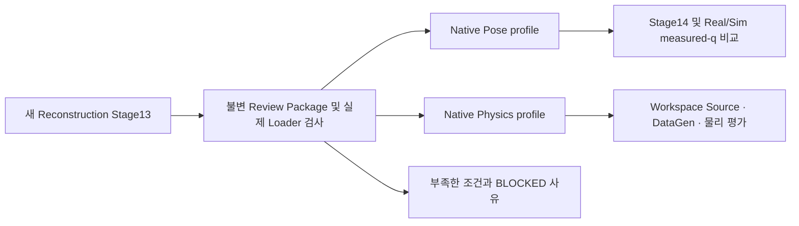

# Native Simulation·Scene 선택·Capture 개선

2026-11-18. `feat/simfoundry-style-reconstruction`, 시작 HEAD `25bb1cf083f2ce05a93c3bc2b9e290ba4f6cbf3b`의 기존 미커밋 작업 위에서 진행했다. 사용자 첨부의 Phase 1–6 범위다. 새 Reconstruction은 Native 실행 준비 여부를 Loader로 판정하고, Capture는 원본 저장과 후처리를 분리한다. 기존 Scene과 Package를 변경하거나 Authored를 Native로 재명명하지 않았다.

**구현 및 관련 집중 검증을 완료했다. 실물에서 관측한 13초가 해소됐다는 실측 결과는 아직 없다.** 실제 작은 합성 MuJoCo 실행, 파일 저장, 프로세스 간 전달을 검사했고, 실물 장치·사용자 Scene E2E·Isaac Kit는 실행하지 않았다. 전체 회귀·모델 추론·설치·다운로드·Commit/Push도 수행하지 않았다.

## 1. 측정 결과와 의미

진단 폴더는 Git 제외 `workbench_runs/diagnostics/native_capture_improvement_20261118_001/`이다. 변경 전 코드는 작업 시작 때 보관한 `source-before/`에서 읽었다. 비교용 Scene과 파일은 진단 폴더 또는 pytest 임시 디렉터리에만 생성했다. `auto_version`을 다시 렌더링하거나 수정하지 않았다.

| 직접 측정한 항목 | 변경 전 | 변경 후 | 측정 범위 |
|---|---:|---:|---|
| Compound 정적 검증 | 193.34ms / SHA 195회 | 17.63ms / SHA 3회 | Asset 3개, Collision Part 64개, 무관한 정적 파일 4MB |
| 위 검증의 논리적 해시 읽기량 | 260,010,270B | 4,000,158B | OS 실제 디스크 읽기량과 다름 |
| Authored 1프레임 | 406.15ms | 115.05ms | 같은 합성 Scene, Side/Wrist RGB가 변경 전후 byte 단위로 동일 |
| Native Pose 첫 / 다음 프레임 | 이전 Stage 기본 경로 아님 | 2.34 / 1.07ms | 실제 MuJoCo, Physics Step 0 |
| Scene 목록 조회 | 15.30ms | 1.05ms | 동일 합성 Workspace의 실행 Package 1개 |
| Real/Sim 설정 조회 | 14.42ms | 1.13ms | 장치 연결·전체 Prepare는 포함하지 않음 |
| RenderProcess 부모 생성 | 42.97ms | 22.50ms | 이전/현재 부모 Transport, Child는 모두 현재 Native 구현 |
| 위 생성부터 최초 검증 영상까지 | 489.11ms | 413.60ms | 실제 별도 Child 및 소프트웨어 EGL, 장치 없음 |
| Scene Prepare 원본 저장+등록 | 98.00ms | 102.37ms | 합성 640×480 두 장, 동기 함수 자체의 시간 |
| 위 Evidence 읽기 / 쓰기 | 4 / 3회 | 1 / 1회 | 기존 기록 확장·별도 이미지 복사 제거 |
| Real/Sim Pair 후처리 | 291.21ms | 100.56ms | 두 카메라의 저장된 RGB→Sim PNG·지표·Pair JSON, Sim 렌더/최종 Evidence 등록 제외 |
| 위 생성 PNG / SHA 호출 | 8장 / 10회 | 2장 / 4회 | 입력 Real PNG는 측정 시작 전에 저장 |

단일 실행 표본이다. 호출 순서와 파일 Cache 영향을 포함하므로 평균·지연 분포나 모든 Scene의 보장값으로 사용하지 않는다. 테스트 Wrapper의 `LIBGL_ALWAYS_SOFTWARE=1`, `MUJOCO_GL=egl` 조건이며 RTX GPU 렌더 속도 측정이 아니다. Native와 Authored는 다른 실행 표현이므로 서로의 픽셀이 같다고 주장하지 않는다. 픽셀 동일성은 **Authored 변경 전후**에만 확인했다.

이전 보고서의 `auto_version` 8.27초·64,296회 SHA는 과거 측정값이다. 이번에는 같은 결함을 독립 합성 Scene으로 재현했다. 원인은 Compound Collision의 각 Mesh를 확인할 때 `validate(minimal_scene)`를 재귀 호출하면서 **무관한 전체 Asset SHA까지 다시 계산**한 것이다. 여기에 Authored의 `observation_scene()`가 매 프레임 전체 검증을 호출하고 큰 Scene을 복사했다. 새 Mesh 검사 helper는 실제 Convex 판정을 유지하며 Asset 집합의 검증은 완전한 검증 호출마다 한 번만 수행한다.

Scene Prepare의 저장 함수 시간은 빨라지지 않았다. 새 경로는 PNG·메타데이터의 fsync와 Seal 검증을 수행한다. 개선점은 그 작업을 관측 루프 밖의 기존 spawned Writer로 옮긴 것이다. 250ms 지연을 강제로 넣은 실제 Writer 테스트에서도 두 촬영을 접수하고 Preview 갱신이 진행됐다. 이를 실제 카메라 또는 Teleop 성능 수치로 바꾸지 않는다.

## 2. Authored / Native Pose / Native Physics

| 실행 | 사용하는 상태 | 물리 의미 | 현재 연결 |
|---|---|---|---|
| Authored | 작성된 Visual/Collision과 measured-q FK | 검토용, 동역학 없음 | 기존 직접 Export 기본 동작과 명시적 `simulator.mode: authored` 보존 |
| Native Pose | Native 엔진 관절에 measured-q 직접 적용 | 물리 Step 0, 동일 q의 영상 비교 | 새 Reconstruction의 기본 Real/Sim 설정 |
| Native Physics | Native 관절 목표·엔진 Step·물체 동역학 | 실제 관절값과 목표 q가 달라질 수 있음 | 별도 Physics profile, Source/DataGen/물리 평가에서 선택 |

Stage13은 `export_revision(execution_mode='native')`로 새 Package만 만든다. 일반 직접 Export의 기존 Authored 기본값은 유지한다. Export의 Parser/Closure 확인 뒤 기존 Native Loader로 Profile을 검사하고 `execution_profiles.json`과 `scene.validation.native_readiness`를 Manifest에 포함한다. 등록 설정은 Project의 `configuration/native-<Manifest SHA>-<engine>-<mode>.json`에 생성한다. 설정에는 정확한 Scene identity가 들어간다. Stage13 Cache에는 `simulator` 설정과 Workbench 구현 SHA도 포함한다. 초기 q만 바뀌어도 새 Package를 만들고, 완료된 Stage1–12는 재사용한다.

`project.yaml.execution_packages`의 기존 `engine_config`는 Real/Sim용 Pose, 새 `engine_profiles[engine].physics`는 물리 작업용이다. Source 선택과 Pipeline 선택기는 Physics Profile을 고른다. Physics가 없는 최신 Revision을 Pose나 과거 Revision으로 대체하지 않는다. 이전 Record에는 기존 Reader 계약을 적용하며 Authored 물리 실행 거부도 유지한다.

Native 준비 검사는 다음을 요구한다.

- 실제 실행 URDF와 6개 Joint 이름·순서·Limit·모델 rad 단위.
- Manifest에 연결된 Follower device-observation Mapping. 변환 전 모델 SHA가 필요한 Mapping은 그 근거 파일도 Package에 있어야 한다.
- Robot Base, 고정 Side, robot-link에 장착된 Wrist 및 FK 연결. 현재 Native adapter의 센서 ID는 `side`/`wrist`다. Photo는 Reference로 보존한다.
- 명시한 초기 관절값 또는 모델 SHA·Joint 순서가 일치하는 measured Capture. 임의 0 자세를 사용자 관측으로 생성하지 않는다.
- Physics에는 실제 활성 Object의 양수 Mass·유한한 비음수 Friction. 기존 estimated/unknown 출처는 보존한다.
- MuJoCo는 실제 `build_model` Compile. Isaac은 기존 설정 Loader와 USD ArticulationRoot 선언을 확인하며, 정적인 로봇 USD를 Articulation으로 취급하지 않는다.

MuJoCo Compile 성공은 실물 물성 검증이 아니다. Isaac `DECLARATIONS_CHECKED`도 Kit 실행 성공이 아니다. Package는 `passed=false`, `physical_verified=false`의 미승인 Review를 유지한다. Stage14에서 Native 설정이 없으면 구체적 `NEEDS_MORE_DATA`로 중단하고 Authored로 대체하지 않는다. 설정 Runtime 부재는 기존 `NEEDS_RUNTIME` 경계다.

Native Real/Sim은 Manifest의 원래 K·Distortion을 보존한 공통 Projection 후처리를 명시적으로 소유한다. 반면 기존 Source/DataGen의 Pinhole 전제는 유지한다. 왜곡 계수가 있는 Scene은 그 경로의 Physics Profile이 차단되며 영상이 보정된 것처럼 처리하지 않는다. 임의로 원본 Camera Calibration을 0으로 바꾸지 않는다.

## 3. 정적 검증 재사용과 연결 과정

`SceneView`를 생성할 때 Package/Mapping/설정의 정적 무결성을 검사한다. Renderer 수명 동안 Scene·Manifest·모델/Asset 파일·설정의 inode/크기/mtime/ctime을 매번 확인하고 바뀌면 전체 검증을 다시 수행한다. 각 파일 stat은 한 번만 읽는다. 파일 손상·Revision 변경·설정 변경 시 이전 검증으로 통과시키지 않는다. 전역의 무제한 검증 Cache는 없다.

Authored의 `observation_scene(validate_static=False)`는 이 소유 경계에서만 사용한다. 변경 가능한 Frame/Pose/Camera를 복사하고 FK·Rigid/Finite 변환을 검사한다. 외부 호출은 기존 완전한 정적 검증 기본값을 유지한다. `Renderer.update_scene()`는 Object ID 조회를 재사용하고 Geometry 변경·Scale 변경의 명시적 재컴파일 경계를 유지한다. Native도 새 q의 Shape·Finite·Limit을 검사하고 관절 목표와 실제 관절값을 별도로 반환한다.

Scene 목록은 Manifest SHA와 표시용 Scene identity만 읽는다. 같은 성공한 선택은 Project·Scene·Manifest·설정 파일 Stamp가 같으면 UI 설정 작업을 반복하지 않는다. **실제 Recipe Prepare와 연결에는 전체 무결성 검사가 남는다.** 목록 표시나 버튼 활성화가 실행 검증을 대신하지 않는다. RenderProcess 부모의 중복 SceneView 생성은 없애고, Child가 전체 SceneView를 검증한 뒤 Ready와 최초 영상을 게시한다.

연결 계측 위치:

| 위치 | 기록 |
|---|---|
| `SessionClient.startup_times_ns` | Prepare 시작/완료, R03 Worker Spawn 요청/수신 |
| Session `connection_times_ns` | Writer 준비, Leader/Follower 연결, Camera 시작, 입력 재확인, RenderProcess Spawn, 첫 Real/Sim 영상 |
| RenderProcess `startup_times_ns` | 부모 입력 확인·Spawn |
| `renderer/ready.json` | Child 진입, Scene 로딩, Renderer 초기화, Native Model Compile |
| 렌더 결과·Pair | Worker 요청 수신/실제 렌더/카메라 PNG 인코딩·SHA/결과 준비/부모 확인 |

UI는 `Scene 검사 → 장치 연결 → 카메라 준비 → Sim 초기화 → 첫 영상 대기`를 표시한다. 실물 장치 연결·Camera 준비 시간의 전후 수치는 이번에 측정하지 않았다. 합성 RenderProcess의 부모 생성→최초 영상 489→414ms는 **전체 실물 연결**의 전후 수치가 아니다.

## 4. Scene Prepare Capture

관측 전용 `scene_capture`에도 UI 클릭의 `requested_ns`를 전달한다. 제한된 기존 Camera 버퍼와 SDK feedback 이력에서 **요청보다 늦지 않은 관측**을 선택한다. 요청 뒤 새 프레임을 골라 요청 순간 자료로 표시하지 않는다. Frame 없음·재사용 Sequence·늦은 관측·Skew 실패는 명시적으로 거부한다.

기존 `snapshot_writer`를 관측 전용 모드에서도 재사용한다. 새 Manager나 별도 실행기를 만들지 않았다. 미결 저장은 최대 2건이며, PNG/JSON/해시/Evidence 등록은 spawned 프로세스에서 처리한다. 원본은 `input/observations/<session>/<observation>/`에 한 번만 저장하고 `scene_photos/`로 같은 이미지를 다시 복사하지 않는다.

두 이미지·시간·원 SDK 단위·Pixel/PNG SHA·요청 시각을 기록하고 원본을 Seal한 뒤, Project Lock 안에서 Evidence를 한 번 읽고 한 번 원자적으로 게시한다. 기존 Evidence Reader가 읽는 images/documents 형식을 유지한다. 기존 notes/다른 기록도 보존한다. 이미 Seal된 원본의 등록 실패는 같은 파일의 명시적 재등록으로 복구한다. 다른 입력에 같은 ID를 재사용하거나 Seal/PNG를 바꾸면 거부한다.

이 경로의 `q_measured=[]`, `model_state=None`, `action=None`은 그대로다. SDK의 각도/백분율을 임의의 모델 q로 바꾸거나 관측 전용 연결에 Teleop 권한을 주지 않는다.

## 5. Real/Sim Capture·Teleop·후처리

기존 4건 한도를 **원본 저장 2건 + 후처리 2건, 총 4건**으로 나눴다. 원본이 Seal되고 후처리 자리를 확보하면 원본 저장 자리를 반환한다. 후처리에는 이미지 배열 대신 저장 경로·고정 q·시각 정보가 남는다. 후처리도 가득 차면 원본 저장 쪽의 안전한 파일을 기다리게 하며 총 미완료 수를 늘리지 않는다. 무제한 촬영·디스크 사용을 허용한 설계가 아니다.

`RAW_SAVED`는 원본이 안전하다는 의미이고 `REGISTERED`는 Sim/Pair/Evidence까지 끝났다는 의미다. UI에는 원본 저장 n/2와 후처리 n/2를 따로 표시한다. 실패·중단 시 Seal된 원본은 남기고, 명시적 Retry도 같은 후처리 한도를 사용한다. 검사 중 Retry가 세 번째 원본 작업으로 계산되는 오류를 재현해 수정했다.

Live와 Pair는 기존 RenderProcess 하나를 사용한다. 대기 중인 frozen Capture가 있으면 새로운 Live 작업을 먼저 시작하지 않는다. 이미 실행 중인 Live 렌더는 강제로 끊지 않는다. 긴 한 프레임 자체가 다시 생기면 그 잔여 시간만큼 기다릴 수 있다. Renderer를 여러 개 띄워 GPU 메모리를 복제하지 않았다.

두 카메라의 MAE/RMSE/edge IoU는 즉시 저장한다. Side-by-side/Overlay/Difference 각 3장, 총 6장은 상세 보기의 **비교 이미지 생성**을 눌렀을 때 저장된 Real/Sim RGB로 만든다. Scene을 다시 렌더링하지 않는다. 원본 PNG/Pair SHA와 기존 지표를 검증하고 동일 Scene/q/Camera 출처를 남긴다. 결과는 원본 밖의 임시 폴더에 생성하며 창을 닫으면 해제한다. 기존 직접 `write_pair()`의 진단 이미지 기본 동작은 보존하고 새 Capture 저장 경로만 지연 생성을 선택한다.

실제 Native Transport 합성 표본의 Capture 요청→부모 검증은 **30.35ms**였다.

| 구간 | 측정 |
|---|---:|
| Worker 실제 렌더 시작 전 대기 | 10.93ms |
| Worker 렌더 함수 호출 | 1.71ms |
| Renderer 내부 보고 | 1.34ms — 위 렌더 함수 구간 안에 포함 |
| Side/Wrist PNG 인코딩 | 6.16ms |
| Worker PNG SHA | 0.09ms |
| 결과 준비→부모 검증 | 11.33ms — 게시·폴링·부모 확인 포함 |
| 부모 SHA | 0.10ms — 위 부모 확인 구간 안에 포함 |

중첩 구간을 더하지 않는다. Transport 결과와 실제 Pair 후처리 100.56ms는 서로 다른 합성 실행이다. 이를 더해 사용자 13초의 개선 후 전체 시간으로 제시하지 않는다.

일반 Capture 파일 I/O 오류는 기존 Teleop 승인을 취소하지 않는다. 실제 Device identity 오류·100ms Freshness 위반·Heartbeat/제어 Deadline·Stop 우선순위는 그대로이며 안전 중지 후 자동 재시작하지 않는다. 정상 저장 중 Control tick 진행과 실제 중지 사례를 Memory Device로 검사했다. **실물 연속 Teleop/Capture는 미검증**이다.

## 6. 추가 조사와 남은 위험

| 분류 | 확인 내용 / 처리 |
|---|---|
| 코드에서 확인·수정 | Compound 전체 Asset 해시 재귀, Authored 프레임 전체 검증/복사, Object 반복 선형 탐색, 중복 부모 SceneView, 관측 루프의 동기 저장, Evidence 반복 파싱/쓰기 |
| 측정으로 확인·개선 | 합성 정적 검증 193→18ms, Authored 406→115ms, 목록 15→1ms, Pair 후처리 291→101ms |
| 이번에 함께 차단 | Source/DataGen이 Pose Profile을 Physics로 사용하는 연결, 왜곡 보정을 소유하지 않은 경로에서의 왜곡 영상 허용, sealed Retry의 Queue 분류 오류 |
| 유지한 안전 장치 | Prepare 전체 파일 SHA, 실행 중 파일 Stamp 무효화, measured-q Limit/FK, 원자적 Manifest/Evidence, Time/Skew, owned Process 종료, 모터 Safety Deadline |
| 규모 증가 위험 | stat은 파일 수에 비례하고 Authored 동적 Pose/FK 검사는 Object/Frame 수에 비례한다. 실제 Convex 검사와 Export Compile 비용도 남는다. 모든 Scene이 1ms가 되는 것은 아니다. |
| 남은 I/O | Live PNG 인코딩/파일 전달/부모 디코딩과 SHA는 남는다. Capture 비교 PNG 6장과 동일 Sim PNG의 불필요한 중복 SHA만 제거했다. 공유 메모리 Transport는 도입하지 않았다. |
| GIL/CPU | Writer 프로세스가 PNG/Canny/등록을 소유하며 OpenCV Thread 수는 그 Child에서 1로 제한한다. Camera/Live 전달과 프로세스 IPC의 모든 GIL 경합까지 제거됐다는 뜻은 아니다. |
| 시간 정확도 | Host receipt 기반이며 하드웨어 Exposure 동기화가 아니다. Real Side/Wrist/q Skew는 검사·기록하고 Native Physics의 추종 차이도 공개한다. |
| 디스크/긴 Session | Queue는 미완료 작업 수를 제한한다. 저장 완료된 원본의 전체 디스크 용량을 자동 제한하거나 삭제하지 않는다. Disk-full/Lock/등록 실패 시 파일 보존·명시적 Retry가 필요하다. |
| 재시도/복구 | Seal/SHA 일치 원본만 재등록한다. 부분 원본은 자동 덮어쓰기/삭제하지 않는다. 장시간 후처리 누적이나 RenderProcess 오류는 명시적으로 표시한다. |
| Isaac | 선언 검사만 구현/검사했다. 실제 Kit/PhysX/센서/시작·종료/GPU 자원은 NOT_TESTED. Articulation USD가 없으면 차단된다. |
| 실물 품질 | 실제 복잡한 사용자 USDA의 Native 동일성·실측 물성·Grasp/Task 성공·실물 13초 지연 재측정은 NOT_TESTED. 합성 Primitive/Compound/Mesh 검사를 이들의 성공으로 확장하지 않는다. |

## 7. 검증

직접 관련 집중 묶음은 **87 passed / 실패0 / skipped0**, 27.04초, 실제 프로세스 exit0이다. `release-focused-verified.xml/log`가 근거다. 그 뒤 초기 q 변경 시 Stage13 재사용을 별도 RED로 재현하고, Cache 키 보완 후 새 재개 시험과 기존 Stage 흐름 **2 passed / 4.61초 / exit0**를 확인했다(`phase6-native-cache-green.xml/log`). 두 묶음은 1개 시험이 겹치므로 **고유 88개**다. 전체 테스트 디렉터리나 전체 회귀는 실행하지 않았다. 중간 84개 통과 뒤 Projection 경계 보완을 한 결과와 구분하며, 겹치는 Phase별 수치를 합산하지 않는다.

- RED: Compound SHA 호출 횟수, 목록/설정의 완전 검증 반복, Evidence 반복 Transaction, 원본/후처리 미분리, 불필요 Live 선점, 진단 이미지 즉시 생성, Profile Consumer 불일치, Retry Queue 한도, Projection 적용 범위를 별도로 재현했다. 테스트 Harness의 누락 경로/PXR Bootstrap/인자 오류도 실패 로그에 남겼으며 제품 결함과 구분한다.
- 실제 합성 MuJoCo: 새 Stage13→Native Profile→Stage14, 실제 소유 Worker CLI, 같은 q의 동일 RGB/Camera, Wrist FK 변경, Limit/NaN 거부, 변경 Asset 무효화, 중력/접촉/Step·관절 추종 차이. 미승인 상태 보존을 확인했다.
- 실제 파일/프로세스: Spawned Writer, 두 관측의 Evidence Transaction, 등록 실패 후 원본 보존·명시 Retry, Native RenderProcess 정상 exit0 및 정리.
- 모의 장치: 저장 중 Teleop 제어 주기 진행, 160ms GIL 점유 작업의 Writer 격리, 실제 100ms Deadline 위반의 중지·무자동재시작, Queue Full/Stop/실패 처리. Serial/Camera를 열지 않았다.
- 실제 Qt offscreen: 같은 Scene 선택 재사용, 기존 Pipeline 선택의 Engine 동기화, 상세 창의 지연 비교 이미지 생성·원본 불변·임시 리소스 해제. Object Library 등 무관한 창을 실행하지 않았다.
- Isaac Camera 설정 3조건은 Mock SDK 계약 검사다. 실제 Isaac 실행이나 이미지 정확도 시험이 아니다.

## 8. 변경 파일

작업 시작의 기존 미커밋 변경과 구분한 이번 목록이다. 제품 파일은 새로 만들지 않고 기존 소유 모듈을 확장했다.

| 파일 | 이번 변경 |
|---|---|
| Builder `scene.py`, `capture.py`, `rendering.py` | 정적/동적 검증, Mesh helper, Pose 복사·조회 최적화 |
| Builder `export.py`, `registration.py` | Loader 확인 Native Profile·불변 Package·등록 |
| Builder `reconstruction_stages.py`, `stage_workers.py`, `automation.py` | Stage13/14 기본 Native·실제 Worker·Workbench 구현 SHA |
| Builder `evidence.py`, `validation.py` | Observation 단일 게시, 지표와 진단 이미지 분리 |
| Workbench `robot/scene_render.py`, `robot/authored_render.py` | Native 모드·q/실제 상태·초기화, Authored 동적 경로 |
| Workbench `robot/render_transport.py`, `robot/render_worker.py` | 중복 부모 검증 제거, Startup/IPC 시각, Capture 우선 |
| Workbench `robot/scene_observation.py`, `robot/snapshots.py`, `robot/pairs.py` | 비동기 관측 저장·Seal·요청 시각·2+2 Queue·지연 비교 |
| Workbench `robot/real_sim.py`, `recipe.py` | 연결 단계 계측, 새 Writer 구현의 입력 코드 Identity |
| Workbench `scene_preparation.py`, `ui/pipeline_inputs.py` | 물리 작업의 명시적 Physics Profile 선택 |
| Workbench `ui/session_operations.py`, `ui/real_sim_page.py`, `ui/session_client.py` | 빠른 목록·동일 선택 재사용·연결 표시·클릭 시각 |
| Workbench `ui/view.py`, `ui/session_results.py` | 원본/후처리 표시, 상세 창 비교 이미지 생성 |
| Workbench `engines/mujoco/model.py`, `engines/mujoco/source.py`, `engines/isaac/env_cfg.py` | Native Profile Consumer, 기존 Pinhole 제한과 명시 Projection 소유 경계 |
| `real2sim_builder/config/simfoundry-reconstruction.example.yaml` | 기본 Native와 부족 조건 안내 |
| 기존 시험 `test_stage_compilation.py`, `test_capture_request_queue.py`, `test_capture_render_timing.py` | 명시 Authored fixture, 새 한도 및 기존 Timing 계약 보존 |
| 신규 시험 `test_scene_validation_performance.py` | 해시/Convex/동적 검증 |
| 신규 시험 `test_native_reconstruction_execution.py` | 실제 Native Export/Stage13/14/물리/Consumer |
| 신규 시험 `test_scene_selection_performance.py` | Metadata 목록과 Prepare 무결성/Qt 선택 |
| 신규 시험 `test_scene_materials_transaction.py`, `test_scene_capture_async.py` | Seal·재등록·요청 시각·비동기 Writer |
| 신규 시험 `test_capture_stage_queues.py`, `test_deferred_pair_diagnostics.py` | Queue·우선순위·지표·원본/Qt 자원 보존 |
| 이 문서 | 근거·설정 연결·한계 |

## 9. 적용과 보존

새 Reconstruction은 예시 설정의 `simulator.mode: native`를 사용하며, 실제 Robot Mapping/초기 q/Base/Sensors와 필요한 Native Runtime이 준비돼야 한다. 값이 없으면 차단 이유를 해결하고 새 Package/Revision을 만든다. 기존 Review를 물리 검증 완료로 승격하거나 과거 Package를 다시 쓰지 않는다. 검토만 필요할 때는 `mode: authored`를 명시한다.

Workspace Source/DataGen은 새 등록의 Physics 설정을, Real/Sim은 Pose 설정을 고른다. 수동 Recipe에는 각각 `engine_profiles.<engine>.physics` 또는 `.pose`의 실제 파일을 연결한다. 두 설정 모두 Manifest identity와 함께 읽는다. 토큰·로컬 모델 경로·실물 장치 설정을 새로 저장하거나 기존 Workspace Runtime을 변경하지 않았다.

이번 보존 근거는 저장소 전체 SDK/모델 디스크의 전수 대조가 아니며, 사용자 원본 보호 Ledger와 작업 시작 Dirty 파일 대조다.

### 마감 기록

보호 대상 `workbench_runs/{scenes,object_assets,robot_rigs,devices,calibration,runtime,source}`의 **19,490개 파일 / 8,935,391,769B**를 시작 SHA·크기와 대조해 **변경0·누락0·신규0**을 확인했다. 기존 `auto_version`·사용자 Capture·URDF·Calibration·Asset도 이 대조 범위에 포함된다. 이 밖의 전체 SDK/모델을 전수 대조한 것은 아니다.

시작 Dirty 파일 84개 중 이번 작업에서 확장하지 않은 **71개는 SHA가 그대로**다. 나머지 관련 기존 파일은 시작 백업과 구분해 수정했다. 이번 변경은 **기존 33개 수정·신규 8개·삭제0개**이며, 그 안의 Python **39개**를 bytecode 생성 없이 Compile했다. `git diff --check`도 exit0이다. 정확한 경로 목록은 `change-inventory.json`에 있다.

HEAD `25bb1cf083f2ce05a93c3bc2b9e290ba4f6cbf3b`·브랜치·시작 Index는 그대로다. 이번 시작 Index에는 staged diff가 없었다. Commit/Push·다른 브랜치 조작·Reset/Clean·원본 삭제를 하지 않았다. 모든 변경은 로컬 미커밋 상태다.

검증 기록: `phase*-red*.xml/log`, `phase*-green*.xml/log`, `release-focused-verified.xml/log`, `phase6-native-cache-green.xml/log`, `phase1-performance.json`, `render-performance.json`, `selection-capture-performance.json`, `pair-performance.json`, `preservation-after.json`, `index-preservation.json`, `compile-check.json`, `change-inventory.json`, `verification-summary.json`. 진단 폴더는 제품의 실행 의존성이 아니다.

## 10. 후속 Branch Checkpoint 범위

사용자의 후속 Commit/Push 지시에 따라 Native/Capture 개선 **41개 파일**을 선별했다. 같은 파일에 섞여 있던 이전 Scene Memo·Robot Rig 변경은 부분 Staging으로 남겼다. 기존 렌더 계측 코드와 원본 영상 비율 보존은 이번 실행 경로의 관련 변경으로 포함했다. 원본 작업 파일은 이 선별 과정에서 교체하거나 되돌리지 않았다.

선별한 Git Tree를 별도 임시 경로에서 검사했다. 직접 관련 88개 중 Backend 등 83개가 통과했고, 기존 Qt Interpreter 상대 경로가 없는 5개만 환경 연결 후 다시 검사해 모두 통과했다. 전체 회귀·설치·실물 구동은 실행하지 않았다. 실제 Commit 대상은 **수정32·신규9개**이며, 앞 절의 작업 시작 대비 수정33·신규8개 집계와 기준이 다르다. 이전 미추적 계측 시험 1개도 이번 Commit에 포함되기 때문이다.

신규 비밀값·개인 홈 절대경로·Binary·1MB 초과 파일은 없음을 확인했다. Scene/Capture/Asset/Calibration 원본, `workbench_runs`, Runtime·모델·Cache는 Commit에서 제외한다. 다른 미커밋 작업은 그대로 남긴다. Commit/Push 결과와 포함·제외 목록은 로컬 진단 `workbench_runs/diagnostics/native_capture_checkpoint_20261118_001/`에 기록한다. 앞 절의 Commit/Push 미실행 기록은 구현 작업 마감 당시 상태다.
