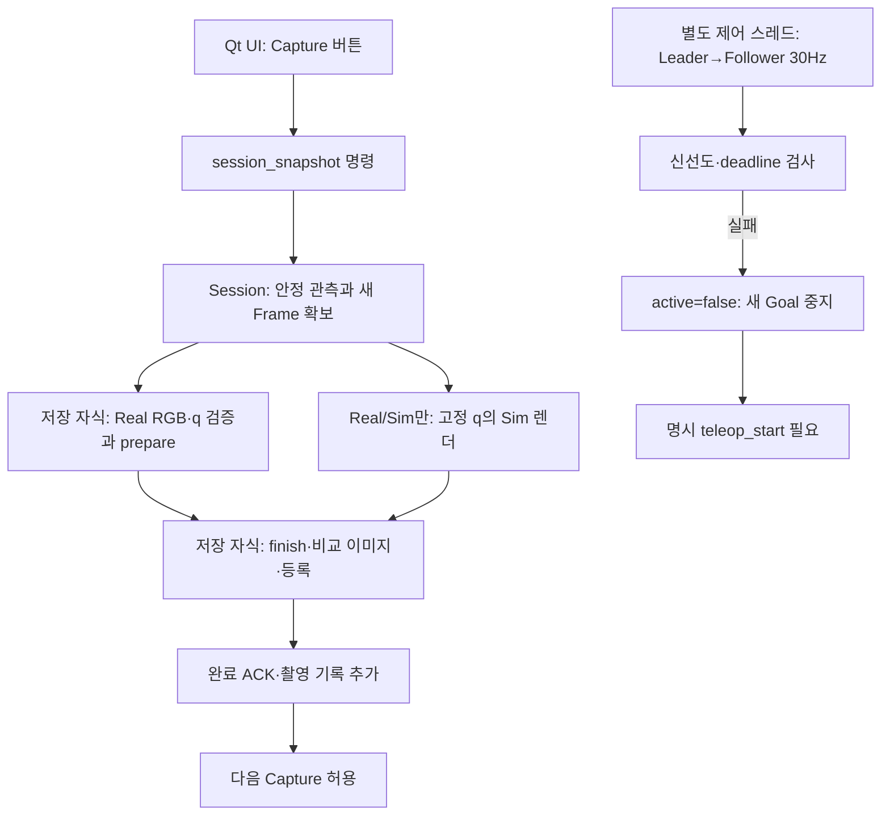

# Teleop 중지와 Capture 지연 — 실제 기록·현재 코드 조사

> 2026-11-18 후속: 아래는 수정 전 조사 기록이다. 이후 구현과 전후 측정·실물 미검증 범위는 [Capture 접수·저장 분리 보고서](capture-pipeline-improvement.md)를 따른다.

2026-11-17, 한국 시각 기준. 브랜치 `feat/simfoundry-style-reconstruction`, HEAD `8e02b1ae023a856694a40b947881f76b66410624`. 사용자의 요청에 따라 **원인 조사와 문서 작성만** 했다. 제품·시험 코드는 수정하지 않았다. 기존 로봇에 접속하거나 명령을 보내지 않았으며 사용자 원본은 읽기만 했다.

핵심은 세 가지다.

1. 보존된 실물 세션에서는 **Capture 도중 100ms 신선도 검사가 실패해 Teleop 권한이 해제**됐다. Capture 버튼 자체가 정상 경로에서 Teleop을 끄는 것은 아니다. 장치 연결 해제와 새 Goal 전송 중지는 다른 상태다.
2. **현재 코드에도 약 10초의 저장 병목이 남아 있다.** 실제 Project의 1.59MB `input/evidence.yaml`을 한 Capture에서 6회 파싱하고 다시 쓰는 비용을 독립 복사본으로 재현했다. 앞선 빈 Project의 0.x초 시험은 이 누적 비용을 포함하지 않았다.
3. 현재 Capture는 **안정된 정합 관측을 하나씩 저장·검증·등록하는 작업**이다. 이전 작업이 끝날 때까지 다음 버튼 입력을 막고 움직이는 중에는 안정 관측을 기다리므로, 사용자가 원하는 연속 촬영 UX를 아직 제공하지 않는다.

## 1. 실물 기록에서 확인한 일

가장 최근 보존된 Real/Sim 실행 `c5d5391b446945ddba4934e3adfc0d68`은 `paired_session`이며 Prepared 설정·Capture Manifest·Session report가 모두 `hardware` 실행을 기록했다. 이번에 장치를 새로 실행한 결과는 아니다.

| R03 이벤트 순번 | 상태 |
|---:|---|
| 4737 | `TELEOP_ACTIVE`, Teleop 활성 |
| 4812 | `CAPTURING`, Teleop은 계속 활성 |
| 4815–4816 | Capture 진행 중 Teleop 비활성. `teleoperation: Stale feedback/Leader command` |
| 4846 | Capture 저장 완료. 연결은 `OBSERVING`, Teleop은 비활성 |
| 5038 | 새 `teleop_start`로 Teleop 재활성 |
| 11963 | Capture 밖에서도 `Stale session heartbeat/control cycle` 중지 발생 |
| 18413–18414 | 나중에 명시 Cancel로 Session 연결 종료 |

Capture 실패로 자료가 없어진 사례가 아니다. 해당 `capture_001`은 저장됐고, Session은 관측을 계속했다. Real/Sim 화면에서 버튼을 다시 누를 때도 `client.running=True`이면 장치를 재접속하는 대신 `teleop_start`를 보내는 구조다.

실제 Capture 요청 파일과 완료 ACK 파일의 mtime 차이는 **12.384초**다. 파일 시각은 처리 단계의 정확한 계측 타이머가 아니지만 보존된 완료 순서를 확인할 수 있다.

| 보존 근거 | 한국 시각 / 관측값 |
|---|---|
| Capture 명령 작성 | 10:32:05.829 |
| 같은 q의 Sim 렌더 | 내부 `render_ms` **12.778ms**; 요청→렌더 완료 monotonic 차이 **25.393ms** |
| `state.json` 작성 | 10:32:07.779 |
| Pair와 비교 이미지가 포함된 Manifest 작성 | 10:32:08.483 |
| Project의 `input/evidence.yaml` 작성 | 10:32:18.143 |
| 완료 ACK 작성 | 10:32:18.213 |

Manifest 작성 뒤 ACK까지 약 **9.730초**가 더 걸렸다. 따라서 이 기록의 12초 전체를 GPU 렌더 시간으로 설명할 수 없다. 이 구간에는 검증·등록·메타데이터 I/O 등이 포함되며, 아래 현재 코드 재현에서 큰 Project의 반복 파싱 비용을 확인했다.

캡처 구간의 보존된 진행 상태에는 실제 영상 age 최대 **1,959ms**, Sim 영상 age 최대 **6,431ms**도 있다. `render 13ms`와 `age 6초`는 다른 값이다. 렌더 연산이 빨라도 결과 전달·관측 루프가 늦으면 UI에는 오래된 영상이 보인다. 이 기록만으로 Qt paint 자체가 6초 멈췄다고 판정하지 않는다.

## 2. Teleop이 꺼지고 다시 시작해야 하는 코드 경로

제어는 [teleop_loop.py](../../robot_learning_workbench/src/robot_learning_workbench/robot/teleop_loop.py)의 `TeleoperationLoop`가 약 30Hz로 실행한다. 실제 판정은 [supervised.py](../../robot_learning_workbench/src/robot_learning_workbench/robot/supervised.py)의 `Teleoperation.tick`에 있다.

| 검사 | 현재 제한 / 실패 결과 |
|---|---|
| Follower feedback 또는 Leader 관측 완료부터 Goal 전송 직전까지 | **100ms** 초과 → `Stale feedback/Leader command` |
| 직전 성공 제어 cycle 이후 간격 | **200ms** 초과 → `Stale session heartbeat/control cycle` |
| UI heartbeat age | **1.5초** 초과 → 같은 오류 문자열 |
| 한 cycle의 전송 전/전체 실행 시간 | **200ms** 초과 → control deadline 오류 |
| Session 주 루프의 UI heartbeat age | **3초** 초과 → Session 종료 경로 |

`tick`의 예외 처리와 `TeleoperationLoop`의 예외 처리는 `stop()`을 호출한다. 이 `Teleoperation.stop()`은 `active=False`로 만들어 **새 Leader Goal 송신을 막는다**. 이 함수가 USB 연결을 닫거나 Torque를 끄는 것은 아니다. 이후 저장 완료는 현재 `active` 값에 따라 `OBSERVING`으로 복귀하므로 Teleop을 다시 켜지 않는다. 재활성은 명시 `teleop_start`가 필요하다.

정상 Capture 명령은 [real_sim.py](../../robot_learning_workbench/src/robot_learning_workbench/robot/real_sim.py)의 `dispatch` 75–78행과 [session.py](../../robot_learning_workbench/src/robot_learning_workbench/robot/session.py)의 `command` 115–118행에서 처리한다. 이 정상 경로에는 `control.stop()`이 없다. 반면 Device/데이터 오류, 명시 Stop, 제어 타이밍 실패에는 중지 경로가 있다. 일반 저장 `OSError`는 현재 코드에서 활성 Teleop을 유지하도록 구분돼 있다.

**확정된 것은 중지 판정과 상태 전이이며, 당시 어떤 함수/SDK/OS 지연이 100ms를 넘겼는지는 미확정이다.** 과거 Worker는 실패 cycle의 새 `timing_ms`를 기록하지 않았다. Capture 밖의 두 번째 오류도 heartbeat age와 control gap을 하나의 문자열로 처리했으므로 어느 쪽이었는지 구분할 자료가 없다. USB 고장·특정 Codec·GIL 하나로 원인을 단정하지 않는다.

## 3. 현재 코드와 실패 세션의 실행 버전 차이

저장된 `prepared.json.effective_settings.code_files`를 현재 소스 SHA와 비교했다. `snapshots.py`, `real_sim.py`, `supervised.py`, `capture.py`, `pairs.py`, Builder `validation.py` **6개가 달랐고**, 6개 모두 이전 저장 분리 작업의 `source-before` 복사와 정확히 일치했다.

실패 세션의 Worker는 **10:29:08**에 시작했고 **10:40:48**에 종료됐다. 현재 `snapshots.py/session.py/real_sim.py`의 수정 시각은 **11:42:48**이다. 저장된 진행 이벤트에는 현재 코드가 보내는 `capture_phase/capture_elapsed_s`도 없다. 따라서 조사한 실물 실패는 현재 수정이 적용된 실행의 실패로 볼 수 없다. 사용자가 앞으로 실행하는 모든 UI가 구버전이라는 뜻은 아니다.

당시에는 저장이 `ThreadPoolExecutor`에서 실행돼 제어 스레드와 같은 Python interpreter를 공유했다. 현재 [snapshots.py](../../robot_learning_workbench/src/robot_learning_workbench/robot/snapshots.py)의 `snapshot_writer`는 **spawn 저장 자식 프로세스 한 개**를 사용한다. PNG/배열 계산·모델 처리·등록을 제어 interpreter 밖으로 분리하고 연결 전에 준비한다.

이 변경은 저장 연산이 제어 실행을 방해할 수 있는 경계를 줄인다. 하지만 저장 작업량이나 단일 Capture 완료를 기다리는 UI 정책을 없애지는 않는다. 현재 코드의 실제 실물 연속 Capture 검증 기록은 이번 조사에서 확보하지 못했다. 앱 재실행만으로 아래 10초 저장 병목까지 해결된다고 말할 수 없다.

## 4. 현재 저장 병목을 따로 재현한 결과

사용자 Capture의 RGB 4장·측정 q·19개 feedback sample을 읽고, **진단 폴더의 독립 Project**에서 현재 `SnapshotStore.prepare/finish`·Reader·Project 등록을 실행했다. 새 촬영·새 Sim 렌더·모터 제어는 없다. 모델 14개 파일 16,145,259B는 진단 폴더로 먼저 복사해 그 복사본만 hardlink했다. 사용자 원본 모델의 링크 수나 내용을 바꾸지 않았다.

같은 입력에서 바꾼 조건은 Project의 Evidence 크기다. 한쪽은 빈 Evidence, 다른 쪽은 사용자 `evidence.yaml`의 독립 복사본이다. 저장 자식의 준비 시간 약0.16초는 아래 시간에서 제외했다.

| 현재 코드 / 같은 RGB·q | 빈 Project | 기존 Evidence 복사 |
|---|---:|---:|
| prepare | 121ms | 1,714ms |
| finish | 427ms | 9,110ms |
| **합계** | **548ms** | **10,824ms** |
| `evidence.yaml` 읽기 횟수 | 6회 | 6회 |
| 같은 파일 읽기 누적 | 2ms | **9,538ms** |
| 같은 파일 쓰기 | 40ms | **785ms** |
| 전체 중 Evidence 읽기·쓰기 비중 | 7.6% | **95.4%** |

각 1회 측정이며 일반적인 지연 분포나 실물 전체 Capture 시간을 인증하지 않는다. 그래도 현재 코드의 동일 저장 경로에서 메타데이터 조건만으로 0.55초→10.82초가 재현돼, **누적 Evidence의 반복 파싱은 확인된 병목**이다. 이전 0.x초 시험은 빈 Project의 저장 Replay였고 실제 Project 크기를 반영하지 못했다.

구체적인 반복 경로는 다음과 같다.

- [project.py](../../real2sim_builder/src/real2sim_builder/project.py)의 `Project.evidence` property는 접근할 때마다 파일을 새로 읽는다.
- `SnapshotStore.prepare`의 중복 ID 검사에서 1회 읽는다.
- [capture.py](../../real2sim_builder/src/real2sim_builder/capture.py)의 `import_snapshots`에서 기존 이미지·대표 q를 구하며 2회, `_import_session`의 그룹·중복 검사에서 2회, 이번 입력의 `register_unbound`에서 1회 읽었다.
- 등록 말미에 전체 Evidence를 다시 직렬화한다. 파일 lock·SHA·측정 검증도 수행하지만 이번 측정의 지배적인 비용은 이 6회 파싱과 전체 쓰기였다. 다른 입력 분기는 횟수가 달라질 수 있다.

실제 Evidence는 **1,592,257B, 이미지36개·Capture Session12개**다. 이미지별 `runtime_baseline`에 `joint_mapping`, 과거 `runtime_profile`, 카메라·Scene 정보가 반복 포함돼 크기가 커진다. 이 구조를 만드는 곳은 `load_snapshots`의 `image['runtime_baseline']`(571–572행)과 등록 시 복사하는 경로다. Compact JSON으로 필드 크기만 비교해도 이미지 목록1,060,808B 중 `runtime_baseline` 값이1,018,200B를 차지한다. 이 수치는 YAML의 실제 디스크 크기와는 구분한다.

현재 [files.py](../../real2sim_builder/src/real2sim_builder/files.py)는 JSON 형태의 `.yaml`은 빠르게 읽지만, 이 기존 `evidence.yaml`은 block YAML이라 `yaml.safe_load`를 매번 사용한다. 설치된 PyYAML6.0.2에서 읽기 전용 비교를 추가했을 때 `SafeLoader` **1,499ms**, `CSafeLoader` **339ms**였고 이 한 입력의 파싱 결과는 같았다. **제품에 적용하지 않았다.** 전체 YAML 의미·오류·보안 계약의 호환 시험을 대체하는 결과도 아니다.

이번 큰 Evidence 조건에서 모델 공유/SHA 부분은 약 **11ms**, Pair 비교 생성은 약 **274ms**였다. URDF/mesh 폴더 구조 개선과 별개로, 이번 10초의 주원인을 모델 파일 복사나 Sim GPU 성능으로 지목하는 것은 측정과 맞지 않는다.

## 5. 왜 버튼을 연속해서 누를 수 없는가

현재 흐름은 다음과 같다. 파일 작업이 비동기인 것과 다음 Capture 요청을 받을 수 있는지는 별도 정책이다.

두 화면 모두 다음 제약을 공유한다.

1. [capture.py](../../robot_learning_workbench/src/robot_learning_workbench/robot/capture.py)의 `Stability` 기본값은 **0.6초** 관측 구간·팔 관절 변화1°·그리퍼2%p다. `capture_reason`은 새 프레임·영상 age≤200ms·영상/q skew≤100ms·관절 관측 간격≤100ms도 요구한다.
2. 움직이는 동안 버튼을 누르면 **그 순간의 프레임을 즉시 저장하는 것이 아니라** 이후 적격 관측을 최대 **5초** 기다린다. 조건을 충족하지 못하면 요청을 거부한다. 이것은 모터에 정지 명령을 보내는 것과 다르다.
3. `acquiring/pending/future`가 하나라도 남으면 `capture_request_allowed=False`다. UI는 이 값으로 Capture 버튼을 비활성화한다. 입력을 순서대로 쌓는 Queue가 없고, 이미 진행 중인 두 번째 요청도 Backend가 거부한다.
4. Real/Sim은 원본 Real RGB뿐 아니라 Sim2장·비교 PNG6장·상태/Manifest·모델 closure·SHA 검사·Evidence 등록까지 끝나야 완료다. Scene Prepare도 Sim/Pair 부분만 빠지고 동일한 Writer·등록 경로를 사용한다.

따라서 저장 자식을 분리해도 큰 Evidence 등록이10초 걸리면 다음 캡처를10초 동안 못 누르는 UX가 남는다. 이는 `.result()`로 Qt가 저장 완료를 직접 기다려서만 생기는 문제가 아니다. 현재 poll handler는 `Future.done()`을 먼저 확인한다.

## 6. 화면 버벅임과 남은 실행 경계

[session_client.py](../../robot_learning_workbench/src/robot_learning_workbench/ui/session_client.py)는 Qt thread의 80ms 타이머에서 상태·이벤트·Preview를 읽고 약400ms마다 heartbeat를 쓴다. Capture 클릭도 작은 명령 파일만 쓰고 돌아온다. 무거운 `SnapshotStore` 작업은 UI에서 직접 실행하지 않는다.

다만 제어 밖의 모든 작업이 완전히 격리된 것은 아니다.

- Session 주 루프는 같은 interpreter에서 Preview 전달과 상태 이벤트를 만든다. R03는 이벤트마다 로그·인덱스·상태 파일을 동기 flush/fsync한다.
- Real/Sim의 `RenderProcess.poll`은 결과 PNG의 SHA 검사·decode를 Session 쪽에서 실행한다. 렌더 자식이 있다는 사실만으로 이 비용까지 분리되는 것은 아니다.
- Qt의 status/event 처리와 Preview decode·확대 표시는 GUI thread에 있다. GUI 지연은 UI heartbeat 전달에도 영향을 줄 수 있다.
- Scene Prepare의 별도 Native Teleop 기록 `Recorder`는 여전히 ThreadPool을 사용한다. Snapshot 저장 자식과 다른 경계이며 해당 비용이 사라진 것은 아니다.

이것들은 실제 존재하는 후속 계측 지점이다. 이번 기록만으로 각각이 실물 중지를 일으켰다고 확정하지 않는다. Capture 밖에서도 타이밍 중지가 있었으므로 저장만 고친 뒤 장시간 제어까지 검증됐다고 할 수 없다.

## 7. 사용자가 원하는 흐름에 맞추려면

목표는 **한 번 Teleop 시작 → 계속 조작 → 원하는 시점마다 Capture → 연결/제어 유지**다. 다음 변경을 별개로 검증해야 한다. 이번 조사에서는 적용하지 않았다.

| 순서 | 필요한 변경 | 보존할 조건 |
|---|---|---|
| 1 | 같은 등록 transaction에서 Evidence를 한 번 읽고 전달·재사용. 안전한 빠른 YAML parser/dumper 사용 여부 검증 | Project lock·최신 파일 일치·실측/중복 검사·원자적 저장 유지. 기존 사용자 파일 일괄 재작성 금지 |
| 2 | 프레임·측정 q·시간을 빠르게 고정하고, 무거운 비교/검증/등록을 뒤로 미룬 **bounded Capture Queue** | 접수/원본 저장/등록 완료를 구분. Queue 초과를 명시하고 Stop 우선권 유지. 저장 전 실패를 성공 표시하지 않음 |
| 3 | 공통 Mapping/Profile/Pair 내용을 각 image index에 반복 저장하는 비용 축소 | 기존 불변 Capture 보존. 새 참조는 SHA 검증하고 기존 Reader/Consumer 계약을 함께 검증. 필드만 지워서는 안 됨 |
| 4 | 움직이는 순간도 담는 관측 Capture와 정합 적격 관측의 판정 분리 | RGB·측정 q·시간 원본 보존. 움직임/blur/skew가 큰 자료를 calibrated/eligible로 승격하지 않음 |
| 5 | 현재 소스 SHA로 실물 연속 Capture·지속 Teleop 검증 | 제어 gap·feedback/leader age·heartbeat·USB 읽기·UI poll·각 저장 단계를 기록. 실제 stale/Stop 뒤 자동 재가동 금지 |

1번은 이번에 확인한 긴 지연을 줄이는 직접 수정이고, 2·4번은 원하는 사용 방식과 현재 정책의 차이를 해결하는 변경이다. 제한 시간을 늘리거나 실제 제어 오류 후 Teleop을 자동 재시작하는 것은 원인 해결이 아니다. 새 Framework/Process Manager/DB 없이 기존 Session·Writer·Reader 경계에서 진행할 수 있다.

## 8. 이번 확인 범위와 증거

- 과거 실물 이벤트를 `trace_probe.py --expect-continuous`로 재생했다. Capture 중 Teleop이 꺼진 원래 증상에서 **실제 exit1 RED**가 나온다. 과거 기록을 성공으로 바꾸지 않는다.
- 현재 Memory 장치의 실제 Session/Writer/Reader/Project 경로로 **5개 집중 시험 통과**: 실제 신선도 실패의 중지·실패 cycle 기록, 두 Session의 연속2 Capture, 느린 미완료 Writer 동안 제어 유지.
- 현재 저장/제어 interpreter의 GIL 격리 검사 **2개 통과**. 160ms 합성 C 작업이며 특정 실물 Codec이160ms를 점유했다는 증거는 아니다.
- 실제 저장 Replay는 독립 Project의 빈/큰 Evidence 조건 각각1회다. 첫 진단 스크립트의 복사 경로 오타로 빈 조건 뒤 중단된 로그를 보존했고, 진단 스크립트만 고쳐 큰 조건을1회 실행했다. 제품 코드는 변경하지 않았다.
- 전체 pytest·AI Forward·엔진 실행·실물 구동·설치·Git Commit/Push는 하지 않았다. 앞선1,269개 회귀 통과를 이번 조사 실행으로 표시하지 않는다.

시작 시 기록한 조사 대상 Python 305개 SHA, 기존 Git Index·Unstaged diff SHA, HEAD·브랜치를 다시 대조해 변경 없음을 확인했다. 조사한 원본 파일 34개도 저장 Replay 후 SHA/크기가 같았다. 그중 30개는 이전 보호 ledger와도 일치했다. 원본 전체를 이번 시작 시 새로 전수 hash한 것은 아니다. 신규 제품/시험 파일은 없으며 이 보고서와 진단 자료만 추가했다. `git diff --check`와 문서 링크 검사도 통과했다.

이번 저장 Replay는 성공했지만 실제 로봇의 자연스러운 연속 촬영 UX를 검증한 것은 아니다. **저장 병목의 원인은 재현했으며, 실물 제어 타이밍 초과의 개별 함수/USB/OS 원인은 아직 미확정**이다.

진단은 Git 제외 `workbench_runs/diagnostics/teleop_capture_investigation_20261117_001/`에 있다. 주요 자료: `trace-red.log`, `trace-result.json`, `historical-timing.json`, `runtime-code-comparison.json`, `current-boundary.xml/log`, `current-isolation.xml/log`, `storage-result.json`, `evidence-read.json`, `evidence-size-breakdown.json`, `parser-comparison.json`, `baseline.json`, `verification-summary.json`. 이 폴더는 제품 실행 의존성이 아니다.
