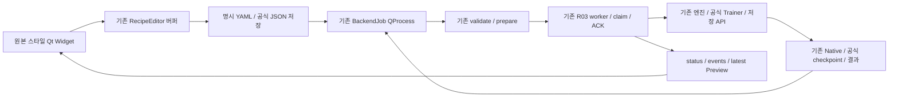

# 기존 UI 원형 복원 · Recipe/R03 연결 결과

2026-10-29. **원본 Qt 스타일·4탭·Navigation·Viewer/설정 분할·Curation 조작을 이관하고 실제 새 Worker 연결을 검증했다.** 사람의 장기 Desktop UX나 모든 화면의 pixel 일치를 입증한 결과는 아니다. 브랜치 `ui-original-restoration`, 기준 `f5cb9b251dfb5080d09b699ba8ff03cba486a139`. main/기존 hardware branch는 병합하지 않는다. 이번 범위는 표현·조작 흐름과 기존 Recipe/R03 연결이다. 원본 UI·Scene·Dataset·Checkpoint·Calibration·SDK는 불변이며 실물 Goal/Torque를 실행하지 않는다.

## 소스와 기준 화면

원본 SO101의 `real2sim/ui.py:Window`, `precision_ui.py:PrecisionPanel`, `workflow/ui.py:WorkflowPanel`, `workflow/curation_ui.py:CurationDialog`, `workflow/theme.py`, `workflow/view.py`와 Builder `app/ui/window.py`를 조사했다. Qt/PyQt6 설치6.11.0, 같은 offscreen QPA·DPI에서1320×900/1920×1080을 사용한다. 원본은 별도 임시 Workspace에서 실제 Qt Widget을 구성했다. motor/camera device open·구형 worker subprocess는 audit로 금지했다. Widget/스타일은 대체하지 않았으며 막힌 Registry 조회 때문에 모델 선택 목록의 초기 상태는 실행 환경의 정상 목록과 다를 수 있다. 빈 데이터 기준 화면이며 실제 실행 UX를 증명하는 것은 아니다.

| 기존 요소 | 원본 실제 소유 | 현재 대응 / 이관 결정 |
|---|---|---|
| Main4탭 | `real2sim.ui.Window`, Capture / Real-Sim / Workspace / Precision | `ui.app.Window` 상위 탭 복원. Scene/Teleop/Hub 등은 Pipeline 내부에서 접근 |
| Dashboard Header/Nav | `WorkflowPanel`, margins12·spacing16, Nav200px | `ui.app`의 Pipeline shell, 원본 objectName/style·버튼 위치 재사용 |
| 중앙/우측 분할 | `WorkflowPanel`, splitter850/390, 설정 minimum320 | `ui.workflow` Viewer/설정 분리. 저장 Recipe가 유일 실행 입력 |
| Preview/Log | `CameraView`, media splitter500/180 | 원본 CameraView paint/비율과 카드·로그 배치 이관. 기존 R03 latest-frame 소비 |
| 실행/수동 제어 | `WorkflowPanel` actionCard, source save/discard, annotate commands | 기존 prepare/start/cancel/ACK 호출 유지. 지원 stage 버튼만 표시 |
| DataGen 설정 | `WorkflowPanel`, Task/배치/목표/예산 | 기존 Object 표·count 값 연결. 승인 제외 Solver/Strict/Hold/RandomPoseSeed 미복원 |
| Curation | `CurationDialog`, 좌 Episode/우 영상·timeline, 접힌 분석/구성 | `ui.curation`의 기존 Native API를 사용해 표현과 조작 이관. 구형 reader/job 미복원 |
| Training | `WorkflowPanel`, 우 설정·중앙 진행/로그·별도 Loss | `TrainingSettings`·공식 로그 LossChart 재배치. MiniVLA/LR 자체 Trainer 미복원 |
| Capture/RealSim | `real2sim.ui.Window`, 실제2영상/4분할·공유 우설정 | 현재 hardware read/capture/렌더 결과 API만 연결. 팔 명령/자동 Torque 없음 |
| Precision | `PrecisionPanel`, 현재값/기준표/접힌 상세·검토 | 보존 근거/Raw 읽기·Revision만 연결. release/home/실물 Calibration 자동 수집 미복원 |
| Builder | `app.ui.window.Window`, projects280/1000·Inputs/Run/Compare/Result | 기존 독립 Builder UI 유지, Scene 검사는 BackendJob. v8 읽기 전용 |
| Hub | 원본 Workflow 입력·업로드 영역 | 현재 공식 HubSettings/API·명시 승인만 유지. 새 숨은 token/remote 변경 없음 |

원본 old UI의 JSON/구형 Task selector·실행 루프·MiniVLA·motor 동작 버튼은 최신 사용자 계약에 따라 대체/제외한다. 화면 복원은 과거 backend 의미·위험한 명령을 복원할 권한이 아니다. 기능상 차이는 최종 결과에 남긴다.

## 구현 순서

1. 원본 Style·CameraView·Main4탭·Pipeline shell을 복원하고 실제 Qt geometry/상태 보존 시험.
2. Workflow Viewer/설정/고급 Recipe 분리 및 stage별 버튼·Preview/진행/로그·학습 설정 연결.
3. Curation 목록·영상·timeline·Trim/Split/분석/Revision/Export 연결.
4. Capture/RealSim/Precision의 표현·결과·안전 상태 및 Builder/Hub 흐름 확인.
5. 동일 크기 Before/After 비교, 실제 R03/공식 도구 통합·전체 회귀/wheel·두 축 리뷰·원본 보존.

로컬 근거는 `docs/evidence/ui-original-restoration/`. 원본187개 Python SHA와56,100개 파일 stat 및 기준249개 tracked bytes를 작업 전 고정했다. 원본 렌더링과 실제 새 Worker 실행 증거를 구분한다.

## 실제 이관한 코드와 실행 경계

`ui/theme.py`의 STYLE 문자열은 원본과 exact다. `ui/view.py`의 CameraView와 EventTimeline은 원본 class AST와 exact다. CameraView는 영상의 종횡비·paint와 크기 정책을 유지하고, EventTimeline은 기존 Slider/marker/hover/선택 동작을 사용한다. `ui/plots.py`는 기존 Curation Plot의 투영·드래그·확대·Target hover 표현을 이관했다. 현재 기록된 Target·EEF·좌표만 표시하도록 구형 Robot mesh/Task 계산 결합과 미사용 selection 상태를 제거했다. Histogram은 기존 Backend가 계산한 공통 bins/counts를 그리며 새 통계 엔진이 아니다.

`ui/app.py`는 원본4탭과200px Navigation, `workflow.py`는 원본 Viewer/우측 설정·실행/정지·Preview/Log의 역할을 소유한다. Curation은 원래처럼 별도 Dialog이며, Source의 저장 Dataset 검토도 별도 Dialog다. 새 UI가 기존 Capture/Annotation/Training의 직접 실행 함수를 호출하는 경로는 없다.

추가 Backend operation은 기존 Curation Reader로 최대512점의 저장 Target/EEF를 읽는 `episode_plot`, 기존 `position_distribution` 호출, 보존 Precision Profile과 완료 관측의 작은 UI projection이다. 엔진 loop·IK·Policy/processor·Task·Saturation·Native publish·공식 Dataset/학습 계산은 변경하지 않았다. Qt는 Torch/Isaac/MuJoCo/LeRobot 실행 객체나 장치 포트를 소유하지 않는다.

저장 Recipe와 편집 버퍼를 구분하고, 변경 후에는 저장→검사→실행을 거친다. Prepare 도중 Recipe를 편집·삭제하거나 파일 bytes가 바뀌면 Ready를 무효화한다. Worker 완료와 Task 성공·Dataset 재개방 검증도 별도 상태다. Source/Annotation 수동 명령은 기존 Episode/env context와 실제 ACK를 사용한다. ACK 수신을 임의의 물리 성공으로 표시하지 않는다.

## 같은 Window·DPI의 비교

설치 Qt/PyQt6 **6.11.0**, offscreen QPA, 논리 DPI96, 실제 Window **1320×900 / 1920×1080**에서 원본22장과 신규22장을 저장했다. Source 등 Pipeline 화면도 양쪽 모두4탭 MainWindow 안에서 비교했다. 초기 별도 WorkflowPanel 캡처는 `screenshots/baseline-initial/`에 보존하고 최종 비교와 구분한다.

[Before/After 나란히 보기](evidence/ui-original-restoration/compare.html)에서 화면과 해상도를 선택할 수 있다. 입력이 없는 실제 Widget 기준 이미지이며 원본 Worker·장치 연결을 허용한 증거는 아니다. 실제 새 RGB/학습/결과 화면은 별도 실행 이미지에 있다.

| 화면 | 원본 / 신규1320×900 | 확인한 구조 |
|---|---|---|
| Main | [원본](evidence/ui-original-restoration/screenshots/old-main-1320x900.png) / [신규](evidence/ui-original-restoration/screenshots/new-main-1320x900.png) |4탭·200px Nav·Header·설정 toggle |
| Source | [원본](evidence/ui-original-restoration/screenshots/old-source-1320x900.png) / [신규](evidence/ui-original-restoration/screenshots/new-source-1320x900.png) |좌 Viewer/우 설정662/390px·2 camera·Save/Discard |
| Annotation | [원본](evidence/ui-original-restoration/screenshots/old-annotation-1320x900.png) / [신규](evidence/ui-original-restoration/screenshots/new-annotation-1320x900.png) |Auto/Manual·Mark/Pause/Resume·실행/정지 |
| DataGen | [원본](evidence/ui-original-restoration/screenshots/old-datagen-1320x900.png) / [신규](evidence/ui-original-restoration/screenshots/new-datagen-1320x900.png) |Fixed/Random·Object·Episode/Attempt·Env·Preview |
| Curation | [원본](evidence/ui-original-restoration/screenshots/old-curation-1320x900.png) / [신규](evidence/ui-original-restoration/screenshots/new-curation-1320x900.png) |Episode list/영상/Timeline·접힌 분석·구성 |
| Training / Evaluation | [원본 학습](evidence/ui-original-restoration/screenshots/old-training-1320x900.png) / [신규 학습](evidence/ui-original-restoration/screenshots/new-training-1320x900.png) · [신규 평가](evidence/ui-original-restoration/screenshots/new-evaluation-1320x900.png) |공식 설정·진행/Log·Training 전용 별도 Loss |
| Capture / RealSim / Precision | [원본 Capture](evidence/ui-original-restoration/screenshots/old-capture-1320x900.png) / [신규 Capture](evidence/ui-original-restoration/screenshots/new-capture-1320x900.png) · [신규 RealSim](evidence/ui-original-restoration/screenshots/new-realsim-1320x900.png) · [신규 Precision](evidence/ui-original-restoration/screenshots/new-precision-1320x900.png) |2영상·4분할·현재값/Reference·공유 우측 설정 |
| Builder | [원본](evidence/ui-original-restoration/screenshots/old-builder-1320x900.png) / [현재](evidence/ui-original-restoration/screenshots/new-builder-1320x900.png) |독립 Window·Project list·Inputs/Run/Compare/Result |

전체1920×1080 비교도 위 HTML에 있다. 주 버튼 중첩·Window 강제 확장 및 Source Preview의 과도한 축소는 Qt geometry/QTest로 검사했다. 우측 설정은 scroll하며, 1320px에서 모든 상세 입력이 한 번에 보인다는 뜻은 아니다. 기본 화면은 해당 Stage 설정을 우선하며 YAML/내부 계약은 고급 영역에 둔다. `/no/worker`로 실행을 금지한 빈 화면 캡처에는 Registry 조회 실패가 표시될 수 있다. [실제 저장 Training 설정](evidence/ui-original-restoration/screenshots/training-saved-final.png)과 [공식 Loss](evidence/ui-original-restoration/screenshots/loss-final.png)는 정상 Backend를 사용한 별도 결과다.

## 기존 화면과 다른 부분 및 이유

- 상단 안전 상태·저장/편집/검사 상태와 현재 Architecture의 Source/Hub/Offline 기능이 추가되어 문구와 일부 높이가 다르다. 보존 Recipe와 실제 실행 조건을 구분하는 데 필요한 표시다.
- 기존 Native JSON·구형 Task/IK/Failure 선택을 기본 설정으로 복원하지 않았다. Fixed/Random·DLS/Best Effort·현재 Task 계약과 공식 Policy Config만 연결한다. YAML과 의미 계약 입력은 고급 영역에 있다.
- Capture는 현재의 **유한 읽기 전용 관측 Run**이다. 구형의 지속 Connect→Teleop→Snapshot 수명이나 힘 풀기/Home/자동 Torque 버튼을 복원하지 않았다. Capture/RealSim 우측의 개별 port 수동 입력은 저장된 Device/Camera/Profile 선택으로 대체한다.
- Precision은 실제 현재값의 저장 결과·보존 Reference·Revision 검토다. 독립 물리 각도 기준을 새로 측정·승인하는 구형 버튼과 실물 명령은 없다. Gripper는 현재 Worker의 별도 유효 제안/승인 경계를 유지하고 기본 차단한다.
- Curation의3D는 **기록된 EEF 경로**다. 원본의 GUI Robot mesh/전체 Scene 물리 상태 재구성은 복원하지 않았다. EEF가 없는 외부 Dataset에는 없음을 표시한다. Task/Scene을 추측하여 보간하거나 새로운 Physics를 GUI에 넣지 않는다.
- 학습은 현재 공식 Registry/Config/CLI Trainer다. 구형 MiniVLA·자체 Trainer를 복원하지 않았다. ACT/SmolVLA/Diffusion의 기존 smoke 검증과 다른 Registry 모델의 미검증 상태를 구분한다. Loss는 Training에서만 열린다.

따라서 원형 Widget·배치·스타일 이관과 안전/저장 계약에 따른 차이를 구분한다. 모든 pixel·구형 제어 버튼의 완전 동일성은 완료 범위가 아니다.

## 실제 새 UI→Backend 실행

설치 Qt의 offscreen QApplication/QTest에서 버튼·입력을 조작했다. 파일 선택 Dialog만 자동화했고 production R03 Worker·엔진·Task·Camera render·공식 Trainer를 대체하지 않았다. 실제 motor/camera device open은 감사 hook으로 금지했다. 아래 시뮬레이션 Camera는 실제 엔진 RGB다.

| 새 UI 경로 | 실제 결과 / 판정 |
|---|---|
| Scene / Recipe |기존 v8 Manifest/Calibration/model 검사. 저장·Dirty·stage 전환·Prepare/Start·없는 Scene 오류와 terminal 재열기 확인 |
| MuJoCo Recorded Source |완료1×388 frame. `recording_only`; 공식 Reader의 success flag를 작업 성공으로 해석하지 않음 |
| MuJoCo Annotation |Auto1 + Manual1, 각각388 frame. Auto post222→저장223, Manual frame203 mark와 실제 Pause/Mark/Resume completed ACK 확인. 물리 gate 통과 |
| MuJoCo Fixed DataGen |새 성공2 Episode, 각각399 step. 기존 StableGrasp AND Placement |
| MuJoCo Random DataGen / Resume |새 성공1 + 같은 출력 Resume로 추가 성공2 = **총3 Episode**. `num_episodes=2`는 이번 추가2이며 누적 목표2가 아님. 기존 segment를 상속 Episode로 중복 계수하지 않음 |
| Curation / Export |Fixed2 Episode에서 train[5,81)76 frame / val[13,103)90 frame. 저장 Revision·분포·공식 Export. 원 Episode UID 교집합0 |
| 최종 Curation 재편집 |실제640×480 양 RGB에서 선택 frame20→원본25; Trim[7,81) 후 frame5→원본12·부모 plot cursor7. 새 자식 Revision 재로드 후 cursor0·train74 frame. 기존 Revision/Export는 보존 |
| 공식 ACT Training |새1-step smoke, 공식 checkpoint000001와 loss70.825. 실제 Worker·공식 CLI 및 Loss dialog. 수렴/성능 개선 근거 아님 |
| MuJoCo / Isaac Evaluation |엔진별1 Episode×60 step, 각각 max_steps 실패·Placement 성공0. 별도 엔진별 취소1·완료 Episode0. 엔진별 성공0/2 attempt이며 취소를 분모에서 임의 제거하지 않음 |
| Hardware 화면 |보존 Capture24 sample·Precision 읽기·양 엔진 measured-q RealSim 결과·Observe 결과 재열기. 실패한 ACT Observe의 stale/skew 오류도 그대로 표시. **이번 신규 장치 연결/추론/명령 시험 아님** |
| Builder |Workbench 실제 버튼→독립 Builder QProcess 기동·UI 종료 시 정리. 새 Scene/Export/원본 편집 없음 |

양 엔진 실제 Live Preview를 확인했고, 완료/취소 시 Native 재개방과 자원 정리를 확인했다. ACT 새1step 외에 SmolVLA/Diffusion Training·전체 Isaac Source/Annotation/DataGen을 이번에 새로 수행하지 않았다. 이 경로는 기존 전체 회귀와 읽기 전용 보존 결과·Registry 연결로 검증했다. 이번 UI 작업의 실제 실행 횟수에 과거 검증을 합치지 않는다. Hub 다운로드/업로드/Repo 생성은 현재 명시 API와 승인 경계를 유지하며 이번 실제 원격 쓰기는0이다.

[실제 MuJoCo 결과](evidence/ui-original-restoration/actual-mujoco/results.json), [Isaac 결과](evidence/ui-original-restoration/actual-isaaclab/results.json), [Manual ACK](evidence/ui-original-restoration/manual-annotation/results.json), [같은 경로 Resume 표시](evidence/ui-original-restoration/resume-results.json), [최종 Curation](evidence/ui-original-restoration/curation-release-results.json), [보존 결과/Builder 재열기](evidence/ui-original-restoration/reopen-results.json)를 분리한다.

공식 Native Reader는 Applied=`joint_targets`, requested/delta와 존재하는 pre[t+1]=post[t]를 검사했다. Source에 post-state가 없으면 검증했다고 표시하지 않는다. 양 camera640×480·30Hz·전체 frame 수/PTS와 시작/중간/끝 RGB decode를 확인했다. 공식 `LeRobotDataset`/DataLoader는 train76 frame, state/action[1,6]·양 RGB[1,3,480,640]을 소비했다. raw Applied와 Parquet는 exact이며 학습 Tensor는 기존 float32 경계다. Dataset 알고리즘·영상 재인코딩은 추가하지 않았다.

## 회귀·리뷰·한계

집중 Qt/기존 UI 시험은34 PASS다. 저장·Dirty·원형 코드/레이아웃·두 Window 크기·Recipe 변경/소실·Source shortcut/Env·Trim/Frame/Revision·지원 Stage·Gripper 기본 차단을 포함한다. 작은 Native fixture의 실제 QProcess 시험과 위 실 엔진 실행을 구분한다.

독립 **Standards** 검토는 Revision 재로드의 stale 선택 상태, Trim graph offset, Prepare 응답 시 파일 소실, 미사용 Plot 상태를 지적했다. 새 시험 RED→GREEN과 소스로 수정하고 마지막 제품 Commit `8416825`의 High/Medium0을 확인받았다.

독립 **Spec** 검토는 Trim graph·Source Env selector·고급 표와 기본 Trim의 이중 편집을 지적했다. 기본 Trim만 구간을 편집하고 고급 표는 구간을 읽기 전용으로 표시하도록 수정했다. 마지막 제품 Commit의 High/Medium0을 확인받았다. 실제 최종 화면에서 추가로 확인한 Trim 직후/Revision 재로드의 오래된 clock·영상도 기존 seek 경로로 갱신하여 RED→GREEN과 재검토를 통과했다. 두 축의 결과를 합쳐 한쪽의 문제를 숨기지 않는다.

실제 Resume 시험에서는 harness가 추가 Episode 수를 누적 목표로 잘못 기대하여 assertion이 실패했다. 실행은 정상적으로 기존1+추가2=3 Episode를 완료했다. UI의 잘못된 누적 라벨도 바로잡고 terminal 재열기·공식 소비자로 확인했다. 이 실패를 물리/Native 오류로 보고하거나 기존 결과를 삭제·재실행하지 않았다. 초기 Trial은 기본 Workspace 폴더와 새 출력 이름이 겹쳐 prepare에서 거부됐고, 별도 run-owned 하위 출력으로 변경했다. 학습/물리 조건이나 보호 검사는 완화하지 않았다.

**최종 전체1,082 passed / skipped0 = 기준1,069 + 신규13**이다. Scene Contract·Builder·Workbench 전체와 Recipe/Hub/Training/ACT/SmolVLA/Diffusion의 기존 회귀를 포함한다. torchvision의 기존 영상 deprecation 경고4회가 남는다. 별도 lint/type 도구를 설치하거나 실행하지 않았다.

Workbench/Builder wheel의 source/config bytes·compile·격리 import/CLI를 검증했고, Workbench wheel에서 실제 Qt4탭 창·Preview geometry·종료도 확인했다. invalid-config 실제 Worker의 명시 거부를 검사했으며 환경에 설치하지 않았다.

보존 대조는 원본56,100개 stat·원본 UI/프로젝트187개 Python SHA·선택한 과거 근거/SDK57개 SHA·기존 Policy/Capture/Calibration47개 SHA에서 변화0이다. v8 전체 Manifest도 재검증했다. 전체 SDK binary/대용량 corpus를 전수 byte hash했다는 뜻은 아니다.

최종 근거는 `final-tests-verified.xml`, `logs/76-full-suite-verified.log`, `build-workbench.json`, `build-builder.json`, `wheel-ui.json`, `consumer-results.json`, `preservation-after.json`, `old-layout.json`/`new-layout.json`, `verification.json`과 [Standards](evidence/ui-original-restoration/standards-review.md) / [Spec](evidence/ui-original-restoration/spec-review.md) review다. 실물 Goal/Torque·신규 Calibration·v9·Gripper 실제 동작·장시간 Desktop UX·모든 입력/장치 오류는 이번 완료 범위가 아니다. E01 물체 잔차와 기존 실측/시간 정합/Command Binding 관문도 그대로다. Isaac에는 기존 Fabric/RTX/종료 경고와 보호 audit가 막은 SDK cache 쓰기 시도가 남으며 warning-free라고 표시하지 않는다.

## 파일과 실행 방법

제품 변경은 `robot_learning_workbench/ui/`의 app/curation/workflow/learning/hub/operations와 theme/view/plots, 시험은 `test_ui_restoration.py`, 문서는 이 보고서와 README 링크다. 새 공통 Manager/Adapter/Worker/설정 포맷·패키지 의존성은 없다. Builder/Scene Contract/엔진/robot/data/learning Backend 제품 파일은 기준 Commit과 byte-exact다.

기존 환경에서 프로젝트 루트의 `./run_workbench_ui.sh`를 실행한다. 별도 Workspace는 `./run_workbench_ui.sh --workspace /새/작업폴더`로 선택한다. 실제 장치 연결을 하지 않고 검토할 때는 저장 Scene/Recipe/Run/Capture만 선택한다. 비교 이미지는 위 HTML로 확인한다. 외부 Scene v8·SDK·과거 입력 의존성은 기존 README와 같다.

Git은 `ui-original-restoration`에만 로컬 Commit을 저장한다. 최종 비교는 `git diff f5cb9b2...HEAD`이며 제품 UI9개·시험1개·문서2개, 총12개 파일이다. main은 `ab94b87d3f579031db0c751f274c0ab7fe6b87e6`, 이전 hardware branch는 `f5cb9b251dfb5080d09b699ba8ff03cba486a139`이며 Push/Merge/force/history rewrite를 하지 않는다. 로컬 screenshot/실험 로그/wheel은 기존 공개 제외 영역 `docs/evidence/ui-original-restoration/`에 보존한다.

공식 Qt 근거: [QSplitter](https://doc.qt.io/qt-6.11/qsplitter.html), [QScrollArea](https://doc.qt.io/qt-6.11/qscrollarea.html), [QLayout](https://doc.qt.io/qt-6.11/qlayout.html). 웹6.11 문서와 실제 설치6.11.0을 구분하며, 원형 이관의 주 근거는 위 원본 Qt 소스·실제 Widget·QTest다.
