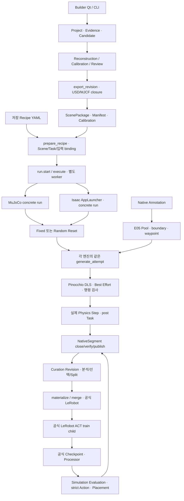

# Robot Learning Workbench — 전체 구조·복잡도 감사

2026-10-27. **현재 구조를 폐기하거나 새 Framework로 바꿀 근거는 없다.** 공식 엔진 실행을 소유하는 두 구현과 작은 Scene 계약·Native 저장 경계는 필요하다. 단순화할 부분은 일부 공통 계산의 잘못된 소유 위치, 넓은 코드 identity 범위, 반복 조회/결과 조립, Builder 비교 계산의 중복이다. **UI는 기존 함수를 연결하는 작업이 중심이지만, 현재 상태로 모든 화면을 연결만 하면 완성되는 것은 아니다.** 실행 가능 단계·목표 달성·Preview 데이터·명령 정책의 차이를 먼저 명확히 해야 한다.

이번 작업은 소스·설치 SDK·SPEC·기존 증거의 **읽기 전용 감사**다. 제품 코드/시험/의존성/Scene/Dataset/기존 증거를 수정하지 않았다. 엔진·Training·장치·회귀 시험을 새로 실행하지 않았다. 아래 KEEP/SIMPLIFY/REMOVE CANDIDATE/OPEN은 분류와 권고이며 리팩터링 승인이나 새 설계의 채택이 아니다.

## 1. 감사 기준과 현재 규모

현재 세 패키지의 `src/**/*.py`를 정적 목록·AST·실제 import/call/등록 경로로 조사했다. Python 소스는 **66개·15,777줄**이며 빈 initializer와 추적된 Mimic reference 소스도 포함한다. 줄 수는 위험 신호를 찾는 자료일 뿐, 필요성이나 품질의 점수가 아니다.

| 제품 경계 | 파일 / 줄 | 실제 역할 |
|---|---:|---|
| scene_contract | 3 / 645 | Builder와 Workbench가 공유하는 불변 Scene 파일 계약·Frame/SE(3)·보정 선언 관계 |
| real2sim_builder | 15 / 5,622 | 편집 프로젝트·증거·재구성·정합·후보 검토·USD/MJCF Export·별도 Qt UI |
| robot_learning_workbench | 48 / 9,510 | 저장 Recipe/worker·Task·실제 엔진 단계·Native/Curation/LeRobot·Robot 계산·ACT 실행 |

Git 저장소가 없으므로 Git diff/log/blame/commit을 수행했다고 주장하지 않는다. 사용자가 요청한 **현재 전체 코드**를 기준으로 고정했다. 감사 전 제품/시험/설정·SPEC/계획·기존 보고서 **168개 파일의 SHA-256**을 기록했고 감사 후 대조했다. snapshot 목록의 정렬 JSON SHA는 `830b9d7d375ac3090b5d3e95c9f53c9ebc9a80d114037fe40a5a77b7e901af2b`다. 외부 SDK/대용량 corpus/모든 과거 증거의 전수 무결성 감사를 이번에 다시 한 것은 아니다.

적용한 실제 Skill은 source-driven-development, code-review, code-simplification, documentation-and-adrs다. code-review의 두 축은 독립 agent가 병행 조사했으며 결과는 끝의 Standards/Spec에 구분했다. 이번에는 변경 diff 대신 현재 snapshot과 명시 요구를 대조했다. code-simplification은 **후보 탐색까지만** 적용했다. 새 ADR로 미승인 결정을 확정하지 않는다.

기준 문서는 [Architecture](architecture.md), [Interface](interfaces.md), [todo](../tasks/todo.md), [plan](../tasks/plan.md), 관련 SPEC과 [Native C](native-dataset-transition.md), [최신 Random](random-placement-horizontal.md) 보고서다. SDK는 설치된 Isaac Lab2.3.0·Isaac Sim5.1·MuJoCo3.3.7·LeRobot0.4.1·Pinocchio2.7.0 소스/고정 계약을 기준으로 했다. 최신 버전으로 교체할 것을 권하지 않는다.

## 2. 실제 실행 구조

그림의 F/G는 **논리 흐름 표시**다. 공통 Engine 실행 Adapter/Manager가 존재한다는 뜻이 아니다. 실제로는 `engines/mujoco`와 `engines/isaac`가 각자의 객체·step·수명을 소유한다. Source→Annotation도 해당 엔진의 `run/collect_episode/replay_episode`가 Native 경계를 직접 호출한다.

Builder는 Workbench의 하위 단계가 아니다. Builder Qt는 `QProcess`로 Builder CLI를 실행하고 자체 Project/Candidate 상태를 관리한다. Workbench는 Scene 패키지를 입력으로 받는 별도 Recipe/worker 제품이다. 두 worker를 한 Framework로 합칠 필요는 발견하지 못했다.

## 3. 모듈별 실제 함수·입출력·책임

아래 경로의 함수 이름과 줄은 감사 시점 소스 기준이다. 입력→출력을 함께 표시하며, 등록/API 존재와 실제 Workflow 지원을 구분한다.

| 영역 / 실제 소유 함수 | 입력 → 출력 / 핵심 실행 | 의존·판정 |
|---|---|---|
| [Builder project.py](../real2sim_builder/src/real2sim_builder/project.py) `Project:431`, `Candidate:1554`, `import_reference:825`, `import_session:1286`, `import_snapshots:1469` | 저장 프로젝트·영상/측정/모델/캡처 → working Scene·증거·후보·상태. `save_scene`, `signature`, `promote/rollback`이 편집/검토 이력을 소유 | **KEEP**, 내부 책임은 SIMPLIFY 후보. 원본 import와 immutable Export는 다른 수명 |
| [reconstruction.py](../real2sim_builder/src/real2sim_builder/reconstruction.py) `import_scan:117`, `registration:130`, `segment:252`, `run:905` | scan/ROI·landmark·제약·실제 이미지 → registration/Geometry 후보·비교/부족 자료/종료 상태 | **KEEP**, 반복 비교 계산은 SIMPLIFY. `run`은 영상 추출→분석→정합→검토 반복. 별도 범용 재구성 Manager 없음 |
| [camera.py](../real2sim_builder/src/real2sim_builder/calibration/camera.py) `project_point:26`, `fit_cameras:43`; [geometry.py](../real2sim_builder/src/real2sim_builder/calibration/geometry.py) `reference_geometry:183`, `fit:310`, `fit_depth_geometry:576`; [physics.py](../real2sim_builder/src/real2sim_builder/calibration/physics.py) `fit:31` | K/extrinsics·이미지/깊이·Geometry/trajectory → 잔차·정합 후보·물성 추정 근거 | **KEEP**. 추정/수치 fit을 실물 검증 완료로 바꾸지 않음 |
| [export.py](../real2sim_builder/src/real2sim_builder/export.py) `copy_native_asset:89`, `verify_native_closure:172`, `export_revision:295`; [usd.py](../real2sim_builder/src/real2sim_builder/exporters/usd.py), [mjcf.py](../real2sim_builder/src/real2sim_builder/exporters/mjcf.py) | 수락/명시 검토 Scene·모델/asset → 상대 참조의 새 Scene Revision·Manifest·USD/MJCF | **KEEP**. 수집/경로 수정/closure/publish가 실제 기능. exporter와 engine runtime compiler는 다른 책임 |
| [package.py](../scene_contract/src/scene_contract/package.py) `load_scene:510`, `verify_files:77`, `validate_scene:459`; [transforms.py](../scene_contract/src/scene_contract/transforms.py) `resolve_transform:71` | scene.json → hash로 고정된 읽기 전용 ScenePackage; Frame Graph → reference matrix | **KEEP**. native 내부 참조 검사는 Builder closure, 패키지 파일/보정 선언 검사는 여기서 담당 |
| [robot/calibration.py](../robot_learning_workbench/src/robot_learning_workbench/robot/calibration.py) `PrecisionMapper:226`, `profile_for_model:362`, `mapper_from_scene:426` | role/phase·profile·원/실행 모델 bytes → Encoder↔model 계산/binding | **KEEP**. S02의 baked/runtime 선언 검사와 RO01의 실제 계수/encoder 계산은 중복 기능이 아님 |
| [robot/devices.py](../robot_learning_workbench/src/robot_learning_workbench/robot/devices.py) `Follower:57`, `Leader:202`, `CalibrationDevice:218`, `CameraReader:297`; [capture.py](../robot_learning_workbench/src/robot_learning_workbench/robot/capture.py) `align_measured:89`, `prepare_snapshot:206` | 명시 SDK 구성·승인/identity·실제 측정 packet → 수명/오류·시간 정렬·검증 Snapshot | **KEEP**. 실제 연결·토크·close 오류의 소유권 때문에 필요한 SDK 경계. 실제 검증/통합 runner는 별도 OPEN |
| [recipe.py](../robot_learning_workbench/src/robot_learning_workbench/recipe.py) `read_recipe:149`, `prepare_recipe:310`, `verify_prepared_inputs:425`; [tasks/registry.py](../robot_learning_workbench/src/robot_learning_workbench/tasks/registry.py) `load_registry:173`, `resolve:228`, `validate_params:408` | 저장 YAML·명시 Task 모듈 목록·Scene/입력 → PreparedRun·binding·필수 runtime 검사 목록 | **KEEP**, identity 범위/반복 검사는 SIMPLIFY. Task Registry는 사용자 요구 T01이며 자동 검색 Plugin이 아님 |
| [run.py](../robot_learning_workbench/src/robot_learning_workbench/run.py) `start:148`, `_run_stage:357`, `execute:379` | StartRequest → 배타 claim·RunHandle·child; WorkerRequest → StageResult·terminal 결과 | **KEEP**. IPC/중복 실행과 Dataset publish는 서로 다른 원자성 경계 |
| [MuJoCo model.py](../robot_learning_workbench/src/robot_learning_workbench/engines/mujoco/model.py) `build_model:214`, [state.py](../robot_learning_workbench/src/robot_learning_workbench/engines/mujoco/state.py) `snapshot:12`, `restore_episode:26`, [control.py](../robot_learning_workbench/src/robot_learning_workbench/engines/mujoco/control.py) `command_target:10`, `step:21` | Scene+ModelConfig → MjModel/bindings; state/target → 실제복원/Step/sample | **KEEP**. calibrated robot·Finger Collision·실제 native state. 엔진 API를 덮는 범용 Env 없음 |
| [Isaac env_cfg.py](../robot_learning_workbench/src/robot_learning_workbench/engines/isaac/env_cfg.py) `execution_inputs:14`, `build_env_cfg:138`, [state.py](../robot_learning_workbench/src/robot_learning_workbench/engines/isaac/state.py) `restore_episode:38`, [mdp.py](../robot_learning_workbench/src/robot_learning_workbench/engines/isaac/mdp.py) `apply_joint_targets:29` | Scene+명시 settings → 공식 ManagerBasedEnv/Articulation/Camera/ContactSensor; 상태·target → 실제 Step/sample | **KEEP**. ManagerBasedEnv는 공식 Isaac API이며 새 Workbench Manager가 아님. packaged v8 execution USD 사용 |
| 양 엔진 [Source](../robot_learning_workbench/src/robot_learning_workbench/engines/mujoco/source.py) / [Isaac Source](../robot_learning_workbench/src/robot_learning_workbench/engines/isaac/source.py) `run/collect_episode/reset_placements` | Leader model-rad 입력·초기 상태 → pre-step 수치/영상·실제 적용→Native Source | **KEEP**. recording_only이며 `ep.success=True`를 Placement 성공으로 해석하면 안 됨. Source clipping은 아래 정책 OPEN |
| 양 엔진 [Annotation](../robot_learning_workbench/src/robot_learning_workbench/engines/mujoco/annotation.py) / [Isaac Annotation](../robot_learning_workbench/src/robot_learning_workbench/engines/isaac/annotation.py) `run/replay_episode` | Source original initial·actions·manual/auto → 실제 재생·post tracker·boundary·Native Annotation | **KEEP**. Source 초기 상태와 Annotation 재측정 initial의 소유권/lineage를 구분 |
| 양 엔진 [DataGen](../robot_learning_workbench/src/robot_learning_workbench/engines/mujoco/datagen.py) / [Isaac DataGen](../robot_learning_workbench/src/robot_learning_workbench/engines/isaac/datagen.py) `load_inputs/run/generate_attempt` | Native Annotation·배치·Mimic seed/예산 → waypoint/DLS/실제 Step·Task·성공 Episode/실패 attempt | **KEEP**, report/publish 조립 중복만 SIMPLIFY. Fixed/Random은 같은 `generate_attempt` 사용 |
| [generation/mimic.py](../robot_learning_workbench/src/robot_learning_workbench/generation/mimic.py) `source_pool:96`, `plan_subtask:192`, `solve_dls:291`, `SO101Kinematics:319` | 공식 EpisodeData·boundary/현재 pose·측정 q/직전 applied target → waypoint·유효 IK candidate/진단 | **KEEP**. CPU reference 수학과 Pinocchio 모델/Data를 소유. 자체 IK Solver 선택 Framework 없음 |
| [tasks/pick_place.py](../robot_learning_workbench/src/robot_learning_workbench/tasks/pick_place.py) `StableGrasp:15`, `placement_details:114`, `grasp_and_placement:247`; [placement.py](../robot_learning_workbench/src/robot_learning_workbench/tasks/placement.py) `fixed_xy:173`, `random_workspace:564` | measured post-step/contact/target-local points → bool/latch/metrics; Geometry/Workspace → Pose | **KEEP**. Task 성공과 정상 실행 완료는 다른 값. legacy/contact/new workspace 규칙의 외부 노출은 정리 가능 |
| [data/native.py](../robot_learning_workbench/src/robot_learning_workbench/data/native.py) `NativeRun:207`, `NativeSegment:264`, `load_catalog:145`, `resume_to:389` | 공식 EpisodeData·MP4·필수 Metadata → 닫힌 official HDF5 segment·attempt·안전 publish·새 출력 Resume | **KEEP**. 자체 bulk Dataset format·별도 optimizer/Reader 재구현이 아님. 완료/미완료·실패/성공을 분리 |
| [curation.py](../robot_learning_workbench/src/robot_learning_workbench/data/curation.py) `save_curation:9`, `distribution:246`, `split_dataset:300`, `review_frame:346`; [lerobot.py](../robot_learning_workbench/src/robot_learning_workbench/data/lerobot.py) `materialize:213`, `merge:201` | 원본 Catalog→선택/구간/split Revision·분포/영상 검토→공식 LeRobot projection | **KEEP**. 원본 수치/MP4 불변, 영상 공유. Worker 단계 연결은 아직 없음 |
| [learning/train.py](../robot_learning_workbench/src/robot_learning_workbench/learning/train.py) `train:85`; [policy.py](../robot_learning_workbench/src/robot_learning_workbench/learning/policy.py) `load_policy:106`, `infer:137`; [validate.py](../robot_learning_workbench/src/robot_learning_workbench/learning/validate.py) `evaluate:10` | 공식 Dataset/config→공식 CLI child·Checkpoint; 모델/processor+batch→후처리 model-rad; val→독립 오차 지표 | **KEEP**. ACT만 지원. SmolVLA의 Dataset/processor 확인과 Training 지원은 다름 |
| 양 엔진 [Evaluation](../robot_learning_workbench/src/robot_learning_workbench/engines/mujoco/evaluation.py) / [Isaac Evaluation](../robot_learning_workbench/src/robot_learning_workbench/engines/isaac/evaluation.py) `rollout/run` | Checkpoint·Fixed initial·실제 RGB/pre q → official ACT→strict target→Step→Placement/실패·Native | **KEEP**. 성공은 Placement. grasp/transport/full_task_success는 추가 지표 |
| [Builder ui.py](../real2sim_builder/src/real2sim_builder/ui.py) `Window:14`; Workbench UI는 파일 없음 | Builder Project/후보→QProcess CLI·상태/영상/Export; Workbench는 아직 CLI/함수 API만 존재 | **OPEN/미구현**. Builder Qt를 전체 Workbench Qt가 있다고 오인하면 안 됨 |

## 4. 사용자 설정과 내부 상태의 경계

| 영역 | 사용자가 명시하는 입력/설정 | 내부 소유 상태 — UI 설정으로 늘릴 필요 없음 |
|---|---|---|
| Builder | 프로젝트/후보·증거·Scene 값·정합 대상·검토/Export 위치·실제 renderer 선택 | signature·후보 수락/rollback·working lock·실행 iteration·자산 파생 관계 |
| Scene/Calibration | 정확한 Revision·실행 모델/보정 선언·Frame·units·증거 | Manifest digest·파일 검사 결과·profile binding·baked/runtime 중복 검증 |
| Source | engine_config·Leader profile·물체 순서/배치·episodes·수집/Reset 시간·역사 seed | 실제 SDK 수명·pause/step/save/discard·pre/post tick·initial snapshot·Native attempt |
| Annotation | Source/Scene·manual/auto·Task 선언·mark/skip | 실제복원 상태·post tracker·이전 latch·Source/Annotation lineage |
| DataGen | Annotation·선택 물체·Fixed XY 또는 Workspace/Frame/support·Yaw/간격·목표/전체 budget·Mimic seed | Pool/waypoint·DLS 고정 상수·직전 실제 target·claim·actual pose·IK 진단·Task outcome |
| Curation | 선택/제외/순서/구간·분할 membership 또는 split seed·Revision 경로·통계 field/범위·Export/독립 copy | 원본 identity·selection lineage·단위/phase 정합·원 영상 offset·공식 index 재색인 |
| Training/Policy | 공식 ACT config·local Dataset·scratch/resume·닫힌 checkpoint·독립 val 범위 | 공식 optimizer/scheduler/RNG/checkpoint·processor 통계·ACT chunk queue·child 수명 |
| Evaluation | Scene/engine_config·local Policy/control contract·Fixed 배치·attempt 목표/timeout | pre RGB/q·후처리 Action/payload·strict 검사·post Task·실패 category·완료 commit |

Random의 **Pose Seed 설정은 없다**. `execution.seed`가 여전히 필수인 이유는 Mimic/Native Attempt identity다. Curation split seed·Training seed도 별개의 기능이므로 지우면 안 된다. Registry가 받는 모든 Task 옵션/참조가 모든 엔진 단계에서 실행 가능한 것은 아니다.

## 5. 최신 Fixed/Random 감사

### 5.1 공통 실행 경로는 실제로 재사용한다 — KEEP

- MuJoCo `datagen.run:125` → Random이면 `reset_placements(..., None):159`, Fixed이면 기존 reset seed 경로 → **동일 `generate_attempt:171`**.
- Isaac `datagen.run:126` → Random/Fixed Reset 분기 → **동일 `generate_attempt:164`**.
- `generate_attempt` 안의 Pool 선택·Mimic 계획·DLS·기존 엔진 command/Step·post Task·Native 반환은 배치 방식별로 복제되지 않았다. 두 엔진 사이의 loop 차이는 native state/dtype/센서 수명 차이이며, 이를 합치기 위한 공통 Env를 추가할 이유는 없다.

### 5.2 새 Random은 코드에 반영돼 있다 — KEEP

`WorkspaceParams:490`, `random_workspace:564`는 실제 Scene Workspace/Collision을 읽고 `default_rng()`를 인자 없이 호출한다. 150×150mm/24mm 기본 블록의 중심±63mm는 실제 치수에서 계산한다. `polygon_distance`로 표면 거리>=24mm, 고정 obstacle 비중첩을 검사하고 `contact_pose`로 실제 Support 높이를 계산한다. `workspace_reset_poses:619`는 전체 batch를 먼저 만들고 `validate_workspace_payload:643`가 native precision 변환 후 다시 검사한다. 이는 설계 문장만 존재하는 상태가 아니다.

실제 이전 실행 증거는 [Random 보고서](random-placement-horizontal.md), [release 소비자](evidence/random-placement/release-consumer-results.json)에 있다. 양 엔진 각2×399frame·새 출력 Resume를 확인한 **과거 검증 결과**이며 이번 감사에서 엔진을 다시 실행한 결과가 아니다.

v8 Marker 로컬 평면은 World에 대해2.604° 기울어져 있다. 새 배치는 이 실제 평면을 사용하며 World 수평화가 아니다. 미래 v9용 `project.validate_horizontal_layout:1914`도 실제 구현돼 있으나 **현재 제품 호출자는 없고 opt-in API/시험만 존재**한다. Builder UI/Export가 자동 호출한다고 보면 안 된다. 이를 신규 요구로 의도적으로 준비한 API이므로 Dead Code 제거 후보로 분류하지 않는다.

### 5.3 남은 Seed/Legacy는 용도별로 구분한다

| 경로 | 실제 사용 여부 | 감사 판단 |
|---|---|---|
| 새 `random_workspace` Pose RNG | DataGen 실행 중 no-argument default_rng | **KEEP**. Pose seed/state restore 없음 |
| `generation.mimic.RandomStream`, `attempt_seed`, Native claim Seed | boundary·source/noise 계산 및 역사 Attempt에 사용 | **KEEP**. Pose RNG와 무관; 지우면 Baseline 의미 손상 |
| MuJoCo Fixed `reset_rng` stream | Fixed DataGen의 기존 순서/역사 상태 경로에 남음 | **KEEP 우선**. 새 Random branch에서는 생성/advance하지 않음 |
| `random_xy`, `contact_random_xy` | 신규 DataGen에서는 거부하지만 등록된 Source/Evaluation 및 해당 Reset에서 호출 가능 | **SIMPLIFY 노출 / 삭제는 OPEN**. 저장소 내 실제 가능한 경로가 있어 Dead Code가 아님 |
| `environment_seed`, `datagen.reset_seeds` | 제품 내부 caller 없음, 기존 시험에서만 직접 호출 | **REMOVE CANDIDATE**. 외부 Python API 사용은 확인되지 않았으므로 확정 삭제 아님 |
| reference selection registry/전략 | `make_selection_strategy`를 통해 실제 사용. 현재 production configuration은 nearest_neighbor_object | **KEEP/OPEN**. 다른 전략도 pure API/회귀에서 도달 가능. 새 Plugin 시스템이 아니라 추적된 upstream subset |

등록 목록 전체를 UI DataGen 선택지로 그대로 보여주면 이미 거부되는 legacy Random이 나타난다. 새 DataGen 화면에서는 현재 승인된 Fixed와 `random_workspace`만 보여주는 것이 최소 조치다. Source/Baseline의 의미까지 몰래 바꾸면 안 된다.

### 5.4 Isaac fresh worker 제약은 UI 결과 해석에 영향을 준다 — OPEN

Isaac Random은 `datagen.py:180`에서 한 attempt 뒤 break하고 `fresh_worker_required:181`를 반환한다. 이 필드는 제품에서 **생산자만 있으며 다음 worker를 실행하는 소비자는 없다**. `run.execute`는 StageResult의 `completed`를 worker terminal로 기록한다. 따라서 **worker가 완료됐어도 목표 성공수는 미달일 수 있다**. Task success, `target_reached`, `budget_exhausted`, `fresh_worker_required`를 별도로 보여줘야 한다.

이 한도를 모든 Isaac 단계의 전역 정책으로 일반화하면 안 된다. 명시적인 one-attempt break는 신규 Random DataGen 경로에 있다. 다른 Source/Fixed/Evaluation에는 반복 loop가 존재하고 Annotation은 별도 단일 Episode 관문이 있다. loop가 있다는 사실만으로 같은 앱 반복 동등성이 검증됐다는 뜻도 아니다.

현재 구조로도 사용자가 새 출력/worker Resume를 명시하면 이어갈 수 있다. 같은 앱 Reset 관문을 임의로 풀거나 자동 반복 Manager를 추가할 필요는 없다. 다만 UI가 한 번의 시작으로 전체 목표를 끝낸다고 표시하면 잘못된 연결이다. 실제 v9/다중 env/장시간 실행 지원을 이 성공 표본으로 확대하면 안 된다.

## 6. 필요한 복잡도 — 제거하지 않을 것

1. **Scene/모델/보정 identity와 source/execution 구분.** stale assets·보정 이중 적용·잘못된 joint order는 실제 물리/실물 의미를 바꾼다. S01 파일 검사, S02 선언 관계, RO 계수 binding, engine 실제 모델 binding은 같은 검사의 이름만 바꾼 것이 아니다.
2. **Native staging→close→검사→fsync→rename 및 미확정 claim.** 공식 HDF5 Writer의 write/flush나 LeRobot save/finalize만으로 과거 완료 Dataset 보존·중단 원자성을 얻지 못했던 반례가 있다. [Native 조사](dataset-storage-review.md)와 [전환](native-dataset-transition.md)의 근거를 유지한다.
3. **독립적인 Request/Command idempotency와 Dataset commit.** 중복 UI 클릭·중복 물리 step 방지는 run.py, 부분 Episode 공개 방지는 Native가 맡는다. lock 이름이 둘이라는 이유로 합치면 보호 경계가 깨진다.
4. **수치/Action 의미 구분.** pre measured observation, solver command, applied payload, post state, Task 결과는 서로 다른 데이터다. B02/L03의 dtype·phase 차이 때문에 이 배열들을 “중복 저장”으로 지울 수 없다.
5. **실제 적용 dtype의 명령/Geometry 재검사.** Policy original→payload 변환, DLS previous-applied jump, Random native Pose 경계는 변환 후 새 위험을 검사하므로 필요하다. 임의 tolerance 확대나 command clipping으로 치환하면 안 된다.
6. **SDK 수명·Stop/close·unknown effect.** configure가 예외 전에 토크를 켤 수 있고 port 정리가 실패할 수 있다. Follower/Leader 경계는 단순 전달 Wrapper가 아니다. Stop의 “새 명령 차단/마지막 hardware target 유지”와 Policy 실패 시 자동 fallback Hold는 구분한다. 둘 다 실물 안전 검증 완료라는 뜻은 아니다.
7. **MP4 수명·공유 및 선택 offset.** AsyncVideoWriter는 bounded queue·worker 오류 전달·flush/abort·원 PTS를 소유한다. LeRobot 기본 이미지 인코딩으로 대체하면 원 MP4 재인코딩/품질 변경이 생길 수 있다.
8. **명시 Task Registry와 두 실제 엔진.** Task 추가 계약과 engine별 physics/센서 수명은 현재 요구다. 공식 Isaac ManagerBasedEnv와 Workbench의 새 범용 Manager를 혼동하지 않는다.

## 7. 먼저 단순화할 후보 9개

현재 코드 안에서 줄일 수 있는 범위만 제안한다. 새 Manager/Adapter/서비스·설정 언어를 제안하지 않는다. 위험도는 변경을 실제 수행할 때의 수준이며, 이번 감사에서 코드를 줄이지 않았다.

| 우선 / 분류 | 실제 파일·함수·caller / 왜 복잡한가 | 최소 변경과 간단해지는 점 | 영향·위험 |
|---|---|---|---|
| **1 SIMPLIFY** | `recipe.prepare_recipe:404–411`은 각 simulation 단계에 Source/Annotation/DataGen·robot.devices·Mimic 등을 넓게 hash. `verify_prepared_inputs`→execution_contract→Native semantic identity로 실제 사용됨 | **실제 단계가 호출하는 파일 목록**으로 좁히기. 다른 단계 수정만으로 현재 단계 Resume가 막히는 결합 감소 | 공유 record/cleanup/calibration caller는 남겨야 함. Scene/모델/Task hash를 삭제하는 제안 아님. 과거 code identity와 continuation 처리 결정 필요. **중간** |
| **2 SIMPLIFY** | `run.execute:412`와 각 concrete runner 진입이 `verify_prepared_inputs`를 호출. `scene_contract.load_scene:535`는 매번 전체 파일 SHA를 검사. 공개 직후 `source.publish_event:143`→`run._stage_event:349`→run 종료 count 검사에서도 Catalog를 반복 읽음 | 같은 프로세스·같은 검증 시점의 중복 조회부터 정리. worker trust boundary/입력 변경 검사/종료 commit 확인은 유지 | Native load_catalog는 Header/Metadata/영상 크기 검사이며 매번 payload SHA를 전수 재검사하는 것은 아님. **병목 측정 전**이므로 속도 향상을 수치로 약속하지 않음. **중간** |
| **3 SIMPLIFY** | Isaac Source/Annotation/DataGen/Evaluation이 `engines.mujoco.source`의 record/add_initial/control_commands/step_completed/publish_event, `mujoco.annotation`의 검증, `mujoco.evaluation`의 공통 outcome/Policy 검사를 import | 엔진 비종속인 함수만 기존 데이터/Task/Policy 소유 파일로 이동하거나 이름/소유권을 명확히 하기. “Isaac이 MuJoCo 엔진에 의존한다”는 오해·넓은 code hash 줄이기 | 실제 MJ physics 의존은 아니고 top-level에 native engine 자동 실행도 없음. record dtype·phase·오류 경계는 그대로. 공통 Env/adapter를 만들지 않음. **중간** |
| **4 SIMPLIFY** | 양 `datagen.run`의 report→ik_summary/last IK→source lineage→record_attempt/commit 조립이 반복. 두 `generate_attempt`는 native 부분과 공통 진단 조립이 섞임 | 동일 report/lineage 계산만 기존 generation/data 함수로 공유. physics/camera/previous-applied 수명 loop는 엔진별 유지 | post-step 순서·Task 채택·실패 seal을 통합하다 바꾸면 위험. 첫 변경은 순수 결과 조립부터. **중간** |
| **5 SIMPLIFY** | `project.Candidate.evaluate:1663–1694`와 `reconstruction.validate_scene:776–815`가 관측 선택·RGB 로드·posed render·비교/preview 흐름을 반복. 후보 CLI/UI와 재구성 run 양쪽에서 도달 | 같은 관측 비교 계산만 기존 validation 함수로 공유. 같은 잔차 식의 변경 지점 감소 | RenderOnly와 검증/승격 gate는 다르므로 전체 Workflow를 합치면 안 됨. 정합 수치·split/근거·출력 경로 회귀 필요. **중간** |
| **6 SIMPLIFY / OPEN** | `recipe.py:421`의 code_identity는 basename key, `mujoco.source.execution_contract:153`도 basename, Isaac `source:97`은 full path. 실제 prepared.json에 두 source.py와 두 annotation.py가 존재 | package-relative key 등 **현재 identity 표현만 일관화**. 같은 이름 파일이 요약 digest에서 덮어써지는 혼란 제거 | full `effective_settings.code_files` 및 Isaac Native workflow map은 보존됨. **Isaac Resume 보호가 뚫렸다고 입증된 것은 아님**. 경로 이동/old record 비교 영향 검토. **중간** |
| **7 REMOVE CANDIDATE** | `placement.environment_seed:205`, `mujoco.datagen.reset_seeds:15`, `native.mimic_episodes:180`: 제품 내부 caller 없음. 각각 `test_placement.py:196`, `test_datagen_workflows.py:14`, `test_native_dataset.py:90`에서 호출 | 역사 계산 검증용 helper를 시험 쪽으로 옮기거나 공개 API 필요성 확인 후 제거. 실행 API에서 역사 보조 함수 감소 | 로컬 정적 검색이 외부 Python caller 부재를 증명하지는 않음. **확정 Dead Code 아님**. pool 순서/RNG 기대값 자체를 삭제하지 말 것. **낮음~중간** |
| **8 REMOVE CANDIDATE** | Builder `export_revision(engine_sources=...):295/305`는 nonempty 입력을 거부만 함. 확인된 호출은 `test_builder_export.py:189` negative test와 Interface 문서 | UI에는 미지원 옵션을 노출하지 않기. 필요성이 없다면 이 placeholder 인자를 제거하고 실제 authored exporter 경계만 남기기 | 지금도 기능을 우회하지는 않음. signature/오류 계약 변경이므로 사용자/API 확인 뒤. **낮음~중간** |
| **9 SIMPLIFY** | Architecture/초기 SPEC의 상태·목표 트리와 실제 구현/최신 append 절이 병존. Recipe는 14개 stage를 선언하지만 Runner는 simulation4+learning2만 실행 | 현재 실행 지원 표와 문서 상태를 한 번 명료하게 정리. UI는 파싱 가능 목록을 실행 가능한 메뉴로 그대로 사용하지 않기 | 제품 기능 삭제나 새 capability registry 도입 불필요. 반복 상태 해석·늦은 STAGE_UNAVAILABLE 감소. **낮음** |

`project.py`1950줄과 `reconstruction.py`1035줄은 읽기 부담이 크지만, **길다는 이유만으로 분해를 최우선으로 권하지 않는다**. 위5번처럼 실제 반복되는 계산을 먼저 정리하고, Project/Candidate 수명과 증거 import의 구체적 변경 충돌이 확인될 때만 기존 책임 파일 안에서 나누는 것이 낫다.

## 8. 공식 SDK 재사용과 자체 구현의 적절성

| 현재 경계 | 공식 기능과 실제 재사용 | 추가 자체 코드에 대한 판단 |
|---|---|---|
| Native HDF5 | `native_api:100`이 수정하지 않은 공식 EpisodeData/HDF5DatasetFileHandler를 반환. write_episode/flush/close/load_episode 호출 | 자체 HDF5 serializer를 다시 만든 것이 아님. segment/완료 seal·Source 문자열/lineage Sidecar는 **KEEP**. 공식 RecorderManager로 모든 MuJoCo/실물 단계를 감쌀 필요 없음 |
| LeRobot 변환 | 공식 LeRobotDataset.create·Metadata·statistics·`_save_episode_data`·finalize 직접 사용 | 이미 materialize가 유일한 변환/merge writer. 중복 구현은 없음. private `_save_episode_data` 의존은 **OPEN 유지보수 경계**지만 pinned0.4.1의 무손실 영상 공유 요구를 기본 add_frame/save_episode가 대체하지 못함 |
| Train/Policy | 공식 CLI subprocess, ACTPolicy.from_pretrained, 공식 processor/select_action; optimizer/scheduler/queue 자체 구현 없음 | Workbench의 config/publish/checkpoint·실행 종료 검사는 **KEEP**. 별도 custom Trainer/Policy Framework로 바꿀 이유 없음 |
| Mimic reference | 원본 추적/라이선스가 있는 CPU math/Pool/selection/waypoint subset | ~1,443줄(reference Python, initializer 포함). 독자 Framework를 처음 만든 것이 아님. 현재 고정 환경의 정상 top-level import가 simulator를 요구하므로 바로 전체 공식 DataGenerator로 교체하는 것은 drop-in 단순화가 아님. 공식 CPU-only 공개 경계로 동일 호출/seed 결과가 확인될 때만 대체 검토 |
| SO101 FK/DLS | 공식 Pinocchio model/Data/Jacobian/log3/integrate 위의 고정 수치 loop | generic IK 기능과 Workbench의 기존 수식/가중치·직전 actual target guard는 같지 않음. **KEEP**. 공식 다른 Solver로 바꾸는 것은 동작 보존 리팩터링이 아님 |
| Builder exporters/runtime | OpenUSD/공식 MJCF API, native closure/상대 참조 수집; E01/E02 runtime은 동적 robot/sensor/controller 구성 | Builder 정적 authoring exporter와 engine model compiler가 모두 XML/USD를 만진다는 이유만으로 중복으로 제거하면 안 됨 |
| SDK Device/CameraReader | 공식 device/bus/camera 객체 사용, connect/configure/read/send/cleanup 의미 보완 | configure 오류 후 토크·port 해제·unknown effect와 timestamp 수명 때문에 필요한 경계. Wrapper라는 이름만으로 제거하지 않음 |
| RGB/수치 통계 | Curation의 선택 구간 streaming·공통 histogram·phase/unit/frame 검사; materialize는 공식 학습 statistics 사용 | 두 통계는 목적/대상이 다름. 일반 SciPy/NumPy histogram만으로 Catalog/선택·단위 계약까지 대체할 수 없음 |

공식 설치 소스도 직접 확인했다. Isaac `hdf5_dataset_file_handler.py:139–182`의 write는 group/attrs/배열을 순서대로 기록하며 자체 원자적 segment publish를 제공하지 않는다. LeRobot `lerobot_dataset.py:830`의 `load_hf_dataset`은 local data를 읽고 transform을 설정하며, `:1039` finalize와 `:1237` writer는 Workbench가 실제 호출하는 경계다. 설치 SmolVLA `modeling_smolvla.py:324`는 `actions_id_pad`를 조회한다. 기존 SMOL-PAD-01을 임의 해제할 근거가 없다.

공식 교차 확인: [LeRobot v0.4.1 소스](https://raw.githubusercontent.com/huggingface/lerobot/v0.4.1/src/lerobot/datasets/lerobot_dataset.py), [MuJoCo3.3.7 native Python API](https://mujoco.readthedocs.io/en/3.3.7/python.html). Isaac2.3 Dataset 웹 페이지는 조회 도구로 접근되지 않아 `/home/hyeonhee/IsaacLab/source/isaaclab/isaaclab/utils/datasets/hdf5_dataset_file_handler.py` 설치 파일을 기준으로 했다. “최신 공식 API로 다 대체할 수 있다”는 추측을 하지 않았다.

## 9. 사용자 요구와 실제 구현의 차이

### 9.1 No-Clipping은 현재 전체 경로의 공통 정책이 아니다 — OPEN

P01 Policy는 `policy.preflight_action:25`에서 원 Action과 실제 dtype payload를 엄격하게 검사한다. DataGen은 `solve_dls/best_effort_candidate` 뒤 실제 engine preflight·0.5rad 이전 applied target guard를 사용하고 잘못된 후보를 Hold/fallback으로 바꾸지 않는다.

**Source는 다르다.** MuJoCo `collect_episode:122`→`source_target:315–320`은 Leader requested를 `np.clip`한 뒤 command_target에 전달한다. Isaac `collect_episode:55`도 `np.clip(requested,limits)`를 호출한다. `robot.control.command_target:30/34`의 Teleop 공통 범위 clipping도 남는다. 이는 과거 Source/Teleop 보존 계약으로 명시돼 있고, 최신 사용자의 “관절 명령 Clipping 금지”를 전체 제어 경로에 적용한 구현은 아니다.

이 부분을 UI에서 “모든 명령 무보정”으로 설명하면 안 된다. Source도 초과 즉시 거부해야 하는지, 기존 보존 계약을 별도로 유지할지 결정이 필요하다. **이번 감사에서는 어느 쪽으로도 변경하지 않았다.** DLS `inverse_kinematics:414–419`의 반복 내부 joint-limit projection, polygon 거리 계산의 선분 투영 clamp, RGB 표시 범위 변환, Camera 보간의 gripper last sample은 최종 command clipping/자동 Hold와 각각 의미가 다르다. 단순 `np.clip` 검색만으로 모두 안전 위반 또는 불필요 코드로 판정하지 않는다.

### 9.2 새 Scene 전체 지원은 아직 좁다 — OPEN

Builder에서 Scene을 불러오고 수정/Export하는 경로는 있다. 다만 현재 engine binding은 검증한 SO101/v8 계약을 명시적으로 요구한다. Isaac `execution_inputs:31`은 profile/task/physics/compiled_physics Metadata와 하나의 baked 실행 URDF/native USD를 요구한다. MuJoCo `build_model:232–234`는 package의 `provenance.json/original_scene`·compiled physics 정보를 사용한다. 원본 repo fallback은 아니지만 **임의 새 Scene Export가 곧바로 모든 Workflow에서 실행된다는 일반성은 확보되지 않았다**.

새 수평 Scene validator는 자동 생성기·재보정·모델 binding 갱신기가 아니다. 향후 v9 UI 흐름에서 현재 필요한 패키지/engine 설정이 실제로 생성되는지 확인해야 한다. 기존 v8 Calibration을 새 Scene에 자동 승계/승인할 수 없다.

### 9.3 등록 가능한 Task와 실행 가능한 Task의 폭이 다르다 — OPEN

T01은 명시 함수·params·참조를 검사하지만 concrete DataGen은 `params.object/target`, 단일 tool0, `trackers['grasp']`를 가정한다. Source의 임의 signal/metric 및 Annotation/DataGen의 일부 standalone metric은 오류로 거부된다. 이는 fake 성공보다 타당하지만 “모듈 하나 등록하면 모든 임의 Task가 모든 단계에서 실행”되는 상태는 아니다. 현재 v8 Task 지원 범위를 UI와 준비 단계에 명시하는 것이 우선이며 범용 Task scheduler를 제안하지 않는다.

### 9.4 Learning/실물 지원을 넓게 표시하면 안 된다

ACT 공식 학습/Resume/Policy 경계는 구현돼 있다. SmolVLA는 Dataset/processor 준비와 진단 소스가 있어도 `train.validate_config:14`, `policy.load_policy:122`에서 지원 거부한다. 실제 Training은 SMOL-PAD-01로 BLOCKED다. 추가 Solver/Strict/Hold/MiniVLA 실행 UI는 없다.

`infer(...,limits=None)`은 독립 수치 Validation에 사용되며 제어 승인 함수가 아니다. 실제 Evaluation은 strict payload 검사와 engine preflight를 추가한다. Follower는 승인된 Calibration/command phase/모터 범위가 필요하고 실제 Real Evaluation runner도 없다. Phase 없는 관측 mapper를 명령 승인으로 바꾸지 않는다. `devices.Follower` 자체를 명시 구성/활성화하는 저수준 API가 존재한다는 사실과 Workbench가 승인된 실물 배포 흐름을 완성했다는 주장은 구분해야 한다.

## 10. UI 개발 전에 할 일과 그대로 연결할 수 있는 것

| 항목 | 지금 상태 | UI 전/연결 시 최소 조치 |
|---|---|---|
| 저장 YAML 편집·구문 오류·정확한 준비 | `read_recipe`, `prepare_recipe`, CLI validate/prepare 있음 | dirty/저장 상태와 syntax_valid/prepared/runtime-ready를 구분해 연결. 새 설정 저장 체계 불필요 |
| 실행/취소·로그·중복 방지 | start/status/events/send_command 있음 | 기존 API 재사용. cancel ACK completed와 실제 terminal/child 정리가 같지 않을 수 있어, 종료 표시는 terminal 기준 |
| 실제 단계 목록 | Recipe는14종을 선언, Runner는 simulation4+learning2만 dispatch | 파싱 목록을 그대로 실행 메뉴로 쓰지 않기. convert/merge는 직접 함수는 있으나 Recipe worker는 STAGE_UNAVAILABLE. Capture/RealSim/실물/Hub도 runner 미구현 |
| Curation/공식 Export | 일반 함수들이 준비됨. 원본 불변/Revision·split/통계·materialize/merge 직접 호출 가능 | 기존 함수 연결 중심. 큰 통계/MP4 decode를 Qt 메인 스레드에서 수행하지 않기. 새 Curation Manager 불필요; 실행/취소 UI 수명은 아직 별도 검증 |
| Isaac Random 목표 완료 | fresh-worker one-attempt 구현, 결과 flag만 있음 | worker terminal과 target_reached/budget_exhausted를 구분. 필요한 새 출력 Resume를 안내. 현재 자동 연속 실행이 있다고 표시하지 않기 |
| Live Preview | `read_preview:256`/`_stage_event:345`의 slot/generation **Metadata** 계약과 protocol 시험 있음. 실제 stage의 preview 생산자·RGB 공유 buffer/reader는 없음 | 현재 API만 연결해서 실제 live 영상이 나온다고 가정하지 않기. U02에서 실제 frame 전달·해제·backlog 연결이 필요. 저장 RGB를 fake live 값으로 채우지 않기 |
| Fixed/Random 설정 | 새 DataGen 경로 구현·실제 검증 있음 | Fixed/new Workspace Random만 노출. Mimic Seed와 Pose seed를 혼동하지 않기. 혼합 Fixed/Random 대상 batch는 현재 미지원 |
| 수평 신규 Scene | opt-in validator만 준비, 기존 Builder UI가 자동 호출하지 않음 | 신규 Scene 생성 절차에서 명시 적용/실제 재보정·engine binding 검증. 카메라/Robot Calibration 자동 승인 금지 |
| command 안전 설명 | Policy/DataGen과 Source/Teleop 규칙 다름 | No-Clipping 범위 결정 후 동일한 문구/오류를 연결. 임의로 source 동작을 바꾸지 않기 |
| 전체 화면 통합 | Builder Qt만 있음. Workbench `ui/` 디렉터리 없음 | U01~U04는 미착수. 기존 backend 함수를 연결하되 미구현 기능은 구분해서 표시 |

아키텍처 전체를 먼저 다시 쓰는 것이 UI 선행조건은 아니다. **지원 범위/결과 의미/실제 Preview/명령 정책은 필수 연결 과제**이고, hash 최적화·helper 정리·Builder 계산 중복은 동작을 유지하며 별도 작은 변경으로 진행할 수 있다.

## 11. 현재 구조를 유지하는 최소 수정 권장 순서

1. **현재 지원 표와 정책부터 확정.** 실제 실행 가능한 stage/Task, Source clipping 범위, Isaac one-attempt 결과 의미를 정리한다. 이미 구현된 Random을 미착수로 보거나 미구현 UI/실물/Smol을 지원으로 표시하는 일을 막는다.
2. **UI가 호출하는 공개 경계만 명료하게 한다.** 기존 Recipe/Run/Curation/Policy 함수의 인자 타입·상태 의미를 보완하고 Workbench UI가 syntax_valid/prepared/completed/target_reached를 혼동하지 않게 한다. 새 Interface 계층을 만들지 않는다.
3. **실제 Preview 연결을 U02 범위에서 준비한다.** 기존 slot/generation/sequence 의미를 사용하되 현재 없는 RGB payload 수명/생산자 연결을 구현·시험해야 한다. 이번 감사에서는 착수하지 않는다.
4. **code identity의 표현/의존 목록을 정리한다.** 먼저 package-relative 키와 정확한 호출 파일 범위를 검토한다. 기존 실행의 source identity를 몰래 재작성하거나 다른 코드의 Resume를 자동 허용하지 않는다.
5. **엔진 비종속 helper와 결과 조립만 정리한다.** 먼저 순수 report/lineage·명령 ACK·record helper의 소유권을 정리하고, 기존 엔진 loop/Native commit/안전 검사 순서는 보존한다.
6. **Builder 반복 비교 계산을 정리한다.** 후보/재구성에서 같은 계산을 공유하되 검토/수락 절차와 renderer를 억지로 하나로 합치지 않는다.
7. **확인된 작은 제거 후보는 마지막에 결정한다.** 외부 API 사용과 Baseline 시험의 목적을 확인한 뒤 test-only 역사 helper·거부 전용 placeholder를 다룬다. 신규 기능을 추가하기 위한 대규모 정리는 필요 없다.

각 단계는 다음에 별도 구현을 승인할 때의 권장 순서다. 데이터 의미·No-Clipping/Source 정책·Resume identity 변경은 단순 코드 정리와 분리해야 한다. 이번에는 이 순서의 어떤 수정도 시작하지 않았다.

## Standards

독립 Standards 검토는 현재 snapshot과 `docs/architecture.md`, Interface·공통 SPEC 규칙을 기준으로 했다. **문서 기준 Low 1건:** Architecture의 인자 타입 명시 요구에 비해 `prepare_recipe`, `load_catalog`, Builder 공개 함수 다수의 타입 표기가 빠져 있다. 실행 결함의 증거는 아니며 UI가 호출할 공개 함수부터 보완할 수 있다.

**단순화 판단 후보4건:** 실제 단계보다 넓은 code identity, Episode 공개 직후 Catalog 반복 조회, Builder 관측 영상 비교 반복, identity key 표현 불일치. 모두 실제 caller를 확인했으며 앞의 후보1/2/5/6에 반영했다. **제거 검토2건:** 제품 caller 없는 native.mimic_episodes와 거부 전용 export engine_sources 인자. 외부 caller 부재를 증명하지 않았으므로 Dead Code로 확정하지 않았다.

Renderer/BlenderRenderer/for_observation은 실제 렌더·좌표·segmentation·Blender process bridge이므로 KEEP이다. `run.execute(_runner=None):379`는 protocol 시험의 작은 주입점이며 CLI 옵션이 아니다. 테스트 전용 Framework가 생겼다는 근거는 없어 KEEP이다. Native 원자적 publish·SDK cleanup·명령 preflight 역시 제거 후보가 아니다.

Standards 요약: **문서 기준 Low 1건, 단순화 판단4건, 제거 검토2건**. 영향이 큰 후보는 단계별 code identity 범위이며 필요한 무결성 검사를 삭제하는 방향은 아니다.

## Spec

독립 Spec 검토는 최신 Random/No-Clipping/공식 SDK/Native/Task/Workbench UI 요구와 actual call을 대조했다. Fixed/Random이 같은 generate_attempt를 사용하며 새 Random Pose에 Seed/RNG continuation이 없다는 점은 확인했다. history/Mimic Seed를 제거하라는 의미로 해석하지 않았다.

주요 차이4건은 **Source/Teleop에 남은 clipping 정책**, **Isaac fresh_worker_required의 소비자 부재 및 목표와 worker 완료 차이**, **파싱 가능한 stage와 실제 runner 목록 차이**, **일반 Task 등록 계약보다 좁은 concrete workflow 지원**이다. 앞9·10절에 반영했다. 또 초기 Architecture/SPEC의 “미착수” 문구와 최신 구현/추가 절이 어긋나는 문서 상태 문제가 있다.

두 개의 historical seed helper는 제품 caller가 없지만 legacy random 함수들은 Source/Evaluation에서 여전히 도달 가능하다. 신규 DataGen의 UI 노출을 줄이는 것과 과거 실행 경로 삭제는 다른 결정이다. 같은 앱 복수 Reset, 실제 새 Scene/실물 Calibration 및 미구현 단계는 기능이 부족한 관문이지 불필요한 추상화의 증거가 아니다.

Spec 요약: **요구/지원 경계 차이4건 + 문서 상태 차이1건**. 가장 중요한 사용자 결정은 Source를 포함한 No-Clipping 적용 범위이며, 그 다음 UI 연결 관문은 실행/목표 상태와 Preview다.

## 12. 읽기 전용 확인과 미검증 범위

감사 전 고정한 **168개 파일의 SHA-256을 재대조해 변경0개**를 확인했다. 제품/시험/패키징·SPEC/계획·기존 보고서는 그대로이며 이 새 Markdown만 작성했다. 원본 v8/SDK/Dataset을 실행·쓰기 대상으로 사용하지 않았다. 보고서의 로컬 파일 링크도 존재 여부를 확인했다. 이 결과는 모든 외부 Dataset/SDK binary를 새로 전수 hash했다는 의미가 아니다.

이번 감사는 새 Runtime 성공·성능 시험이 아니다. 기존 Random의895 PASS·실제 엔진/Resume·wheel 결과는 해당 보고서의 과거 증거로만 참조한다. 같은 프로세스의 재검증·Catalog 반복 읽기가 성능 병목이라고 새로 측정한 것은 아니며, 모든 외부 Python caller나 동적 호출의 부재를 증명하지도 않았다.

E01 cube–cup1.197188790mm 잔차, 같은 Isaac 앱의 여러 Reset/복수 Annotation·다중 env/장시간, SMOL-PAD-01, MuJoCo float32 strict joint-limit 경계, Follower command binding/motor range·실물 안전성은 그대로 OPEN이다. **산출물은 이 감사 보고서 하나이며 제품 코드 변경·리팩터링·설치·Scene 수정·후속 구현을 수행하지 않고 중단한다.**
