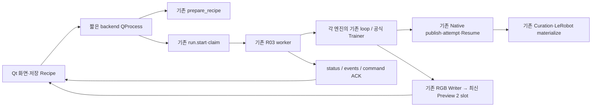

# Phase 0 · U01~U04 · X01 — 실제 Qt Workbench 연결

2026-10-27. **저장 Recipe 중심 UI와 실제 RGB 전달, MuJoCo의 데이터 생성→Curation→공식 ACT 학습/Resume, 양 엔진 ACT Evaluation을 구현·실행했다. 전체 X01은 부분 완료다.** Isaac의 보존 Source Annotation 및 새 Random DataGen은 원래 URDF 한계를 넘는 float32 명령을 strict 정책으로 거부한다. 이 경로를 성공으로 만들기 위해 원본·한계·IK·물리를 수정하지 않았다.

이번 범위는 사용자가 새로 정의한 **U01 기본 UI / U02 Source·Annotation·Preview / U03 DataGen·Curation / U04 ACT·Evaluation / X01 UI 통합**이다. 과거 U03의 Capture/RealSim/Calibration 전체 화면 및 SPEC AC01의 모든 실물/Hub inventory 완료를 뜻하지 않는다. 원본 v8, 고정 SDK, Native C, Builder 자산·정합·물성·Collision, Task 수식은 보존했다. 실제 장치·v9 생성·실측 보정·SmolVLA 수정·P02/P03는 수행하지 않았다.

## 실행 방법과 기본 화면

프로젝트 루트에서 `./run_workbench_ui.sh`를 실행한다. 설치된 Qt 환경과 backend 환경을 그대로 사용하며 설치/업그레이드는 하지 않는다. 기본 작업 위치는 `workbench_runs`이고 `--workspace /새/작업폴더`로 바꿀 수 있다.

- Qt: 기존 `.venv-real2sim-ui/bin/python3.11`, PyQt6/Qt 6.11.0.
- Backend: 기존 `lerobot-arena/bin/python`, Python3.11.15·MuJoCo3.3.7·LeRobot0.4.1·Lab2.3.0/Sim5.1.
- `Scene → Source → Annotation → DataGen → Curation → ACT Training → Evaluation`과 독립 Validation 화면이다. 화면마다 필요한 설정만 보이고, 저장 YAML은 고급 편집으로 분리했다. Loss는 Training 화면에만 있다.
- Scene Package 검사 후 기존 저장 Recipe를 열고 필요한 입력/출력을 바꿔 **다른 이름으로 저장 → 입력 검사 → 실행**한다. 각 엔진 초기화/센서/명령의 런타임 오류는 실행 시 별도로 확인한다. 준비 완료는 물리 성공 보장이 아니다.
- Builder Project를 선택하면 기존 Builder를 별도 프로세스로 연다. 새 Export 결과는 Scene 선택으로 다시 읽는다. 선택적 수평 검사는 기존 `validate_horizontal_layout`만 호출하며 v8의 기울기를 수정하거나 Calibration을 승인하지 않는다.
- Source는 이번에 실물 Leader를 연결하지 않는다. 보존된 실제 Native Source Episode의 목록·영상·수치를 읽고 Annotation 입력으로 선택한다. 물리 수집이 정상 지원되는 것처럼 fake 장치를 노출하지 않는다.
- DataGen 대상은 Recipe의 Object 표에서 선택하고 Frame/Support·Fixed XY 또는 실제 Random Workspace를 명시한다. Random Pose Seed/RNG 복원 UI는 없다. Fixed/Random 혼합 batch는 준비 시 거부한다.
- ACT Config는 공식 JSON을 읽어 device/누적 steps/batch를 편집하고 새 파일로 저장한다. 명시한 Dataset·출력·scratch/resume를 같은 공식 JSON에 기록한 뒤 Recipe를 다시 저장·검사한다. SmolVLA는 차단한다.

## 구현 경계

새 Manager·Engine Adapter·Trainer·Dataset/설정 포맷을 만들지 않았다. 작은 UI operation 분기는 이미 있는 함수들을 호출한다. 새 UI package는 화면별 책임으로 나뉘고, Qt 프로세스는 엔진·Torch·LeRobot을 import하지 않는다. 통계/저장 영상 decode/공식 Dataset 작업은 backend QProcess에서 수행한다.

| 제품 파일 | 역할 |
|---|---|
| `ui/app.py` | 화면 이동·Scene 검사·독립 Builder·종료 시 취소/정리 대기 |
| `ui/recipe_editor.py` | 저장 버퍼·dirty·원본/SDK 덮어쓰기 차단 |
| `ui/workflow.py` | 단계별 입력·배치 대상·준비/실행·Manual 제어·로그/Preview·기존 Run 다시 열기 |
| `ui/jobs.py`, `ui/operations.py` | QProcess의 명시 API 호출·typed 오류 직렬화·실제 지원 조건 검사 |
| `ui/curation.py` | 기존 선택/Trim/Split/Revision/검토/통계/비교/Export/Merge API 연결 |
| `ui/learning.py` | 공식 ACT JSON의 새 파일 편집·실제 공식 loss 표시 |
| `run.py`, `data/video.py` | 기존 IPC를 유지한 실제 RGB payload·조기 child 종료 관측 |
| `robot/control.py`, 양 엔진 `source.py`, Isaac `mdp.py` | 원 command와 실제 dtype payload의 strict 최종 명령 검사 |

### 저장·실행·종료 상태

편집 중/저장됨/문법 유효/Prepared/지원 입력 준비 완료를 구분한다. UI가 검사한 **Recipe SHA와 Prepared SHA**를 StartRequest까지 전달해 외부 파일 변경을 차단한다. Task 선언이 없는 train에서 Worker에 불필요한 Task registry를 넣어 Prepared identity를 바꾸지 않는다. 잘못된 stage와 실패한 화면 편집은 기존 실행 설정으로 몰래 돌아가지 않는다.

Worker terminal과 완료 Native Dataset 재개방 결과는 별도 상태다. DataGen의 `target_reached`, `budget_exhausted`, `fresh_worker_required`를 나누고 새 출력 Resume를 명시적으로 요청한다. 자동 Worker 반복기는 없다. cancel ACK는 종료 확인이 아니며 실제 terminal/child 상태를 기다린다. 시작 직후 child identity를 읽지 못하거나 identity 기록 전에 죽어도 `unknown`이며 자동 재시작하지 않는다.

Manual mark/skip은 현재 Episode/env context를 포함한다. 아직 재생하지 않은 frame은 GUI와 실제 command 경계에서 거부한다. step 완료/mark ACK는 기존 R03의 실제 적용 ACK를 그대로 표시한다.

### 실제 Live RGB

`AsyncVideoWriter.write`에 들어간 **현재 pre-step 실제 RGB**를 320×240 PPM으로 내려 run-owned 임시 폴더에 camera별 2 slot만 유지한다. 각 PPM header의 run/camera/generation과 작은 최신 metadata를 함께 확인한다. 약10Hz 표시 제한이며 저장 영상은 원래640×480·30FPS다. 기존 queue/encoder·원본 저장 timestamp를 바꾸지 않는다.

GUI는 최신 RGB만 읽고 Physics/MP4 decode를 실행하지 않는다. backlog/Streaming Server/별도 영상 Dataset은 없다. 정상 종료/취소는 worker가 Preview를 지우고, UI가 시작한 child의 관측된 비정상 종료는 그 owned Preview만 정리한다. 과거 Run을 다시 여는 것으로 보존 증거를 지우지 않는다. Preview 생성/쓰기/정리 오류는 경고로 분리하며 Native 기록의 성공/실패를 바꾸지 않는다.

## Phase 0 — No-Clipping의 실제 변경과 경계

`checked_target`는 JOINTS 순서의 원래 model-rad 6축과 **float64 원 URDF limits**, 엔진에 적용할 dtype payload를 각각 검사한다. 범위 밖·NaN/Inf·잘못된 shape는 `COMMAND_TARGET_REJECTED`, `command_applied=false`로 거부한다. joint/원값/dtype/한계/초과량/original 또는 payload 단계를 남긴다. Source 수집은 거부된 행을 정상 기록하지 않고 실패 attempt를 seal하며 video/device/Native 정리를 수행한다. SDK 오류의 효과 불명 상태와 순수 명령 미적용을 혼동하지 않는다.

기존 MuJoCo/Isaac Source와 공통 Teleop의 clipping을 제거했다. **공통 Isaac preflight에서 limits까지 float32로 반올림하던 묵시적 허용도 제거했다.** 이 변경은 Source 이외의 Annotation/DataGen에도 사용자의 최종 명령 정책을 적용한다. DLS 반복 내부 projection·Geometry clamp·pixel 변환은 유지한다.

원래 wrist_flex upper=`1.7453264625997165rad`, float32 upper payload=`1.7453265190124512rad`의 차이 **5.641273470580188e-8rad**도 거부한다. 이를 수치 오차라는 이유로 허용하거나 가장 가까운 내부 값으로 바꾸지 않는다.

이 정책 때문에 과거에 통과한 Isaac Source/새 DLS candidate가 이번 strict 계약에서는 거부된다. 이는 Scene/물리/성공 조건 버그 수정으로 수치 동등성을 복구한 결과가 아니라 **명시 승인된 최종 command 정책 변경**이다. 후속 해결에 원본 명령 수정·한계 확대·clipping이 필요하다고 추측하여 실행하지 않았다.

## 실제 UI 실행 결과

모든 시험은 실제 설치 Qt의 offscreen QApplication에서 QTest로 버튼/입력/파일 선택을 조작했다. 대화상자의 파일 선택만 자동화했으며 production Worker/엔진/센서/Writer/Task/Trainer를 대체하지 않았다. 데스크톱에서 사람이 장시간 사용한 UX 검증과는 구분한다. 각 결과의 `results.json`, Live/terminal PNG와 실제 Worker stdout/Native output을 보존했다.

| UI 경로 | 실제 결과 | 증거 |
|---|---|---|
| Scene·보존 Source 입력 | v8 Manifest/Calibration/model 선언 검사·실제 Source 저장 RGB frame 검토 | `ui-smoke`, `ui-failure-restart` |
| 기존 Builder 실행 | 기존 Project 목록의 별도 Builder QProcess 기동·UI 종료 시 child 종료, 편집/Export 요청 없음 | `builder-ui-result.json` |
| MuJoCo Auto Annotation | 388frame·완료1, 최초 post222→저장223 | `ui-mujoco-validated` |
| MuJoCo Manual Annotation | 388frame·완료1, 늦게 전달한 수동 frame203 승인·물리 gate 통과 | `manual-annotation-verified` |
| MuJoCo Fixed DataGen | 새 성공1→새 출력 Resume 누적 성공2, 각각399frame | `connected-mujoco/fixed[-resume]` |
| MuJoCo Random DataGen | 새 성공1, 399frame; Seed 없는 실제 Pose | `ui-mujoco-random` |
| Curation·LeRobot | 원 Episode별 `[5,81)`, `[13,103)` Revision; train76/val90 frame, 공식 train Export76 frame | `connected-mujoco/selected-*.json`, `lerobot-*` |
| 공식 ACT Training | 새 smoke scratch2 step, checkpoint2→누적4 step Resume; 실제 loss/checkpoint | `act-scratch-verified`, `act-resume-verified`, `resume-ui-result.json` |
| MuJoCo Evaluation | 완료 실패1×60 step, 별도 취소1·완료0; Placement 성공0 | `ui-mujoco-evaluation`, `ui-mujoco-evaluation-cancel` |
| Isaac Annotation | 보존 Source 명령 index323의 wrist_flex 초과를 replay 전체 사전 검사에서 거부; 해당 tick까지 재생한 것이 아니며 완료0 | `ui-isaac-annotation-verified` |
| Isaac Random DataGen | 새 worker attempt1 실패→새 출력 Resume attempt2 실패; 두 번 모두 tick348 명령 payload 거부, 완료0 | `connected-isaac/random[-resume]` |
| Isaac Evaluation | 완료 실패1×60 step, 별도 취소1·완료0; Placement 성공0 | `connected-isaac/evaluation[-cancel]` |
| 오류/강제 종료/재시작 | 잘못된 Scene·없는 Dataset 오류, 자체 MuJoCo child만 SIGKILL→unknown·Preview 제거·부분 Episode 미공개, 새 창에서 Revision/기존 완료 Run 재개방 | `ui-failure-restart` |

DataGen Resume 표의 누적2를 새 Episode3개로 중복 계산하지 않는다. 개발 중의 초기 실행/실패도 별도 폴더에 보존했으며 표는 선택한 검증 경로다. 초기 실패를 숨기기 위해 출력 디렉터리를 덮어쓰지 않았다.

Isaac Random은 실패여도 worker가 완료됐고 `target_reached=false`, `budget_exhausted=false`, `fresh_worker_required=true`다. UI는 이를 전체 성공으로 표시하지 않는다. 두 attempt 모두 유효 DLS 후보의 float32 wrist_flex payload가 원 URDF upper를 넘어서 거부됐다. Best Effort는 안전 검사를 우회하지 않는다. 이전 Random 보고서의 성공2×양 엔진을 이번 strict UI 실행의 성공으로 재사용하지 않는다.

양 엔진 Evaluation은 기존4-step checkpoint를 선택했다. 새 Training의 일반화 성능이나 Placement 성공을 주장하지 않는다. 각 엔진의 최종 검증은 최대 step 실패1+취소1, 성공0/2 attempt다. 성공 gate는 기존 **Placement**이며 DataGen의 grasp AND placement로 바꾸지 않았다.

## 공식 소비자·보존·예외 검증

[consumer-results.json](evidence/workbench-ui/consumer-results.json)과 [official-consumer.json](evidence/workbench-ui/official-consumer.json):

- 새 MuJoCo Fixed의 기존 정상 범위 Baseline 대비 8개 배열 경로의 dtype/shape/값 **exact**. joint_targets/actions/pre·post q/latch/applied command/cube pose를 확인했다. Random Pose를 과거 Seed 값과 같다고 비교하지 않는다.
- 공식 HDF5 Reader가 새 Native를 읽고, 전체 수치의 pre[t+1]=post[t], 실제 MP4 frame count·640×480·30FPS·PTS를 확인했다. 실제 decoded RGB를 읽었으며 lossy encode를 pixel exact라고 주장하지 않는다.
- 설치된 수정 없는 Mimic Pool이 새 Auto/Manual Annotation을 소비했다. Auto `[0,224)/[224,388)`, Manual `[0,204)/[204,388)`다. namespace로 공식 child module을 읽고 gripper callback fixture를 제공한 기존 CPU 검증 방식이며 전체 Isaac Mimic 실행 완료라는 뜻은 아니다.
- 공식 LeRobotDataset `__getitem__`와 실제 DataLoader로 새 UI Export의 state/action `[B,6]`, Side/Wrist `[B,3,480,640]`, 76 selected frame을 소비했다. pre-step measured state/recorded absolute model-rad command 의미와 원 영상 hardlink/선택 offset은 기존 L03을 재사용한다.
- 새 창에서 저장된 Revision의 선택 구간이 복원되고 원 Episode train/val 교집합0이다. 대용량 Native 숫자·영상을 GUI 편집으로 덮어쓰지 않는다.
- 취소/중단/Task 실패/command 안전 실패/worker unknown은 별개다. 강제 종료한 것은 자체 시험 child 하나뿐이며 SDK/다른 프로세스/실물 장치는 건드리지 않았다.

초기 UI 시험에서 task-free Training의 Prepared hash 불일치, typed Issue JSON 직렬화 누락, Manual command Episode context 누락을 RED/실제 실패로 재현해 수정했다. 오류는 실제 원인을 표시하며 정상인 것처럼 빈 결과를 만들지 않는다. full suite의 기존 mock process PID는 새 생존 검사와 맞지 않아 fixture의 현재 process identity로 고쳤다. 공통 IPC의 command dedup/atomic write 검사를 약화하지 않았다.

## 회귀·완료 경계

**전체 926 passed, skipped0 = 기존895 + 신규31**, 기존 torchvision warning2개다. Workbench wheel의 소스/설정 bytes·compile·isolated import 및 실제 Qt 창 기동을 확인했다. 원본56,100개 stat와 선택175개 SHA, 작업 전 제품 Python 사본 대조의 미승인 변화0이다. 전체 SDK/corpus binary의 전수 hash 검증은 아니다. 상세 wheel·보존 결과는 [verification.json](evidence/workbench-ui/verification.json), JUnit 및 `logs/71-full-suite-final-release.log`에 기록한다. 실제 Qt/engine/공식 Trainer 실행과 pytest fixture를 구분한다. 별도 lint/type 도구·Git 저장소를 만들거나 설치/commit을 했다고 보고하지 않는다.

독립 [Standards](evidence/workbench-ui/standards-review.md) / [Spec](evidence/workbench-ui/spec-review.md) 검토의 UI 상태 불일치·검사 후 입력 변경·Preview 오류/수명·Native 재개방 오류 표시·조기 child 종료 지적을 수정했다. 최종 High/Medium 잔여0 확인 후 실제 Manual 시험에서 추가 발견한 context 누락도 별도 RED→GREEN/실행 재검증했다. 단순화는 기존 direct API와 bounded 파일 전달을 유지한 범위이며 안전 검사/Native publish를 삭제하지 않았다.

| 단계 | 현재 완료 범위 / 남은 관문 |
|---|---|
| Phase 0 | strict Source/Teleop/Isaac 최종 target 검사·지원 Stage 구분·worker/목표 분리 완료. Legacy rounding 거부는 의도된 변경 |
| U01 | 실제 Qt 기동·Scene/Builder·저장 Recipe·prepare/start/cancel/status/result 재열기 완료 |
| U02 | 실제 저장 Source 입력·MuJoCo Auto/Manual·양 엔진 실제 RGB Preview/정리 완료. 실물 Source 수집 미실행, Isaac 보존 Source 재생 BLOCKED |
| U03 | Fixed/Random·선택/Trim/Split/통계/비교/Revision/공식 Export/호환 Merge 함수 연결. 실제 MuJoCo 생성/Resume·Curation 통과. Isaac 새 success Episode 관문 미통과 |
| U04 | 실제 ACT Training/Resume·checkpoint/loss·기존 checkpoint 양 엔진 Evaluation 완료. SmolVLA/실물/작업 성공률 검증은 제외 |
| X01 | MuJoCo의 승인된 Source 입력→Annotation→DataGen→Curation→공식 Export→ACT 및 Simulation Evaluation 연결 통과. Isaac Annotation/DataGen 성공 자료를 포함하는 전체 연쇄는 **BLOCKED/부분 완료** |

E01 cube–cup1.197188790mm 잔차, 같은 Isaac 앱 복수 Reset/Annotation·장시간/다중 env, Smol padding, Follower command binding/motor range, physical_verified=false는 그대로다. 이번에는 fresh worker와 기존 Native Resume만 사용했다. UI로 원본 수평화·동일 앱 반복 Reset·승인 없는 Command Binding을 우회하지 않았다.

다음 관문은 **현재의 no-clipping/strict 한계를 유지하면서 Isaac legacy Source와 DLS 상한 payload를 어떻게 취급할지 별도로 결정하는 것**이다. 현재 자료는 자동으로 고쳐 재생할 수 없다. 이번 결과를 근거로 실물·Smol·v9 또는 전체 X01 완료를 자동 시작/승격하지 않는다.

공식 UI 근거: [Qt6.11 QProcess](https://doc.qt.io/qt-6.11/qprocess.html), [QImage.fromData](https://doc.qt.io/qt-6.11/qimage.html#fromData), [QObject thread affinity](https://doc.qt.io/qt-6.11/qobject.html#thread-affinity). 웹은6.11.3 API 문서이며 실제 실행은 설치6.11.0이다. 기존 Engine/Trainer/Native의 고정 SDK 근거와 이번 설치 파일 SHA는 증거 inventory에 연결했다.
